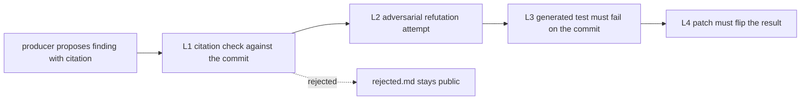

# CodeProof

**Every finding carries the level of proof it earned: machine-checked citation, adversarial confirmation, or a failing test.**

CodeProof statically reviews a TypeScript/JavaScript repository. A producer model proposes findings with exact
citations; a deterministic checker verifies every citation against the analyzed commit; a second model tries to
refute each claim; and where a reproducer is feasible, a generated test must fail on the analyzed commit before
anything is published. Rejected findings stay visible instead of being silently filtered.

**Meta Global AI Developer Hackathon 2026** · Indie Dev track · Push the Frontier · written from scratch during the
event, zero runtime dependencies.

| **268/268** deterministic tests (Node 22 & 26) | **12** hand-confirmed defects in 5 new OSS repositories (**2 patch-proven**) | **3** findings filed upstream | **$15.7163** measured for the final round |
|---|---|---|---|

**Video (2:48):** linked here after upload on 3 Nov 2026. · **Try it now, offline:** `make demo` (mock pipeline, no API key, no network).

## The problem

An AI code review can sound convincing and still be wrong: the citation may exist, the reasoning may read well,
and the claim may still be false. Nothing in the output tells you which is which. CodeProof’s answer is a gate:
every published finding must earn a recorded level of proof, and the gate’s own output (including what it rejected)
is part of the artifact.

## Evidence levels

| Level | Check | Producer |
|---|---|---|
| **L1** | Every citation exists in the analyzed commit and matches the declared line range | deterministic, no model |
| **L2** | A second model tries to refute the claim; a strong refutation needs a machine-checked counter-citation | Muse Wonder |
| **L3 - execution proof** | A generated test fails on every run (at least three) against the analyzed commit, in a Node permission sandbox with no network | Muse Wonder writes the test |
| **L4** | A minimal patch flips the reproduced result (differential proof) | Muse Wonder writes the patch |

Findings are published only up to the level they earned (`verified` → `execution-proven` → `patch-proven`);
refuted and uncertain candidates stay in `rejected.md`. Scan and verify are static — only the generated test runs,
on a `git archive` snapshot.



## Measured results (frozen at `v0.2.3-final`)

The final round was pre-registered, locked and independently reviewed before the first paid call; every paid run
went through a ledger that anchors the budget reservation in git before the money is spent. Plan, ledger and every
attempt (including aborted ones) are in [reports/final/](reports/final/).

| Block | Result | Cost |
|---|---|---|
| Calibration (n=8) | **7/8, 7/8** in two single runs, **8/8** in the dual run; 100% verified precision; 0/4 traps; 0 false refutations | $3.3467 |
| Extended (axios `lib/`, 16 injected defects) | **9/16** with chunked scanning, **3/16** single-pass; 0/5 traps; 100% verified precision | $2.1106 |
| Held-out (6 defects + 4 traps, never used for tuning) | **6/6** through L2, **5/6** through L3; 0 traps | $0.4069 |
| Real world (5 new repositories × 2 runs) | **12 hand-confirmed defects** (one of them latent); **2 patch-proven** on bcryptjs; one more candidate was rejected on review; see upstream status below | $4.3263 |
| Dogfood (own `src/`) | 6 candidates → 5 verified, 1 patch-proven; **5 real defects fixed with 5 regression tests**; re-run after fixes: 0 findings | $2.9470 |
| Regression pair (picomatch, jsesc) | previously published defects re-found and **patch-proven**; L3/L4 work as before the hardening | $2.5787 |
| **Total** | | **$15.7163** of the $40 hard cap |

**Honest deltas.** Both single calibration runs scored 7/8 (the expected 8/8 was not reached) and the extended
single run scored 3/16 (the pre-registered range was 4-7/16) — reported as measured, with no prompt or set change
after the first run. All 24 published real-world findings were hand-checked; one was rejected as not-a-defect.
Of the 12 defects in the five new repositories: **2 had already been reported upstream before the round**
(mustache [#854](https://github.com/janl/mustache.js/pull/854), bcryptjs [#170](https://github.com/dcodeIO/bcrypt.js/pull/170))
and are not claimed as new; **3 were filed by us on 30 Oct** (fast-json-patch [#337](https://github.com/Starcounter-Jack/JSON-Patch/issues/337),
dateformat [#196](https://github.com/felixge/node-dateformat/issues/196), sax-js [#303](https://github.com/isaacs/sax-js/issues/303));
1 is a latent dead path and 1 is covered by a comment on an existing report; 5 are not reported.
Per-run artifacts and hand-checks: [reports/final/README.md](reports/final/README.md).

## Where the Meta models are

**Muse Spark 1.3** is the producer: it reads the repository and returns schema-constrained findings with verbatim
citations. **Muse Wonder 1.0** is the adversary: it refutes claims (L2), writes the two-phase reproducer test (L3)
and the patch (L4). In opt-in dual-scanner mode both models produce candidates, the candidates are merged, and each
finding is verified by the model that did not propose it. Prompt caching, a hard pre-flight budget gate and a
per-call log in `run.json` keep the cost bounded and auditable.

## Run it yourself (offline first)

Nothing below needs an API key or the network:

```bash
make demo                              # mock pipeline: no model calls, no network
make test                              # 268 deterministic tests
make replay                            # re-checks the committed golden artifacts offline (L0/L1)
make score RUN=reports/golden          # scores the committed golden run
```

A live run needs `MODEL_API_KEY` and Node 26.8.2 for L3/L4 (LinkCheck uses `--allow-inspector`; on Node 22 the
pipeline stays at L2 `verified`):

```bash
export MODEL_API_KEY=...
BUDGET_USD=2 node src/cli.mjs analyze path/to/repo --mode smoke --out reports/run
```

A smoke run on a small repository costs cents to a dollar; the hard budget gate refuses a call before it is sent
when its worst-case price does not fit into the remaining cap.

## What CodeProof does not claim

- No completeness: it publishes what passed the gate, not everything that exists in a repository.
- No statistical claim: the calibration set is n=8, the extended set n=16, and real-world runs are anecdotes.
- Real-code recall is lower than the calibration numbers: 56.3% (chunked) and 18.8% (single) on the extended set,
  with 100% verified precision and 0/5 traps published.
- Execution/patch proofs require Node 26.8.2; TypeScript trees that need their own build step stay at L2.
- Real-world findings are hand-checked anecdotes, not a precision metric; latent and partial findings are labelled.
- Nothing here is claimed as accepted, merged or a novel discovery; analyzed commits are public.

## Built during the hackathon

The first commit is tagged `hackathon-start`; every line of code, prompt and fixture was written during the event,
with no runtime dependencies and no imported project code. The git history is the evidence. Full project history
(v0.2.0 → v0.2.3, earlier rounds and hardening): [HISTORY.md](HISTORY.md).

## Documentation and evidence

| What | Where |
|---|---|
| Final round: pre-registration, budget ledger, every attempt, hand-checks, independent verification | [reports/final/](reports/final/) |
| Full evidence index across all rounds | [reports/README.md](reports/README.md) |
| Project history and earlier rounds | [HISTORY.md](HISTORY.md) |
| Benchmark fixtures, scoring and frozen expectations | [bench/](bench/) |
| Static proof explorer (no JavaScript, no network) | [docs/index.html](docs/index.html) |

## License

MIT (see [LICENSE](LICENSE)). Source snippets quoted from analyzed repositories keep their original license; each
report links the analyzed repository and commit.
