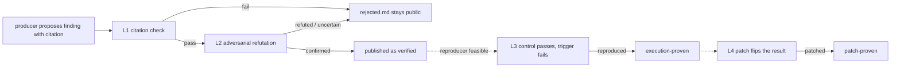

# CodeProof

**Every finding carries the level of proof it earned: machine-checked citation, adversarial confirmation, or a failing test.**

CodeProof statically reviews a TypeScript/JavaScript repository. A producer model proposes findings with exact
citations; a deterministic checker verifies every citation against the analyzed commit; a second model tries to
refute each claim. Findings are published at the level of proof they earned: a claim that passes the citation and
refutation gates is published as `verified`, and a generated test is required only for the stronger
`execution-proven` / `patch-proven` labels. Rejected candidates stay visible instead of being silently filtered.

**Meta Global AI Developer Hackathon 2026** · Indie Dev track · Push the Frontier · written from scratch during the
event, zero runtime dependencies.

| **268/268** deterministic tests (Node 22 & 26) | **12** hand-confirmed defects in 5 new OSS repositories (**1 unique patch-proven, both runs**) | **6** findings filed upstream (3 in the earlier sample + 3 in this round) | **$15.7163** measured for the final round |
|---|---|---|---|

**Try it now, offline:** `make demo` (mock pipeline, no API key, no network). · **Demo video (2:48):** linked here with the submission on 3 Nov 2026.

## The problem

An AI code review can sound convincing and still be wrong: the citation may exist, the reasoning may read well,
and the claim may still be false. Nothing in the output tells you which is which. CodeProof’s answer is a gate:
every published finding must earn a recorded level of proof, and the gate’s own output (including what it rejected)
is part of the artifact.

## Evidence levels

| Level | Check | Producer |
|---|---|---|
| **L1** | Every citation exists in the analyzed commit and matches the declared line range (±1 line tolerance for off-by-one counts) | deterministic, no model |
| **L2** | A second model tries to refute the claim; a strong refutation needs a machine-checked counter-citation | Muse Wonder (in dual mode, Muse Spark verifies Wonder-proposed findings) |
| **L3 - execution proof** | A generated test has two phases: the control case passes on every run (at least three) and the trigger case fails on every run, both against the analyzed commit in a Node permission sandbox with no network | Muse Wonder writes the test |
| **L4** | A minimal patch flips the reproduced result (differential proof) | Muse Wonder writes the patch |

L1 and L2 decide publication: a claim that passes both is published as `verified` even when no reproducer
exists. L3 and L4 are upgrades that a finding earns only when a reproducer is feasible
(`verified` → `execution-proven` → `patch-proven`). Refuted and uncertain candidates stay in `rejected.md`;
scan and verify are static — only the generated test runs, on a `git archive` snapshot.



## Measured results (frozen at `v0.2.3-final`)

The final round was pre-registered, locked and reviewed blind-input by two independent models from other vendors — **OpenAI codex** and **Google agy**, not Meta models and not humans — before the first paid call, and the published numbers were then verified by the same two models in separate blind threads ([F5 verification](reports/final/F5-VERIFICATION.md)); every paid run
went through a ledger that anchors the budget reservation in git before the money is spent. Plan, ledger and every
attempt (including aborted ones) are in [reports/final/](reports/final/).

| Block | Result | Cost |
|---|---|---|
| Calibration (n=8, tuned set) | **7/8, 7/8** in two single runs, **8/8** in the dual run; 100% verified precision; 0/4 traps; 0 false refutations | $3.3467 |
| Extended (axios `lib/`, 16 injected defects) | **9/16** with chunked scanning, **3/16** single-pass; 0/5 traps; 100% verified precision | $2.1106 |
| Held-out (6 defects + 4 traps, never used for tuning) | **6/6** through L2, **5/6** through L3; 0 traps | $0.4069 |
| Real world (5 new repositories × 2 runs) | **12 hand-confirmed defects** (one of them latent); **1 unique patch-proven (both runs)** (bcryptjs); one more candidate was rejected on review; see upstream status below | $4.3263 |
| Dogfood (own `src/`) | 6 candidates → 5 verified, 1 patch-proven; **5 real defects fixed with 5 regression tests**; re-run after fixes: 0 findings | $2.9470 |
| Regression pair (picomatch, jsesc) | previously published defects re-found and **patch-proven**; L3/L4 work as before the hardening | $2.5787 |
| **Total** | | **$15.7163** of the $40 hard cap |

**Real-world evidence in numbers (F4 — 13 paid runs: 5 new repositories × 2 + 3 regression runs).**

- **13 runs · 29 candidates · 7 L1 rejects · 21 verified** (L1 citation + L2 adversarial confirmation; of 22 published, 0 refuted, 1 uncertain) · **20 of 21 hand-confirmed · 1 false positive** (sax F-002).
- **6 reproduced · 6 patched** (L3/L4 execution proofs, recorded per run — a separate axis from `verified`, 3 unique defects) · **0 merged upstream** · cost **$6.9050**.

[Run-by-run results](01-real-world-results/RESULTS-TABLE.md) · [Manual validation](02-manual-validation/MANUAL-VALIDATION-OVERVIEW.md) · [Upstream status](02-manual-validation/UPSTREAM-STATUS.md)

**Honest deltas.** Both single calibration runs scored 7/8 (the expected 8/8 was not reached) and the extended
single run scored 3/16 (the pre-registered range was 4-7/16) — reported as measured, with no prompt or set change
after the first run. All 22 published real-world entries (21 verified + 1 uncertain) were hand-checked; 20 were confirmed as real code states, 1 verified finding was rejected as a false positive (sax F-002), and the uncertain one was hand-confirmed real.

**Upstream status.** Of the 12 defects in the five new repositories: **3 had already been reported upstream before the round**
(mustache [#854](https://github.com/janl/mustache.js/pull/854) open; mustache [#762](https://github.com/janl/mustache.js/issues/762),
closed in 2021 as stale; bcryptjs [#170](https://github.com/dcodeIO/bcrypt.js/pull/170) open) and are not claimed as new;
**3 were filed by us on 30 Oct** (fast-json-patch [#337](https://github.com/Starcounter-Jack/JSON-Patch/issues/337),
dateformat [#196](https://github.com/felixge/node-dateformat/issues/196), sax-js [#303](https://github.com/isaacs/sax-js/issues/303));
1 is a latent dead path, 1 is covered by a comment on an existing report, and **4 are not reported**. Two PR authors replied
to our comments (#854 and fast-json-patch [#331](https://github.com/Starcounter-Jack/JSON-Patch/pull/331), whose author
extended the fix for the empty-string case); no maintainer has responded and nothing is merged.
**Six findings have been filed upstream in total**: three from the earlier v0.2.2 sample (picomatch
[#242](https://github.com/micromatch/picomatch/issues/242), [#243](https://github.com/micromatch/picomatch/issues/243) and
jsesc [#79](https://github.com/mathiasbynens/jsesc/issues/79)) and the three from this round listed above.
Per-run artifacts and hand-checks: [reports/final/README.md](reports/final/README.md).

## Where the Meta models are

**Muse Spark 1.3** is the producer: it reads the repository and returns schema-constrained findings with verbatim
citations. **Muse Wonder 1.0** is the adversary: it refutes claims (L2), writes the two-phase reproducer test (L3)
and the patch (L4). In opt-in dual-scanner mode both models produce candidates, the candidates are merged, and each
finding is verified by the model that did not propose it. Prompt caching, a hard pre-flight budget gate and a
per-call log in `run.json` keep the cost bounded and auditable.

## Run it yourself (offline first)

Nothing below needs an API key or the network:

```bash
make demo                              # mock pipeline: no model calls, no network
make test                              # 268 deterministic tests
make replay                            # re-checks the committed golden artifacts offline (L0/L1)
make score RUN=reports/golden          # scores the committed golden run
```

A live run needs `MODEL_API_KEY` and Node 26.8.2 for L3/L4 (LinkCheck uses `--allow-inspector`; on Node 22 the
pipeline stays at L2 `verified`):

```bash
export MODEL_API_KEY=...
BUDGET_USD=2 node src/cli.mjs analyze path/to/repo --mode smoke --out reports/run
```

A smoke run costs cents on a small repository and up to a few dollars on ~4k+ LOC; the hard budget gate refuses
a call before it is sent when its worst-case price does not fit into the remaining cap.

## What CodeProof does not claim

- **The sandbox is process-level, not OS-level.** L3 executes a generated test that imports the analyzed repository's code under the Node permission model (no network, no writes) — it is not a VM.
- **The tie between a failing test and the claim is a human review, not a machine proof.** The same model (Muse Wonder) that confirms a claim also writes its test, so the machine checks execution, not the semantic link.
- **Both models are from the same vendor family** — role separation (producer vs adversary) is not provenance separation.
- **Large repositories are analysed partially**: the scanner prompt is capped at 400,000 characters, so above roughly 15–20k LOC only an alphabetical prefix reaches the model (recorded in `run.json.scanCoverage`).
- **Historical recall is 2/9** known fix commits — the weakest number in the project, published first here.
- **Recall on injected defects in real-world code is 3–7/16 single and 9–10/16 chunked** (19–44% / 56–63%) with 100% verified precision and 0/5 traps published; it is not organic-bug recall.
- **No statistical and no completeness claim**: calibration is n=8, extended n=16, real-world runs are hand-checked anecdotes; L3/L4 need Node 26.8.2; TypeScript trees that need their own build step stay at L2; nothing here is claimed as accepted, merged or a novel discovery.

## Built during the hackathon

The first commit is tagged `hackathon-start`; the code, prompts and fixtures were written during the event, with no
runtime dependencies and no imported project code. The git history is the evidence. The product runs on Meta Muse
models.

**AI assistance disclosure.** The author directed the work and owns the design decisions, the evidence and every
published claim. The implementation — product code, prompts, fixtures, tests and this documentation — was written
with an AI coding harness (DeepSeek Harness) under that direction; codex (OpenAI) and agy (Google) were used for
independent analysis, blind review and verification, and the patches produced from their hardening findings were
applied by the author's harness, not by the assistants directly. Full project history (v0.2.0 → v0.2.3, earlier
rounds and hardening): [HISTORY.md](HISTORY.md).

## Documentation and evidence

| What | Where |
|---|---|
| Final round: pre-registration, budget ledger, every attempt, hand-checks, independent verification | [reports/final/](reports/final/) |
| Full evidence index across all rounds | [reports/README.md](reports/README.md) |
| Project history and earlier rounds | [HISTORY.md](HISTORY.md) |
| Benchmark fixtures, scoring and frozen expectations | [bench/](bench/) |
| Proof explorer (local, no network) | [docs/index.html](docs/index.html) |

## License

MIT (see [LICENSE](LICENSE)). Source snippets quoted from analyzed repositories keep their original license; each
report links the analyzed repository and commit.
