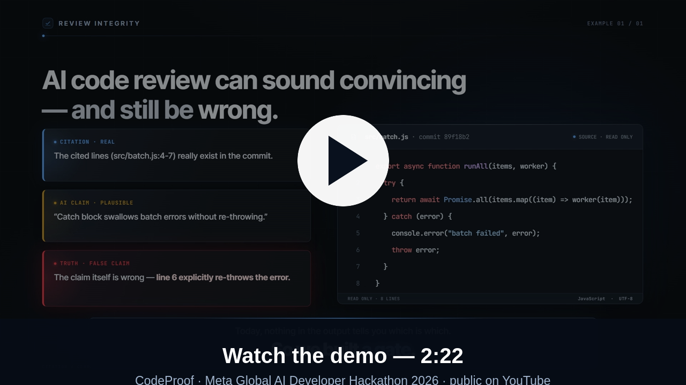
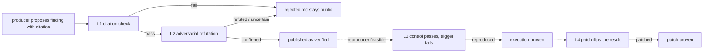

# CodeProof

**Every finding carries the level of proof it earned: machine-checked citation, adversarial confirmation, or a failing test.**

[](https://github.com/Gruya13/codeproof/actions/workflows/docker.yml)

<a href="https://youtu.be/pFNrljVBJh0"></a>

**Meta Global AI Developer Hackathon 2026** · Indie Dev track · Push the Frontier · written from scratch during the
event, zero runtime dependencies.

| **268/268** deterministic tests (Node 22 & 26) | **12** hand-confirmed defects in 5 new OSS repositories (**1 unique patch-proven, both runs**) | **13** findings filed upstream (**1 community fix PR**) | **$15.7163** measured for the final round |
|---|---|---|---|

**Try it now, offline:** `make demo` (mock pipeline, no API key, no network) · `make docker-demo` (same demo in a container).

## Table of contents

1. [What it does](#what-it-does)
2. [Evidence levels](#evidence-levels)
3. [Measured results (frozen at v0.2.3-final)](#measured-results-frozen-at-v023-final)
4. [After the freeze: exploratory studies](#after-the-freeze-exploratory-studies)
5. [Upstream reports](#upstream-reports)
6. [Honest limits](#honest-limits)
7. [Try it yourself](#try-it-yourself)
8. [Documentation and evidence](#documentation-and-evidence)
9. [Built during the hackathon](#built-during-the-hackathon)

## What it does

An AI code review can sound convincing and still be wrong: the citation may exist, the reasoning may read well, and
the claim may still be false. CodeProof's answer is a gate: **no finding is published without a recorded level of
proof**, and the gate's own output — including what it rejected — is part of the artifact. A second model tries to
refute every claim; a generated test is required only for the stronger `execution-proven` / `patch-proven` labels.
Rejected and uncertain candidates stay visible in `rejected.md` instead of being silently filtered.

Both models are **Meta Muse models** served through the Meta Model API; no other vendor's model is used anywhere in
the pipeline. **Muse Spark 1.3** is the producer; **Muse Wonder 1.0** is the adversary, the test writer and the patch
writer.

## Evidence levels

L1 and L2 decide publication: a claim that passes both is published as `verified` even when no reproducer exists.
L3 and L4 are upgrades a finding earns only when a reproducer is feasible (`verified` → `execution-proven` →
`patch-proven`). Scan and verify are static — only the generated test runs, on a `git archive` snapshot.

| Level | What must be earned | Enforced by |
|---|---|---|
| **L1 - citation** | every citation exists in the analyzed commit and matches the declared line range (±1 line for off-by-one counts) | deterministic checker, no model |
| **L2 - adversarial** | a second model tries to refute the claim; a strong refutation needs a machine-checked counter-citation | **Meta Muse Wonder 1.0** (in opt-in dual mode, Muse Spark verifies Wonder-proposed findings) |
| **L3 - execution proof** | a generated test has two phases: the control case passes on every run (at least three) and the trigger case fails on every run, against the analyzed commit in a Node permission sandbox with no network | **Meta Muse Wonder 1.0** writes the test |
| **L4 - patch proof** | a minimal patch flips the reproduced result (differential proof) | **Meta Muse Wonder 1.0** writes the patch |



## Measured results (frozen at `v0.2.3-final`)

The final round was pre-registered, budget-anchored in git before every paid call, and blindly verified by two
independent models from other vendors (OpenAI codex and Google agy, not Meta models and not humans) — see
[reports/final/](reports/final/), including the [F5 verification](reports/final/F5-VERIFICATION.md).

| Block | Result | Cost |
|---|---|---|
| Calibration (n=8, tuned set) | **7/8, 7/8** in two single runs, **8/8** in the dual run; 100% verified precision; 0/4 traps; 0 false refutations | $3.3467 |
| Extended (axios `lib/`, 16 injected defects) | **9/16** with chunked scanning, **3/16** single-pass; 0/5 traps; 100% verified precision | $2.1106 |
| Held-out (6 defects + 4 traps, never used for tuning) | **6/6** through L2, **5/6** through L3; 0 traps | $0.4069 |
| Real world (5 new repositories × 2 runs) | **12 hand-confirmed defects** (one latent); **1 unique patch-proven (both runs)**; one candidate rejected on review | $4.3263 |
| Dogfood (own `src/`) | 6 candidates → 5 verified, 1 patch-proven; **5 real defects fixed with 5 regression tests**; re-run: 0 findings | $2.9470 |
| Regression pair (picomatch, jsesc) | previously published defects re-found and **patch-proven** | $2.5787 |
| **Total** | | **$15.7163** of the $40 hard cap |

**Honest deltas.** Both single calibration runs scored 7/8 (the expected 8/8 was not reached) and the extended
single run scored 3/16 (the pre-registered range was 4–7/16) — reported as measured, with no prompt or set change
after the first run. Of 22 published real-world entries, 20 were confirmed as real code states, 1 verified finding
was rejected as a false positive, and the uncertain one was hand-confirmed real.

**Real-world evidence in numbers (F4 — 13 paid runs).** 29 candidates · 7 L1 rejects · 21 verified · **20 of 21
hand-confirmed** · 1 false positive · 6 reproduced and 6 patched through L3/L4 (3 unique defects) · **0 merged
upstream** · cost **$6.9050**. Per-run artifacts and hand-checks: [reports/final/README.md](reports/final/README.md).

## After the freeze: exploratory studies

After the final round was frozen, the remaining Meta API credit was used on a separate branch to test the claims
instead of adding features: **106 paid attempts for $50.10**, every one in git-anchored ledgers, questions and
hypotheses pre-registered before the first paid call. Nothing in the frozen table above was changed. Full record:
[reports/exploratory/](reports/exploratory/).

**What held up**

- **Historical recall reproduces.** The 2/9 (22.2%) became **6/30 (20.0%)** on 30 new fix commits from 6 libraries,
  none used before — the weakest published number is not a nine-sample accident.
- **The gate kept precision at 100% across all four Spark/Wonder producer/adversary combinations**; recall followed
  the producer, and the cheapest combination verified findings at $0.0105 each on that set.
- **Dual calibration was stable (8/8 in all three runs), and 2 new hand-confirmed defects** were found in three
  unseen repositories (both encoder/decoder asymmetries in `@jridgewell/sourcemap-codec`, machine round-trip).

**What did not hold up (published as measured)**

- **"100% precision, 0 traps" is not an invariant.** Repeating the frozen runs gave 1 verified false positive in 7
  single calibration runs (87.5% precision) and, in 1 of 3 chunked extended runs, 5 false positives with 1 trap leak
  (64.3% precision). The gate is good, not perfect.
- **A bigger candidate budget does not buy recall** (MAX_FINDINGS 6 → 12: 20.0% → 20.7%, +13% cost), and **scope
  size dominates**: fix commits in scopes ≤500 LOC were found 50% of the time, above 500 LOC ~12%.
- **Dual scanning is a trade-off** (+15.4 pp on the paired subset, but $7.18 per hit vs $1.35), and library-level
  variance is huge (60% of fix commits found in dateformat, 0% in swr/ky/picomatch on the same protocol).

Small samples (n=30 single arm, n=13 dual arm, 3–7 runs per configuration); the hit check verifies cited lines, not
the root cause; 8 of 15 confirmed candidates were deliberately not filed. Details and all ledgers:
[reports/exploratory/](reports/exploratory/).

## Upstream reports

**13 issues filed in total, all open, 0 merged, 1 community fix PR** — 6 from the final round and 7 from the
exploratory round ([sourcemaps #59/#60](https://github.com/jridgewell/sourcemaps/issues/59), fast-json-patch
[#338](https://github.com/Starcounter-Jack/JSON-Patch/issues/338)–[#340](https://github.com/Starcounter-Jack/JSON-Patch/issues/340),
swr [#4375](https://github.com/vercel/swr/issues/4375)/[#4376](https://github.com/vercel/swr/issues/4376)). swr #4376
already has a community fix PR ([#4377](https://github.com/vercel/swr/pulls/4377)). Nothing here is claimed as
accepted or a novel discovery: the status table, including the 8 verified candidates deliberately not filed, is in
[reports/exploratory/UPSTREAM.md](reports/exploratory/UPSTREAM.md).

## Honest limits

- **The sandbox is process-level, not OS-level.** L3 runs a generated test under the Node permission model (no
  network, no writes) — it is not a VM.
- **The tie between a failing test and the claim is human review**, not machine proof: the same model that confirms a
  claim also writes its test. Both models are from the same vendor family, so role separation is not provenance
  separation.
- **Large repositories are analysed partially**: the scanner prompt is capped at 400,000 characters, so above roughly
  15–20k LOC only a prefix reaches the model (recorded in `run.json.scanCoverage`).
- **Historical recall is low**: 2/9 known fix commits, re-measured at 6/30 (20.0%). Injected-defect recall in
  real-world code is 3–7/16 single-pass and 9–10/16 chunked — not organic-bug recall.
- **The precision and trap figures are single-run measurements**; repeated runs showed the spread above. No
  statistical or completeness claim is made: calibration is n=8, extended n=16, real-world runs are hand-checked
  anecdotes; L3/L4 need Node 26.8.2; TypeScript trees that need their own build step stay at L2.

## Try it yourself

Nothing below needs an API key or the network:

```bash
make demo          # mock pipeline: no model calls, no network
make test          # 268 deterministic tests
make replay        # offline replay of the committed golden artifacts (L0/L1)
make score RUN=reports/golden
```

A live run needs `MODEL_API_KEY` (and Node 26.8.2 for L3/L4); the hard budget gate refuses a call before it is sent
when its worst-case price does not fit into the remaining cap:

```bash
BUDGET_USD=2 node src/cli.mjs analyze path/to/repo --mode smoke --out reports/run
```

The same offline gates run in a container (no key, no network, unprivileged user):
`docker run --rm ghcr.io/gruya13/codeproof:latest demo` — image, mounts, MCP server and the full command matrix:
[DOCKER.md](DOCKER.md).

## Documentation and evidence

| What | Where |
|---|---|
| Final round: pre-registration, budget ledger, every attempt, hand-checks, independent verification | [reports/final/](reports/final/) |
| Post-freeze exploratory studies: variance, role ablation, historical n=30, upstream reports | [reports/exploratory/](reports/exploratory/) |
| Full evidence index across all rounds | [reports/README.md](reports/README.md) |
| Project history and earlier rounds | [HISTORY.md](HISTORY.md) |
| Benchmark fixtures, scoring and frozen expectations | [bench/](bench/) |
| Proof explorer (local, no network) | [docs/index.html](docs/index.html) |
| Demo video (2:22) | [youtu.be/pFNrljVBJh0](https://youtu.be/pFNrljVBJh0) |

## Built during the hackathon

The first commit is tagged `hackathon-start`; the code, prompts and fixtures were written during the event, with no
runtime dependencies and no imported project code. The git history is the evidence. The product runs on Meta Muse
models.

**AI assistance disclosure.** The author directed the work and owns the design decisions, the evidence and every
published claim. The implementation — product code, prompts, fixtures, tests and this documentation — was written
with an AI coding harness (DeepSeek Harness) under that direction; codex (OpenAI) and agy (Google) were used for
independent analysis, blind review and verification. The demo voiceover is a local synthesis of the author's own voice
sample, produced with an open-source text-to-speech model; no external voice service was used. Full history
(v0.2.0 → v0.2.3, earlier rounds and hardening): [HISTORY.md](HISTORY.md).

## License

MIT (see [LICENSE](LICENSE)). Source snippets quoted from analyzed repositories keep their original license; each
report links the analyzed repository and commit.
