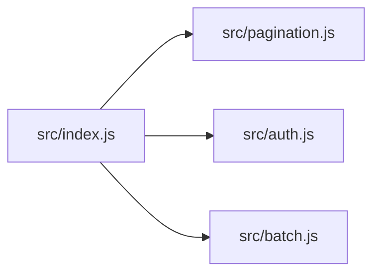

# CodeProof report

Commit: 89f18b2880afbca9fc26a0f926e862d549036349  |  run-id: 65857ce15ea9d5c3  |  mode: controlled-verifier

> **CONTROLLED VERIFIER TEST** - the candidates in this report were injected directly into the verifier. They are not scanner output and must not be presented as a scan.

**Publishing rule:** a finding appears under *Verified findings* only if the deterministic citation gate (L1) passed and the adversarial verifier confirmed it. Refuted, uncertain and moderate findings are kept in separate sections - nothing is hidden, and nothing unproven is presented as verified.

## Summary

| Metric | Value |
|---|---|
| Files / LOC | 4 / 21 |
| Import edges / cycles | 3 / 0 |
| Findings proposed | 3 |
| Rejected at L1 (bad citation) | 0 |
| Verified | 2 |
| Moderate confidence | 0 |
| Refuted | 1 |
| Uncertain | 0 |
| Calls / retries | 4 / 0 |
| Tokens in / out | 4065 / 4960 |
| Cached input tokens | 3280 |
| Cost | $0.1030 |

## Verified findings

### F-102 - high - Pagination slice returns one extra item

**Claim:** items.slice(start, start + size + 1) returns size + 1 elements because slice end is exclusive, so every page leaks one item from the next page.

**Citation:** src/pagination.js:3-3
```text
  return items.slice(start, start + size + 1);
```

**Verifier (muse-wonder-1.0):** confirm - At src/pagination.js:3 the code returns items.slice(start, start + size + 1) with start computed at src/pagination.js:2, so the exclusive end yields size+1 items per full page, confirming the off-by-one.

### F-103 - high - Missing await before reading rotated token

**Claim:** store.save is not awaited before store.get, so the rotated token read can return the previous token and the caller receives a stale value.

**Citation:** src/auth.js:2-3
```text
  store.save(userId, token);
  return store.get(userId);
```

**Verifier (muse-wonder-1.0):** confirm - At src/auth.js:2 store.save(userId, token) is called without await and src/auth.js:3 immediately returns store.get(userId), so there is no ordering guarantee that an asynchronous save completes before the read.

## Architecture

Deterministic facts only: 4 files, 21 LOC, 3 import edges, 0 cycles. The diagram is generated from the import graph by code, never by the model.



## Limits

- Static analysis only: the analyzed code is never executed.
- No completeness claim; this report shows what passed the gate, not everything that exists in the repository.
- Only direct correctness defects; omission, security and style findings are out of scope for this milestone.
- The L1 gate proves that a citation exists in the commit; the semantic match is judged by the verifier model and presented as such.

