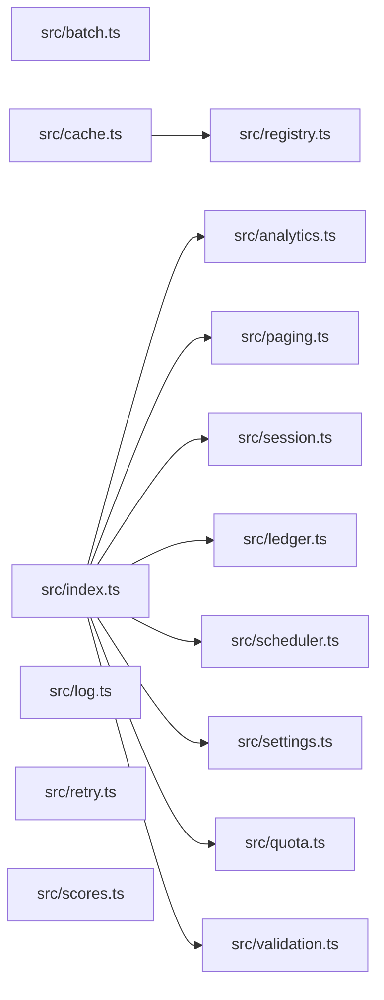

# CodeProof report

Commit: 328af2180b242472b5e0e2e87d8b5ca24e99bf57  |  run-id: ad5bfdbcd9ed17eb  |  mode: bench

**Publishing rule:** a finding appears under *Verified findings* only if every citation passed L1 and the adversarial verifier confirmed it. This checks provenance and model agreement, not semantic proof. Refuted, uncertain and moderate findings are in rejected.md.

## Summary

| Metric | Value |
|---|---|
| Files / LOC | 15 / 229 |
| Import edges / cycles | 9 / 0 |
| Files in scanner prompt | 15 / 15 |
| Findings proposed | 14 |
| Rejected at L1 (bad citation) | 1 |
| Verified | 13 |
| Reproduced by execution (L3) | 8 |
| Patch-proven (L4, differential) | 8 |
| Moderate confidence | 0 |
| Refuted | 0 |
| Uncertain | 0 |
| Calls / retries | 36 / 0 |
| Tokens in / out | 56390 / 63408 |
| Cached input tokens | 6848 |
| Cost | $1.2968 |

## Verified findings

### F-001 - critical - validation always reports errors due to OR null check

**Claim:** validate uses || instead of && so the conditions are always true and every payload reports missing id and value.

**Proposed by:** Muse Spark

**Evidence level:** citation-proven + adversarially-confirmed + **execution-proven (generated test fails on the analyzed commit)**

**Execution check:** reproduced by execution: the control passed 3/3 and the trigger failed 3/3 (see Reproduced by execution)

**Citation (from commit, lines 6-15):** src/validation.ts
```text
export function validate(payload: Payload): string[] {
  const errors: string[] = [];
  if (payload.id !== undefined || payload.id !== null) {
    errors.push("id is required");
  }
  if (payload.value !== undefined || payload.value !== null) {
    errors.push("value is required");
  }
  return errors;
}
```

**Verifier (muse-wonder-1.0):** confirm - The conditions at src/validation.ts:8 and src/validation.ts:11 use !== undefined || !== null, which is true for undefined, null, and any other value, so both errors are always pushed.

### F-002 - critical - rotateToken does not await save before get

**Claim:** rotateToken calls store.save without await then immediately calls store.get, so the read can race the write and return stale token.

**Proposed by:** Muse Spark + Muse Wonder

**Evidence level:** citation-proven + adversarially-confirmed + **execution-proven (generated test fails on the analyzed commit)**

**Execution check:** reproduced by execution: the control passed 3/3 and the trigger failed 3/3 (see Reproduced by execution)

**Citation (from commit, lines 6-13):** src/session.ts
```text
export async function rotateToken(
  store: SessionStore,
  userId: string,
  token: string,
): Promise<string | undefined> {
  store.save(userId, token);
  return store.get(userId);
}
```

**Verifier (muse-wonder-1.0):** confirm - The code at src/session.ts:11 calls store.save(userId, token) without await and src/session.ts:12 immediately returns store.get(userId), while save is declared as returning Promise<void> at src/session.ts:2, so the read can race the write and return a stale token.

### F-003 - critical - buildSummary accumulates into module totals causing double count

**Claim:** buildSummary appends its argument to module-level totals then summarizes totals, so repeated calls double-count prior entries.

**Proposed by:** Muse Spark

**Evidence level:** citation-proven + adversarially-confirmed

**Execution check:** inconclusive: reproducer failed L0: unsupported response must not include testCode; unsupported response must not include controlCode; unsupportedReason is too short

**Citation (from commit, lines 6-19):** src/ledger.ts
```text
const totals: Entry[] = [];

export function post(entries: Entry[]): void {
  for (const entry of entries) totals.push(entry);
}

export function buildSummary(entries: Entry[]): string {
  post(entries);
  const byAccount = new Map<string, number>();
  for (const entry of totals) {
    byAccount.set(entry.account, (byAccount.get(entry.account) ?? 0) + entry.cents);
  }
  return [...byAccount.entries()].map(([account, cents]) => account + "=" + cents).join(",");
}
```

**Verifier (muse-wonder-1.0):** confirm - buildSummary at src/ledger.ts:12-15 calls post(entries), which pushes onto the module-level totals array at src/ledger.ts:6-9, then summarizes all of totals without any reset, so repeated calls re-include prior entries.

### F-004 - high - collect does not await async forEach tasks

**Claim:** collect uses forEach with async callback without awaiting, so it returns empty results before tasks complete and try/catch cannot catch task rejections.

**Proposed by:** Muse Spark + Muse Wonder

**Evidence level:** citation-proven + adversarially-confirmed

**Execution check:** inconclusive: reproducer failed L0: testCode assertion is not tied to a call of an imported symbol

**Citation (from commit, lines 3-13):** src/analytics.ts
```text
export async function collect(tasks: Task[]): Promise<number[]> {
  const results: number[] = [];
  try {
    tasks.forEach(async (task) => {
      results.push(await task());
    });
  } catch (error) {
    console.error("analytics collection failed", error);
  }
  return results;
}
```

**Verifier (muse-wonder-1.0):** confirm - The code at src/analytics.ts:6-12 uses tasks.forEach with an async callback and immediately returns results without awaiting those callbacks, so the surrounding try/catch cannot observe their rejections.

### F-005 - high - Scheduler.start replaces timer without clearing existing interval

**Claim:** start overwrites this.timer with a new setInterval without clearing any existing interval, leaking the prior timer on repeated start.

**Proposed by:** Muse Spark + Muse Wonder

**Evidence level:** citation-proven + adversarially-confirmed

**Execution check:** inconclusive: reproducer failed L0: unsupported response must not include testCode; unsupported response must not include controlCode; unsupportedReason is too short

**Citation (from commit, lines 4-11):** src/scheduler.ts
```text
  private timer: NodeJS.Timeout | null = null;
  private readonly ticks: Tick[] = [];

  start(intervalMs: number): void {
    this.timer = setInterval(() => {
      for (const tick of this.ticks) tick();
    }, intervalMs);
  }
```

**Verifier (muse-wonder-1.0):** confirm - Scheduler.start at src/scheduler.ts:7-11 assigns this.timer = setInterval(...) with no preceding clearInterval or guard, so a second call orphans the previous interval which continues firing ticks.

### F-006 - high - numeric sort without comparator sorts lexicographically

**Claim:** sortScores calls Array.sort without numeric comparator so numbers are sorted lexicographically, making topScore wrong.

**Proposed by:** Muse Spark

**Evidence level:** citation-proven + adversarially-confirmed + **execution-proven (generated test fails on the analyzed commit)**

**Execution check:** reproduced by execution: the control passed 3/3 and the trigger failed 3/3 (see Reproduced by execution)

**Citation (from commit, lines 1-3):** src/scores.ts
```text
export function sortScores(scores: number[]): number[] {
  return scores.slice().sort();
}
```

**Verifier (muse-wonder-1.0):** confirm - sortScores at src/scores.ts:2 calls scores.slice().sort() with no comparator, so JavaScript sorts numbers lexicographically as strings, and topScore at src/scores.ts:7 returns the last element, which is therefore not necessarily the numeric maximum.

### F-007 - medium - pageSlice off-by-one returns extra element

**Claim:** pageSlice uses slice(start, end+1) while end is already start+size, so each page returns size+1 items.

**Proposed by:** Muse Spark + Muse Wonder

**Evidence level:** citation-proven + adversarially-confirmed

**Execution check:** inconclusive: reproducer failed L0: unsupported response must not include testCode; unsupported response must not include controlCode; unsupportedReason is too short

**Citation (from commit, lines 6-11):** src/paging.ts
```text
export function pageSlice<T>(items: T[], request: PageRequest): T[] {
  const size = Math.max(1, request.size);
  const start = Math.max(0, request.page) * size;
  const end = start + size;
  return items.slice(start, end + 1);
}
```

**Verifier (muse-wonder-1.0):** confirm - At src/paging.ts:9 end is already start+size and at src/paging.ts:10 items.slice(start, end + 1) uses an exclusive end index, so a full page returns size+1 items.

### F-009 - medium - normalizeSettings treats 0 as missing via OR fallback

**Claim:** normalizeSettings uses || fallback so legitimate 0 values for pageSize/budgetCents are replaced with defaults despite 0 being valid.

**Proposed by:** Muse Spark

**Evidence level:** citation-proven + adversarially-confirmed + **execution-proven (generated test fails on the analyzed commit)**

**Execution check:** reproduced by execution: the control passed 3/3 and the trigger failed 3/3 (see Reproduced by execution)

**Citation (from commit, lines 11-18):** src/settings.ts
```text
export function normalizeSettings(raw: RawSettings): Settings {
  return {
    pageSize: raw.pageSize || 20,
    budgetCents: raw.budgetCents || 1000,
  };
}

// Optional values are read from settings where 0 is a legitimate value.
```

**Verifier (muse-wonder-1.0):** confirm - The code at src/settings.ts:13-14 uses `raw.pageSize || 20` and `raw.budgetCents || 1000`, so falsy 0 is replaced by defaults, and src/settings.ts:18 states 0 is a legitimate value for settings while src/settings.ts:1-4 allow 0 as a number.

### F-010 - high - validate() always reports id and value as required

**Claim:** validate() always reports both fields as required: `x !== undefined || x !== null` is true for every value (including present values), so valid payloads always produce errors.

**Proposed by:** Muse Wonder

**Evidence level:** citation-proven + adversarially-confirmed + **execution-proven (generated test fails on the analyzed commit)**

**Execution check:** reproduced by execution: the control passed 3/3 and the trigger failed 3/3 (see Reproduced by execution)

**Citation (from commit, lines 6-15):** src/validation.ts
```text
export function validate(payload: Payload): string[] {
  const errors: string[] = [];
  if (payload.id !== undefined || payload.id !== null) {
    errors.push("id is required");
  }
  if (payload.value !== undefined || payload.value !== null) {
    errors.push("value is required");
  }
  return errors;
}
```

**Verifier (muse-spark-1.3):** confirm - The conditions at src/validation.ts:8 and src/validation.ts:11 use OR instead of AND, so for any value one side is true (e.g., undefined !== null is true), meaning errors are always pushed even for valid payloads.

### F-011 - high - buildSummary() double-counts on repeated calls via persistent totals

**Claim:** buildSummary() appends entries to the module-level totals accumulator via post() and sums over all of totals without ever resetting it, so a second call double-counts entries from the first call.

**Proposed by:** Muse Wonder

**Evidence level:** citation-proven + adversarially-confirmed + **execution-proven (generated test fails on the analyzed commit)**

**Execution check:** reproduced by execution: the control passed 3/3 and the trigger failed 3/3 (see Reproduced by execution)

**Citation (from commit, lines 6-18):** src/ledger.ts
```text
const totals: Entry[] = [];

export function post(entries: Entry[]): void {
  for (const entry of entries) totals.push(entry);
}

export function buildSummary(entries: Entry[]): string {
  post(entries);
  const byAccount = new Map<string, number>();
  for (const entry of totals) {
    byAccount.set(entry.account, (byAccount.get(entry.account) ?? 0) + entry.cents);
  }
  return [...byAccount.entries()].map(([account, cents]) => account + "=" + cents).join(",");
```

**Verifier (muse-spark-1.3):** confirm - buildSummary at src/ledger.ts:12-13 calls post() which pushes to module-level totals at src/ledger.ts:9 and then sums over totals at src/ledger.ts:15 without clearing it inside buildSummary, so repeated calls accumulate; resetTotals at src/ledger.ts:21-23 exists but is never invoked by buildSummary.

### F-012 - medium - sortScores() sorts numbers lexicographically

**Claim:** sortScores() calls Array.prototype.sort() with no comparator on numbers, which sorts lexicographically as strings (e.g. 100 before 9), so topScore() can return a wrong maximum.

**Proposed by:** Muse Wonder

**Evidence level:** citation-proven + adversarially-confirmed + **execution-proven (generated test fails on the analyzed commit)**

**Execution check:** reproduced by execution: the control passed 3/3 and the trigger failed 3/3 (see Reproduced by execution)

**Citation (from commit, lines 1-3):** src/scores.ts
```text
export function sortScores(scores: number[]): number[] {
  return scores.slice().sort();
}
```

**Verifier (muse-spark-1.3):** confirm - src/scores.ts:2 calls scores.slice().sort() with no comparator on a number[], which sorts lexicographically as strings in JavaScript, and src/scores.ts:7 returns the last element as the maximum so topScore() can return the wrong value.

### F-013 - medium - withinQuota() rejects requests that exactly meet the inclusive max

**Claim:** withinQuota() uses strict `<` even though the documented contract says the maximum is inclusive, so a request that exactly reaches max is incorrectly rejected.

**Proposed by:** Muse Wonder

**Evidence level:** citation-proven + adversarially-confirmed + **execution-proven (generated test fails on the analyzed commit)**

**Execution check:** reproduced by execution: the control passed 3/3 and the trigger failed 3/3 (see Reproduced by execution)

**Citation (from commit, lines 1-6):** src/quota.ts
```text
/**
 * Returns true when the request fits. Max is inclusive: a request that uses
 * exactly the maximum is still within quota.
 */
export function withinQuota(used: number, amount: number, max: number): boolean {
  return used + amount < max;
```

**Verifier (muse-spark-1.3):** confirm - The doc comment at src/quota.ts:2-3 states max is inclusive, but the implementation at src/quota.ts:6 uses strict `<` (`used + amount < max`), so a request exactly reaching max incorrectly returns false.

### F-014 - low - normalizeSettings() treats legitimate 0 values as missing

**Claim:** normalizeSettings() uses `||` for numeric settings, so an explicitly provided 0 (a legitimate value) is discarded and replaced by the defaults 20/1000 instead of being preserved.

**Proposed by:** Muse Wonder

**Evidence level:** citation-proven + adversarially-confirmed

**Execution check:** inconclusive: reproducer failed L0: unsupported response must not include testCode; unsupported response must not include controlCode; unsupportedReason is too short

**Citation (from commit, lines 11-16):** src/settings.ts
```text
export function normalizeSettings(raw: RawSettings): Settings {
  return {
    pageSize: raw.pageSize || 20,
    budgetCents: raw.budgetCents || 1000,
  };
}
```

**Verifier (muse-spark-1.3):** confirm - src/settings.ts:13-14 uses `||` so an explicit 0 is falsy and replaced by 20/1000, and src/settings.ts:18 confirms 0 is a legitimate value for settings.

## Reproduced by execution

For each finding below, the verifier model wrote two standalone files. They run on a `git archive` snapshot of the analyzed commit inside a permission-model sandbox: no network, no writes, 2 s timeout, at least three runs each.

- **[CONTROL]** uses a clean, normal input and must pass every run. It proves the environment and the way the API is called are valid; if it fails, the finding is reported as `control-failed` and the trigger is never run.
- **[TRIGGER]** uses a different input and must fail every run with an assertion error on the analyzed commit.
- **LinkCheck** (Node 26) runs the trigger under the permission model with inspector coverage and requires that the imported symbol actually executed. Without that linkage proof the finding is not reported as execution-proven.


### F-001 - validation always reports errors due to OR null check

**Expected behavior:** validate returns no errors when both id and value are present, and reports both errors when both are missing.

**Control (must pass 3/3 on the analyzed commit):**
```js
import assert from 'node:assert/strict';
import { validate } from './src/validation.ts';
const errors = validate({});
assert.equal(errors.length, 2);
assert.deepEqual(errors, ['id is required', 'value is required']);
```

**Trigger (must fail 3/3 with an assertion error on the analyzed commit):**
```js
import assert from 'node:assert/strict';
import { validate } from './src/validation.ts';
const errors = validate({ id: 'user-1', value: 42 });
assert.equal(errors.length, 0);
assert.deepEqual(errors, []);
```

**LinkCheck:** proven (symbol) - the imported symbol executed under inspector coverage.

**Runner output (last of 3 attempts):**
```text
2 !== 0

    at file:///tmp/codeproof-repro-v3Zr9l/snapshot/.codeproof-repro.test.mjs:4:8
    at ModuleJob.run (node:internal/modules/esm/module_job:569:25)
    at async node:internal/modules/esm/loader:650:26
    at async asyncRunEntryPointWithESMLoader (node:internal/modules/run_main:101:5) {
  generatedMessage: true,
  code: 'ERR_ASSERTION',
  actual: 2,
  expected: 0,
  operator: 'strictEqual',
  diff: 'simple'
}

Node.js v26.8.2
```

### F-002 - rotateToken does not await save before get

**Expected behavior:** rotateToken should return the newly saved token after save completes, even when save is asynchronous.

**Control (must pass 3/3 on the analyzed commit):**
```js
import assert from 'node:assert/strict';
import { rotateToken } from './src/session.ts';
const data = new Map([['alice', 'old-a']]);
const store = {
  async save(userId, token) { data.set(userId, token); },
  async get(userId) { return data.get(userId); },
};
const result = await rotateToken(store, 'alice', 'new-a');
assert.equal(result, 'new-a');
```

**Trigger (must fail 3/3 with an assertion error on the analyzed commit):**
```js
import assert from 'node:assert/strict';
import { rotateToken } from './src/session.ts';
const data = new Map([['bob', 'old-b']]);
const store = {
  async save(userId, token) { await new Promise((resolve) => setTimeout(resolve, 50)); data.set(userId, token); },
  async get(userId) { return data.get(userId); },
};
const result = await rotateToken(store, 'bob', 'new-b');
assert.equal(result, 'new-b');
```

**LinkCheck:** proven (symbol) - the imported symbol executed under inspector coverage.

**Runner output (last of 3 attempts):**
```text

AssertionError [ERR_ASSERTION]: Expected values to be strictly equal:

'old-b' !== 'new-b'

    at file:///tmp/codeproof-repro-POB5tB/snapshot/.codeproof-repro.test.mjs:9:8 {
  generatedMessage: true,
  code: 'ERR_ASSERTION',
  actual: 'old-b',
  expected: 'new-b',
  operator: 'strictEqual',
  diff: 'simple'
}

Node.js v26.8.2
```

### F-006 - numeric sort without comparator sorts lexicographically

**Expected behavior:** topScore returns the numerically largest score; sortScores/topScore must sort numbers numerically, not lexicographically.

**Control (must pass 3/3 on the analyzed commit):**
```js
import assert from 'node:assert/strict';
import { topScore } from './src/scores.ts';
const result = topScore([1, 5, 3]);
assert.equal(result, 5);
```

**Trigger (must fail 3/3 with an assertion error on the analyzed commit):**
```js
import assert from 'node:assert/strict';
import { topScore } from './src/scores.ts';
const result = topScore([10, 9, 100]);
assert.equal(result, 100);
```

**LinkCheck:** proven (symbol) - the imported symbol executed under inspector coverage.

**Runner output (last of 3 attempts):**
```text
9 !== 100

    at file:///tmp/codeproof-repro-8JRq7J/snapshot/.codeproof-repro.test.mjs:4:8
    at ModuleJob.run (node:internal/modules/esm/module_job:569:25)
    at async node:internal/modules/esm/loader:650:26
    at async asyncRunEntryPointWithESMLoader (node:internal/modules/run_main:101:5) {
  generatedMessage: true,
  code: 'ERR_ASSERTION',
  actual: 9,
  expected: 100,
  operator: 'strictEqual',
  diff: 'simple'
}

Node.js v26.8.2
```

### F-009 - normalizeSettings treats 0 as missing via OR fallback

**Expected behavior:** normalizeSettings preserves legitimate values including 0, using defaults only for missing values

**Control (must pass 3/3 on the analyzed commit):**
```js
import assert from 'node:assert/strict';
import { normalizeSettings } from './src/settings.ts';
const result = normalizeSettings({ pageSize: 5, budgetCents: 250 });
assert.equal(result.pageSize, 5);
assert.equal(result.budgetCents, 250);
```

**Trigger (must fail 3/3 with an assertion error on the analyzed commit):**
```js
import assert from 'node:assert/strict';
import { normalizeSettings } from './src/settings.ts';
const result = normalizeSettings({ pageSize: 0, budgetCents: 0 });
assert.equal(result.pageSize, 0);
assert.equal(result.budgetCents, 0);
```

**LinkCheck:** proven (symbol) - the imported symbol executed under inspector coverage.

**Runner output (last of 3 attempts):**
```text
20 !== 0

    at file:///tmp/codeproof-repro-w56VpD/snapshot/.codeproof-repro.test.mjs:4:8
    at ModuleJob.run (node:internal/modules/esm/module_job:569:25)
    at async node:internal/modules/esm/loader:650:26
    at async asyncRunEntryPointWithESMLoader (node:internal/modules/run_main:101:5) {
  generatedMessage: true,
  code: 'ERR_ASSERTION',
  actual: 20,
  expected: 0,
  operator: 'strictEqual',
  diff: 'simple'
}

Node.js v26.8.2
```

### F-010 - validate() always reports id and value as required

**Expected behavior:** validate({}) returns both required errors, and validate({id, value}) returns no errors

**Control (must pass 3/3 on the analyzed commit):**
```js
import assert from 'node:assert/strict';
import { validate } from './src/validation.ts';
const result = validate({});
assert.deepEqual(result, ['id is required', 'value is required']);
```

**Trigger (must fail 3/3 with an assertion error on the analyzed commit):**
```js
import assert from 'node:assert/strict';
import { validate } from './src/validation.ts';
const result = validate({ id: 'user-1', value: 42 });
assert.deepEqual(result, []);
```

**LinkCheck:** proven (symbol) - the imported symbol executed under inspector coverage.

**Runner output (last of 3 attempts):**
```text
- []

    at file:///tmp/codeproof-repro-j60qzv/snapshot/.codeproof-repro.test.mjs:4:8
    at ModuleJob.run (node:internal/modules/esm/module_job:569:25)
    at async node:internal/modules/esm/loader:650:26
    at async asyncRunEntryPointWithESMLoader (node:internal/modules/run_main:101:5) {
  generatedMessage: true,
  code: 'ERR_ASSERTION',
  actual: [ 'id is required', 'value is required' ],
  expected: [],
  operator: 'deepStrictEqual',
  diff: 'simple'
}

Node.js v26.8.2
```

### F-011 - buildSummary() double-counts on repeated calls via persistent totals

**Expected behavior:** buildSummary(entries) summarizes only the entries passed to that call, so repeated calls do not include entries from earlier calls.

**Control (must pass 3/3 on the analyzed commit):**
```js
import assert from 'node:assert/strict';
import { buildSummary } from './src/ledger.ts';
const result = buildSummary([{ account: 'cash', cents: 500 }]);
assert.equal(result, 'cash=500');
```

**Trigger (must fail 3/3 with an assertion error on the analyzed commit):**
```js
import assert from 'node:assert/strict';
import { buildSummary } from './src/ledger.ts';
const first = buildSummary([{ account: 'sales', cents: 200 }]);
assert.equal(first, 'sales=200');
const second = buildSummary([{ account: 'sales', cents: 300 }]);
assert.equal(second, 'sales=300');
```

**LinkCheck:** proven (symbol) - the imported symbol executed under inspector coverage.

**Runner output (last of 3 attempts):**
```text
         ^

    at file:///tmp/codeproof-repro-4v1jcc/snapshot/.codeproof-repro.test.mjs:6:8
    at ModuleJob.run (node:internal/modules/esm/module_job:569:25)
    at async node:internal/modules/esm/loader:650:26
    at async asyncRunEntryPointWithESMLoader (node:internal/modules/run_main:101:5) {
  generatedMessage: true,
  code: 'ERR_ASSERTION',
  actual: 'sales=500',
  expected: 'sales=300',
  operator: 'strictEqual',
  diff: 'simple'
}

Node.js v26.8.2
```

### F-012 - sortScores() sorts numbers lexicographically

**Expected behavior:** sortScores returns numbers sorted in ascending numeric order, so topScore returns the numeric maximum.

**Control (must pass 3/3 on the analyzed commit):**
```js
import assert from 'node:assert/strict';
import { sortScores } from './src/scores.ts';
const result = sortScores([3, 1, 2]);
assert.deepEqual(result, [1, 2, 3]);
```

**Trigger (must fail 3/3 with an assertion error on the analyzed commit):**
```js
import assert from 'node:assert/strict';
import { sortScores } from './src/scores.ts';
const result = sortScores([9, 100, 20]);
assert.deepEqual(result, [9, 20, 100]);
```

**LinkCheck:** proven (symbol) - the imported symbol executed under inspector coverage.

**Runner output (last of 3 attempts):**
```text
  ]

    at file:///tmp/codeproof-repro-cmgqOG/snapshot/.codeproof-repro.test.mjs:4:8
    at ModuleJob.run (node:internal/modules/esm/module_job:569:25)
    at async node:internal/modules/esm/loader:650:26
    at async asyncRunEntryPointWithESMLoader (node:internal/modules/run_main:101:5) {
  generatedMessage: true,
  code: 'ERR_ASSERTION',
  actual: [ 100, 20, 9 ],
  expected: [ 9, 20, 100 ],
  operator: 'deepStrictEqual',
  diff: 'simple'
}

Node.js v26.8.2
```

### F-013 - withinQuota() rejects requests that exactly meet the inclusive max

**Expected behavior:** withinQuota returns true when used+amount is below max, and true when it exactly equals the inclusive max

**Control (must pass 3/3 on the analyzed commit):**
```js
import assert from 'node:assert/strict';
import { withinQuota } from './src/quota.ts';
const result = withinQuota(2, 3, 10);
assert.equal(result, true);
```

**Trigger (must fail 3/3 with an assertion error on the analyzed commit):**
```js
import assert from 'node:assert/strict';
import { withinQuota } from './src/quota.ts';
const result = withinQuota(5, 5, 10);
assert.equal(result, true);
```

**LinkCheck:** proven (symbol) - the imported symbol executed under inspector coverage.

**Runner output (last of 3 attempts):**
```text
false !== true

    at file:///tmp/codeproof-repro-OAeCRQ/snapshot/.codeproof-repro.test.mjs:4:8
    at ModuleJob.run (node:internal/modules/esm/module_job:569:25)
    at async node:internal/modules/esm/loader:650:26
    at async asyncRunEntryPointWithESMLoader (node:internal/modules/run_main:101:5) {
  generatedMessage: true,
  code: 'ERR_ASSERTION',
  actual: false,
  expected: true,
  operator: 'strictEqual',
  diff: 'simple'
}

Node.js v26.8.2
```

## Patch-proven (differential proof)

For each finding below the patcher model proposed a minimal patch to one of the cited files. The patch is applied to a **copy** of the L3 snapshot (the snapshot itself is never mutated) and both phases are re-run: the control must still pass every run and the trigger must now pass every run. This is a differential result over the reproduction - it does not claim to fix the root cause, and the repository's own test suite is not run.

### F-001 - validation always reports errors due to OR null check

**Patch rationale:** The !== undefined || !== null conditions are always true; errors should be pushed only when the field is missing (=== undefined || === null).

```diff
--- a/src/validation.ts
+++ b/src/validation.ts
@@ -8,4 +8,4 @@
-  if (payload.id !== undefined || payload.id !== null) {
-    errors.push("id is required");
-  }
-  if (payload.value !== undefined || payload.value !== null) {
+  if (payload.id === undefined || payload.id === null) {
+    errors.push("id is required");
+  }
+  if (payload.value === undefined || payload.value === null) {
```

**Differential result:** control passed 3/3, trigger passed 3/3 after the patch. The repository's own test suite was not run; the patch was never written to the analyzed repository.

### F-002 - rotateToken does not await save before get

**Patch rationale:** Awaiting save ensures the write completes before the subsequent get, eliminating the stale-read race.

```diff
--- a/src/session.ts
+++ b/src/session.ts
@@ -11,1 +11,1 @@
-  store.save(userId, token);
+  await store.save(userId, token);
```

**Differential result:** control passed 3/3, trigger passed 3/3 after the patch. The repository's own test suite was not run; the patch was never written to the analyzed repository.

### F-006 - numeric sort without comparator sorts lexicographically

**Patch rationale:** Default Array.sort converts numbers to strings, so [10,9,100] sorts lexicographically and topScore returns the wrong maximum. Adding a numeric comparator (a,b)=>a-b sorts numerically.

```diff
--- a/src/scores.ts
+++ b/src/scores.ts
@@ -2,1 +2,1 @@
-  return scores.slice().sort();
+  return scores.slice().sort((a, b) => a - b);
```

**Differential result:** control passed 3/3, trigger passed 3/3 after the patch. The repository's own test suite was not run; the patch was never written to the analyzed repository.

### F-009 - normalizeSettings treats 0 as missing via OR fallback

**Patch rationale:** Replace || with ?? so 0 is preserved while undefined still falls back to defaults.

```diff
--- a/src/settings.ts
+++ b/src/settings.ts
@@ -13,2 +13,2 @@
-    pageSize: raw.pageSize || 20,
-    budgetCents: raw.budgetCents || 1000,
+    pageSize: raw.pageSize ?? 20,
+    budgetCents: raw.budgetCents ?? 1000,
```

**Differential result:** control passed 3/3, trigger passed 3/3 after the patch. The repository's own test suite was not run; the patch was never written to the analyzed repository.

### F-010 - validate() always reports id and value as required

**Patch rationale:** The required-field checks use `!== undefined || !== null`, which is always true. Changing to `===` makes missing/null fields report errors while present fields pass, satisfying both control and trigger.

```diff
--- a/src/validation.ts
+++ b/src/validation.ts
@@ -8,4 +8,4 @@
-  if (payload.id !== undefined || payload.id !== null) {
-    errors.push("id is required");
-  }
-  if (payload.value !== undefined || payload.value !== null) {
+  if (payload.id === undefined || payload.id === null) {
+    errors.push("id is required");
+  }
+  if (payload.value === undefined || payload.value === null) {
```

**Differential result:** control passed 3/3, trigger passed 3/3 after the patch. The repository's own test suite was not run; the patch was never written to the analyzed repository.

### F-011 - buildSummary() double-counts on repeated calls via persistent totals

**Patch rationale:** buildSummary() must summarize only its argument, not the persistent module-level totals accumulated via post() across calls.

```diff
--- a/src/ledger.ts
+++ b/src/ledger.ts
@@ -13,3 +13,2 @@
-  post(entries);
-  const byAccount = new Map<string, number>();
-  for (const entry of totals) {
+  const byAccount = new Map<string, number>();
+  for (const entry of entries) {
```

**Differential result:** control passed 3/3, trigger passed 3/3 after the patch. The repository's own test suite was not run; the patch was never written to the analyzed repository.

### F-012 - sortScores() sorts numbers lexicographically

**Patch rationale:** sort() without comparator converts numbers to strings; adding numeric comparator (a,b)=>a-b fixes ordering.

```diff
--- a/src/scores.ts
+++ b/src/scores.ts
@@ -2,1 +2,1 @@
-  return scores.slice().sort();
+  return scores.slice().sort((a, b) => a - b);
```

**Differential result:** control passed 3/3, trigger passed 3/3 after the patch. The repository's own test suite was not run; the patch was never written to the analyzed repository.

### F-013 - withinQuota() rejects requests that exactly meet the inclusive max

**Patch rationale:** Change strict < to <= so a request exactly reaching the inclusive max is accepted, matching the documented contract.

```diff
--- a/src/quota.ts
+++ b/src/quota.ts
@@ -6,1 +6,1 @@
-  return used + amount < max;
+  return used + amount <= max;
```

**Differential result:** control passed 3/3, trigger passed 3/3 after the patch. The repository's own test suite was not run; the patch was never written to the analyzed repository.

## Architecture

Deterministic facts only: 15 files, 229 LOC, 9 import edges, 0 cycles. The diagram is generated from the import graph by code, never by the model.



## Limits

- Scan and verify are static: the analyzed code is never executed while the scanner and verifier run. L3 runs only the generated test, on a git-archive snapshot, inside a permission-model sandbox (no network, no writes, 2 s timeout); isolation is process-level, not OS-level.
- No completeness claim; this report shows what passed the gate, not everything that exists in the repository.
- Only direct correctness defects; omission, security and style findings are out of scope for this milestone.
- The L1 gate proves that a citation exists in the commit; the semantic match is judged by the verifier model and presented as such.

