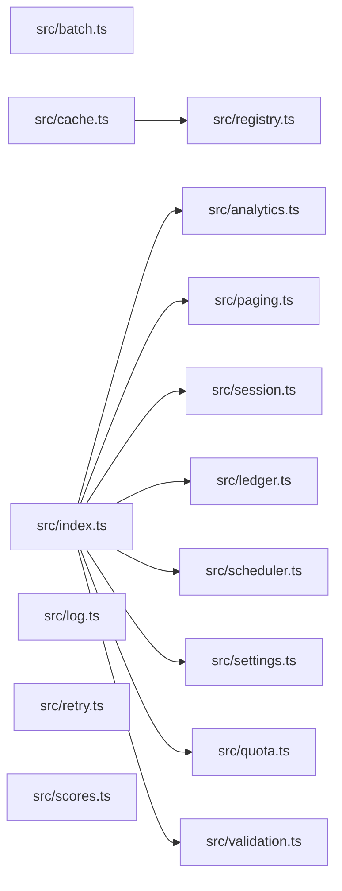

# CodeProof report

Commit: 93259a428ff336273e3e373cc8e591c5e4053cb7  |  run-id: ae354d4fdabfded1  |  mode: bench

**Publishing rule:** a finding appears under *Verified findings* only if every citation passed L1 and the adversarial verifier confirmed it. This checks provenance and model agreement, not semantic proof. Refuted, uncertain and moderate findings are in rejected.md.

## Summary

| Metric | Value |
|---|---|
| Files / LOC | 15 / 229 |
| Import edges / cycles | 9 / 0 |
| Files in scanner prompt | 15 / 15 |
| Findings proposed | 9 |
| Rejected at L1 (bad citation) | 1 |
| Verified | 8 |
| Reproduced by execution (L3) | 5 |
| Patch-proven (L4, differential) | 5 |
| Moderate confidence | 0 |
| Refuted | 0 |
| Uncertain | 0 |
| Calls / retries | 23 / 0 |
| Tokens in / out | 35766 / 45997 |
| Cached input tokens | 7012 |
| Cost | $0.9426 |

## Verified findings

### F-001 - critical - async forEach never awaited returns empty results

**Claim:** collect uses forEach with an async callback and returns results immediately, so promises are never awaited and the returned array is always empty.

**Proposed by:** Muse Spark

**Evidence level:** citation-proven + adversarially-confirmed

**Execution check:** inconclusive: reproducer failed L0: controlCode assertion is not tied to a call of an imported symbol; testCode assertion is not tied to a call of an imported symbol

**Citation (from commit, lines 3-13):** src/analytics.ts
```text
export async function collect(tasks: Task[]): Promise<number[]> {
  const results: number[] = [];
  try {
    tasks.forEach(async (task) => {
      results.push(await task());
    });
  } catch (error) {
    console.error("analytics collection failed", error);
  }
  return results;
}
```

**Verifier (muse-wonder-1.0):** confirm - The code at src/analytics.ts:6 uses tasks.forEach with an async callback whose awaited push at src/analytics.ts:7 is never awaited by collect, which returns results at src/analytics.ts:12 immediately after the synchronous forEach call.

### F-002 - critical - module accumulator makes buildSummary double-count

**Claim:** buildSummary appends to module-level totals on every call and then summarizes totals, so a second call double-counts prior entries.

**Proposed by:** Muse Spark

**Evidence level:** citation-proven + adversarially-confirmed + **execution-proven (generated test fails on the analyzed commit)**

**Execution check:** reproduced by execution: the control passed 3/3 and the trigger failed 3/3 (see Reproduced by execution)

**Citation (from commit, lines 6-18):** src/ledger.ts
```text
const totals: Entry[] = [];

export function post(entries: Entry[]): void {
  for (const entry of entries) totals.push(entry);
}

export function buildSummary(entries: Entry[]): string {
  post(entries);
  const byAccount = new Map<string, number>();
  for (const entry of totals) {
    byAccount.set(entry.account, (byAccount.get(entry.account) ?? 0) + entry.cents);
  }
  return [...byAccount.entries()].map(([account, cents]) => account + "=" + cents).join(",");
```

**Verifier (muse-wonder-1.0):** confirm - buildSummary at src/ledger.ts:12-15 calls post which pushes onto the module-level totals declared at src/ledger.ts:6 and defined at src/ledger.ts:8-9, then iterates all of totals without any reset, so a second call re-includes and re-counts prior entries.

### F-003 - critical - OR instead of AND makes validation always fail

**Claim:** validate uses OR instead of AND for missing checks, so each condition is always true and errors are always reported even for complete payloads.

**Proposed by:** Muse Spark

**Evidence level:** citation-proven + adversarially-confirmed + **execution-proven (generated test fails on the analyzed commit)**

**Execution check:** reproduced by execution: the control passed 3/3 and the trigger failed 3/3 (see Reproduced by execution)

**Citation (from commit, lines 6-15):** src/validation.ts
```text
export function validate(payload: Payload): string[] {
  const errors: string[] = [];
  if (payload.id !== undefined || payload.id !== null) {
    errors.push("id is required");
  }
  if (payload.value !== undefined || payload.value !== null) {
    errors.push("value is required");
  }
  return errors;
}
```

**Verifier (muse-wonder-1.0):** confirm - At src/validation.ts:8 and src/validation.ts:11, the conditions using !== undefined || !== null are tautologies because any value differs from at least one of undefined/null, so both errors are unconditionally pushed even for complete payloads.

### F-004 - high - missing await on save races subsequent get

**Claim:** rotateToken does not await store.save before calling store.get, so the read can race the write and return the old token.

**Proposed by:** Muse Spark

**Evidence level:** citation-proven + adversarially-confirmed + **execution-proven (generated test fails on the analyzed commit)**

**Execution check:** reproduced by execution: the control passed 3/3 and the trigger failed 3/3 (see Reproduced by execution)

**Citation (from commit, lines 6-13):** src/session.ts
```text
export async function rotateToken(
  store: SessionStore,
  userId: string,
  token: string,
): Promise<string | undefined> {
  store.save(userId, token);
  return store.get(userId);
}
```

**Verifier (muse-wonder-1.0):** confirm - The code at src/session.ts:11 calls store.save(userId, token) without await while save returns Promise<void> at src/session.ts:2, then immediately returns store.get(userId) at src/session.ts:12, so the read can race the write.

### F-005 - high - timer handle replaced without clearing existing interval

**Claim:** start overwrites this.timer with a new setInterval without clearing any existing interval, leaking the prior timer on repeated calls.

**Proposed by:** Muse Spark

**Evidence level:** citation-proven + adversarially-confirmed

**Execution check:** inconclusive: reproducer failed L0: controlCode assertion is not tied to a call of an imported symbol; testCode assertion is not tied to a call of an imported symbol; control and trigger must use a different input: control and trigger call the shared symbol(s) with identical arguments

**Citation (from commit, lines 3-11):** src/scheduler.ts
```text
export class Scheduler {
  private timer: NodeJS.Timeout | null = null;
  private readonly ticks: Tick[] = [];

  start(intervalMs: number): void {
    this.timer = setInterval(() => {
      for (const tick of this.ticks) tick();
    }, intervalMs);
  }
```

**Verifier (muse-wonder-1.0):** confirm - The start method at src/scheduler.ts:7-11 assigns this.timer = setInterval(...) with no preceding clearInterval or guard on an existing timer, so repeated calls orphan the prior interval.

### F-006 - high - off-by-one slice returns extra element

**Claim:** pageSlice computes end as start+size then slices to end+1, returning size+1 items instead of one page.

**Proposed by:** Muse Spark

**Evidence level:** citation-proven + adversarially-confirmed

**Execution check:** inconclusive: reproducer failed L0: unsupported response must not include testCode; unsupported response must not include controlCode; unsupportedReason is too short

**Citation (from commit, lines 6-11):** src/paging.ts
```text
export function pageSlice<T>(items: T[], request: PageRequest): T[] {
  const size = Math.max(1, request.size);
  const start = Math.max(0, request.page) * size;
  const end = start + size;
  return items.slice(start, end + 1);
}
```

**Verifier (muse-wonder-1.0):** confirm - Confirmed: src/paging.ts:9 sets end as start+size and src/paging.ts:10 returns items.slice(start, end + 1), and since slice's end is exclusive this returns size+1 items when available.

### F-007 - high - numeric sort without comparator orders lexicographically

**Claim:** sort without a numeric comparator sorts numbers lexicographically, so sortScores and topScore return wrong order for values like 10 and 9.

**Proposed by:** Muse Spark

**Evidence level:** citation-proven + adversarially-confirmed + **execution-proven (generated test fails on the analyzed commit)**

**Execution check:** reproduced by execution: the control passed 3/3 and the trigger failed 3/3 (see Reproduced by execution)

**Citation (from commit, lines 1-3):** src/scores.ts
```text
export function sortScores(scores: number[]): number[] {
  return scores.slice().sort();
}
```

**Verifier (muse-wonder-1.0):** confirm - The code at src/scores.ts:2 uses scores.slice().sort() with no comparator, which sorts numbers lexicographically as strings, and topScore at src/scores.ts:7 returns the last sorted element, so values like 10 and 9 are ordered incorrectly.

### F-009 - medium - exclusive comparison violates inclusive quota

**Claim:** withinQuota uses strict less-than while the contract says max is inclusive, so using exactly the maximum is incorrectly rejected.

**Proposed by:** Muse Spark

**Evidence level:** citation-proven + adversarially-confirmed + **execution-proven (generated test fails on the analyzed commit)**

**Execution check:** reproduced by execution: the control passed 3/3 and the trigger failed 3/3 (see Reproduced by execution)

**Citation (from commit, lines 1-7):** src/quota.ts
```text
/**
 * Returns true when the request fits. Max is inclusive: a request that uses
 * exactly the maximum is still within quota.
 */
export function withinQuota(used: number, amount: number, max: number): boolean {
  return used + amount < max;
}
```

**Verifier (muse-wonder-1.0):** confirm - The comment at src/quota.ts:2 states max is inclusive for exactly the maximum, but src/quota.ts:6 returns used + amount < max, which is false when used + amount equals max.

## Reproduced by execution

For each finding below, the verifier model wrote two standalone files. They run on a `git archive` snapshot of the analyzed commit inside a permission-model sandbox: no network, no writes, 2 s timeout, at least three runs each.

- **[CONTROL]** uses a clean, normal input and must pass every run. It proves the environment and the way the API is called are valid; if it fails, the finding is reported as `control-failed` and the trigger is never run.
- **[TRIGGER]** uses a different input and must fail every run with an assertion error on the analyzed commit.
- **LinkCheck** (Node 26) runs the trigger under the permission model with inspector coverage and requires that the imported symbol actually executed. Without that linkage proof the finding is not reported as execution-proven.


### F-002 - module accumulator makes buildSummary double-count

**Expected behavior:** buildSummary returns a summary of only the entries passed to that call

**Control (must pass 3/3 on the analyzed commit):**
```js
import assert from 'node:assert/strict';
import { buildSummary, resetTotals } from './src/ledger.ts';
resetTotals();
const result = buildSummary([{ account: 'checking', cents: 100 }]);
assert.equal(result, 'checking=100');
```

**Trigger (must fail 3/3 with an assertion error on the analyzed commit):**
```js
import assert from 'node:assert/strict';
import { buildSummary, resetTotals } from './src/ledger.ts';
resetTotals();
const first = buildSummary([{ account: 'savings', cents: 50 }]);
assert.equal(first, 'savings=50');
const second = buildSummary([{ account: 'savings', cents: 30 }]);
assert.equal(second, 'savings=30');
```

**LinkCheck:** proven (symbol) - the imported symbol executed under inspector coverage.

**Runner output (last of 3 attempts):**
```text
           ^

    at file:///tmp/codeproof-repro-oPX88Q/snapshot/.codeproof-repro.test.mjs:7:8
    at ModuleJob.run (node:internal/modules/esm/module_job:569:25)
    at async node:internal/modules/esm/loader:650:26
    at async asyncRunEntryPointWithESMLoader (node:internal/modules/run_main:101:5) {
  generatedMessage: true,
  code: 'ERR_ASSERTION',
  actual: 'savings=80',
  expected: 'savings=30',
  operator: 'strictEqual',
  diff: 'simple'
}

Node.js v26.8.2
```

### F-003 - OR instead of AND makes validation always fail

**Expected behavior:** validate returns an empty error list for a complete payload and reports errors only for missing fields.

**Control (must pass 3/3 on the analyzed commit):**
```js
import assert from 'node:assert/strict';
import { validate } from './src/validation.ts';

const errors = validate({});
assert.equal(errors.length, 2);
assert.equal(errors.includes('id is required'), true);
assert.equal(errors.includes('value is required'), true);
```

**Trigger (must fail 3/3 with an assertion error on the analyzed commit):**
```js
import assert from 'node:assert/strict';
import { validate } from './src/validation.ts';

const errors = validate({ id: 'complete-1', value: 42 });
assert.equal(errors.length, 0);
assert.deepEqual(errors, []);
```

**LinkCheck:** proven (symbol) - the imported symbol executed under inspector coverage.

**Runner output (last of 3 attempts):**
```text
2 !== 0

    at file:///tmp/codeproof-repro-xS9cqX/snapshot/.codeproof-repro.test.mjs:5:8
    at ModuleJob.run (node:internal/modules/esm/module_job:569:25)
    at async node:internal/modules/esm/loader:650:26
    at async asyncRunEntryPointWithESMLoader (node:internal/modules/run_main:101:5) {
  generatedMessage: true,
  code: 'ERR_ASSERTION',
  actual: 2,
  expected: 0,
  operator: 'strictEqual',
  diff: 'simple'
}

Node.js v26.8.2
```

### F-004 - missing await on save races subsequent get

**Expected behavior:** rotateToken returns the newly saved token after rotation, i.e. the get observes the preceding save.

**Control (must pass 3/3 on the analyzed commit):**
```js
import assert from 'node:assert/strict';
import { rotateToken } from './src/session.ts';

let stored = 'old-control-token';
const store = {
  async save(userId, token) { stored = token; },
  async get(userId) { return stored; }
};
const result = await rotateToken(store, 'control-user', 'new-control-token');
assert.equal(result, 'new-control-token');
```

**Trigger (must fail 3/3 with an assertion error on the analyzed commit):**
```js
import assert from 'node:assert/strict';
import { rotateToken } from './src/session.ts';

let stored = 'old-test-token';
const store = {
  async save(userId, token) {
    await new Promise((resolve) => setTimeout(resolve, 20));
    stored = token;
  },
  async get(userId) { return stored; }
};
const result = await rotateToken(store, 'test-user', 'new-test-token');
assert.equal(result, 'new-test-token');
```

**LinkCheck:** proven (symbol) - the imported symbol executed under inspector coverage.

**Runner output (last of 3 attempts):**
```text
+ actual - expected

+ 'old-test-token'
- 'new-test-token'

    at file:///tmp/codeproof-repro-W9qsBE/snapshot/.codeproof-repro.test.mjs:13:8 {
  generatedMessage: true,
  code: 'ERR_ASSERTION',
  actual: 'old-test-token',
  expected: 'new-test-token',
  operator: 'strictEqual',
  diff: 'simple'
}

Node.js v26.8.2
```

### F-007 - numeric sort without comparator orders lexicographically

**Expected behavior:** sortScores returns numbers in ascending numeric order

**Control (must pass 3/3 on the analyzed commit):**
```js
import assert from 'node:assert/strict';
import { sortScores } from './src/scores.ts';
const result = sortScores([3, 1, 2]);
assert.deepEqual(result, [1, 2, 3]);
```

**Trigger (must fail 3/3 with an assertion error on the analyzed commit):**
```js
import assert from 'node:assert/strict';
import { sortScores } from './src/scores.ts';
const result = sortScores([10, 9, 2]);
assert.deepEqual(result, [2, 9, 10]);
```

**LinkCheck:** proven (symbol) - the imported symbol executed under inspector coverage.

**Runner output (last of 3 attempts):**
```text
  ]

    at file:///tmp/codeproof-repro-5YzPlS/snapshot/.codeproof-repro.test.mjs:4:8
    at ModuleJob.run (node:internal/modules/esm/module_job:569:25)
    at async node:internal/modules/esm/loader:650:26
    at async asyncRunEntryPointWithESMLoader (node:internal/modules/run_main:101:5) {
  generatedMessage: true,
  code: 'ERR_ASSERTION',
  actual: [ 10, 2, 9 ],
  expected: [ 2, 9, 10 ],
  operator: 'deepStrictEqual',
  diff: 'simple'
}

Node.js v26.8.2
```

### F-009 - exclusive comparison violates inclusive quota

**Expected behavior:** withinQuota returns true when used+amount is below or exactly equal to the inclusive max, per the documented contract.

**Control (must pass 3/3 on the analyzed commit):**
```js
import assert from 'node:assert/strict';
import { withinQuota } from './src/quota.ts';
const result = withinQuota(0, 5, 10);
assert.equal(result, true);
```

**Trigger (must fail 3/3 with an assertion error on the analyzed commit):**
```js
import assert from 'node:assert/strict';
import { withinQuota } from './src/quota.ts';
const result = withinQuota(5, 5, 10);
assert.equal(result, true);
```

**LinkCheck:** proven (symbol) - the imported symbol executed under inspector coverage.

**Runner output (last of 3 attempts):**
```text
false !== true

    at file:///tmp/codeproof-repro-wRR0nx/snapshot/.codeproof-repro.test.mjs:4:8
    at ModuleJob.run (node:internal/modules/esm/module_job:569:25)
    at async node:internal/modules/esm/loader:650:26
    at async asyncRunEntryPointWithESMLoader (node:internal/modules/run_main:101:5) {
  generatedMessage: true,
  code: 'ERR_ASSERTION',
  actual: false,
  expected: true,
  operator: 'strictEqual',
  diff: 'simple'
}

Node.js v26.8.2
```

## Patch-proven (differential proof)

For each finding below the patcher model proposed a minimal patch to one of the cited files. The patch is applied to a **copy** of the L3 snapshot (the snapshot itself is never mutated) and both phases are re-run: the control must still pass every run and the trigger must now pass every run. This is a differential result over the reproduction - it does not claim to fix the root cause, and the repository's own test suite is not run.

### F-002 - module accumulator makes buildSummary double-count

**Patch rationale:** buildSummary should summarize only its argument, not the module-level accumulator that persists across calls.

```diff
--- a/src/ledger.ts
+++ b/src/ledger.ts
@@ -13,3 +13,2 @@
-  post(entries);
-  const byAccount = new Map<string, number>();
-  for (const entry of totals) {
+  const byAccount = new Map<string, number>();
+  for (const entry of entries) {
```

**Differential result:** control passed 3/3, trigger passed 3/3 after the patch. The repository's own test suite was not run; the patch was never written to the analyzed repository.

### F-003 - OR instead of AND makes validation always fail

**Patch rationale:** The !== ... || !== ... conditions are tautologies, always pushing errors. Missing means === undefined or === null, which passes the complete payload and still reports both errors for {}.

```diff
--- a/src/validation.ts
+++ b/src/validation.ts
@@ -8,4 +8,4 @@
-  if (payload.id !== undefined || payload.id !== null) {
-    errors.push("id is required");
-  }
-  if (payload.value !== undefined || payload.value !== null) {
+  if (payload.id === undefined || payload.id === null) {
+    errors.push("id is required");
+  }
+  if (payload.value === undefined || payload.value === null) {
```

**Differential result:** control passed 3/3, trigger passed 3/3 after the patch. The repository's own test suite was not run; the patch was never written to the analyzed repository.

### F-004 - missing await on save races subsequent get

**Patch rationale:** Awaiting save ensures the write completes before the subsequent get, eliminating the race.

```diff
--- a/src/session.ts
+++ b/src/session.ts
@@ -11,1 +11,1 @@
-  store.save(userId, token);
+  await store.save(userId, token);
```

**Differential result:** control passed 3/3, trigger passed 3/3 after the patch. The repository's own test suite was not run; the patch was never written to the analyzed repository.

### F-007 - numeric sort without comparator orders lexicographically

**Patch rationale:** Default Array.sort converts numbers to strings, ordering 10 before 9. Adding a numeric comparator fixes sortScores and topScore which depends on it.

```diff
--- a/src/scores.ts
+++ b/src/scores.ts
@@ -2,1 +2,1 @@
-  return scores.slice().sort();
+  return scores.slice().sort((a, b) => a - b);
```

**Differential result:** control passed 3/3, trigger passed 3/3 after the patch. The repository's own test suite was not run; the patch was never written to the analyzed repository.

### F-009 - exclusive comparison violates inclusive quota

**Patch rationale:** Change strict less-than to inclusive less-than-or-equal so exactly reaching max is within quota.

```diff
--- a/src/quota.ts
+++ b/src/quota.ts
@@ -6,1 +6,1 @@
-  return used + amount < max;
+  return used + amount <= max;
```

**Differential result:** control passed 3/3, trigger passed 3/3 after the patch. The repository's own test suite was not run; the patch was never written to the analyzed repository.

## Architecture

Deterministic facts only: 15 files, 229 LOC, 9 import edges, 0 cycles. The diagram is generated from the import graph by code, never by the model.



## Limits

- Scan and verify are static: the analyzed code is never executed while the scanner and verifier run. L3 runs only the generated test, on a git-archive snapshot, inside a permission-model sandbox (no network, no writes, 2 s timeout); isolation is process-level, not OS-level.
- No completeness claim; this report shows what passed the gate, not everything that exists in the repository.
- Only direct correctness defects; omission, security and style findings are out of scope for this milestone.
- The L1 gate proves that a citation exists in the commit; the semantic match is judged by the verifier model and presented as such.

