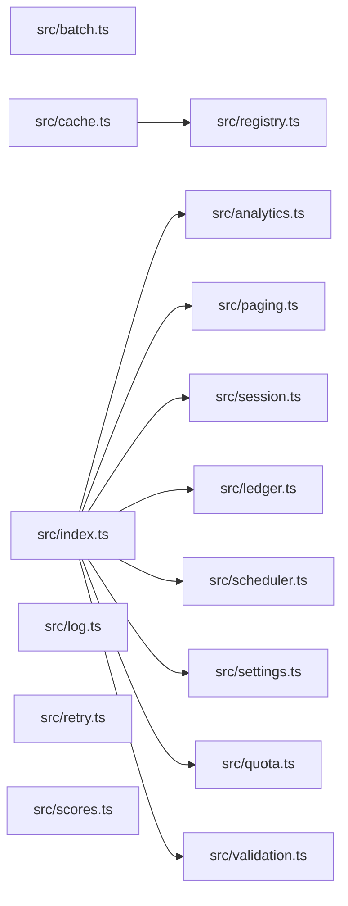

# CodeProof report

Commit: c67d6b9207ffe2904291e16ee139b09f39661c1a  |  run-id: 77ca0cd10b081478  |  mode: bench

**Publishing rule:** a finding appears under *Verified findings* only if every citation passed L1 and the adversarial verifier confirmed it. This checks provenance and model agreement, not semantic proof. Refuted, uncertain and moderate findings are in rejected.md.

## Summary

| Metric | Value |
|---|---|
| Files / LOC | 15 / 229 |
| Import edges / cycles | 9 / 0 |
| Files in scanner prompt | 15 / 15 |
| Findings proposed | 9 |
| Rejected at L1 (bad citation) | 1 |
| Verified | 8 |
| Reproduced by execution (L3) | 7 |
| Patch-proven (L4, differential) | 7 |
| Moderate confidence | 0 |
| Refuted | 0 |
| Uncertain | 0 |
| Calls / retries | 25 / 0 |
| Tokens in / out | 39335 / 53094 |
| Cached input tokens | 5464 |
| Cost | $1.1073 |

## Verified findings

### F-001 - critical - async forEach without await returns empty results

**Claim:** collect uses forEach with an async callback and returns results without awaiting, so it always returns an empty array and try/catch cannot catch task rejections.

**Proposed by:** Muse Spark

**Evidence level:** citation-proven + adversarially-confirmed + **execution-proven (generated test fails on the analyzed commit)**

**Execution check:** reproduced by execution: the control passed 3/3 and the trigger failed 3/3 (see Reproduced by execution)

**Citation (from commit, lines 3-13):** src/analytics.ts
```text
export async function collect(tasks: Task[]): Promise<number[]> {
  const results: number[] = [];
  try {
    tasks.forEach(async (task) => {
      results.push(await task());
    });
  } catch (error) {
    console.error("analytics collection failed", error);
  }
  return results;
}
```

**Verifier (muse-wonder-1.0):** confirm - The code at src/analytics.ts:6 uses tasks.forEach with an async callback that awaits task() at src/analytics.ts:7, while src/analytics.ts:12 returns results synchronously after forEach without awaiting those callbacks, so no push can complete before return and async rejections escape the try/catch at src/analytics.ts:5.

### F-002 - critical - OR instead of AND makes validation always fail

**Claim:** validate uses || instead of && so each condition is always true and it always reports both fields as missing.

**Proposed by:** Muse Spark

**Evidence level:** citation-proven + adversarially-confirmed + **execution-proven (generated test fails on the analyzed commit)**

**Execution check:** reproduced by execution: the control passed 3/3 and the trigger failed 3/3 (see Reproduced by execution)

**Citation (from commit, lines 6-15):** src/validation.ts
```text
export function validate(payload: Payload): string[] {
  const errors: string[] = [];
  if (payload.id !== undefined || payload.id !== null) {
    errors.push("id is required");
  }
  if (payload.value !== undefined || payload.value !== null) {
    errors.push("value is required");
  }
  return errors;
}
```

**Verifier (muse-wonder-1.0):** confirm - The conditions at src/validation.ts:8 and src/validation.ts:11 use `!== undefined || !== null`, which is true for every possible value (undefined, null, or present), so validate always pushes both errors.

### F-003 - critical - missing await on save before get

**Claim:** rotateToken does not await store.save before calling store.get, so the read can race the write and return the old token.

**Proposed by:** Muse Spark

**Evidence level:** citation-proven + adversarially-confirmed + **execution-proven (generated test fails on the analyzed commit)**

**Execution check:** reproduced by execution: the control passed 3/3 and the trigger failed 3/3 (see Reproduced by execution)

**Citation (from commit, lines 6-13):** src/session.ts
```text
export async function rotateToken(
  store: SessionStore,
  userId: string,
  token: string,
): Promise<string | undefined> {
  store.save(userId, token);
  return store.get(userId);
}
```

**Verifier (muse-wonder-1.0):** confirm - At src/session.ts:2 save returns Promise<void>, but src/session.ts:11 calls store.save(userId, token) without await before src/session.ts:12 immediately returns store.get(userId), so the read can race the unfinished write.

### F-004 - high - module accumulator makes buildSummary double-count

**Claim:** buildSummary appends to module-level totals on every call and then summarizes totals, so a second call double-counts prior entries.

**Proposed by:** Muse Spark

**Evidence level:** citation-proven + adversarially-confirmed + **execution-proven (generated test fails on the analyzed commit)**

**Execution check:** reproduced by execution: the control passed 3/3 and the trigger failed 3/3 (see Reproduced by execution)

**Citation (from commit, lines 6-19):** src/ledger.ts
```text
const totals: Entry[] = [];

export function post(entries: Entry[]): void {
  for (const entry of entries) totals.push(entry);
}

export function buildSummary(entries: Entry[]): string {
  post(entries);
  const byAccount = new Map<string, number>();
  for (const entry of totals) {
    byAccount.set(entry.account, (byAccount.get(entry.account) ?? 0) + entry.cents);
  }
  return [...byAccount.entries()].map(([account, cents]) => account + "=" + cents).join(",");
}
```

**Verifier (muse-wonder-1.0):** confirm - buildSummary at src/ledger.ts:12-15 calls post, which pushes onto the module-level totals array at src/ledger.ts:6-9, and then iterates all of totals without any reset, so a second call re-includes and re-sums prior entries.

### F-005 - high - timer handle replaced without clearing existing interval

**Claim:** start overwrites this.timer with a new setInterval without clearing an existing interval, leaking the prior handle and running duplicate tick loops.

**Proposed by:** Muse Spark

**Evidence level:** citation-proven + adversarially-confirmed

**Execution check:** inconclusive: reproducer failed L0: controlCode assertion is not tied to a call of an imported symbol; testCode assertion is not tied to a call of an imported symbol; control and trigger must use a different input: control and trigger call the shared symbol(s) with identical arguments

**Citation (from commit, lines 7-11):** src/scheduler.ts
```text
  start(intervalMs: number): void {
    this.timer = setInterval(() => {
      for (const tick of this.ticks) tick();
    }, intervalMs);
  }
```

**Verifier (muse-wonder-1.0):** confirm - The start method at src/scheduler.ts:7-11 unconditionally assigns this.timer = setInterval(...) with no clearInterval or existing-timer guard, so a second call orphans the prior handle and leaves both intervals running.

### F-006 - high - off-by-one slice returns extra element

**Claim:** pageSlice uses slice(start, end + 1) while end is already start+size, returning one extra element per page.

**Proposed by:** Muse Spark

**Evidence level:** citation-proven + adversarially-confirmed + **execution-proven (generated test fails on the analyzed commit)**

**Execution check:** reproduced by execution: the control passed 3/3 and the trigger failed 3/3 (see Reproduced by execution)

**Citation (from commit, lines 6-11):** src/paging.ts
```text
export function pageSlice<T>(items: T[], request: PageRequest): T[] {
  const size = Math.max(1, request.size);
  const start = Math.max(0, request.page) * size;
  const end = start + size;
  return items.slice(start, end + 1);
}
```

**Verifier (muse-wonder-1.0):** confirm - pageSlice at src/paging.ts:9 sets end = start + size and at src/paging.ts:10 returns items.slice(start, end + 1), which because slice's end index is exclusive yields size+1 elements when available.

### F-007 - high - numeric sort without comparator

**Claim:** sort without a numeric comparator sorts numbers lexicographically, so topScore can return the wrong maximum.

**Proposed by:** Muse Spark

**Evidence level:** citation-proven + adversarially-confirmed + **execution-proven (generated test fails on the analyzed commit)**

**Execution check:** reproduced by execution: the control passed 3/3 and the trigger failed 3/3 (see Reproduced by execution)

**Citation (from commit, lines 1-3):** src/scores.ts
```text
export function sortScores(scores: number[]): number[] {
  return scores.slice().sort();
}
```

**Verifier (muse-wonder-1.0):** confirm - sortScores at src/scores.ts:2 calls scores.slice().sort() with no comparator, so JavaScript lexicographic string ordering applies, and topScore at src/scores.ts:7 returns the last element which need not be the numeric maximum.

### F-009 - medium - falsy fallback discards legitimate zero

**Claim:** normalizeSettings uses || fallbacks so legitimate 0 values are replaced with defaults instead of preserved.

**Proposed by:** Muse Spark

**Evidence level:** citation-proven + adversarially-confirmed + **execution-proven (generated test fails on the analyzed commit)**

**Execution check:** reproduced by execution: the control passed 3/3 and the trigger failed 3/3 (see Reproduced by execution)

**Citation (from commit, lines 11-16):** src/settings.ts
```text
export function normalizeSettings(raw: RawSettings): Settings {
  return {
    pageSize: raw.pageSize || 20,
    budgetCents: raw.budgetCents || 1000,
  };
}
```
**Citation (from commit, lines 18-18):** src/settings.ts
```text
// Optional values are read from settings where 0 is a legitimate value.
```

**Verifier (muse-wonder-1.0):** confirm - The code at src/settings.ts:13-14 uses raw.pageSize || 20 and raw.budgetCents || 1000, so 0 evaluates as falsy and is replaced by the default, contradicting the stated principle at src/settings.ts:18 that 0 is a legitimate value for settings.

## Reproduced by execution

For each finding below, the verifier model wrote two standalone files. They run on a `git archive` snapshot of the analyzed commit inside a permission-model sandbox: no network, no writes, 2 s timeout, at least three runs each.

- **[CONTROL]** uses a clean, normal input and must pass every run. It proves the environment and the way the API is called are valid; if it fails, the finding is reported as `control-failed` and the trigger is never run.
- **[TRIGGER]** uses a different input and must fail every run with an assertion error on the analyzed commit.
- **LinkCheck** (Node 26) runs the trigger under the permission model with inspector coverage and requires that the imported symbol actually executed. Without that linkage proof the finding is not reported as execution-proven.


### F-001 - async forEach without await returns empty results

**Expected behavior:** collect should await all tasks and return their resolved values in order; empty input returns an empty array.

**Control (must pass 3/3 on the analyzed commit):**
```js
import assert from 'node:assert/strict';
import { collect } from './src/analytics.ts';

const results = await collect([]);
assert.deepEqual(results, []);
```

**Trigger (must fail 3/3 with an assertion error on the analyzed commit):**
```js
import assert from 'node:assert/strict';
import { collect } from './src/analytics.ts';

const task = (value) => async () => {
  await new Promise((resolve) => setTimeout(resolve, 10));
  return value;
};
const results = await collect([task(10), task(20)]);
assert.deepEqual(results, [10, 20]);
```

**LinkCheck:** proven (symbol) - the imported symbol executed under inspector coverage.

**Runner output (last of 3 attempts):**
```text
- [
-   10,
-   20
- ]

    at file:///tmp/codeproof-repro-7208gu/snapshot/.codeproof-repro.test.mjs:9:8 {
  generatedMessage: true,
  code: 'ERR_ASSERTION',
  actual: [],
  expected: [ 10, 20 ],
  operator: 'deepStrictEqual',
  diff: 'simple'
}

Node.js v26.8.2
```

### F-002 - OR instead of AND makes validation always fail

**Expected behavior:** validate returns an error for each missing field and no errors when both id and value are present.

**Control (must pass 3/3 on the analyzed commit):**
```js
import assert from 'node:assert/strict';
import { validate } from './src/validation.ts';
const errors = validate({});
assert.equal(errors.length, 2);
assert.deepEqual(errors, ['id is required', 'value is required']);
```

**Trigger (must fail 3/3 with an assertion error on the analyzed commit):**
```js
import assert from 'node:assert/strict';
import { validate } from './src/validation.ts';
const errors = validate({ id: 'abc', value: 42 });
assert.equal(errors.length, 0);
assert.deepEqual(errors, []);
```

**LinkCheck:** proven (symbol) - the imported symbol executed under inspector coverage.

**Runner output (last of 3 attempts):**
```text
2 !== 0

    at file:///tmp/codeproof-repro-sOpqCT/snapshot/.codeproof-repro.test.mjs:4:8
    at ModuleJob.run (node:internal/modules/esm/module_job:569:25)
    at async node:internal/modules/esm/loader:650:26
    at async asyncRunEntryPointWithESMLoader (node:internal/modules/run_main:101:5) {
  generatedMessage: true,
  code: 'ERR_ASSERTION',
  actual: 2,
  expected: 0,
  operator: 'strictEqual',
  diff: 'simple'
}

Node.js v26.8.2
```

### F-003 - missing await on save before get

**Expected behavior:** rotateToken returns the newly saved token after saving it

**Control (must pass 3/3 on the analyzed commit):**
```js
import assert from 'node:assert/strict';
import { rotateToken } from './src/session.ts';

const data = new Map([['alice', 'old-control']]);
const store = {
  async save(userId, token) { data.set(userId, token); },
  async get(userId) { return data.get(userId); },
};
const result = await rotateToken(store, 'alice', 'new-control');
assert.equal(result, 'new-control');
```

**Trigger (must fail 3/3 with an assertion error on the analyzed commit):**
```js
import assert from 'node:assert/strict';
import { rotateToken } from './src/session.ts';

const data = new Map([['bob', 'old-trigger']]);
const store = {
  async save(userId, token) {
    await new Promise((resolve) => setTimeout(resolve, 20));
    data.set(userId, token);
  },
  async get(userId) { return data.get(userId); },
};
const result = await rotateToken(store, 'bob', 'new-trigger');
assert.equal(result, 'new-trigger');
```

**LinkCheck:** proven (symbol) - the imported symbol executed under inspector coverage.

**Runner output (last of 3 attempts):**
```text
+ actual - expected

+ 'old-trigger'
- 'new-trigger'

    at file:///tmp/codeproof-repro-nrDBWY/snapshot/.codeproof-repro.test.mjs:13:8 {
  generatedMessage: true,
  code: 'ERR_ASSERTION',
  actual: 'old-trigger',
  expected: 'new-trigger',
  operator: 'strictEqual',
  diff: 'simple'
}

Node.js v26.8.2
```

### F-004 - module accumulator makes buildSummary double-count

**Expected behavior:** buildSummary(entries) returns a summary of only the entries passed to that call, e.g. a single call with alice=100 returns 'alice=100' and a later call with bob=30 returns 'bob=30'.

**Control (must pass 3/3 on the analyzed commit):**
```js
import assert from 'node:assert/strict';
import { buildSummary, resetTotals } from './src/ledger.ts';
resetTotals();
const result = buildSummary([{ account: 'alice', cents: 100 }]);
assert.equal(result, 'alice=100');
```

**Trigger (must fail 3/3 with an assertion error on the analyzed commit):**
```js
import assert from 'node:assert/strict';
import { buildSummary, resetTotals } from './src/ledger.ts';
resetTotals();
const first = buildSummary([{ account: 'bob', cents: 50 }]);
assert.equal(first, 'bob=50');
const second = buildSummary([{ account: 'bob', cents: 30 }]);
assert.equal(second, 'bob=30');
```

**LinkCheck:** proven (symbol) - the imported symbol executed under inspector coverage.

**Runner output (last of 3 attempts):**
```text
'bob=80' !== 'bob=30'

    at file:///tmp/codeproof-repro-hLd3h3/snapshot/.codeproof-repro.test.mjs:7:8
    at ModuleJob.run (node:internal/modules/esm/module_job:569:25)
    at async node:internal/modules/esm/loader:650:26
    at async asyncRunEntryPointWithESMLoader (node:internal/modules/run_main:101:5) {
  generatedMessage: true,
  code: 'ERR_ASSERTION',
  actual: 'bob=80',
  expected: 'bob=30',
  operator: 'strictEqual',
  diff: 'simple'
}

Node.js v26.8.2
```

### F-006 - off-by-one slice returns extra element

**Expected behavior:** pageSlice returns at most size elements: a page of size 2 contains exactly 2 elements when available.

**Control (must pass 3/3 on the analyzed commit):**
```js
import assert from 'node:assert/strict';
import { pageSlice } from './src/paging.ts';
const result = pageSlice([1, 2], { page: 0, size: 2 });
assert.equal(result.length, 2);
assert.deepEqual(result, [1, 2]);
```

**Trigger (must fail 3/3 with an assertion error on the analyzed commit):**
```js
import assert from 'node:assert/strict';
import { pageSlice } from './src/paging.ts';
const result = pageSlice([1, 2, 3, 4], { page: 0, size: 2 });
assert.equal(result.length, 2);
assert.deepEqual(result, [1, 2]);
```

**LinkCheck:** proven (symbol) - the imported symbol executed under inspector coverage.

**Runner output (last of 3 attempts):**
```text
3 !== 2

    at file:///tmp/codeproof-repro-LCmhrU/snapshot/.codeproof-repro.test.mjs:4:8
    at ModuleJob.run (node:internal/modules/esm/module_job:569:25)
    at async node:internal/modules/esm/loader:650:26
    at async asyncRunEntryPointWithESMLoader (node:internal/modules/run_main:101:5) {
  generatedMessage: true,
  code: 'ERR_ASSERTION',
  actual: 3,
  expected: 2,
  operator: 'strictEqual',
  diff: 'simple'
}

Node.js v26.8.2
```

### F-007 - numeric sort without comparator

**Expected behavior:** topScore returns the numeric maximum; sortScores/topScore should order numbers numerically, not lexicographically.

**Control (must pass 3/3 on the analyzed commit):**
```js
import assert from 'node:assert/strict';
import { topScore } from './src/scores.ts';
const result = topScore([1, 2, 3]);
assert.equal(result, 3);
```

**Trigger (must fail 3/3 with an assertion error on the analyzed commit):**
```js
import assert from 'node:assert/strict';
import { topScore } from './src/scores.ts';
const result = topScore([9, 10, 100]);
assert.equal(result, 100);
```

**LinkCheck:** proven (symbol) - the imported symbol executed under inspector coverage.

**Runner output (last of 3 attempts):**
```text
9 !== 100

    at file:///tmp/codeproof-repro-vi4lJa/snapshot/.codeproof-repro.test.mjs:4:8
    at ModuleJob.run (node:internal/modules/esm/module_job:569:25)
    at async node:internal/modules/esm/loader:650:26
    at async asyncRunEntryPointWithESMLoader (node:internal/modules/run_main:101:5) {
  generatedMessage: true,
  code: 'ERR_ASSERTION',
  actual: 9,
  expected: 100,
  operator: 'strictEqual',
  diff: 'simple'
}

Node.js v26.8.2
```

### F-009 - falsy fallback discards legitimate zero

**Expected behavior:** normalizeSettings preserves legitimate 0 values and only applies defaults when values are absent

**Control (must pass 3/3 on the analyzed commit):**
```js
import assert from 'node:assert/strict';
import { normalizeSettings } from './src/settings.ts';
const result = normalizeSettings({ pageSize: 10, budgetCents: 500 });
assert.equal(result.pageSize, 10);
assert.equal(result.budgetCents, 500);
const defaults = normalizeSettings({});
assert.equal(defaults.pageSize, 20);
assert.equal(defaults.budgetCents, 1000);
```

**Trigger (must fail 3/3 with an assertion error on the analyzed commit):**
```js
import assert from 'node:assert/strict';
import { normalizeSettings } from './src/settings.ts';
const result = normalizeSettings({ pageSize: 0, budgetCents: 0 });
assert.equal(result.pageSize, 0);
assert.equal(result.budgetCents, 0);
```

**LinkCheck:** proven (symbol) - the imported symbol executed under inspector coverage.

**Runner output (last of 3 attempts):**
```text
20 !== 0

    at file:///tmp/codeproof-repro-sdYWsZ/snapshot/.codeproof-repro.test.mjs:4:8
    at ModuleJob.run (node:internal/modules/esm/module_job:569:25)
    at async node:internal/modules/esm/loader:650:26
    at async asyncRunEntryPointWithESMLoader (node:internal/modules/run_main:101:5) {
  generatedMessage: true,
  code: 'ERR_ASSERTION',
  actual: 20,
  expected: 0,
  operator: 'strictEqual',
  diff: 'simple'
}

Node.js v26.8.2
```

## Patch-proven (differential proof)

For each finding below the patcher model proposed a minimal patch to one of the cited files. The patch is applied to a **copy** of the L3 snapshot (the snapshot itself is never mutated) and both phases are re-run: the control must still pass every run and the trigger must now pass every run. This is a differential result over the reproduction - it does not claim to fix the root cause, and the repository's own test suite is not run.

### F-001 - async forEach without await returns empty results

**Patch rationale:** Await all tasks with Promise.all (preserving input order) inside the existing try/catch so results are populated before return and rejections are caught.

```diff
--- a/src/analytics.ts
+++ b/src/analytics.ts
@@ -6,3 +6,1 @@
-    tasks.forEach(async (task) => {
-      results.push(await task());
-    });
+    results.push(...(await Promise.all(tasks.map((task) => task()))));
```

**Differential result:** control passed 3/3, trigger passed 3/3 after the patch. The repository's own test suite was not run; the patch was never written to the analyzed repository.

### F-002 - OR instead of AND makes validation always fail

**Patch rationale:** Inverted conditions always pushed errors; missing means === undefined or === null, so present values no longer error while {} still reports both.

```diff
--- a/src/validation.ts
+++ b/src/validation.ts
@@ -8,4 +8,4 @@
-  if (payload.id !== undefined || payload.id !== null) {
-    errors.push("id is required");
-  }
-  if (payload.value !== undefined || payload.value !== null) {
+  if (payload.id === undefined || payload.id === null) {
+    errors.push("id is required");
+  }
+  if (payload.value === undefined || payload.value === null) {
```

**Differential result:** control passed 3/3, trigger passed 3/3 after the patch. The repository's own test suite was not run; the patch was never written to the analyzed repository.

### F-003 - missing await on save before get

**Patch rationale:** Await the asynchronous save so the subsequent get cannot race the write and return the stale token.

```diff
--- a/src/session.ts
+++ b/src/session.ts
@@ -11,1 +11,1 @@
-  store.save(userId, token);
+  await store.save(userId, token);
```

**Differential result:** control passed 3/3, trigger passed 3/3 after the patch. The repository's own test suite was not run; the patch was never written to the analyzed repository.

### F-004 - module accumulator makes buildSummary double-count

**Patch rationale:** buildSummary should summarize only the entries passed to it, not the cumulative module-level totals appended via post().

```diff
--- a/src/ledger.ts
+++ b/src/ledger.ts
@@ -13,3 +13,2 @@
-  post(entries);
-  const byAccount = new Map<string, number>();
-  for (const entry of totals) {
+  const byAccount = new Map<string, number>();
+  for (const entry of entries) {
```

**Differential result:** control passed 3/3, trigger passed 3/3 after the patch. The repository's own test suite was not run; the patch was never written to the analyzed repository.

### F-006 - off-by-one slice returns extra element

**Patch rationale:** slice end is exclusive and end already equals start+size, so end+1 returns one extra element.

```diff
--- a/src/paging.ts
+++ b/src/paging.ts
@@ -10,1 +10,1 @@
-  return items.slice(start, end + 1);
+  return items.slice(start, end);
```

**Differential result:** control passed 3/3, trigger passed 3/3 after the patch. The repository's own test suite was not run; the patch was never written to the analyzed repository.

### F-007 - numeric sort without comparator

**Patch rationale:** Default Array.sort converts numbers to strings, so [9,10,100] sorts lexicographically and topScore returns 9 instead of 100. Adding a numeric comparator fixes ordering while preserving the API.

```diff
--- a/src/scores.ts
+++ b/src/scores.ts
@@ -2,1 +2,1 @@
-  return scores.slice().sort();
+  return scores.slice().sort((a, b) => a - b);
```

**Differential result:** control passed 3/3, trigger passed 3/3 after the patch. The repository's own test suite was not run; the patch was never written to the analyzed repository.

### F-009 - falsy fallback discards legitimate zero

**Patch rationale:** Use nullish coalescing so 0 is preserved while undefined still falls back to defaults.

```diff
--- a/src/settings.ts
+++ b/src/settings.ts
@@ -13,2 +13,2 @@
-    pageSize: raw.pageSize || 20,
-    budgetCents: raw.budgetCents || 1000,
+    pageSize: raw.pageSize ?? 20,
+    budgetCents: raw.budgetCents ?? 1000,
```

**Differential result:** control passed 3/3, trigger passed 3/3 after the patch. The repository's own test suite was not run; the patch was never written to the analyzed repository.

## Architecture

Deterministic facts only: 15 files, 229 LOC, 9 import edges, 0 cycles. The diagram is generated from the import graph by code, never by the model.



## Limits

- Scan and verify are static: the analyzed code is never executed while the scanner and verifier run. L3 runs only the generated test, on a git-archive snapshot, inside a permission-model sandbox (no network, no writes, 2 s timeout); isolation is process-level, not OS-level.
- No completeness claim; this report shows what passed the gate, not everything that exists in the repository.
- Only direct correctness defects; omission, security and style findings are out of scope for this milestone.
- The L1 gate proves that a citation exists in the commit; the semantic match is judged by the verifier model and presented as such.

