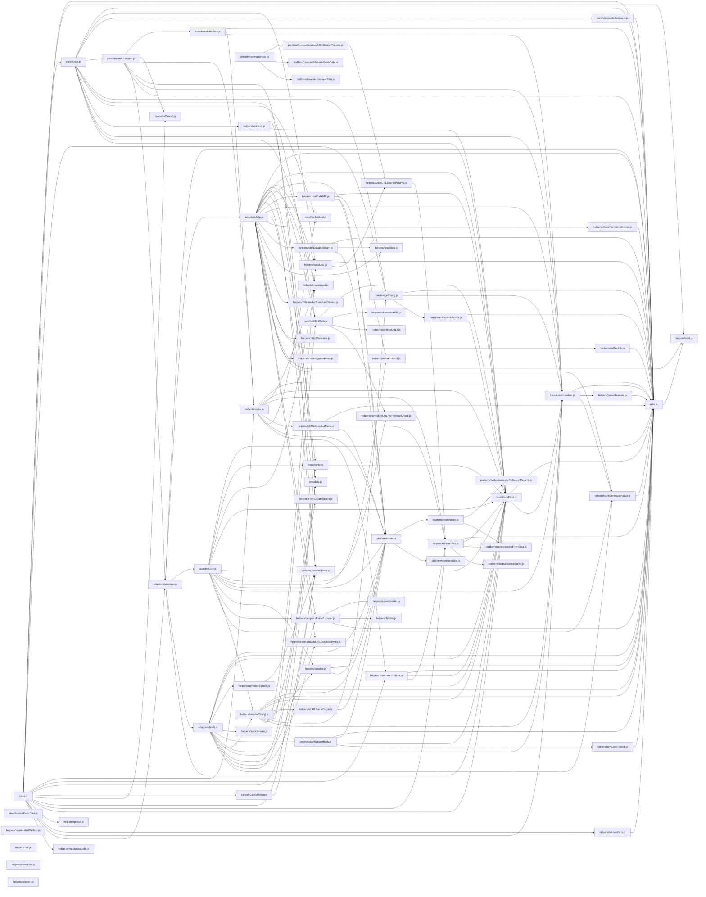

# CodeProof report

Commit: b2c8f4c90801b6c2260a43ce7550c22868a0fb82  |  run-id: 27937bbf34fed1b7  |  mode: smoke

**Publishing rule:** a finding appears under *Verified findings* only if every citation passed L1 and the adversarial verifier confirmed it. This checks provenance and model agreement, not semantic proof. Refuted, uncertain and moderate findings are in rejected.md.

## Summary

| Metric | Value |
|---|---|
| Files / LOC | 74 / 9564 |
| Import edges / cycles | 177 / 0 |
| Files in scanner prompt | 74 / 74 |
| Findings proposed | 10 |
| Rejected at L1 (bad citation) | 1 |
| Verified | 9 |
| Reproduced by execution (L3) | 1 |
| Patch-proven (L4, differential) | 1 |
| Moderate confidence | 0 |
| Refuted | 0 |
| Uncertain | 0 |
| Calls / retries | 27 / 0 |
| Tokens in / out | 188028 / 79738 |
| Cached input tokens | 1000 |
| Cost | $1.5038 |

## Verified findings

### F-001 - critical - Inverted cancellation guard prevents CancelToken from ever cancelling

**Claim:** The cancel guard is inverted: on first cancel token.reason is falsy so `if (!token.reason) return` exits early and never sets reason or resolves the promise, so cancellation never takes effect.

**Proposed by:** Muse Spark

**Evidence level:** citation-proven + adversarially-confirmed

**Execution check:** inconclusive: reproducer failed L0: controlCode assertion is not tied to a call of an imported symbol; testCode assertion is not tied to a call of an imported symbol

**Citation (from commit, lines 54-62):** cancel/CancelToken.js
```text
    executor(function cancel(message, config, request) {
      if (!token.reason) {
        // Cancellation has already been requested
        return;
      }

      token.reason = new CanceledError(message, config, request);
      resolvePromise(token.reason);
    });
```

**Verifier (muse-wonder-1.0):** confirm - The guard at cancel/CancelToken.js:55 returns when token.reason is falsy, which is its initial unset state, so the assignments at cancel/CancelToken.js:60-61 are unreachable on first and subsequent cancels.

### F-002 - critical - settle ignores validateStatus for status <500

**Claim:** settle resolves any status <500 even when validateStatus returns false, so custom validateStatus and default 4xx rejection never reject.

**Proposed by:** Muse Spark

**Evidence level:** citation-proven + adversarially-confirmed

**Execution check:** inconclusive: reproducer failed L0: controlCode assertion is not tied to a call of an imported symbol; testCode assertion is not tied to a call of an imported symbol

**Citation (from commit, lines 14-17):** core/settle.js
```text
export default function settle(resolve, reject, response) {
  const validateStatus = response.config.validateStatus;
  if (!response.status || !validateStatus || validateStatus(response.status) || response.status < 500) {
    resolve(response);
```

**Verifier (muse-wonder-1.0):** confirm - The condition at core/settle.js:16 includes '|| response.status < 500' as an independent disjunct before resolve(response) at core/settle.js:17, so any status below 500 resolves regardless of validateStatus(response.status) returning false, leaving rejection at core/settle.js:19 reachable only for status >=500.

### F-003 - high - InterceptorManager.forEach missing null guard

**Claim:** forEach invokes fn(null) for ejected interceptors instead of skipping null, causing TypeError on interceptor.runWhen/fulfilled access in Axios request chain.

**Proposed by:** Muse Spark

**Evidence level:** citation-proven + adversarially-confirmed

**Execution check:** inconclusive: reproducer failed L0: controlCode assertion is not tied to a call of an imported symbol; testCode assertion is not tied to a call of an imported symbol; control and trigger must use a different input: control and trigger call the shared symbol(s) with identical arguments

**Citation (from commit, lines 167-169):** core/InterceptorManager.js
```text
      utils.forEach(this.handlers, function forEachHandler(h) {
        fn(h);
      });
```

**Verifier (muse-wonder-1.0):** confirm - Eject sets this.handlers[entry.index] = null at core/InterceptorManager.js:127, while forEach unconditionally invokes fn(h) at core/InterceptorManager.js:167-169 without an h !== null check, contradicting its documented null-skipping purpose at core/InterceptorManager.js:152-154.

### F-004 - critical - spread does not spread array arguments

**Claim:** spread passes the whole array as a single argument instead of spreading it, so spread(fn)([1,2,3]) calls fn([1,2,3]) not fn(1,2,3).

**Proposed by:** Muse Spark

**Evidence level:** citation-proven + adversarially-confirmed

**Execution check:** inconclusive: reproducer failed L0: control and trigger must use a different input: control and trigger call the shared symbol(s) with identical arguments

**Citation (from commit, lines 24-27):** helpers/spread.js
```text
export default function spread(callback) {
  return function wrap(arr) {
    return callback.apply(null, [arr]);
  };
```

**Verifier (muse-wonder-1.0):** confirm - The code at helpers/spread.js:26 wraps arr in an extra array via callback.apply(null, [arr]), so apply receives [[1,2,3]] and invokes the callback with the whole array as its single argument instead of spreading its elements.

### F-005 - critical - combineURLs missing separator slash

**Claim:** combineURLs strips trailing slashes from baseURL and leading slashes from relativeURL then concatenates without adding '/', producing e.g. 'http://a/b'+'c'='http://a/bc' instead of 'http://a/b/c'.

**Proposed by:** Muse Spark

**Evidence level:** citation-proven + adversarially-confirmed + **execution-proven (generated test fails on the analyzed commit)**

**Execution check:** reproduced by execution: the control passed 3/3 and the trigger failed 3/3 (see Reproduced by execution)

**Citation (from commit, lines 16-22):** helpers/combineURLs.js
```text
  let end = baseURL.length;

  while (end > 0 && baseURL.charCodeAt(end - 1) === 47) {
    end--;
  }

  return baseURL.slice(0, end) + relativeURL.replace(/^\/+/, '');
```

**Verifier (muse-wonder-1.0):** confirm - The code at helpers/combineURLs.js:22 returns baseURL.slice(0, end) + relativeURL.replace(/^\/+/, '') with no '/' separator, while helpers/combineURLs.js:18-20 strips trailing slashes, so 'http://a/b' + 'c' yields 'http://a/bc'.

### F-006 - high - isAxiosError returns true for any object

**Claim:** isAxiosError uses !== false so any object with undefined isAxiosError (i.e. every plain object) is reported as an AxiosError; it should check === true.

**Proposed by:** Muse Spark

**Evidence level:** citation-proven + adversarially-confirmed

**Execution check:** inconclusive: reproducer failed L0: unsupported response must not include testCode; unsupported response must not include controlCode; unsupportedReason is too short

**Citation (from commit, lines 12-14):** helpers/isAxiosError.js
```text
export default function isAxiosError(payload) {
  return utils.isObject(payload) && payload.isAxiosError !== false;
}
```

**Verifier (muse-wonder-1.0):** confirm - The code at helpers/isAxiosError.js:13 returns utils.isObject(payload) && payload.isAxiosError !== false, so a plain object with no isAxiosError property satisfies undefined !== false and is reported as an AxiosError.

### F-007 - high - buildURL retains hash when appending params

**Claim:** buildURL keeps the '#' when stripping the fragment (slice to hashmarkIndex+1), yielding URLs like 'path#?a=1' with the query after the fragment instead of before it.

**Proposed by:** Muse Spark

**Evidence level:** citation-proven + adversarially-confirmed

**Execution check:** control failed: the control test did not pass 3/3, so the trigger was not run (control did not pass 3/3 on the analyzed commit (classification: invalid-test); the trigger was not run)

**Citation (from commit, lines 60-65):** helpers/buildURL.js
```text
    const hashmarkIndex = url.indexOf('#');

    if (hashmarkIndex !== -1) {
      url = url.slice(0, hashmarkIndex + 1);
    }
    url += (url.indexOf('?') === -1 ? '?' : '&') + serializedParams;
```

**Verifier (muse-wonder-1.0):** confirm - The code at helpers/buildURL.js:63 slices to hashmarkIndex + 1, retaining '#', and helpers/buildURL.js:65 then appends '?'+serializedParams after it, producing 'path#?a=1' as claimed.

### F-009 - medium - scheduler start replaces interval without clearing

**Claim:** createScheduler.start overwrites this.timer with a new setInterval without clearing an existing interval, leaking the previous timer on repeated start calls.

**Proposed by:** Muse Spark

**Evidence level:** citation-proven + adversarially-confirmed

**Execution check:** inconclusive: reproducer failed L0: control and trigger must use a different input: control and trigger call the shared symbol(s) with identical arguments

**Citation (from commit, lines 6-8):** helpers/scheduler.js
```text
    start(callback, intervalMs) {
      this.timer = setInterval(callback, intervalMs);
    },
```

**Verifier (muse-wonder-1.0):** confirm - helpers/scheduler.js:6-8 assigns this.timer = setInterval(callback, intervalMs) with no clearInterval or guard, while helpers/scheduler.js:9-12 stop() only clears the current this.timer, so a repeated start orphans the previous interval.

### F-010 - medium - cookie parsing fails on semicolon without space

**Claim:** cookies.read splits on '; ' only, so a cookie string serialized with bare ';' (no space) is not split and cookies after the first separator are missed.

**Proposed by:** Muse Spark

**Evidence level:** citation-proven + adversarially-confirmed

**Execution check:** inconclusive: reproducer failed L0: controlCode must bind at least one symbol from the repository import; controlCode assertion is not tied to a call of an imported symbol; testCode must bind at least one symbol from the repository import; testCode assertion is not tied to a call of an imported symbol

**Citation (from commit, lines 48-50):** helpers/cookies.js
```text
        const cookies = cookieString.split('; ');
        for (let i = 0; i < cookies.length; i++) {
          const cookie = cookies[i].replace(/^\s+/, '');
```

**Verifier (muse-wonder-1.0):** confirm - Confirmed: helpers/cookies.js:48 splits only on '; ' and helpers/cookies.js:51-52 compares only the text before the first '=' in each piece, so a bare-';' string like 'a=1;b=2' remains one piece and lookup for 'b' returns null.

## Reproduced by execution

For each finding below, the verifier model wrote two standalone files. They run on a `git archive` snapshot of the analyzed commit inside a permission-model sandbox: no network, no writes, 2 s timeout, at least three runs each.

- **[CONTROL]** uses a clean, normal input and must pass every run. It proves the environment and the way the API is called are valid; if it fails, the finding is reported as `control-failed` and the trigger is never run.
- **[TRIGGER]** uses a different input and must fail every run with an assertion error on the analyzed commit.
- **LinkCheck** (Node 26) runs the trigger under the permission model with inspector coverage and requires that the imported symbol actually executed. Without that linkage proof the finding is not reported as execution-proven.


### F-005 - combineURLs missing separator slash

**Expected behavior:** combineURLs joins baseURL and relativeURL with a single '/' separator, and returns baseURL unchanged when relativeURL is empty.

**Control (must pass 3/3 on the analyzed commit):**
```js
import assert from 'node:assert/strict';
import combineURLs from './helpers/combineURLs.js';
const result = combineURLs('https://example.com/api', '');
assert.equal(result, 'https://example.com/api');
```

**Trigger (must fail 3/3 with an assertion error on the analyzed commit):**
```js
import assert from 'node:assert/strict';
import combineURLs from './helpers/combineURLs.js';
const result = combineURLs('http://a/b', 'c');
assert.equal(result, 'http://a/b/c');
```

**LinkCheck:** proven (symbol) - the imported symbol executed under inspector coverage.

**Runner output (last of 3 attempts):**
```text
             ^

    at file:///tmp/codeproof-repro-9irsmK/snapshot/.codeproof-repro.test.mjs:4:8
    at ModuleJob.run (node:internal/modules/esm/module_job:569:25)
    at async node:internal/modules/esm/loader:650:26
    at async asyncRunEntryPointWithESMLoader (node:internal/modules/run_main:101:5) {
  generatedMessage: true,
  code: 'ERR_ASSERTION',
  actual: 'http://a/bc',
  expected: 'http://a/b/c',
  operator: 'strictEqual',
  diff: 'simple'
}

Node.js v26.8.2
```

## Patch-proven (differential proof)

For each finding below the patcher model proposed a minimal patch to one of the cited files. The patch is applied to a **copy** of the L3 snapshot (the snapshot itself is never mutated) and both phases are re-run: the control must still pass every run and the trigger must now pass every run. This is a differential result over the reproduction - it does not claim to fix the root cause, and the repository's own test suite is not run.

### F-005 - combineURLs missing separator slash

**Patch rationale:** combineURLs strips trailing slashes from baseURL and leading slashes from relativeURL but concatenates without a separator, so 'http://a/b'+'c' becomes 'http://a/bc'. Inserting '/' between the stripped parts restores the separator; the empty-relativeURL early return preserves the control case.

```diff
--- a/helpers/combineURLs.js
+++ b/helpers/combineURLs.js
@@ -22,1 +22,1 @@
-  return baseURL.slice(0, end) + relativeURL.replace(/^\/+/, '');
+  return baseURL.slice(0, end) + '/' + relativeURL.replace(/^\/+/, '');
```

**Differential result:** control passed 3/3, trigger passed 3/3 after the patch. The repository's own test suite was not run; the patch was never written to the analyzed repository.

## Architecture

Deterministic facts only: 74 files, 9564 LOC, 177 import edges, 0 cycles. The diagram is generated from the import graph by code, never by the model.



## Limits

- Scan and verify are static: the analyzed code is never executed while the scanner and verifier run. L3 runs only the generated test, on a git-archive snapshot, inside a permission-model sandbox (no network, no writes, 2 s timeout); isolation is process-level, not OS-level.
- No completeness claim; this report shows what passed the gate, not everything that exists in the repository.
- Only direct correctness defects; omission, security and style findings are out of scope for this milestone.
- The L1 gate proves that a citation exists in the commit; the semantic match is judged by the verifier model and presented as such.

