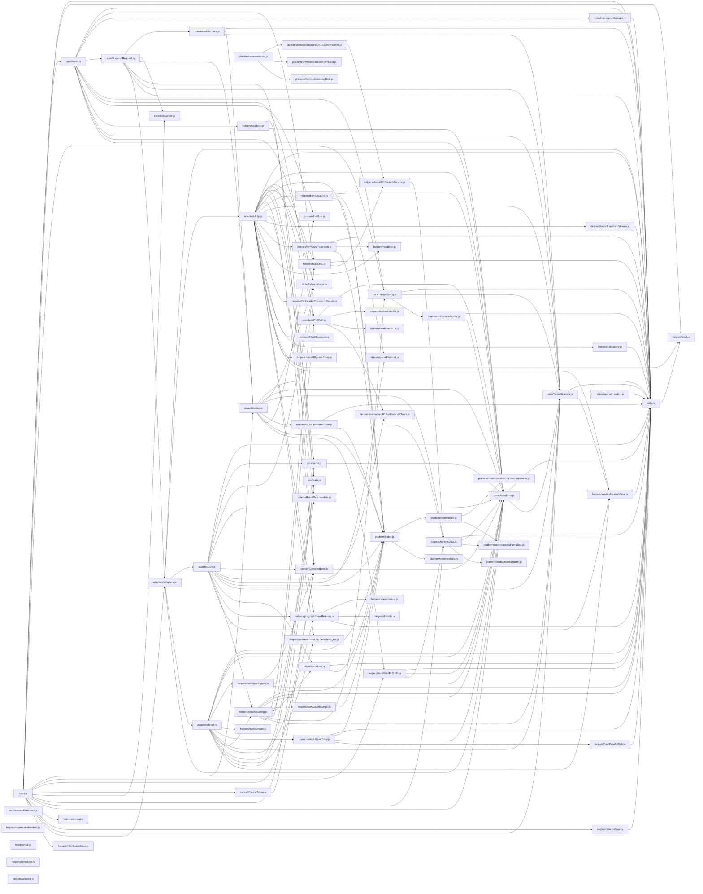

# CodeProof report

Commit: b2c8f4c90801b6c2260a43ce7550c22868a0fb82  |  run-id: f0b6d3c2b5e351ae  |  mode: smoke

**Publishing rule:** a finding appears under *Verified findings* only if every citation passed L1 and the adversarial verifier confirmed it. This checks provenance and model agreement, not semantic proof. Refuted, uncertain and moderate findings are in rejected.md.

## Summary

| Metric | Value |
|---|---|
| Files / LOC | 74 / 9564 |
| Import edges / cycles | 177 / 0 |
| Files in scanner prompt | 74 / 74 |
| Findings proposed | 8 |
| Rejected at L1 (bad citation) | 5 |
| Verified | 3 |
| Reproduced by execution (L3) | 1 |
| Patch-proven (L4, differential) | 1 |
| Moderate confidence | 0 |
| Refuted | 0 |
| Uncertain | 0 |
| Calls / retries | 8 / 0 |
| Tokens in / out | 127854 / 20801 |
| Cached input tokens | 0 |
| Cost | $0.6068 |

## Verified findings

### F-001 - critical - CancelToken cancel never sets reason due to inverted check

**Claim:** Cancel guard is inverted: when no cancellation has been requested (!token.reason) it returns early without setting reason, so cancel() never creates a CanceledError.

**Proposed by:** Muse Spark

**Evidence level:** citation-proven + adversarially-confirmed

**Execution check:** inconclusive: reproducer failed L0: controlCode assertion is not tied to a call of an imported symbol; testCode assertion is not tied to a call of an imported symbol

**Citation (from commit, lines 54-62):** cancel/CancelToken.js
```text
    executor(function cancel(message, config, request) {
      if (!token.reason) {
        // Cancellation has already been requested
        return;
      }

      token.reason = new CanceledError(message, config, request);
      resolvePromise(token.reason);
    });
```

**Verifier (muse-wonder-1.0):** confirm - The guard at cancel/CancelToken.js:55 returns early when token.reason is falsy (its initial state), so the assignment at cancel/CancelToken.js:60 is unreachable on first cancel and no CanceledError is created.

### F-005 - high - isAxiosError returns true for non-Axios objects

**Claim:** isAxiosError uses !== false so any object without isAxiosError (undefined !== false) returns true, misidentifying plain objects as Axios errors.

**Proposed by:** Muse Spark

**Evidence level:** citation-proven + adversarially-confirmed + **execution-proven (generated test fails on the analyzed commit)**

**Execution check:** reproduced by execution: the control passed 3/3 and the trigger failed 3/3 (see Reproduced by execution)

**Citation (from commit, lines 12-14):** helpers/isAxiosError.js
```text
export default function isAxiosError(payload) {
  return utils.isObject(payload) && payload.isAxiosError !== false;
}
```

**Verifier (muse-wonder-1.0):** confirm - The function at helpers/isAxiosError.js:13 returns utils.isObject(payload) && payload.isAxiosError !== false, so a plain object lacking the property yields undefined !== false and is classified as an Axios error.

### F-008 - medium - scheduler start replaces timer without clearing

**Claim:** start() overwrites this.timer with new setInterval without clearing existing handle, leaking prior interval on repeated start.

**Proposed by:** Muse Spark

**Evidence level:** citation-proven + adversarially-confirmed

**Execution check:** inconclusive: reproducer failed L0: control and trigger must use a different input: control and trigger call the shared symbol(s) with identical arguments

**Citation (from commit, lines 4-12):** helpers/scheduler.js
```text
  return {
    timer: null,
    start(callback, intervalMs) {
      this.timer = setInterval(callback, intervalMs);
    },
    stop() {
      clearInterval(this.timer);
      this.timer = null;
    }
```

**Verifier (muse-wonder-1.0):** confirm - start() at helpers/scheduler.js:7 assigns this.timer = setInterval(callback, intervalMs) without any preceding clearInterval, so a repeated start orphans the prior handle and stop() at helpers/scheduler.js:10 can only clear the latest one.

## Reproduced by execution

For each finding below, the verifier model wrote two standalone files. They run on a `git archive` snapshot of the analyzed commit inside a permission-model sandbox: no network, no writes, 2 s timeout, at least three runs each.

- **[CONTROL]** uses a clean, normal input and must pass every run. It proves the environment and the way the API is called are valid; if it fails, the finding is reported as `control-failed` and the trigger is never run.
- **[TRIGGER]** uses a different input and must fail every run with an assertion error on the analyzed commit.
- **LinkCheck** (Node 26) runs the trigger under the permission model with inspector coverage and requires that the imported symbol actually executed. Without that linkage proof the finding is not reported as execution-proven.


### F-005 - isAxiosError returns true for non-Axios objects

**Expected behavior:** isAxiosError returns false for objects that are not Axios errors and true only for Axios errors.

**Control (must pass 3/3 on the analyzed commit):**
```js
import assert from 'node:assert/strict';
import isAxiosError from './helpers/isAxiosError.js';

const result = isAxiosError({ isAxiosError: false });
assert.equal(result, false);
```

**Trigger (must fail 3/3 with an assertion error on the analyzed commit):**
```js
import assert from 'node:assert/strict';
import isAxiosError from './helpers/isAxiosError.js';

const result = isAxiosError({ message: 'plain object' });
assert.equal(result, false);
```

**LinkCheck:** proven (symbol) - the imported symbol executed under inspector coverage.

**Runner output (last of 3 attempts):**
```text
true !== false

    at file:///tmp/codeproof-repro-zdyh9Z/snapshot/.codeproof-repro.test.mjs:5:8
    at ModuleJob.run (node:internal/modules/esm/module_job:569:25)
    at async node:internal/modules/esm/loader:650:26
    at async asyncRunEntryPointWithESMLoader (node:internal/modules/run_main:101:5) {
  generatedMessage: true,
  code: 'ERR_ASSERTION',
  actual: true,
  expected: false,
  operator: 'strictEqual',
  diff: 'simple'
}

Node.js v26.8.2
```

## Patch-proven (differential proof)

For each finding below the patcher model proposed a minimal patch to one of the cited files. The patch is applied to a **copy** of the L3 snapshot (the snapshot itself is never mutated) and both phases are re-run: the control must still pass every run and the trigger must now pass every run. This is a differential result over the reproduction - it does not claim to fix the root cause, and the repository's own test suite is not run.

### F-005 - isAxiosError returns true for non-Axios objects

**Patch rationale:** Plain objects lack isAxiosError, so !== false incorrectly returns true; requiring === true preserves the false control case.

```diff
--- a/helpers/isAxiosError.js
+++ b/helpers/isAxiosError.js
@@ -13,1 +13,1 @@
-  return utils.isObject(payload) && payload.isAxiosError !== false;
+  return utils.isObject(payload) && payload.isAxiosError === true;
```

**Differential result:** control passed 3/3, trigger passed 3/3 after the patch. The repository's own test suite was not run; the patch was never written to the analyzed repository.

## Architecture

Deterministic facts only: 74 files, 9564 LOC, 177 import edges, 0 cycles. The diagram is generated from the import graph by code, never by the model.



## Limits

- Scan and verify are static: the analyzed code is never executed while the scanner and verifier run. L3 runs only the generated test, on a git-archive snapshot, inside a permission-model sandbox (no network, no writes, 2 s timeout); isolation is process-level, not OS-level.
- No completeness claim; this report shows what passed the gate, not everything that exists in the repository.
- Only direct correctness defects; omission, security and style findings are out of scope for this milestone.
- The L1 gate proves that a citation exists in the commit; the semantic match is judged by the verifier model and presented as such.

