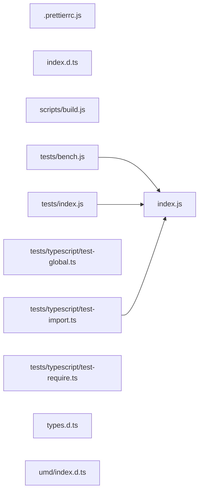

# CodeProof report

Commit: 1211e9a2213e0b3ee232a204b3ce899beebce31a  |  run-id: 56f8831fa1284062  |  mode: smoke

**Publishing rule:** a finding appears under *Verified findings* only if every citation passed L1 and the adversarial verifier confirmed it. This checks provenance and model agreement, not semantic proof. Refuted, uncertain and moderate findings are in rejected.md.

## Summary

| Metric | Value |
|---|---|
| Files / LOC | 11 / 1666 |
| Import edges / cycles | 3 / 0 |
| Files in scanner prompt | 11 / 11 |
| Findings proposed | 3 |
| Rejected at L1 (bad citation) | 0 |
| Verified | 3 |
| Reproduced by execution (L3) | 1 |
| Patch-proven (L4, differential) | 1 |
| Moderate confidence | 0 |
| Refuted | 0 |
| Uncertain | 0 |
| Calls / retries | 8 / 0 |
| Tokens in / out | 120747 / 37662 |
| Cached input tokens | 0 |
| Cost | $0.9219 |

## Verified findings

### F-001 - high - hash ignores genSalt error before calling _hash

**Claim:** hash() with numeric salt calls genSalt then unconditionally calls _hash with the salt result without checking err, so a genSalt failure is masked and _hash is invoked with undefined salt producing a different error.

**Proposed by:** Muse Spark

**Evidence level:** citation-proven + adversarially-confirmed

**Execution check:** inconclusive: reproducer failed L0: testCode assertion is not tied to a call of an imported symbol

**Citation (from commit, lines 172-176):** index.js
```text
  function _async(callback) {
    if (typeof password === "string" && typeof salt === "number")
      genSalt(salt, function (err, salt) {
        _hash(password, salt, callback, progressCallback);
      });
```

**Verifier (muse-wonder-1.0):** confirm - The callback at index.js:174-175 receives err but unconditionally calls _hash(password, salt, callback, progressCallback), and genSalt invokes callback(err) with no salt value on failure at index.js:125-126, so the original error is ignored and _hash receives undefined salt.

### F-002 - medium - genSalt throws instead of callback on illegal rounds

**Claim:** genSalt throws synchronously for non-number rounds even when a callback was supplied, while hash/compare deliver argument errors via callback; an async caller with callback gets an unexpected synchronous throw.

**Proposed by:** Muse Spark

**Evidence level:** citation-proven + adversarially-confirmed

**Execution check:** inconclusive: reproducer failed L0: controlCode assertion is not tied to a call of an imported symbol; testCode assertion is not tied to a call of an imported symbol

**Citation (from commit, lines 112-118):** index.js
```text
export function genSalt(rounds, seed_length, callback) {
  if (typeof seed_length === "function")
    (callback = seed_length), (seed_length = undefined); // Not supported.
  if (typeof rounds === "function") (callback = rounds), (rounds = undefined);
  if (typeof rounds === "undefined") rounds = GENSALT_DEFAULT_LOG2_ROUNDS;
  else if (typeof rounds !== "number")
    throw Error("illegal arguments: " + typeof rounds);
```

**Verifier (muse-wonder-1.0):** confirm - genSalt at index.js:117-118 throws synchronously for non-number rounds before the callback handling at index.js:131-134 is reached, so a supplied callback is never invoked for that argument error.

### F-003 - medium - base64_decode missing invalid check for c4

**Claim:** base64_decode breaks on invalid c1/c2/c3 but does not check c4 for -1 before OR-ing it into the output byte, producing an out-of-range byte (65535) and incrementing olen instead of stopping.

**Proposed by:** Muse Spark

**Evidence level:** citation-proven + adversarially-confirmed + **execution-proven (generated test fails on the analyzed commit)**

**Execution check:** reproduced by execution: the control passed 3/3 and the trigger failed 3/3 (see Reproduced by execution)

**Citation (from commit, lines 474-486):** index.js
```text
  while (off < slen - 1 && olen < len) {
    code = s.charCodeAt(off++);
    c1 = code < BASE64_INDEX.length ? BASE64_INDEX[code] : -1;
    code = s.charCodeAt(off++);
    c2 = code < BASE64_INDEX.length ? BASE64_INDEX[code] : -1;
    if (c1 == -1 || c2 == -1) break;
    o = (c1 << 2) >>> 0;
    o |= (c2 & 0x30) >> 4;
    rs.push(String.fromCharCode(o));
    if (++olen >= len || off >= slen) break;
    code = s.charCodeAt(off++);
    c3 = code < BASE64_INDEX.length ? BASE64_INDEX[code] : -1;
    if (c3 == -1) break;
```
**Citation (from commit, lines 491-496):** index.js
```text
    code = s.charCodeAt(off++);
    c4 = code < BASE64_INDEX.length ? BASE64_INDEX[code] : -1;
    o = ((c3 & 0x03) << 6) >>> 0;
    o |= c4;
    rs.push(String.fromCharCode(o));
    ++olen;
```

**Verifier (muse-wonder-1.0):** confirm - Confirmed at index.js:491-496: c4 is assigned -1 for invalid codes with no c4==-1 break unlike c1/c2 at index.js:479 and c3 at index.js:486, then o|=c4 yields -1, String.fromCharCode(-1) is 65535, and ++olen includes it in the result.

## Reproduced by execution

For each finding below, the verifier model wrote two standalone files. They run on a `git archive` snapshot of the analyzed commit inside a permission-model sandbox: no network, no writes, 2 s timeout, at least three runs each.

- **[CONTROL]** uses a clean, normal input and must pass every run. It proves the environment and the way the API is called are valid; if it fails, the finding is reported as `control-failed` and the trigger is never run.
- **[TRIGGER]** uses a different input and must fail every run with an assertion error on the analyzed commit.
- **LinkCheck** (Node 26) runs the trigger under the permission model with inspector coverage and requires that the imported symbol actually executed. Without that linkage proof the finding is not reported as execution-proven.


### F-003 - base64_decode missing invalid check for c4

**Expected behavior:** decodeBase64 stops at an invalid character and returns only bytes decoded before it, with all values in byte range

**Control (must pass 3/3 on the analyzed commit):**
```js
import assert from "node:assert/strict";
import { decodeBase64 } from "./index.js";
const result = decodeBase64("..!.", 3);
assert.deepEqual(result, [0]);
```

**Trigger (must fail 3/3 with an assertion error on the analyzed commit):**
```js
import assert from "node:assert/strict";
import { decodeBase64 } from "./index.js";
const result = decodeBase64("...!", 3);
assert.deepEqual(result, [0, 0]);
```

**LinkCheck:** proven (symbol) - the imported symbol executed under inspector coverage.

**Runner output (last of 3 attempts):**
```text
  ]

    at file:///tmp/codeproof-repro-ttcctM/snapshot/.codeproof-repro.test.mjs:4:8
    at ModuleJob.run (node:internal/modules/esm/module_job:569:25)
    at async node:internal/modules/esm/loader:650:26
    at async asyncRunEntryPointWithESMLoader (node:internal/modules/run_main:101:5) {
  generatedMessage: true,
  code: 'ERR_ASSERTION',
  actual: [ 0, 0, 65535 ],
  expected: [ 0, 0 ],
  operator: 'deepStrictEqual',
  diff: 'simple'
}

Node.js v26.8.2
```

## Patch-proven (differential proof)

For each finding below the patcher model proposed a minimal patch to one of the cited files. The patch is applied to a **copy** of the L3 snapshot (the snapshot itself is never mutated) and both phases are re-run: the control must still pass every run and the trigger must now pass every run. This is a differential result over the reproduction - it does not claim to fix the root cause, and the repository's own test suite is not run.

### F-003 - base64_decode missing invalid check for c4

**Patch rationale:** Add the missing c4 == -1 break in base64_decode, mirroring the existing c3 check, so an invalid fourth character stops decoding instead of producing 65535.

```diff
--- a/index.js
+++ b/index.js
@@ -492,0 +493,1 @@
+    if (c4 == -1) break;
```

**Differential result:** control passed 3/3, trigger passed 3/3 after the patch. The repository's own test suite was not run; the patch was never written to the analyzed repository.

**Warnings:** replaceBlock contains literals that also appear in the generated test (possible overfitting): 6, 0

## Architecture

Deterministic facts only: 11 files, 1666 LOC, 3 import edges, 0 cycles. The diagram is generated from the import graph by code, never by the model.



## Limits

- Scan and verify are static: the analyzed code is never executed while the scanner and verifier run. L3 runs only the generated test, on a git-archive snapshot, inside a permission-model sandbox (no network, no writes, 2 s timeout); isolation is process-level, not OS-level.
- No completeness claim; this report shows what passed the gate, not everything that exists in the repository.
- Only direct correctness defects; omission, security and style findings are out of scope for this milestone.
- The L1 gate proves that a citation exists in the commit; the semantic match is judged by the verifier model and presented as such.

