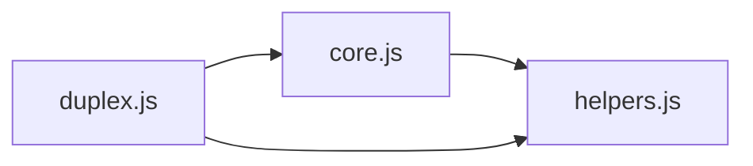

# CodeProof report

Commit: 9d313ac01916e525e9204074f06e5295edec491b  |  run-id: 4e12c16371305216  |  mode: smoke

**Publishing rule:** a finding appears under *Verified findings* only if every citation passed L1 and the adversarial verifier confirmed it. This checks provenance and model agreement, not semantic proof. Refuted, uncertain and moderate findings are in rejected.md.

## Summary

| Metric | Value |
|---|---|
| Files / LOC | 3 / 803 |
| Import edges / cycles | 3 / 0 |
| Files in scanner prompt | 3 / 3 |
| Findings proposed | 4 |
| Rejected at L1 (bad citation) | 1 |
| Verified | 3 |
| Reproduced by execution (L3) | 0 |
| Moderate confidence | 0 |
| Refuted | 0 |
| Uncertain | 0 |
| Calls / retries | 7 / 0 |
| Tokens in / out | 38456 / 29759 |
| Cached input tokens | 500 |
| Cost | $0.4997 |

## Verified findings

### F-001 - high - isInteger accepts empty string as integer

**Claim:** isInteger returns true for empty string, so array index '' is treated as integer 0 instead of invalid.

**Proposed by:** Muse Spark

**Evidence level:** citation-proven + adversarially-confirmed

**Execution check:** inconclusive: reproducer failed L0: unsupported response must not include testCode; unsupported response must not include controlCode; unsupportedReason is too short

**Citation (from commit, lines 64-77):** helpers.js
```text
function isInteger(str) {
    var i = 0;
    var len = str.length;
    var charCode;
    while (i < len) {
        charCode = str.charCodeAt(i);
        if (charCode >= 48 && charCode <= 57) {
            i++;
            continue;
        }
        return false;
    }
    return true;
}
```

**Verifier (muse-wonder-1.0):** confirm - isInteger at helpers.js:64-77 returns true for '' because the while loop never executes when len is 0, and core.js:215-219 then fails to throw OPERATION_PATH_ILLEGAL_ARRAY_INDEX and converts the key via ~~key, where ~~'' is 0.

### F-002 - high - Second observe clobbers shared mirror baseline

**Claim:** observe overwrites shared mirror.value on every new callback, discarding un-generated changes for existing observers of the same object.

**Proposed by:** Muse Spark

**Evidence level:** citation-proven + adversarially-confirmed

**Execution check:** inconclusive: reproducer failed L0: control and trigger must use a different input: control and trigger call the shared symbol(s) with identical arguments

**Citation (from commit, lines 46-59):** duplex.js
```text
    var mirror = getMirror(obj);
    if (!mirror) {
        mirror = new Mirror(obj);
        beforeDict.set(obj, mirror);
    }
    else {
        var observerInfo = getObserverFromMirror(mirror, callback);
        observer = observerInfo && observerInfo.observer;
    }
    if (observer) {
        return observer;
    }
    observer = {};
    mirror.value = helpers_js_1._deepClone(obj);
```

**Verifier (muse-wonder-1.0):** confirm - Confirmed: observe at duplex.js:46 reuses the shared mirror, returns early only for the same callback at duplex.js:55-57, otherwise unconditionally resets mirror.value at duplex.js:59, while generate at duplex.js:101-102 diffs against that shared mirror.value, so a second observer discards the first observer's un-generated diff.

### F-004 - medium - Array index truncated with double-bitwise-NOT

**Claim:** Array index conversion uses ~~key which truncates to 32-bit signed int, so large indices wrap and bypass bounds checks / address wrong element.

**Proposed by:** Muse Spark

**Evidence level:** citation-proven + adversarially-confirmed

**Execution check:** inconclusive: reproducer failed L0: unsupported response must not include testCode; unsupported response must not include controlCode; unsupportedReason is too short

**Citation (from commit, lines 214-220):** core.js
```text
                else {
                    if (validateOperation && !helpers_js_1.isInteger(key)) {
                        throw new exports.JsonPatchError("Expected an unsigned base-10 integer value, making the new referenced value the array element with the zero-based index", "OPERATION_PATH_ILLEGAL_ARRAY_INDEX", index, operation, document);
                    } // only parse key when it's an integer for `arr.prop` to work
                    else if (helpers_js_1.isInteger(key)) {
                        key = ~~key;
                    }
```

**Verifier (muse-wonder-1.0):** confirm - The conversion at core.js:219 uses ~~key, which performs ToInt32 truncation, and the add bounds check at core.js:223 compares the already-truncated key, so an index such as 4294967296 wraps to 0, evades that check, and addresses element 0 instead.

## Architecture

Deterministic facts only: 3 files, 803 LOC, 3 import edges, 0 cycles. The diagram is generated from the import graph by code, never by the model.



## Limits

- Scan and verify are static: the analyzed code is never executed while the scanner and verifier run. L3 runs only the generated test, on a git-archive snapshot, inside a permission-model sandbox (no network, no writes, 2 s timeout); isolation is process-level, not OS-level.
- No completeness claim; this report shows what passed the gate, not everything that exists in the repository.
- Only direct correctness defects; omission, security and style findings are out of scope for this milestone.
- The L1 gate proves that a citation exists in the commit; the semantic match is judged by the verifier model and presented as such.

