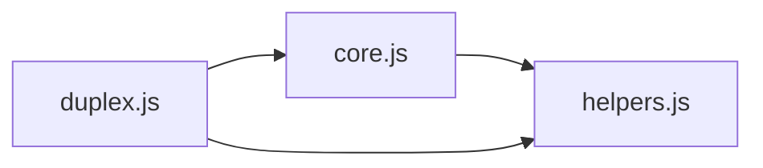

# CodeProof report

Commit: 9d313ac01916e525e9204074f06e5295edec491b  |  run-id: 4e12c16371305216  |  mode: smoke

**Publishing rule:** a finding appears under *Verified findings* only if every citation passed L1 and the adversarial verifier confirmed it. This checks provenance and model agreement, not semantic proof. Refuted, uncertain and moderate findings are in rejected.md.

## Summary

| Metric | Value |
|---|---|
| Files / LOC | 3 / 803 |
| Import edges / cycles | 3 / 0 |
| Files in scanner prompt | 3 / 3 |
| Findings proposed | 4 |
| Rejected at L1 (bad citation) | 3 |
| Verified | 1 |
| Reproduced by execution (L3) | 0 |
| Moderate confidence | 0 |
| Refuted | 0 |
| Uncertain | 0 |
| Calls / retries | 3 / 0 |
| Tokens in / out | 18333 / 18518 |
| Cached input tokens | 0 |
| Cost | $0.2514 |

## Verified findings

### F-001 - high - Null dereference on obj.toJSON in _generate

**Claim:** _generate dereferences obj.toJSON without a null check, so compare/generate with a null new value throws TypeError instead of producing a replace patch.

**Proposed by:** Muse Spark

**Evidence level:** citation-proven + adversarially-confirmed

**Execution check:** inconclusive: reproducer failed L0: controlCode assertion is not tied to a call of an imported symbol; testCode assertion is not tied to a call of an imported symbol; control and trigger must use a different input: no shared symbol is called in both codes

**Citation (from commit, lines 117-123):** duplex.js
```text
function _generate(mirror, obj, patches, path, invertible) {
    if (obj === mirror) {
        return;
    }
    if (typeof obj.toJSON === "function") {
        obj = obj.toJSON();
    }
```

**Verifier (muse-wonder-1.0):** confirm - At duplex.js:121 _generate accesses typeof obj.toJSON with only the identity guard at duplex.js:118, and compare at duplex.js:178 passes tree2 directly without validation, so a non-identical null new value throws TypeError before any replace patch is generated.

## Architecture

Deterministic facts only: 3 files, 803 LOC, 3 import edges, 0 cycles. The diagram is generated from the import graph by code, never by the model.



## Limits

- Scan and verify are static: the analyzed code is never executed while the scanner and verifier run. L3 runs only the generated test, on a git-archive snapshot, inside a permission-model sandbox (no network, no writes, 2 s timeout); isolation is process-level, not OS-level.
- No completeness claim; this report shows what passed the gate, not everything that exists in the repository.
- Only direct correctness defects; omission, security and style findings are out of scope for this milestone.
- The L1 gate proves that a citation exists in the commit; the semantic match is judged by the verifier model and presented as such.

