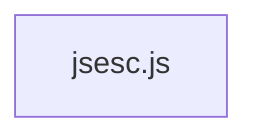

# CodeProof report

Commit: e3349b542eaaf55239cb60519991b80097cee24b  |  run-id: 1e1b03c5d8ba9776  |  mode: smoke

**Publishing rule:** a finding appears under *Verified findings* only if every citation passed L1 and the adversarial verifier confirmed it. This checks provenance and model agreement, not semantic proof. Refuted, uncertain and moderate findings are in rejected.md.

## Summary

| Metric | Value |
|---|---|
| Files / LOC | 1 / 337 |
| Import edges / cycles | 0 / 0 |
| Files in scanner prompt | 1 / 1 |
| Findings proposed | 2 |
| Rejected at L1 (bad citation) | 0 |
| Verified | 2 |
| Reproduced by execution (L3) | 2 |
| Patch-proven (L4, differential) | 2 |
| Moderate confidence | 0 |
| Refuted | 0 |
| Uncertain | 0 |
| Calls / retries | 10 / 3 |
| Tokens in / out | 32787 / 74074 |
| Cached input tokens | 7144 |
| Cost | $1.4033 |

## Verified findings

### F-001 - high - Negative numbers produce invalid hex/binary/octal literals

**Claim:** Hexadecimal/binary/octal number formatting prefixes '0x'/'0b'/'0o' directly to argument.toString(radix). For negative values this yields '0x-A' / '0b-1010' / '0o-12' instead of '-0xA' etc., and for Infinity/NaN/fractions it yields syntactically invalid literals, so the returned JS cannot be evaluated.

**Proposed by:** Muse Spark

**Evidence level:** citation-proven + adversarially-confirmed + **execution-proven (generated test fails on the analyzed commit)**

**Execution check:** reproduced by execution: the control passed 3/3 and the trigger failed 3/3 (see Reproduced by execution)

**Citation (from commit, lines 221-221):** jsesc.js
```text
				result = '0x' + hexadecimal;
```
**Citation (from commit, lines 223-223):** jsesc.js
```text
				result = '0b' + argument.toString(2);
```
**Citation (from commit, lines 225-225):** jsesc.js
```text
				result = '0o' + argument.toString(8);
```

**Verifier (muse-wonder-1.0):** confirm - The code at jsesc.js:217-225 directly prefixes '0x'/'0b'/'0o' to argument.toString(radix) with no handling for a leading '-' or for Infinity/NaN/fractional values, so -10 yields '0x-A' and Infinity yields '0xInfinity', both invalid literals, before the plain return at jsesc.js:228-231.

### F-002 - high - Negative numbers produce invalid radix literals

**Claim:** Radix number conversion places the radix prefix before the sign, producing invalid literals for negative numbers and BigInts.

**Proposed by:** Muse Wonder

**Evidence level:** citation-proven + adversarially-confirmed + **execution-proven (generated test fails on the analyzed commit)**

**Execution check:** reproduced by execution: the control passed 3/3 and the trigger failed 3/3 (see Reproduced by execution)

**Citation (from commit, lines 216-225):** jsesc.js
```text
			} else if (useHexNumbers) {
				let hexadecimal = argument.toString(16);
				if (!lowercaseHex) {
					hexadecimal = hexadecimal.toUpperCase();
				}
				result = '0x' + hexadecimal;
			} else if (useBinNumbers) {
				result = '0b' + argument.toString(2);
			} else if (useOctNumbers) {
				result = '0o' + argument.toString(8);
```

**Verifier (muse-spark-1.3):** confirm - jsesc.js:221 prefixes '0x' to argument.toString(16) from jsesc.js:217 which retains a leading '-' for negatives, producing '0x-...', with the same prefix-before-sign pattern at jsesc.js:223 and jsesc.js:225 and BigInt 'n' suffix at jsesc.js:229 preserving the invalid literal.

## Reproduced by execution

For each finding below, the verifier model wrote two standalone files. They run on a `git archive` snapshot of the analyzed commit inside a permission-model sandbox: no network, no writes, 2 s timeout, at least three runs each.

- **[CONTROL]** uses a clean, normal input and must pass every run. It proves the environment and the way the API is called are valid; if it fails, the finding is reported as `control-failed` and the trigger is never run.
- **[TRIGGER]** uses a different input and must fail every run with an assertion error on the analyzed commit.
- **LinkCheck** (Node 26) runs the trigger under the permission model with inspector coverage and requires that the imported symbol actually executed. Without that linkage proof the finding is not reported as execution-proven.


### F-001 - Negative numbers produce invalid hex/binary/octal literals

**Expected behavior:** Positive hexadecimal formatting returns a valid literal with the sign (if any) before the 0x prefix.

**Control (must pass 3/3 on the analyzed commit):**
```js
import assert from 'node:assert/strict';
import jsesc from './jsesc.js';
const result = jsesc(255, { numbers: 'hexadecimal' });
assert.equal(result, '0xFF');
```

**Trigger (must fail 3/3 with an assertion error on the analyzed commit):**
```js
import assert from 'node:assert/strict';
import jsesc from './jsesc.js';
const result = jsesc(-255, { numbers: 'hexadecimal' });
assert.equal(result, '-0xFF');
```

**LinkCheck:** proven (symbol) - the imported symbol executed under inspector coverage.

**Runner output (last of 3 attempts):**
```text
'0x-FF' !== '-0xFF'

    at file:///tmp/codeproof-repro-XvyCqz/snapshot/.codeproof-repro.test.mjs:4:8
    at ModuleJob.run (node:internal/modules/esm/module_job:569:25)
    at async node:internal/modules/esm/loader:650:26
    at async asyncRunEntryPointWithESMLoader (node:internal/modules/run_main:101:5) {
  generatedMessage: true,
  code: 'ERR_ASSERTION',
  actual: '0x-FF',
  expected: '-0xFF',
  operator: 'strictEqual',
  diff: 'simple'
}

Node.js v26.8.2
```

### F-002 - Negative numbers produce invalid radix literals

**Expected behavior:** Radix conversion places any negative sign before the radix prefix, e.g. -255 in hexadecimal is '-0xFF', not '0x-FF'.

**Control (must pass 3/3 on the analyzed commit):**
```js
import assert from 'node:assert/strict';
import jsesc from './jsesc.js';

const hex = jsesc(255, { numbers: 'hexadecimal' });
assert.equal(hex, '0xFF');
const bin = jsesc(5, { numbers: 'binary' });
assert.equal(bin, '0b101');
const oct = jsesc(8, { numbers: 'octal' });
assert.equal(oct, '0o10');
const big = jsesc(255n, { numbers: 'hexadecimal' });
assert.equal(big, '0xFFn');
```

**Trigger (must fail 3/3 with an assertion error on the analyzed commit):**
```js
import assert from 'node:assert/strict';
import jsesc from './jsesc.js';

const hex = jsesc(-255, { numbers: 'hexadecimal' });
assert.equal(hex, '-0xFF');
const bin = jsesc(-5, { numbers: 'binary' });
assert.equal(bin, '-0b101');
const oct = jsesc(-8, { numbers: 'octal' });
assert.equal(oct, '-0o10');
const big = jsesc(-255n, { numbers: 'hexadecimal' });
assert.equal(big, '-0xFFn');
```

**LinkCheck:** proven (symbol) - the imported symbol executed under inspector coverage.

**Runner output (last of 3 attempts):**
```text
'0x-FF' !== '-0xFF'

    at file:///tmp/codeproof-repro-4YvpZR/snapshot/.codeproof-repro.test.mjs:5:8
    at ModuleJob.run (node:internal/modules/esm/module_job:569:25)
    at async node:internal/modules/esm/loader:650:26
    at async asyncRunEntryPointWithESMLoader (node:internal/modules/run_main:101:5) {
  generatedMessage: true,
  code: 'ERR_ASSERTION',
  actual: '0x-FF',
  expected: '-0xFF',
  operator: 'strictEqual',
  diff: 'simple'
}

Node.js v26.8.2
```

## Patch-proven (differential proof)

For each finding below the patcher model proposed a minimal patch to one of the cited files. The patch is applied to a **copy** of the L3 snapshot (the snapshot itself is never mutated) and both phases are re-run: the control must still pass every run and the trigger must now pass every run. This is a differential result over the reproduction - it does not claim to fix the root cause, and the repository's own test suite is not run.

### F-001 - Negative numbers produce invalid hex/binary/octal literals

**Patch rationale:** Negative hex values gave '0x-FF' because the sign from toString(16) was after the prefix; moving the sign before the prefix yields '-0xFF', and non-finite/non-integer numbers fall back to decimal String() which is valid JS.

```diff
--- a/jsesc.js
+++ b/jsesc.js
@@ -221,1 +221,1 @@
-				result = '0x' + hexadecimal;
+				result = (typeof argument == 'number' && (!Number.isFinite(argument) || !Number.isInteger(argument))) ? String(argument) : hexadecimal.startsWith('-') ? '-0x' + hexadecimal.slice(1) : '0x' + hexadecimal;
```

**Differential result:** control passed 3/3, trigger passed 3/3 after the patch. The repository's own test suite was not run; the patch was never written to the analyzed repository.

### F-002 - Negative numbers produce invalid radix literals

**Patch rationale:** Negative Number/BigInt toString(radix) yields '-ff' etc., so prefixing '0x'/'0b'/'0o' creates '0x-FF'. Move the '-' before the prefix for hex, binary and octal branches, preserving positive and BigInt 'n' suffix behavior.

```diff
--- a/jsesc.js
+++ b/jsesc.js
@@ -221,5 +221,7 @@
-				result = '0x' + hexadecimal;
-			} else if (useBinNumbers) {
-				result = '0b' + argument.toString(2);
-			} else if (useOctNumbers) {
-				result = '0o' + argument.toString(8);
+				result = hexadecimal.startsWith('-') ? '-0x' + hexadecimal.slice(1) : '0x' + hexadecimal;
+			} else if (useBinNumbers) {
+				const binary = argument.toString(2);
+				result = binary.startsWith('-') ? '-0b' + binary.slice(1) : '0b' + binary;
+			} else if (useOctNumbers) {
+				const octal = argument.toString(8);
+				result = octal.startsWith('-') ? '-0o' + octal.slice(1) : '0o' + octal;
```

**Differential result:** control passed 3/3, trigger passed 3/3 after the patch. The repository's own test suite was not run; the patch was never written to the analyzed repository.

**Warnings:** replaceBlock contains literals that also appear in the generated test (possible overfitting): 1, 2, 1

## Architecture

Deterministic facts only: 1 files, 337 LOC, 0 import edges, 0 cycles. The diagram is generated from the import graph by code, never by the model.



## Limits

- Scan and verify are static: the analyzed code is never executed while the scanner and verifier run. L3 runs only the generated test, on a git-archive snapshot, inside a permission-model sandbox (no network, no writes, 2 s timeout); isolation is process-level, not OS-level.
- No completeness claim; this report shows what passed the gate, not everything that exists in the repository.
- Only direct correctness defects; omission, security and style findings are out of scope for this milestone.
- The L1 gate proves that a citation exists in the commit; the semantic match is judged by the verifier model and presented as such.

