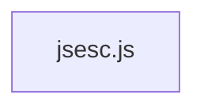

# CodeProof report

Commit: e3349b542eaaf55239cb60519991b80097cee24b  |  run-id: ea5b1ae7f3eeac48  |  mode: smoke

**Publishing rule:** a finding appears under *Verified findings* only if every citation passed L1 and the adversarial verifier confirmed it. This checks provenance and model agreement, not semantic proof. Refuted, uncertain and moderate findings are in rejected.md.

## Summary

| Metric | Value |
|---|---|
| Files / LOC | 1 / 337 |
| Import edges / cycles | 0 / 0 |
| Files in scanner prompt | 1 / 1 |
| Findings proposed | 3 |
| Rejected at L1 (bad citation) | 0 |
| Verified | 2 |
| Reproduced by execution (L3) | 1 |
| Patch-proven (L4, differential) | 1 |
| Moderate confidence | 0 |
| Refuted | 0 |
| Uncertain | 1 |
| Calls / retries | 9 / 0 |
| Tokens in / out | 28798 / 33736 |
| Cached input tokens | 0 |
| Cost | $0.6289 |

## Verified findings

### F-001 - high - Negative hex/bin/oct number prefix produces invalid literal

**Claim:** Negative numbers formatted as hexadecimal/binary/octal produce invalid literals like 0x-A instead of -0xA because the sign from toString(radix) is kept after the prefix.

**Proposed by:** Muse Spark

**Evidence level:** citation-proven + adversarially-confirmed + **execution-proven (generated test fails on the analyzed commit)**

**Execution check:** reproduced by execution: the control passed 3/3 and the trigger failed 3/3 (see Reproduced by execution)

**Citation (from commit, lines 216-225):** jsesc.js
```text
			} else if (useHexNumbers) {
				let hexadecimal = argument.toString(16);
				if (!lowercaseHex) {
					hexadecimal = hexadecimal.toUpperCase();
				}
				result = '0x' + hexadecimal;
			} else if (useBinNumbers) {
				result = '0b' + argument.toString(2);
			} else if (useOctNumbers) {
				result = '0o' + argument.toString(8);
```

**Verifier (muse-wonder-1.0):** confirm - The branch at jsesc.js:216-225 builds '0x' + argument.toString(16), '0b' + argument.toString(2), and '0o' + argument.toString(8) without moving the leading '-' before the prefix, so e.g. (-10).toString(16)='-a' yields '0x-a'/'0x-A', and the result is returned directly at jsesc.js:228-231.

### F-003 - low - Unreachable BigInt branch after combined number check

**Claim:** The second isBigInt branch can never execute because the preceding branch already matches isNumber OR isBigInt, making it dead code.

**Proposed by:** Muse Spark

**Evidence level:** citation-proven + adversarially-confirmed

**Execution check:** unavailable: Dead code has no observable behavioral effect: the branch at line 203 (isNumber || isBigInt) already handles every BigInt input, including JSON conversion and decimal/hexadecimal/binary/octal formatting with the 'n' suffix at lines 228-230, identically or more correctly than the unreachable branch at line 232. No input can produce different correct output by reaching the second branch, so a faithful execution test asserting correct BigInt behavior would pass on this commit; demonstrating the finding requires static reachability analysis, not a runtime reproducer.

**Citation (from commit, lines 203-203):** jsesc.js
```text
		} else if (isNumber(argument) || isBigInt(argument)) {
```
**Citation (from commit, lines 232-232):** jsesc.js
```text
		} else if (isBigInt(argument)) {
```

**Verifier (muse-wonder-1.0):** confirm - The else-if at jsesc.js:203 matches isNumber(argument) || isBigInt(argument), so reaching jsesc.js:232 requires that condition to be false and therefore isBigInt(argument) to be false with no intervening code, making the second isBigInt branch unreachable.

## Reproduced by execution

For each finding below, the verifier model wrote two standalone files. They run on a `git archive` snapshot of the analyzed commit inside a permission-model sandbox: no network, no writes, 2 s timeout, at least three runs each.

- **[CONTROL]** uses a clean, normal input and must pass every run. It proves the environment and the way the API is called are valid; if it fails, the finding is reported as `control-failed` and the trigger is never run.
- **[TRIGGER]** uses a different input and must fail every run with an assertion error on the analyzed commit.
- **LinkCheck** (Node 26) runs the trigger under the permission model with inspector coverage and requires that the imported symbol actually executed. Without that linkage proof the finding is not reported as execution-proven.


### F-001 - Negative hex/bin/oct number prefix produces invalid literal

**Expected behavior:** Negative numbers in non-decimal modes should place the minus sign before the prefix, e.g. jsesc(-10, {numbers:'hexadecimal'}) === '-0xA', producing a valid numeric literal.

**Control (must pass 3/3 on the analyzed commit):**
```js
import assert from 'node:assert/strict';
import jsesc from './jsesc.js';
const hexResult = jsesc(255, { numbers: 'hexadecimal' });
assert.equal(hexResult, '0xFF');
const binResult = jsesc(10, { numbers: 'binary' });
assert.equal(binResult, '0b1010');
```

**Trigger (must fail 3/3 with an assertion error on the analyzed commit):**
```js
import assert from 'node:assert/strict';
import jsesc from './jsesc.js';
const hexResult = jsesc(-10, { numbers: 'hexadecimal' });
assert.equal(hexResult, '-0xA');
const binResult = jsesc(-10, { numbers: 'binary' });
assert.equal(binResult, '-0b1010');
const octResult = jsesc(-10, { numbers: 'octal' });
assert.equal(octResult, '-0o12');
```

**LinkCheck:** proven (symbol) - the imported symbol executed under inspector coverage.

**Runner output (last of 3 attempts):**
```text
'0x-A' !== '-0xA'

    at file:///tmp/codeproof-repro-5UYzxb/snapshot/.codeproof-repro.test.mjs:4:8
    at ModuleJob.run (node:internal/modules/esm/module_job:569:25)
    at async node:internal/modules/esm/loader:650:26
    at async asyncRunEntryPointWithESMLoader (node:internal/modules/run_main:101:5) {
  generatedMessage: true,
  code: 'ERR_ASSERTION',
  actual: '0x-A',
  expected: '-0xA',
  operator: 'strictEqual',
  diff: 'simple'
}

Node.js v26.8.2
```

## Patch-proven (differential proof)

For each finding below the patcher model proposed a minimal patch to one of the cited files. The patch is applied to a **copy** of the L3 snapshot (the snapshot itself is never mutated) and both phases are re-run: the control must still pass every run and the trigger must now pass every run. This is a differential result over the reproduction - it does not claim to fix the root cause, and the repository's own test suite is not run.

### F-001 - Negative hex/bin/oct number prefix produces invalid literal

**Patch rationale:** Move the minus sign before the 0x/0b/0o prefix for negative numbers and BigInts so the output is a valid literal.

```diff
--- a/jsesc.js
+++ b/jsesc.js
@@ -221,5 +221,7 @@
-				result = '0x' + hexadecimal;
-			} else if (useBinNumbers) {
-				result = '0b' + argument.toString(2);
-			} else if (useOctNumbers) {
-				result = '0o' + argument.toString(8);
+				result = hexadecimal.startsWith('-') ? '-0x' + hexadecimal.slice(1) : '0x' + hexadecimal;
+			} else if (useBinNumbers) {
+				const binary = argument.toString(2);
+				result = binary.startsWith('-') ? '-0b' + binary.slice(1) : '0b' + binary;
+			} else if (useOctNumbers) {
+				const octal = argument.toString(8);
+				result = octal.startsWith('-') ? '-0o' + octal.slice(1) : '0o' + octal;
```

**Differential result:** control passed 3/3, trigger passed 3/3 after the patch. The repository's own test suite was not run; the patch was never written to the analyzed repository.

**Warnings:** replaceBlock contains literals that also appear in the generated test (possible overfitting): 1, 2, 1

## Architecture

Deterministic facts only: 1 files, 337 LOC, 0 import edges, 0 cycles. The diagram is generated from the import graph by code, never by the model.



## Limits

- Scan and verify are static: the analyzed code is never executed while the scanner and verifier run. L3 runs only the generated test, on a git-archive snapshot, inside a permission-model sandbox (no network, no writes, 2 s timeout); isolation is process-level, not OS-level.
- No completeness claim; this report shows what passed the gate, not everything that exists in the repository.
- Only direct correctness defects; omission, security and style findings are out of scope for this milestone.
- The L1 gate proves that a citation exists in the commit; the semantic match is judged by the verifier model and presented as such.

