# CodeProof report

Commit: 972fd2b27a036888acfcb60d6119317744fac7ee  |  run-id: 4d11c6d684b65418  |  mode: smoke

**Publishing rule:** a finding appears under *Verified findings* only if every citation passed L1 and the adversarial verifier confirmed it. This checks provenance and model agreement, not semantic proof. Refuted, uncertain and moderate findings are in rejected.md.

## Summary

| Metric | Value |
|---|---|
| Files / LOC | 80 / 2402 |
| Import edges / cycles | 11 / 0 |
| Files in scanner prompt | 80 / 80 |
| Findings proposed | 2 |
| Rejected at L1 (bad citation) | 0 |
| Verified | 2 |
| Reproduced by execution (L3) | 0 |
| Moderate confidence | 0 |
| Refuted | 0 |
| Uncertain | 0 |
| Calls / retries | 5 / 0 |
| Tokens in / out | 65067 / 25426 |
| Cached input tokens | 0 |
| Cost | $0.4756 |

## Verified findings

### F-001 - high - Context cache lookup shadows hasOwnProperty method

**Claim:** Context.lookup checks cache.hasOwnProperty(name). After caching a view key named 'hasOwnProperty', the method is shadowed by a string value, so any later lookup on the same Context throws TypeError instead of returning the value.

**Proposed by:** Muse Spark

**Evidence level:** citation-proven + adversarially-confirmed

**Execution check:** inconclusive: reproducer failed L0: controlCode assertion is not tied to a call of an imported symbol; testCode assertion is not tied to a call of an imported symbol; control and trigger must use a different input: no shared symbol is called in both codes

**Citation (from commit, lines 397-398):** mustache.js
```text
  if (cache.hasOwnProperty(name)) {
    value = cache[name];
```

**Verifier (muse-wonder-1.0):** confirm - The cache is created as a plain object literal at mustache.js:377, and lookup invokes it as cache.hasOwnProperty(name) at mustache.js:397, so once a string view value is cached under 'hasOwnProperty' it shadows Object.prototype.hasOwnProperty and any subsequent lookup on that Context attempts to call a string and throws TypeError.

### F-002 - medium - Ambiguous template cache key collides

**Claim:** Parse cache key concatenates template and tags with ':' separator, so distinct template/tags pairs (e.g. template 'foo' with tags ['bar:baz','qux'] vs template 'foo:bar' with tags ['baz','qux']) produce the same key and return wrong cached tokens.

**Proposed by:** Muse Spark

**Evidence level:** citation-proven + adversarially-confirmed

**Execution check:** inconclusive: reproducer failed L0: controlCode assertion is not tied to a call of an imported symbol; testCode assertion is not tied to a call of an imported symbol; control and trigger must use a different input: no shared symbol is called in both codes

**Citation (from commit, lines 512-512):** mustache.js
```text
  var cacheKey = template + ':' + (tags || mustache.tags).join(':');
```

**Verifier (muse-wonder-1.0):** confirm - The key at mustache.js:512 is built as template + ':' + (tags || mustache.tags).join(':') with no escaping or length prefix, so 'foo' with ['bar:baz','qux'] and 'foo:bar' with ['baz','qux'] both produce 'foo:bar:baz:qux', and mustache.js:514-518 returns the cached tokens on a hit without re-parsing.

## Architecture

Deterministic facts only: 80 files, 2402 LOC, 11 import edges, 0 cycles. The diagram is generated from the import graph by code, never by the model.

```mermaid
graph LR
  n0["mustache.js"]
  n1["spec/_files/bom_as_whitespace.js"]
  n2["test/_files/ampersand_escape.js"]
  n3["test/_files/apostrophe.js"]
  n4["test/_files/array_of_strings.js"]
  n5["test/_files/avoids_obj_prototype_in_view_cache.js"]
  n6["test/_files/backslashes.js"]
  n7["test/_files/bug_11_eating_whitespace.js"]
  n8["test/_files/bug_length_property.js"]
  n9["test/_files/changing_delimiters.js"]
  n10["test/_files/check_falsy.js"]
  n11["test/_files/cli.cjs"]
  n12["test/_files/cli.js"]
  n13["test/_files/cli_js_view_with_function.js"]
  n14["test/_files/comments.js"]
  n15["test/_files/complex.js"]
  n16["test/_files/context_lookup.js"]
  n17["test/_files/delimiters.js"]
  n18["test/_files/disappearing_whitespace.js"]
  n19["test/_files/dot_notation.js"]
  n20["test/_files/double_render.js"]
  n21["test/_files/empty_list.js"]
  n22["test/_files/empty_sections.js"]
  n23["test/_files/empty_string.js"]
  n24["test/_files/empty_template.js"]
  n25["test/_files/error_not_found.js"]
  n26["test/_files/escaped.js"]
  n27["test/_files/falsy.js"]
  n28["test/_files/falsy_array.js"]
  n29["test/_files/grandparent_context.js"]
  n30["test/_files/higher_order_sections.js"]
  n31["test/_files/implicit_iterator.js"]
  n32["test/_files/included_tag.js"]
  n33["test/_files/inverted_section.js"]
  n34["test/_files/keys_with_questionmarks.js"]
  n35["test/_files/malicious_template.js"]
  n36["test/_files/multiline_comment.js"]
  n37["test/_files/nested_dot.js"]
  n38["test/_files/nested_higher_order_sections.js"]
  n39["test/_files/nested_iterating.js"]
  n40["test/_files/nesting.js"]
  n41["test/_files/nesting_same_name.js"]
  n42["test/_files/null_lookup_array.js"]
  n43["test/_files/null_lookup_object.js"]
  n44["test/_files/null_string.js"]
  n45["test/_files/null_view.js"]
  n46["test/_files/partial_array.js"]
  n47["test/_files/partial_array_of_partials.js"]
  n48["test/_files/partial_array_of_partials_implicit.js"]
  n49["test/_files/partial_empty.js"]
  n50["test/_files/partial_template.js"]
  n51["test/_files/partial_view.js"]
  n52["test/_files/partial_whitespace.js"]
  n53["test/_files/recursion_with_same_names.js"]
  n54["test/_files/reuse_of_enumerables.js"]
  n55["test/_files/section_as_context.js"]
  n56["test/_files/section_functions_in_partials.js"]
  n57["test/_files/simple.js"]
  n58["test/_files/string_as_context.js"]
  n59["test/_files/two_in_a_row.js"]
  n60["test/_files/two_sections.js"]
  n61["test/_files/unescaped.js"]
  n62["test/_files/uses_props_from_view_prototype.js"]
  n63["test/_files/whitespace.js"]
  n64["test/_files/zero_view.js"]
  n65["test/cli-test.js"]
  n66["test/context-test.js"]
  n67["test/create-browser-suite.js"]
  n68["test/helper.js"]
  n69["test/module-systems/browser-test.js"]
  n70["test/module-systems/commonjs-test.js"]
  n71["test/module-systems/deno-test.ts"]
  n72["test/module-systems/esm-test-exports.mjs"]
  n73["test/module-systems/esm-test.mjs"]
  n74["test/mustache-spec-test.js"]
  n75["test/parse-test.js"]
  n76["test/partial-test.js"]
  n77["test/render-helper.js"]
  n78["test/render-test.js"]
  n79["test/scanner-test.js"]
  n65 --> n68
  n66 --> n68
  n67 --> n68
  n67 --> n77
  n68 --> n0
  n74 --> n68
  n75 --> n68
  n76 --> n68
  n78 --> n68
  n78 --> n77
  n79 --> n68
```



## Limits

- Scan and verify are static: the analyzed code is never executed while the scanner and verifier run. L3 runs only the generated test, on a git-archive snapshot, inside a permission-model sandbox (no network, no writes, 2 s timeout); isolation is process-level, not OS-level.
- No completeness claim; this report shows what passed the gate, not everything that exists in the repository.
- Only direct correctness defects; omission, security and style findings are out of scope for this milestone.
- The L1 gate proves that a citation exists in the commit; the semantic match is judged by the verifier model and presented as such.

