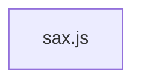

# CodeProof report

Commit: 961ceeefcc5186005466f2085aeb36f31b161e37  |  run-id: 86ed5667b2ec15cc  |  mode: smoke

**Publishing rule:** a finding appears under *Verified findings* only if every citation passed L1 and the adversarial verifier confirmed it. This checks provenance and model agreement, not semantic proof. Refuted, uncertain and moderate findings are in rejected.md.

## Summary

| Metric | Value |
|---|---|
| Files / LOC | 1 / 1866 |
| Import edges / cycles | 0 / 0 |
| Files in scanner prompt | 1 / 1 |
| Findings proposed | 3 |
| Rejected at L1 (bad citation) | 0 |
| Verified | 3 |
| Reproduced by execution (L3) | 0 |
| Moderate confidence | 0 |
| Refuted | 0 |
| Uncertain | 0 |
| Calls / retries | 8 / 0 |
| Tokens in / out | 103397 / 47650 |
| Cached input tokens | 18673 |
| Cost | $0.8008 |

## Verified findings

### F-001 - high - SGML_DECL_QUOTED never exits: parser.q never set

**Claim:** S.SGML_DECL_QUOTED is entered without setting parser.q, so the exit test `c === parser.q` can never succeed and quoted SGML declarations never terminate.

**Proposed by:** Muse Spark

**Evidence level:** citation-proven + adversarially-confirmed

**Execution check:** inconclusive: reproducer failed L0: controlCode assertion is not tied to a call of an imported symbol; testCode assertion is not tied to a call of an imported symbol; control and trigger must use a different input: no shared symbol is called in both codes

**Citation (from commit, lines 1357-1359):** sax.js
```text
          } else if (isQuote(c)) {
            parser.state = S.SGML_DECL_QUOTED
            parser.sgmlDecl += c
```
**Citation (from commit, lines 1365-1371):** sax.js
```text
        case S.SGML_DECL_QUOTED:
          if (c === parser.q) {
            parser.state = S.SGML_DECL
            parser.q = ''
          }
          parser.sgmlDecl += c
          continue
```

**Verifier (muse-wonder-1.0):** confirm - Entry at sax.js:1357-1359 transitions to S.SGML_DECL_QUOTED without assigning parser.q, while the exit at sax.js:1365-1368 requires c === parser.q, unlike the DOCTYPE path at sax.js:1382-1385 which correctly sets parser.q = c.

### F-002 - high - Valueless attribute bypasses xmlns handling

**Claim:** Valueless attribute path in ATTRIB_NAME_SAW_WHITE directly assigns parser.tag.attributes and emits onattribute, bypassing the xmlns deferred attribList/namespace handling used by attrib().

**Proposed by:** Muse Spark

**Evidence level:** citation-proven + adversarially-confirmed

**Execution check:** inconclusive: reproducer failed L0: controlCode assertion is not tied to a call of an imported symbol; testCode assertion is not tied to a call of an imported symbol; control and trigger must use a different input: no shared symbol is called in both codes

**Citation (from commit, lines 1609-1615):** sax.js
```text
            strictFail(parser, 'Attribute without value')
            parser.tag.attributes[parser.attribName] = ''
            parser.attribValue = ''
            emitNode(parser, 'onattribute', {
              name: parser.attribName,
              value: '',
            })
```
**Citation (from commit, lines 943-944):** sax.js
```text
      // so deferred events can be emitted in document order
      parser.attribList.push([parser.attribName, parser.attribValue])
```

**Verifier (muse-wonder-1.0):** confirm - The ATTRIB_NAME_SAW_WHITE branch at sax.js:1609-1615 directly assigns parser.tag.attributes and emits onattribute without calling attrib(), whereas attrib() at sax.js:903-944 performs xmlns binding handling and defers attributes via parser.attribList.push when parser.opt.xmlns is set.

### F-003 - low - Error constructed with parser object as message

**Claim:** Default state handler constructs Error with parser object as message instead of message string, losing the unknown-state diagnostic.

**Proposed by:** Muse Spark

**Evidence level:** citation-proven + adversarially-confirmed

**Execution check:** inconclusive: reproducer failed L0: controlCode assertion is not tied to a call of an imported symbol; testCode assertion is not tied to a call of an imported symbol; control and trigger must use a different input: no shared symbol is called in both codes

**Citation (from commit, lines 1797-1799):** sax.js
```text
        default: /* istanbul ignore next */ {
          throw new Error(parser, 'Unknown state: ' + parser.state)
        }
```

**Verifier (muse-wonder-1.0):** confirm - The cited line at sax.js:1798 passes parser as the first Error argument and the diagnostic string as the ignored second argument, so the Error message will be the stringified parser object rather than 'Unknown state: ...'.

## Architecture

Deterministic facts only: 1 files, 1866 LOC, 0 import edges, 0 cycles. The diagram is generated from the import graph by code, never by the model.



## Limits

- Scan and verify are static: the analyzed code is never executed while the scanner and verifier run. L3 runs only the generated test, on a git-archive snapshot, inside a permission-model sandbox (no network, no writes, 2 s timeout); isolation is process-level, not OS-level.
- No completeness claim; this report shows what passed the gate, not everything that exists in the repository.
- Only direct correctness defects; omission, security and style findings are out of scope for this milestone.
- The L1 gate proves that a citation exists in the commit; the semantic match is judged by the verifier model and presented as such.

