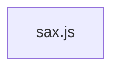

# CodeProof report

Commit: 961ceeefcc5186005466f2085aeb36f31b161e37  |  run-id: 86ed5667b2ec15cc  |  mode: smoke

**Publishing rule:** a finding appears under *Verified findings* only if every citation passed L1 and the adversarial verifier confirmed it. This checks provenance and model agreement, not semantic proof. Refuted, uncertain and moderate findings are in rejected.md.

## Summary

| Metric | Value |
|---|---|
| Files / LOC | 1 / 1866 |
| Import edges / cycles | 0 / 0 |
| Files in scanner prompt | 1 / 1 |
| Findings proposed | 4 |
| Rejected at L1 (bad citation) | 3 |
| Verified | 1 |
| Reproduced by execution (L3) | 0 |
| Moderate confidence | 0 |
| Refuted | 0 |
| Uncertain | 0 |
| Calls / retries | 3 / 0 |
| Tokens in / out | 40405 / 20358 |
| Cached input tokens | 0 |
| Cost | $0.3164 |

## Verified findings

### F-001 - high - SGML_DECL_QUOTED never exits: missing parser.q assignment

**Claim:** SGML_DECL enters SGML_DECL_QUOTED without saving the quote char to parser.q, so the exit test `c === parser.q` can never succeed and the parser stays in quoted state.

**Proposed by:** Muse Spark

**Evidence level:** citation-proven + adversarially-confirmed

**Execution check:** inconclusive: reproducer failed L0: controlCode assertion is not tied to a call of an imported symbol; testCode assertion is not tied to a call of an imported symbol; control and trigger must use a different input: no shared symbol is called in both codes

**Citation (from commit, lines 1357-1371):** sax.js
```text
          } else if (isQuote(c)) {
            parser.state = S.SGML_DECL_QUOTED
            parser.sgmlDecl += c
          } else {
            parser.sgmlDecl += c
          }
          continue

        case S.SGML_DECL_QUOTED:
          if (c === parser.q) {
            parser.state = S.SGML_DECL
            parser.q = ''
          }
          parser.sgmlDecl += c
          continue
```

**Verifier (muse-wonder-1.0):** confirm - At sax.js:1357-1359 SGML_DECL transitions to SGML_DECL_QUOTED on isQuote(c) without assigning parser.q=c, unlike sax.js:1382-1384 and sax.js:1404-1407, while the only exit at sax.js:1365-1368 requires c === parser.q and clears parser.q to '' on exit, so the quoted state cannot terminate on the opening quote.

## Architecture

Deterministic facts only: 1 files, 1866 LOC, 0 import edges, 0 cycles. The diagram is generated from the import graph by code, never by the model.



## Limits

- Scan and verify are static: the analyzed code is never executed while the scanner and verifier run. L3 runs only the generated test, on a git-archive snapshot, inside a permission-model sandbox (no network, no writes, 2 s timeout); isolation is process-level, not OS-level.
- No completeness claim; this report shows what passed the gate, not everything that exists in the repository.
- Only direct correctness defects; omission, security and style findings are out of scope for this milestone.
- The L1 gate proves that a citation exists in the commit; the semantic match is judged by the verifier model and presented as such.

