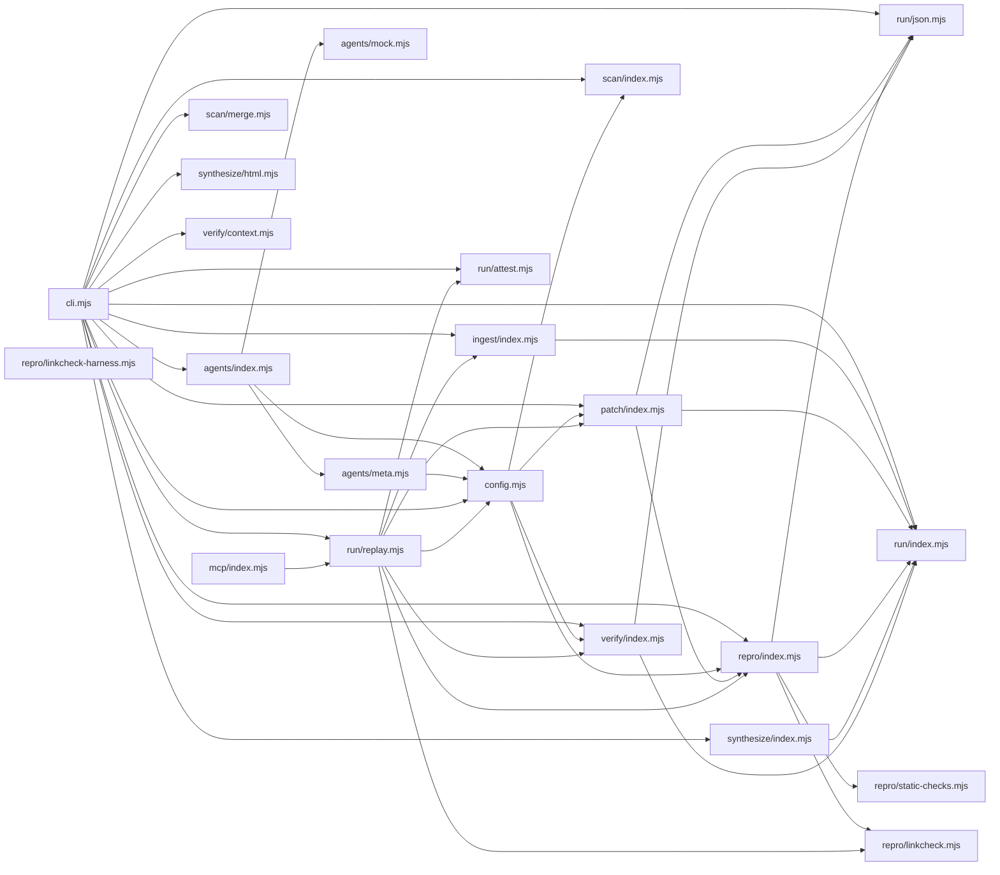

# CodeProof report

Commit: 2e7cf6d6771f1f76dc8304e55d32d80557990c95  |  run-id: 4cf698ba270f207e  |  mode: smoke

**Publishing rule:** a finding appears under *Verified findings* only if every citation passed L1 and the adversarial verifier confirmed it. This checks provenance and model agreement, not semantic proof. Refuted, uncertain and moderate findings are in rejected.md.

## Summary

| Metric | Value |
|---|---|
| Files / LOC | 22 / 4882 |
| Import edges / cycles | 42 / 0 |
| Files in scanner prompt | 22 / 22 |
| Findings proposed | 6 |
| Rejected at L1 (bad citation) | 0 |
| Verified | 5 |
| Reproduced by execution (L3) | 1 |
| Patch-proven (L4, differential) | 1 |
| Moderate confidence | 0 |
| Refuted | 0 |
| Uncertain | 1 |
| Calls / retries | 25 / 0 |
| Tokens in / out | 164937 / 155907 |
| Cached input tokens | 2500 |
| Cost | $2.2969 |

## Verified findings

### F-002 - medium - byScanner counts ignore secondary label

**Claim:** byScanner accounting only counts "spark"/"wonder"/"both" and drops findings proposed as "secondary" when models are equal, so secondary-only findings are invisible in counts and logs.

**Proposed by:** Muse Spark

**Evidence level:** citation-proven + adversarially-confirmed

**Execution check:** unavailable: byScanner is a non-exported local constant computed inline inside main() in cli.mjs (lines 433-438); cli.mjs exports only evidenceLevelFor and buildRunBanner, neither of which accepts proposedEntries or computes scanner counts. mergeScannerRuns in scan/merge.mjs only preserves proposedBy labels and does not compute byScanner, so calling it cannot expose the drop. Faithfully exercising the defect requires a full dual-scan analyze run through unexported main(), including loadConfig environment, a target repository, scanner agents/model or mock pipeline, equal scanner/secondary model configuration, and filesystem report output, which cannot be invoked through an imported exported symbol under the stated constraints.

**Citation (from commit, lines 376-376):** cli.mjs
```text
      const secondaryLabel = config.secondaryScannerModel === config.scannerModel ? "secondary" : "wonder";
```
**Citation (from commit, lines 433-438):** cli.mjs
```text
  const byScanner = {
    spark: proposedEntries.filter(function (entry) { return entry.proposedBy.indexOf("spark") !== -1; }).length,
    wonder: proposedEntries.filter(function (entry) { return entry.proposedBy.indexOf("wonder") !== -1; }).length,
    both: proposedEntries.filter(function (entry) { return entry.proposedBy.indexOf("spark") !== -1 && entry.proposedBy.indexOf("wonder") !== -1; }).length,
    controlled: proposedEntries.filter(function (entry) { return entry.proposedBy.indexOf("controlled") !== -1; }).length
  };
```

**Verifier (muse-wonder-1.0):** confirm - Confirmed: cli.mjs:376 assigns proposedBy "secondary" when the scanner models are equal, while cli.mjs:433-438 byScanner only counts "spark", "wonder", "both", and "controlled", and cli.mjs:440-444 logs only that breakdown, so secondary-only entries contribute to no byScanner count.

### F-003 - high - Prototype-polluted regex cache returns inherited value

**Claim:** wordRegex uses a plain {} as cache and tests __idRegexCache[name] directly, so inherited properties like toString, constructor, hasOwnProperty or __proto__ return a non-RegExp value and subsequent .test crashes instead of creating a fresh RegExp.

**Proposed by:** Muse Spark

**Evidence level:** citation-proven + adversarially-confirmed + **execution-proven (generated test fails on the analyzed commit)**

**Execution check:** reproduced by execution: the control passed 3/3 and the trigger failed 3/3 (see Reproduced by execution)

**Citation (from commit, lines 7-13):** repro/static-checks.mjs
```text
var __idRegexCache = {};
function wordRegex(name) {
  if (!__idRegexCache[name]) {
    __idRegexCache[name] = new RegExp("\\b" + name.replace(/[.*+?^${}()|[\]\\]/g, "\\$&") + "\\b");
  }
  return __idRegexCache[name];
}
```

**Verifier (muse-wonder-1.0):** confirm - The cache is a plain object at repro/static-checks.mjs:7 with only a truthiness guard at repro/static-checks.mjs:9, so inherited truthy properties such as toString or __proto__ bypass RegExp creation and are returned at repro/static-checks.mjs:12, after which callers invoke .test at repro/static-checks.mjs:137 and repro/static-checks.mjs:140.

### F-004 - medium - Self-comparison checked on whole file not assertions

**Claim:** hasTautology tests self-comparison against the whole file instead of assert segments, so any x===x outside an assertion is reported as a tautological assertion and causes valid reproducers to be rejected.

**Proposed by:** Muse Spark

**Evidence level:** citation-proven + adversarially-confirmed

**Execution check:** inconclusive: reproducer failed L0: unsupported response must not include testCode; unsupported response must not include controlCode; unsupportedReason is too short

**Citation (from commit, lines 112-114):** repro/static-checks.mjs
```text
export function hasTautology(code) {
  const selfCompare = new RegExp("\\b(" + IDENT + ")\\s*(?:===|!==|==|!=)\\s*\\1\\b");
  if (selfCompare.test(code)) return "self-comparison";
```

**Verifier (muse-wonder-1.0):** confirm - At repro/static-checks.mjs:112-114 hasTautology tests the selfCompare regex against the whole unscoped code argument and returns "self-comparison" before extractAssertSegments is only invoked at repro/static-checks.mjs:115 for the later checks, so any x===x outside an assert segment triggers the tautology rejection.

### F-005 - medium - Escape flag set outside string literals corrupts JSON scanning

**Claim:** firstJsonObject treats backslash as an escape even when not inside a string, so the character after an outside-string backslash is skipped and cannot toggle inString or update brace depth, corrupting object boundary detection.

**Proposed by:** Muse Spark

**Evidence level:** citation-proven + adversarially-confirmed

**Execution check:** inconclusive: empty model output

**Citation (from commit, lines 55-59):** run/json.mjs
```text
      const char = source[index];
      if (escape) { escape = false; continue; }
      if (char === "\\") { escape = true; continue; }
      if (char === '"') { inString = !inString; continue; }
      if (inString) continue;
```

**Verifier (muse-wonder-1.0):** confirm - The code at run/json.mjs:56-57 unconditionally consumes the next character and sets escape on any backslash before the quote toggle at run/json.mjs:58 and brace-depth handling at run/json.mjs:60-62, so an outside-string backslash does skip a quote or brace and corrupt boundary detection.

### F-006 - high - LinkCheck proof text emitted for non-proven statuses

**Claim:** proof suffix claims the imported symbol executed for any LinkCheck status except 'unproven', so statuses like failed/error/timeout are still reported as executed proof.

**Proposed by:** Muse Spark

**Evidence level:** citation-proven + adversarially-confirmed

**Execution check:** inconclusive: reproducer failed L0: controlCode assertion is not tied to a call of an imported symbol; testCode assertion is not tied to a call of an imported symbol

**Citation (from commit, lines 189-192):** synthesize/index.mjs
```text
        const proof = linkcheck.status === "proven" && linkcheck.method === "file"
          ? " - the cited file executed under inspector coverage."
          : " - the imported symbol executed under inspector coverage.";
        lines.push("**LinkCheck:** " + linkcheck.status + method + (linkcheck.detail ? " (" + linkcheck.detail + ")" : "") + (linkcheck.status === "unproven" ? " - reported as verified, not execution-proven." : proof));
```

**Verifier (muse-wonder-1.0):** confirm - The ternary at synthesize/index.mjs:192 appends the proof suffix for every status other than 'unproven', and 'error' is a real non-proven status produced at repro/linkcheck.mjs:93 and repro/linkcheck.mjs:101, so an error LinkCheck would be printed as 'the imported symbol executed under inspector coverage.'

## Reproduced by execution

For each finding below, the verifier model wrote two standalone files. They run on a `git archive` snapshot of the analyzed commit inside a permission-model sandbox: no network, no writes, 2 s timeout, at least three runs each.

- **[CONTROL]** uses a clean, normal input and must pass every run. It proves the environment and the way the API is called are valid; if it fails, the finding is reported as `control-failed` and the trigger is never run.
- **[TRIGGER]** uses a different input and must fail every run with an assertion error on the analyzed commit.
- **LinkCheck** (Node 26) runs the trigger under the permission model with inspector coverage and requires that the imported symbol actually executed. Without that linkage proof the finding is not reported as execution-proven.


### F-003 - Prototype-polluted regex cache returns inherited value

**Expected behavior:** assertionTiedToSymbols returns {ok:true, via:'direct', symbol:<name>} when an assert segment mentions the given symbol as a word, creating a fresh RegExp for that name.

**Control (must pass 3/3 on the analyzed commit):**
```js
import assert from 'node:assert/strict';
import { assertionTiedToSymbols } from './repro/static-checks.mjs';
const result = assertionTiedToSymbols("assert.equal(page(items), 1);", ["page"]);
assert.equal(result.ok, true);
assert.equal(result.via, "direct");
assert.equal(result.symbol, "page");
```

**Trigger (must fail 3/3 with an assertion error on the analyzed commit):**
```js
import assert from 'node:assert/strict';
import { assertionTiedToSymbols } from './repro/static-checks.mjs';
let caught = null;
var result = null;
try {
  var result = assertionTiedToSymbols("assert.equal(toString(value), 'x');", ["toString"]);
} catch (error) {
  caught = error;
}
assert.equal(result !== null && caught === null, true);
assert.equal(result?.ok, true);
assert.equal(result?.via, "direct");
assert.equal(result?.symbol, "toString");
```

**LinkCheck:** proven (symbol) - the imported symbol executed under inspector coverage.

**Runner output (last of 3 attempts):**
```text
false !== true

    at file:///tmp/codeproof-repro-sIwW93/snapshot/.codeproof-repro.test.mjs:10:8
    at ModuleJob.run (node:internal/modules/esm/module_job:569:25)
    at async node:internal/modules/esm/loader:650:26
    at async asyncRunEntryPointWithESMLoader (node:internal/modules/run_main:101:5) {
  generatedMessage: true,
  code: 'ERR_ASSERTION',
  actual: false,
  expected: true,
  operator: 'strictEqual',
  diff: 'simple'
}

Node.js v26.8.2
```

## Patch-proven (differential proof)

For each finding below the patcher model proposed a minimal patch to one of the cited files. The patch is applied to a **copy** of the L3 snapshot (the snapshot itself is never mutated) and both phases are re-run: the control must still pass every run and the trigger must now pass every run. This is a differential result over the reproduction - it does not claim to fix the root cause, and the repository's own test suite is not run.

### F-003 - Prototype-polluted regex cache returns inherited value

**Patch rationale:** Use a null-prototype cache so inherited Object.prototype members like toString are not mistaken for cached RegExps.

```diff
--- a/repro/static-checks.mjs
+++ b/repro/static-checks.mjs
@@ -7,1 +7,1 @@
-var __idRegexCache = {};
+var __idRegexCache = Object.create(null);
```

**Differential result:** control passed 3/3, trigger passed 3/3 after the patch. The repository's own test suite was not run; the patch was never written to the analyzed repository.

## Architecture

Deterministic facts only: 22 files, 4882 LOC, 42 import edges, 0 cycles. The diagram is generated from the import graph by code, never by the model.



## Limits

- Scan and verify are static: the analyzed code is never executed while the scanner and verifier run. L3 runs only the generated test, on a git-archive snapshot, inside a permission-model sandbox (no network, no writes, 2 s timeout); isolation is process-level, not OS-level.
- No completeness claim; this report shows what passed the gate, not everything that exists in the repository.
- Only direct correctness defects; omission, security and style findings are out of scope for this milestone.
- The L1 gate proves that a citation exists in the commit; the semantic match is judged by the verifier model and presented as such.

