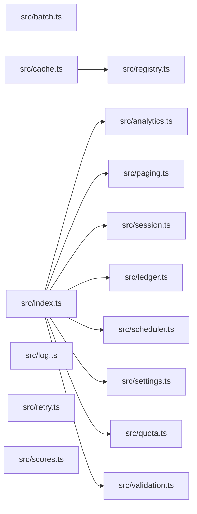

# CodeProof report

Commit: b0e656859f424771320951e6b6045a91c38c7fb4  |  run-id: 9a5a56d676fbdb2e  |  mode: bench

**Publishing rule:** a finding appears under *Verified findings* only if the deterministic citation gate (L1) passed and the adversarial verifier confirmed it. Refuted, uncertain and moderate findings are kept in separate sections - nothing is hidden, and nothing unproven is presented as verified.

## Summary

| Metric | Value |
|---|---|
| Files / LOC | 15 / 229 |
| Import edges / cycles | 9 / 0 |
| Findings proposed | 8 |
| Rejected at L1 (bad citation) | 0 |
| Verified | 8 |
| Moderate confidence | 0 |
| Refuted | 0 |
| Uncertain | 0 |
| Calls / retries | 9 / 0 |
| Tokens in / out | 26255 / 11918 |
| Cached input tokens | 4000 |
| Cost | $0.2308 |

## Verified findings

### F-001 - critical - async forEach not awaited returns empty results

**Claim:** collect uses forEach with async callback without awaiting, so it returns empty results before tasks complete and try/catch cannot observe rejections

**Citation:** src/analytics.ts:6-12
```text
    tasks.forEach(async (task) => {
      results.push(await task());
    });
  } catch (error) {
    console.error("analytics collection failed", error);
  }
  return results;
```

**Verifier (muse-wonder-1.0):** confirm - The code at src/analytics.ts:6-12 uses tasks.forEach with an async callback and immediately returns results without awaiting those callbacks, so the array is returned before awaited tasks complete and rejections bypass the try/catch at src/analytics.ts:9.

### F-002 - critical - summary aggregates global totals instead of argument

**Claim:** buildSummary posts to module-global totals then summarizes totals instead of the passed entries, so repeated calls accumulate prior entries

**Citation:** src/ledger.ts:12-18
```text
export function buildSummary(entries: Entry[]): string {
  post(entries);
  const byAccount = new Map<string, number>();
  for (const entry of totals) {
    byAccount.set(entry.account, (byAccount.get(entry.account) ?? 0) + entry.cents);
  }
```

**Verifier (muse-wonder-1.0):** confirm - Confirmed at src/ledger.ts:6 the totals array is module-global, src/ledger.ts:13 buildSummary appends via post(entries) without clearing it, and src/ledger.ts:15 it aggregates totals rather than the passed entries, so repeated calls accumulate.

### F-003 - critical - OR instead of AND makes validation always fail

**Claim:** validate uses OR instead of AND for undefined/null checks, so conditions are always true and errors are always reported

**Citation:** src/validation.ts:8-13
```text
  if (payload.id !== undefined || payload.id !== null) {
    errors.push("id is required");
  }
  if (payload.value !== undefined || payload.value !== null) {
    errors.push("value is required");
  }
```

**Verifier (muse-wonder-1.0):** confirm - At src/validation.ts:8 and src/validation.ts:11, `!== undefined || !== null` is always true because a value cannot be both undefined and null, so errors are always pushed at src/validation.ts:9 and src/validation.ts:12.

### F-004 - high - missing await on save before get

**Claim:** rotateToken does not await store.save before store.get, so read can race the write and return stale token

**Citation:** src/session.ts:6-13
```text
export async function rotateToken(
  store: SessionStore,
  userId: string,
  token: string,
): Promise<string | undefined> {
  store.save(userId, token);
  return store.get(userId);
```

**Verifier (muse-wonder-1.0):** confirm - At src/session.ts:11 store.save(userId, token) is called without await despite SessionStore.save returning Promise<void> at src/session.ts:2, and src/session.ts:12 immediately returns store.get(userId), so the read can race the write and return a stale token.

### F-005 - high - off-by-one slice returns extra element

**Claim:** pageSlice uses slice(start, end+1) where end is already start+size, returning size+1 elements instead of size

**Citation:** src/paging.ts:6-11
```text
export function pageSlice<T>(items: T[], request: PageRequest): T[] {
  const size = Math.max(1, request.size);
  const start = Math.max(0, request.page) * size;
  const end = start + size;
  return items.slice(start, end + 1);
```

**Verifier (muse-wonder-1.0):** confirm - Confirmed: at src/paging.ts:9 end is already start+size and Array.slice's end is exclusive, so src/paging.ts:10 slice(start, end+1) returns up to size+1 elements instead of size.

### F-006 - high - numeric sort without comparator

**Claim:** sortScores calls sort without numeric comparator, so numbers sort lexicographically (e.g. 10 before 9)

**Citation:** src/scores.ts:1-3
```text
export function sortScores(scores: number[]): number[] {
  return scores.slice().sort();
}
```

**Verifier (muse-wonder-1.0):** confirm - The code at src/scores.ts:2 calls scores.slice().sort() with no comparator, so JavaScript's default string conversion sorts numbers lexicographically (e.g. 10 before 9).

### F-007 - high - exclusive quota check contradicts inclusive max

**Claim:** withinQuota uses strict < but documented max is inclusive, so exact-max requests are incorrectly rejected; should be <=

**Citation:** src/quota.ts:1-6
```text
/**
 * Returns true when the request fits. Max is inclusive: a request that uses
 * exactly the maximum is still within quota.
 */
export function withinQuota(used: number, amount: number, max: number): boolean {
  return used + amount < max;
```

**Verifier (muse-wonder-1.0):** confirm - The documentation at src/quota.ts:2-3 states max is inclusive and exact-max use is within quota, but src/quota.ts:6 returns used + amount < max, so an exact-max request returns false.

### F-008 - medium - OR fallback discards legitimate zero

**Claim:** normalizeSettings uses || fallback so legitimate 0 values become 20/1000; should use ??

**Citation:** src/settings.ts:11-15
```text
export function normalizeSettings(raw: RawSettings): Settings {
  return {
    pageSize: raw.pageSize || 20,
    budgetCents: raw.budgetCents || 1000,
  };
```
**Citation:** src/settings.ts:18-18
```text
// Optional values are read from settings where 0 is a legitimate value.
```

**Verifier (muse-wonder-1.0):** confirm - The code at src/settings.ts:13-14 uses `raw.pageSize || 20` and `raw.budgetCents || 1000`, so 0 is falsy and is replaced, while src/settings.ts:18 states 0 is a legitimate value for settings.

## Architecture

Deterministic facts only: 15 files, 229 LOC, 9 import edges, 0 cycles. The diagram is generated from the import graph by code, never by the model.



## Limits

- Static analysis only: the analyzed code is never executed.
- No completeness claim; this report shows what passed the gate, not everything that exists in the repository.
- Only direct correctness defects; omission, security and style findings are out of scope for this milestone.
- The L1 gate proves that a citation exists in the commit; the semantic match is judged by the verifier model and presented as such.

