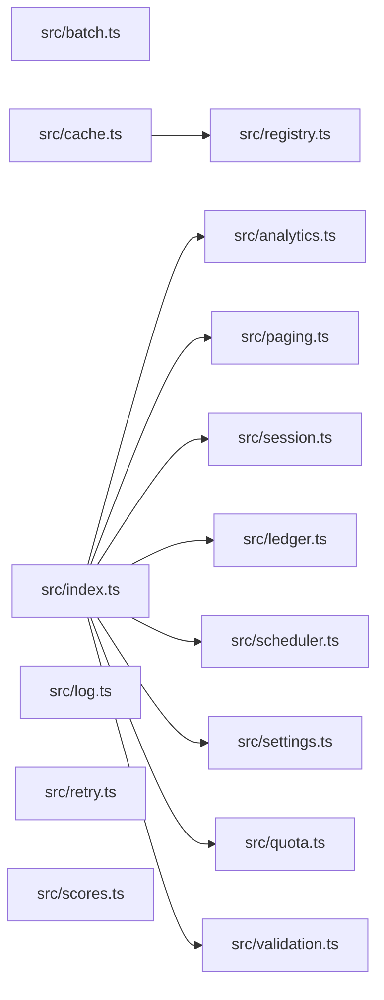

# CodeProof report

Commit: d0cde392d0a519158af04866e446d65b96ebd52f  |  run-id: a17a5b3e9aa004ff  |  mode: bench

**Publishing rule:** a finding appears under *Verified findings* only if the deterministic citation gate (L1) passed and the adversarial verifier confirmed it. Refuted, uncertain and moderate findings are kept in separate sections - nothing is hidden, and nothing unproven is presented as verified.

## Summary

| Metric | Value |
|---|---|
| Files / LOC | 15 / 229 |
| Import edges / cycles | 9 / 0 |
| Findings proposed | 9 |
| Rejected at L1 (bad citation) | 0 |
| Verified | 9 |
| Moderate confidence | 0 |
| Refuted | 0 |
| Uncertain | 0 |
| Calls / retries | 10 / 0 |
| Tokens in / out | 29408 / 14705 |
| Cached input tokens | 3500 |
| Cost | $0.2777 |

## Verified findings

### F-001 - critical - validation condition always true

**Claim:** validate uses `!== undefined || !== null` which is always true, so it always reports "id is required" and "value is required" even for complete payloads.

**Citation:** src/validation.ts:6-15
```text
export function validate(payload: Payload): string[] {
  const errors: string[] = [];
  if (payload.id !== undefined || payload.id !== null) {
    errors.push("id is required");
  }
  if (payload.value !== undefined || payload.value !== null) {
    errors.push("value is required");
  }
  return errors;
}
```

**Verifier (muse-wonder-1.0):** confirm - The conditions at src/validation.ts:8 and src/validation.ts:11 use `!== undefined || !== null`, which is tautologically true since a value cannot be both undefined and null, so both errors are always pushed even for complete payloads.

### F-002 - critical - async forEach never awaited

**Claim:** collect uses forEach with an async callback and returns immediately, so results is always empty and async errors are never caught.

**Citation:** src/analytics.ts:3-13
```text
export async function collect(tasks: Task[]): Promise<number[]> {
  const results: number[] = [];
  try {
    tasks.forEach(async (task) => {
      results.push(await task());
    });
  } catch (error) {
    console.error("analytics collection failed", error);
  }
  return results;
}
```

**Verifier (muse-wonder-1.0):** confirm - The code at src/analytics.ts:6 uses tasks.forEach with an async callback whose awaited pushes at src/analytics.ts:7 are not awaited by collect, which returns results immediately at src/analytics.ts:12, and the surrounding try/catch at src/analytics.ts:5 cannot catch the discarded async callback rejections.

### F-003 - critical - module accumulator double-counts

**Claim:** buildSummary appends to module-level totals then sums totals, so repeated calls double-count prior entries.

**Citation:** src/ledger.ts:6-19
```text
const totals: Entry[] = [];

export function post(entries: Entry[]): void {
  for (const entry of entries) totals.push(entry);
}

export function buildSummary(entries: Entry[]): string {
  post(entries);
  const byAccount = new Map<string, number>();
  for (const entry of totals) {
    byAccount.set(entry.account, (byAccount.get(entry.account) ?? 0) + entry.cents);
  }
  return [...byAccount.entries()].map(([account, cents]) => account + "=" + cents).join(",");
}
```

**Verifier (muse-wonder-1.0):** confirm - Confirmed: buildSummary at src/ledger.ts:12-15 calls post(entries) which pushes onto the module-level totals at src/ledger.ts:6-9, then sums all of totals without resetting, so a second call re-includes entries from the first call.

### F-004 - critical - missing await on save before read

**Claim:** rotateToken does not await store.save before store.get, so the read can return the stale token.

**Citation:** src/session.ts:6-13
```text
export async function rotateToken(
  store: SessionStore,
  userId: string,
  token: string,
): Promise<string | undefined> {
  store.save(userId, token);
  return store.get(userId);
}
```

**Verifier (muse-wonder-1.0):** confirm - At src/session.ts:11 store.save(userId, token) is called without await despite SessionStore.save returning Promise<void> at src/session.ts:2, and src/session.ts:12 immediately returns store.get(userId), so the read can race the pending save and return the stale token.

### F-005 - high - timer handle replaced without clear

**Claim:** start overwrites this.timer with a new setInterval without clearing the existing interval, leaking the prior timer.

**Citation:** src/scheduler.ts:3-11
```text
export class Scheduler {
  private timer: NodeJS.Timeout | null = null;
  private readonly ticks: Tick[] = [];

  start(intervalMs: number): void {
    this.timer = setInterval(() => {
      for (const tick of this.ticks) tick();
    }, intervalMs);
  }
```

**Verifier (muse-wonder-1.0):** confirm - The start method at src/scheduler.ts:7-11 unconditionally assigns this.timer = setInterval(...) with no clearInterval call or null guard, and no stop method exists in src/scheduler.ts:3-20, so a second call loses the prior timer handle.

### F-006 - high - page slice off-by-one

**Claim:** pageSlice uses slice(start, end + 1) where end is start+size, returning size+1 elements instead of size.

**Citation:** src/paging.ts:6-11
```text
export function pageSlice<T>(items: T[], request: PageRequest): T[] {
  const size = Math.max(1, request.size);
  const start = Math.max(0, request.page) * size;
  const end = start + size;
  return items.slice(start, end + 1);
}
```

**Verifier (muse-wonder-1.0):** confirm - Confirmed at src/paging.ts:9-10: end is start+size and slice(start, end+1) is end-exclusive, so it returns up to size+1 elements instead of size.

### F-007 - high - numeric sort uses lexicographic order

**Claim:** sortScores uses default Array.sort without numeric comparator, sorting numbers lexicographically and breaking topScore.

**Citation:** src/scores.ts:1-3
```text
export function sortScores(scores: number[]): number[] {
  return scores.slice().sort();
}
```

**Verifier (muse-wonder-1.0):** confirm - The code at src/scores.ts:2 uses scores.slice().sort() with no comparator, so JavaScript sorts numbers as strings, and topScore at src/scores.ts:5-7 returns the last element, which will not be the numeric maximum for multi-digit values.

### F-008 - medium - inclusive quota uses strict less-than

**Claim:** withinQuota uses `< max` while the contract states max is inclusive, rejecting requests that exactly fill quota.

**Citation:** src/quota.ts:1-6
```text
/**
 * Returns true when the request fits. Max is inclusive: a request that uses
 * exactly the maximum is still within quota.
 */
export function withinQuota(used: number, amount: number, max: number): boolean {
  return used + amount < max;
}
```

**Verifier (muse-wonder-1.0):** confirm - The contract at src/quota.ts:2 states max is inclusive, but src/quota.ts:6 returns used + amount < max, so an exact-fill request returns false.

### F-009 - medium - falsy default replaces legitimate zero

**Claim:** normalizeSettings uses `||` for defaults, so legitimate 0 values for pageSize/budgetCents are replaced with defaults.

**Citation:** src/settings.ts:11-16
```text
export function normalizeSettings(raw: RawSettings): Settings {
  return {
    pageSize: raw.pageSize || 20,
    budgetCents: raw.budgetCents || 1000,
  };
}
```
**Citation:** src/settings.ts:18-18
```text
// Optional values are read from settings where 0 is a legitimate value.
```

**Verifier (muse-wonder-1.0):** confirm - The code at src/settings.ts:13-14 uses `raw.pageSize || 20` and `raw.budgetCents || 1000`, so a legitimate 0 is falsy and is replaced by the default, consistent with the note at src/settings.ts:18 that 0 is a legitimate value.

## Architecture

Deterministic facts only: 15 files, 229 LOC, 9 import edges, 0 cycles. The diagram is generated from the import graph by code, never by the model.



## Limits

- Static analysis only: the analyzed code is never executed.
- No completeness claim; this report shows what passed the gate, not everything that exists in the repository.
- Only direct correctness defects; omission, security and style findings are out of scope for this milestone.
- The L1 gate proves that a citation exists in the commit; the semantic match is judged by the verifier model and presented as such.

