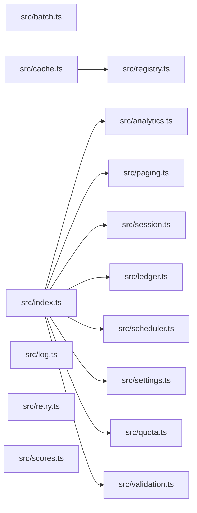

# CodeProof report

Commit: 06ab5f8dbcf2c8210492b49efe4f251147cb13d5  |  run-id: 231fc717dc282c88  |  mode: bench

**Publishing rule:** a finding appears under *Verified findings* only if every citation passed L1 and the adversarial verifier confirmed it. This checks provenance and model agreement, not semantic proof. Refuted, uncertain and moderate findings are in rejected.md.

## Summary

| Metric | Value |
|---|---|
| Files / LOC | 15 / 229 |
| Import edges / cycles | 9 / 0 |
| Findings proposed | 9 |
| Rejected at L1 (bad citation) | 1 |
| Verified | 8 |
| Moderate confidence | 0 |
| Refuted | 0 |
| Uncertain | 0 |
| Calls / retries | 9 / 0 |
| Tokens in / out | 18974 / 15892 |
| Cached input tokens | 2000 |
| Cost | $0.2947 |

## Verified findings

### F-001 - critical - async forEach never awaited returns empty results

**Claim:** collect uses forEach with an async callback and returns immediately, so results is always empty and async errors are never caught.

**Evidence level:** citation-proven + adversarially-confirmed

**Citation (from commit, lines 3-13):** src/analytics.ts
```text
export async function collect(tasks: Task[]): Promise<number[]> {
  const results: number[] = [];
  try {
    tasks.forEach(async (task) => {
      results.push(await task());
    });
  } catch (error) {
    console.error("analytics collection failed", error);
  }
  return results;
}
```

**Verifier (muse-wonder-1.0):** confirm - The code at src/analytics.ts:6 uses tasks.forEach with an async callback whose awaited pushes at src/analytics.ts:7 are not awaited by collect, which returns the still-unpopulated results array at src/analytics.ts:12, and the surrounding try/catch at src/analytics.ts:5 cannot catch the callbacks' later async rejections.

### F-002 - critical - validation condition always true

**Claim:** validate uses || instead of && so each condition is always true and every payload reports missing id and value.

**Evidence level:** citation-proven + adversarially-confirmed

**Citation (from commit, lines 6-15):** src/validation.ts
```text
export function validate(payload: Payload): string[] {
  const errors: string[] = [];
  if (payload.id !== undefined || payload.id !== null) {
    errors.push("id is required");
  }
  if (payload.value !== undefined || payload.value !== null) {
    errors.push("value is required");
  }
  return errors;
}
```

**Verifier (muse-wonder-1.0):** confirm - The conditions at src/validation.ts:8 and src/validation.ts:11 use !== undefined || !== null, which is tautologically true for any value, so both errors are always pushed for every payload.

### F-003 - critical - module accumulator makes repeated summary double-count

**Claim:** buildSummary appends to module-level totals on every call then summarizes totals, so a second call double-counts prior entries.

**Evidence level:** citation-proven + adversarially-confirmed

**Citation (from commit, lines 6-19):** src/ledger.ts
```text
const totals: Entry[] = [];

export function post(entries: Entry[]): void {
  for (const entry of entries) totals.push(entry);
}

export function buildSummary(entries: Entry[]): string {
  post(entries);
  const byAccount = new Map<string, number>();
  for (const entry of totals) {
    byAccount.set(entry.account, (byAccount.get(entry.account) ?? 0) + entry.cents);
  }
  return [...byAccount.entries()].map(([account, cents]) => account + "=" + cents).join(",");
}
```

**Verifier (muse-wonder-1.0):** confirm - buildSummary at src/ledger.ts:12-15 calls post(entries), which pushes onto the module-level totals declared at src/ledger.ts:6-9, and then iterates totals rather than only its argument with no reset inside buildSummary, so a second call re-includes prior entries.

### F-004 - high - missing await on async save before read

**Claim:** rotateToken does not await store.save before store.get, so the read can race the write and return a stale token.

**Evidence level:** citation-proven + adversarially-confirmed

**Citation (from commit, lines 6-13):** src/session.ts
```text
export async function rotateToken(
  store: SessionStore,
  userId: string,
  token: string,
): Promise<string | undefined> {
  store.save(userId, token);
  return store.get(userId);
}
```

**Verifier (muse-wonder-1.0):** confirm - Confirmed: store.save returns Promise<void> at src/session.ts:2 but is called without await at src/session.ts:11 before store.get is returned at src/session.ts:12, so the read can race the pending write.

### F-005 - high - interval handle replaced without clearing

**Claim:** start replaces this.timer with a new setInterval without clearing any existing interval, leaking the prior timer.

**Evidence level:** citation-proven + adversarially-confirmed

**Citation (from commit, lines 4-11):** src/scheduler.ts
```text
  private timer: NodeJS.Timeout | null = null;
  private readonly ticks: Tick[] = [];

  start(intervalMs: number): void {
    this.timer = setInterval(() => {
      for (const tick of this.ticks) tick();
    }, intervalMs);
  }
```

**Verifier (muse-wonder-1.0):** confirm - The code at src/scheduler.ts:7-11 assigns this.timer = setInterval(...) with no preceding clearInterval or guard, so a second start() call orphans the prior interval handle.

### F-006 - high - numeric sort without comparator

**Claim:** sort without a comparator sorts numbers lexicographically, so sortScores and topScore return wrong order.

**Evidence level:** citation-proven + adversarially-confirmed

**Citation (from commit, lines 1-3):** src/scores.ts
```text
export function sortScores(scores: number[]): number[] {
  return scores.slice().sort();
}
```

**Verifier (muse-wonder-1.0):** confirm - The code at src/scores.ts:2 calls scores.slice().sort() with no comparator, so JavaScript sorts numbers lexicographically, and topScore at src/scores.ts:7 returns the last element of that incorrectly ordered array.

### F-007 - high - page slice off-by-one returns extra item

**Claim:** pageSlice slices to end+1 instead of end, returning size+1 elements per page.

**Evidence level:** citation-proven + adversarially-confirmed

**Citation (from commit, lines 6-11):** src/paging.ts
```text
export function pageSlice<T>(items: T[], request: PageRequest): T[] {
  const size = Math.max(1, request.size);
  const start = Math.max(0, request.page) * size;
  const end = start + size;
  return items.slice(start, end + 1);
}
```

**Verifier (muse-wonder-1.0):** confirm - At src/paging.ts:9 end is start+size and at src/paging.ts:10 slice(start, end+1) is returned, so the exclusive slice bound yields size+1 elements when available.

### F-009 - medium - falsy fallback discards legitimate zero

**Claim:** normalizeSettings uses || fallback so legitimate 0 values are replaced by defaults, contradicting the stated 0-is-legitimate rule.

**Evidence level:** citation-proven + adversarially-confirmed

**Citation (from commit, lines 11-18):** src/settings.ts
```text
export function normalizeSettings(raw: RawSettings): Settings {
  return {
    pageSize: raw.pageSize || 20,
    budgetCents: raw.budgetCents || 1000,
  };
}

// Optional values are read from settings where 0 is a legitimate value.
```

**Verifier (muse-wonder-1.0):** confirm - normalizeSettings at src/settings.ts:13-14 uses `raw.pageSize || 20` and `raw.budgetCents || 1000`, so an input of 0 is replaced by the default, while src/settings.ts:18 states 0 is a legitimate value and src/settings.ts:20-21 shows the correct null-only fallback pattern.

## Architecture

Deterministic facts only: 15 files, 229 LOC, 9 import edges, 0 cycles. The diagram is generated from the import graph by code, never by the model.



## Limits

- Static analysis only: the analyzed code is never executed.
- No completeness claim; this report shows what passed the gate, not everything that exists in the repository.
- Only direct correctness defects; omission, security and style findings are out of scope for this milestone.
- The L1 gate proves that a citation exists in the commit; the semantic match is judged by the verifier model and presented as such.

