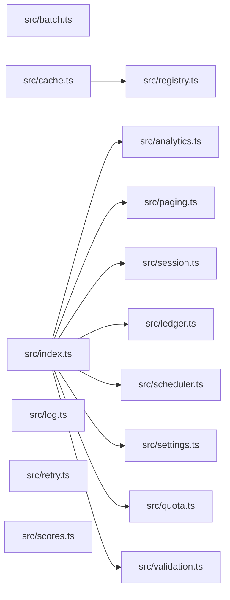

# CodeProof report

Commit: 95c324339300d5a7e05b74fe237f385bcf99a28f  |  run-id: 26ab3dd52bcd1e4f  |  mode: bench

**Publishing rule:** a finding appears under *Verified findings* only if the deterministic citation gate (L1) passed and the adversarial verifier confirmed it. Refuted, uncertain and moderate findings are kept in separate sections - nothing is hidden, and nothing unproven is presented as verified.

## Summary

| Metric | Value |
|---|---|
| Files / LOC | 15 / 229 |
| Import edges / cycles | 9 / 0 |
| Findings proposed | 9 |
| Rejected at L1 (bad citation) | 0 |
| Verified | 9 |
| Moderate confidence | 0 |
| Refuted | 0 |
| Uncertain | 0 |
| Calls / retries | 10 / 0 |
| Tokens in / out | 20873 / 13893 |
| Cached input tokens | 6801 |
| Cost | $0.2190 |

## Verified findings

### F-001 - critical - validate condition always true

**Claim:** validate uses !== with || so each condition is always true and valid payloads always report errors.

**Citation:** src/validation.ts:6-15
```text
export function validate(payload: Payload): string[] {
  const errors: string[] = [];
  if (payload.id !== undefined || payload.id !== null) {
    errors.push("id is required");
  }
  if (payload.value !== undefined || payload.value !== null) {
    errors.push("value is required");
  }
  return errors;
}
```

**Verifier (muse-wonder-1.0):** confirm - The conditions at src/validation.ts:8 and src/validation.ts:11 use !== undefined || !== null, which is tautologically true for any value, so both errors are always pushed even for valid payloads.

### F-002 - critical - ledger summary accumulates across calls

**Claim:** buildSummary pushes into module-level totals then summarizes totals, so repeated calls double-count prior entries.

**Citation:** src/ledger.ts:6-19
```text
const totals: Entry[] = [];

export function post(entries: Entry[]): void {
  for (const entry of entries) totals.push(entry);
}

export function buildSummary(entries: Entry[]): string {
  post(entries);
  const byAccount = new Map<string, number>();
  for (const entry of totals) {
    byAccount.set(entry.account, (byAccount.get(entry.account) ?? 0) + entry.cents);
  }
  return [...byAccount.entries()].map(([account, cents]) => account + "=" + cents).join(",");
}
```

**Verifier (muse-wonder-1.0):** confirm - buildSummary at src/ledger.ts:12-15 calls post(entries), which pushes into the module-level totals at src/ledger.ts:6-9, then iterates all of totals with no reset inside buildSummary, so a second call re-summarizes entries from the first call.

### F-003 - high - rotateToken missing await on save

**Claim:** rotateToken does not await store.save before store.get, so the read can race the write.

**Citation:** src/session.ts:6-13
```text
export async function rotateToken(
  store: SessionStore,
  userId: string,
  token: string,
): Promise<string | undefined> {
  store.save(userId, token);
  return store.get(userId);
}
```

**Verifier (muse-wonder-1.0):** confirm - At src/session.ts:2 save returns Promise<void>, but src/session.ts:11 calls store.save without await before src/session.ts:12 returns store.get(userId), so the read can race the unfinished write.

### F-004 - high - collect does not await tasks

**Claim:** collect uses forEach with async callback and returns immediately, so results is returned before tasks complete.

**Citation:** src/analytics.ts:3-13
```text
export async function collect(tasks: Task[]): Promise<number[]> {
  const results: number[] = [];
  try {
    tasks.forEach(async (task) => {
      results.push(await task());
    });
  } catch (error) {
    console.error("analytics collection failed", error);
  }
  return results;
}
```

**Verifier (muse-wonder-1.0):** confirm - Confirmed: src/analytics.ts:6 uses tasks.forEach with an async callback whose returned promises are discarded, and src/analytics.ts:12 returns results synchronously without awaiting them, so the array is returned before awaited task pushes at src/analytics.ts:7 complete.

### F-005 - high - Scheduler start replaces timer without clear

**Claim:** start overwrites this.timer with a new setInterval without clearing an existing interval, leaking the prior timer.

**Citation:** src/scheduler.ts:3-11
```text
export class Scheduler {
  private timer: NodeJS.Timeout | null = null;
  private readonly ticks: Tick[] = [];

  start(intervalMs: number): void {
    this.timer = setInterval(() => {
      for (const tick of this.ticks) tick();
    }, intervalMs);
  }
```

**Verifier (muse-wonder-1.0):** confirm - Confirmed at src/scheduler.ts:7-11: start() directly assigns this.timer = setInterval(...) with no prior clearInterval or running guard, and no stop/clear method exists in src/scheduler.ts:13-20, so a second call orphans the previous interval.

### F-006 - high - numeric sort uses default lexicographic order

**Claim:** sort without comparator sorts lexicographically, so numeric scores order incorrectly and topScore can be wrong.

**Citation:** src/scores.ts:1-3
```text
export function sortScores(scores: number[]): number[] {
  return scores.slice().sort();
}
```

**Verifier (muse-wonder-1.0):** confirm - The code at src/scores.ts:2 calls scores.slice().sort() with no comparator, which sorts numbers lexicographically as strings in JavaScript, and topScore at src/scores.ts:7 returns the last sorted element, so the maximum can be incorrect.

### F-007 - medium - pageSlice off-by-one returns extra item

**Claim:** pageSlice uses slice(start, end + 1) where end is already start+size, returning size+1 items instead of one page.

**Citation:** src/paging.ts:6-11
```text
export function pageSlice<T>(items: T[], request: PageRequest): T[] {
  const size = Math.max(1, request.size);
  const start = Math.max(0, request.page) * size;
  const end = start + size;
  return items.slice(start, end + 1);
}
```

**Verifier (muse-wonder-1.0):** confirm - Confirmed: at src/paging.ts:9 end is already start+size (exclusive bound for slice), so src/paging.ts:10 slice(start, end + 1) returns size+1 items when available.

### F-008 - medium - withinQuota excludes inclusive max

**Claim:** withinQuota uses < while documented max is inclusive, so used+amount exactly equal to max is wrongly rejected.

**Citation:** src/quota.ts:1-6
```text
/**
 * Returns true when the request fits. Max is inclusive: a request that uses
 * exactly the maximum is still within quota.
 */
export function withinQuota(used: number, amount: number, max: number): boolean {
  return used + amount < max;
}
```

**Verifier (muse-wonder-1.0):** confirm - At src/quota.ts:2-3 max is documented as inclusive, but src/quota.ts:6 uses strict <, so used+amount == max returns false.

### F-009 - medium - normalizeSettings treats 0 as missing

**Claim:** normalizeSettings uses || so explicit 0 is replaced by defaults, while 0 is documented as legitimate.

**Citation:** src/settings.ts:11-16
```text
export function normalizeSettings(raw: RawSettings): Settings {
  return {
    pageSize: raw.pageSize || 20,
    budgetCents: raw.budgetCents || 1000,
  };
}
```
**Citation:** src/settings.ts:18-22
```text
// Optional values are read from settings where 0 is a legitimate value.
export function optionalLimit(value: number | null | undefined, fallback: number): number {
  if (value == null) return fallback;
  return value;
}
```

**Verifier (muse-wonder-1.0):** confirm - normalizeSettings at src/settings.ts:13-14 uses || so an explicit 0 is replaced by 20/1000, contradicting src/settings.ts:18 stating 0 is a legitimate settings value and the null-only fallback pattern at src/settings.ts:20.

## Architecture

Deterministic facts only: 15 files, 229 LOC, 9 import edges, 0 cycles. The diagram is generated from the import graph by code, never by the model.



## Limits

- Static analysis only: the analyzed code is never executed.
- No completeness claim; this report shows what passed the gate, not everything that exists in the repository.
- Only direct correctness defects; omission, security and style findings are out of scope for this milestone.
- The L1 gate proves that a citation exists in the commit; the semantic match is judged by the verifier model and presented as such.

