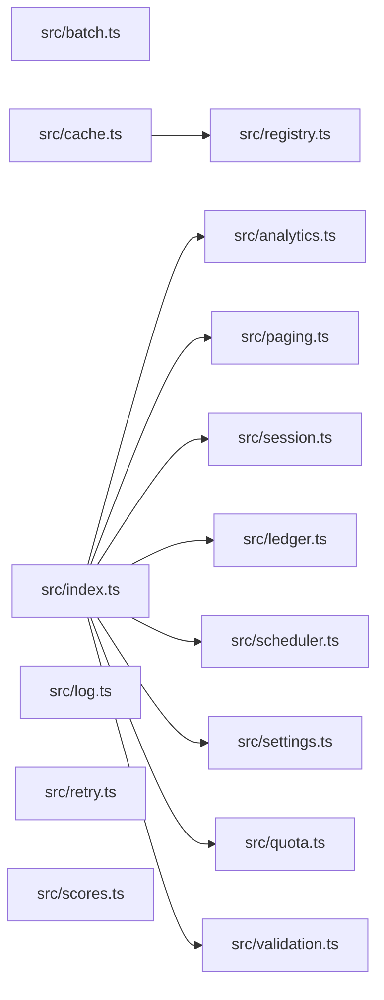

# CodeProof report

Commit: 8b690c77a5814bde3b0396e34a1470062d440a13  |  run-id: de7a1ccf9801a77f  |  mode: bench

**Publishing rule:** a finding appears under *Verified findings* only if every citation passed L1 and the adversarial verifier confirmed it. This checks provenance and model agreement, not semantic proof. Refuted, uncertain and moderate findings are in rejected.md.

## Summary

| Metric | Value |
|---|---|
| Files / LOC | 15 / 229 |
| Import edges / cycles | 9 / 0 |
| Findings proposed | 9 |
| Rejected at L1 (bad citation) | 0 |
| Verified | 9 |
| Reproduced by execution (L3) | 9 |
| Moderate confidence | 0 |
| Refuted | 0 |
| Uncertain | 0 |
| Calls / retries | 19 / 0 |
| Tokens in / out | 25322 / 31261 |
| Cached input tokens | 3580 |
| Cost | $0.6204 |

## Verified findings

### F-001 - critical - validate always reports required errors

**Claim:** validate uses || instead of && so the id/value checks are always true and errors are always reported

**Evidence level:** citation-proven + adversarially-confirmed + **execution-proven (generated test fails on the analyzed commit)**

**Execution check:** reproduced by execution (see Reproduced by execution)

**Citation (from commit, lines 8-13):** src/validation.ts
```text
  if (payload.id !== undefined || payload.id !== null) {
    errors.push("id is required");
  }
  if (payload.value !== undefined || payload.value !== null) {
    errors.push("value is required");
  }
```

**Verifier (muse-wonder-1.0):** confirm - The conditions at src/validation.ts:8 and src/validation.ts:11 use `!== undefined || !== null`, which is true for every possible value (undefined, null, or present), so both required errors are always pushed.

### F-002 - critical - collect returns before tasks complete

**Claim:** collect uses forEach with async callback without awaiting, so it returns empty results before tasks complete and try/catch cannot catch task errors

**Evidence level:** citation-proven + adversarially-confirmed + **execution-proven (generated test fails on the analyzed commit)**

**Execution check:** reproduced by execution (see Reproduced by execution)

**Citation (from commit, lines 3-13):** src/analytics.ts
```text
export async function collect(tasks: Task[]): Promise<number[]> {
  const results: number[] = [];
  try {
    tasks.forEach(async (task) => {
      results.push(await task());
    });
  } catch (error) {
    console.error("analytics collection failed", error);
  }
  return results;
}
```

**Verifier (muse-wonder-1.0):** confirm - The code at src/analytics.ts:6 uses tasks.forEach with an async callback and returns results at src/analytics.ts:12 without awaiting those callbacks, so the promise resolves before pushes at src/analytics.ts:7 occur and async task errors escape the try/catch at src/analytics.ts:5.

### F-003 - high - buildSummary accumulates across calls

**Claim:** buildSummary appends to module-level totals on every call then sums totals, so a second call double-counts prior entries

**Evidence level:** citation-proven + adversarially-confirmed + **execution-proven (generated test fails on the analyzed commit)**

**Execution check:** reproduced by execution (see Reproduced by execution)

**Citation (from commit, lines 6-17):** src/ledger.ts
```text
const totals: Entry[] = [];

export function post(entries: Entry[]): void {
  for (const entry of entries) totals.push(entry);
}

export function buildSummary(entries: Entry[]): string {
  post(entries);
  const byAccount = new Map<string, number>();
  for (const entry of totals) {
    byAccount.set(entry.account, (byAccount.get(entry.account) ?? 0) + entry.cents);
  }
```

**Verifier (muse-wonder-1.0):** confirm - Confirmed: module-level totals at src/ledger.ts:6 is appended by post at src/ledger.ts:9, buildSummary calls post at src/ledger.ts:13 and then sums all of totals at src/ledger.ts:15 without resetting, so prior entries are included again on a second call.

### F-004 - high - rotateToken missing await on save

**Claim:** rotateToken does not await store.save before store.get, so the read can race the write and return stale token

**Evidence level:** citation-proven + adversarially-confirmed + **execution-proven (generated test fails on the analyzed commit)**

**Execution check:** reproduced by execution (see Reproduced by execution)

**Citation (from commit, lines 6-13):** src/session.ts
```text
export async function rotateToken(
  store: SessionStore,
  userId: string,
  token: string,
): Promise<string | undefined> {
  store.save(userId, token);
  return store.get(userId);
}
```

**Verifier (muse-wonder-1.0):** confirm - rotateToken at src/session.ts:11 calls store.save(userId, token) without await while save returns Promise<void> at src/session.ts:2, then immediately returns store.get(userId) at src/session.ts:12, so the read can race the write and return a stale token.

### F-005 - high - pageSlice off-by-one returns extra element

**Claim:** pageSlice slices to end+1 instead of end, returning size+1 items instead of size items

**Evidence level:** citation-proven + adversarially-confirmed + **execution-proven (generated test fails on the analyzed commit)**

**Execution check:** reproduced by execution (see Reproduced by execution)

**Citation (from commit, lines 6-11):** src/paging.ts
```text
export function pageSlice<T>(items: T[], request: PageRequest): T[] {
  const size = Math.max(1, request.size);
  const start = Math.max(0, request.page) * size;
  const end = start + size;
  return items.slice(start, end + 1);
}
```

**Verifier (muse-wonder-1.0):** confirm - Confirmed: at src/paging.ts:9 end is start+size and at src/paging.ts:10 slice(start, end+1) uses an exclusive end index, so it returns up to size+1 items.

### F-006 - high - sortScores lexicographic numeric sort

**Claim:** sortScores uses sort() without numeric comparator so numbers sort lexicographically

**Evidence level:** citation-proven + adversarially-confirmed + **execution-proven (generated test fails on the analyzed commit)**

**Execution check:** reproduced by execution (see Reproduced by execution)

**Citation (from commit, lines 1-3):** src/scores.ts
```text
export function sortScores(scores: number[]): number[] {
  return scores.slice().sort();
}
```

**Verifier (muse-wonder-1.0):** confirm - The code at src/scores.ts:2 returns scores.slice().sort() with no comparator, so JavaScript's default lexicographic string sort applies to the numbers.

### F-007 - high - Scheduler.start leaks prior interval

**Claim:** start replaces this.timer with a new interval without clearing existing interval, leaking the prior timer on repeated calls

**Evidence level:** citation-proven + adversarially-confirmed + **execution-proven (generated test fails on the analyzed commit)**

**Execution check:** reproduced by execution (see Reproduced by execution)

**Citation (from commit, lines 7-11):** src/scheduler.ts
```text
  start(intervalMs: number): void {
    this.timer = setInterval(() => {
      for (const tick of this.ticks) tick();
    }, intervalMs);
  }
```

**Verifier (muse-wonder-1.0):** confirm - Scheduler.start at src/scheduler.ts:7-11 unconditionally assigns this.timer = setInterval(...) at src/scheduler.ts:8 with no clearInterval or running guard anywhere in src/scheduler.ts, so repeated calls overwrite the handle and leak the prior interval.

### F-008 - medium - withinQuota excludes inclusive max

**Claim:** withinQuota uses < max while documented max is inclusive, so exact-max requests are incorrectly rejected

**Evidence level:** citation-proven + adversarially-confirmed + **execution-proven (generated test fails on the analyzed commit)**

**Execution check:** reproduced by execution (see Reproduced by execution)

**Citation (from commit, lines 1-6):** src/quota.ts
```text
/**
 * Returns true when the request fits. Max is inclusive: a request that uses
 * exactly the maximum is still within quota.
 */
export function withinQuota(used: number, amount: number, max: number): boolean {
  return used + amount < max;
```

**Verifier (muse-wonder-1.0):** confirm - Documented inclusive max at src/quota.ts:2-3 contradicts the strict comparison at src/quota.ts:6, so used+amount==max returns false instead of true.

### F-009 - medium - normalizeSettings discards zero values

**Claim:** normalizeSettings uses || fallback so legitimate 0 values are replaced with defaults instead of preserved

**Evidence level:** citation-proven + adversarially-confirmed + **execution-proven (generated test fails on the analyzed commit)**

**Execution check:** reproduced by execution (see Reproduced by execution)

**Citation (from commit, lines 11-18):** src/settings.ts
```text
export function normalizeSettings(raw: RawSettings): Settings {
  return {
    pageSize: raw.pageSize || 20,
    budgetCents: raw.budgetCents || 1000,
  };
}

// Optional values are read from settings where 0 is a legitimate value.
```

**Verifier (muse-wonder-1.0):** confirm - The code at src/settings.ts:13-14 uses raw.pageSize || 20 and raw.budgetCents || 1000, so a legitimate 0 is falsy and is replaced by the default.

## Reproduced by execution

For each finding below, the verifier model wrote a standalone test. The test runs on a `git archive` snapshot of the analyzed commit inside a permission-model sandbox: no network, no writes, 2 s timeout, three runs. The finding is execution-proven only if the test fails 3/3 with an assertion error.

### F-001 - validate always reports required errors

**Expected behavior:** validate returns no errors for a complete payload and only the corresponding required error for each missing field

**Generated test (fails on the analyzed commit):**
```js
import assert from 'node:assert/strict';
import { validate } from './src/validation.ts';

// A complete payload satisfies both required fields, so no errors.
assert.deepEqual(validate({ id: 'abc', value: 42 }), []);
assert.deepEqual(validate({ id: 'abc', value: 0 }), []);
// Missing fields should report only their own required error.
assert.deepEqual(validate({ id: 'abc' }), ['value is required']);
assert.deepEqual(validate({ value: 42 }), ['id is required']);
assert.deepEqual(validate({}), ['id is required', 'value is required']);
```

**Runner output (last of 3 attempts):**
```text
- []

    at file:///tmp/codeproof-repro-blUdKL/snapshot/.codeproof-repro.test.mjs:5:8
    at ModuleJob.run (node:internal/modules/esm/module_job:569:25)
    at async node:internal/modules/esm/loader:650:26
    at async asyncRunEntryPointWithESMLoader (node:internal/modules/run_main:101:5) {
  generatedMessage: true,
  code: 'ERR_ASSERTION',
  actual: [ 'id is required', 'value is required' ],
  expected: [],
  operator: 'deepStrictEqual',
  diff: 'simple'
}

Node.js v26.8.2
```

### F-002 - collect returns before tasks complete

**Expected behavior:** collect awaits all tasks and returns their results in order; a failing task is caught by its internal try/catch and yields the results collected so far (empty for a single failing task) instead of rejecting or returning before completion.

**Generated test (fails on the analyzed commit):**
```js
import assert from 'node:assert/strict';
import { collect } from './src/analytics.ts';

const results = await collect([
  async () => 10,
  async () => 20,
  async () => 30,
]);
assert.deepEqual(results, [10, 20, 30]);

const delayed = await collect([
  async () => {
    await new Promise((resolve) => setTimeout(resolve, 5));
    return 42;
  },
]);
assert.deepEqual(delayed, [42]);

const errorResults = await collect([
  async () => {
    throw new Error('boom');
  },
]);
assert.deepEqual(errorResults, []);
```

**Runner output (last of 3 attempts):**
```text
+ []
- [
-   42
- ]

    at file:///tmp/codeproof-repro-hjOCDk/snapshot/.codeproof-repro.test.mjs:17:8 {
  generatedMessage: true,
  code: 'ERR_ASSERTION',
  actual: [],
  expected: [ 42 ],
  operator: 'deepStrictEqual',
  diff: 'simple'
}

Node.js v26.8.2
```

### F-003 - buildSummary accumulates across calls

**Expected behavior:** buildSummary(entries) summarizes only the entries passed to that call, so repeated calls with the same entries return the same result and do not include prior calls' entries

**Generated test (fails on the analyzed commit):**
```js
import assert from 'node:assert/strict';
import { buildSummary, resetTotals } from './src/ledger.ts';

resetTotals();
const entries = [
  { account: 'checking', cents: 100 },
  { account: 'savings', cents: 50 },
];
assert.equal(buildSummary(entries), 'checking=100,savings=50');
assert.equal(buildSummary(entries), 'checking=100,savings=50');
assert.equal(buildSummary([{ account: 'checking', cents: 25 }]), 'checking=25');
resetTotals();
```

**Runner output (last of 3 attempts):**
```text
            ^

    at file:///tmp/codeproof-repro-6vQfyj/snapshot/.codeproof-repro.test.mjs:10:8
    at ModuleJob.run (node:internal/modules/esm/module_job:569:25)
    at async node:internal/modules/esm/loader:650:26
    at async asyncRunEntryPointWithESMLoader (node:internal/modules/run_main:101:5) {
  generatedMessage: true,
  code: 'ERR_ASSERTION',
  actual: 'checking=200,savings=100',
  expected: 'checking=100,savings=50',
  operator: 'strictEqual',
  diff: 'simple'
}

Node.js v26.8.2
```

### F-004 - rotateToken missing await on save

**Expected behavior:** rotateToken awaits store.save before store.get, so it returns the newly saved token rather than the stale previous token

**Generated test (fails on the analyzed commit):**
```js
import assert from 'node:assert/strict';
import { rotateToken } from './src/session.ts';

let stored = 'old-token';
const store = {
  async save(userId, token) {
    await new Promise((resolve) => setTimeout(resolve, 50));
    stored = token;
  },
  async get(userId) {
    return stored;
  },
};

const result = await rotateToken(store, 'user-1', 'new-token');
assert.equal(result, 'new-token');
assert.equal(stored, 'new-token');
```

**Runner output (last of 3 attempts):**
```text
+ actual - expected

+ 'old-token'
- 'new-token'

    at file:///tmp/codeproof-repro-SJKYH2/snapshot/.codeproof-repro.test.mjs:16:8 {
  generatedMessage: true,
  code: 'ERR_ASSERTION',
  actual: 'old-token',
  expected: 'new-token',
  operator: 'strictEqual',
  diff: 'simple'
}

Node.js v26.8.2
```

### F-005 - pageSlice off-by-one returns extra element

**Expected behavior:** pageSlice returns exactly `size` items per full page (e.g. page 0 size 3 of 0..9 is [0,1,2])

**Generated test (fails on the analyzed commit):**
```js
import assert from 'node:assert/strict';
import { pageSlice } from './src/paging.ts';

const items = [0, 1, 2, 3, 4, 5, 6, 7, 8, 9];

assert.deepEqual(pageSlice(items, { page: 0, size: 3 }), [0, 1, 2]);
assert.deepEqual(pageSlice(items, { page: 1, size: 3 }), [3, 4, 5]);
assert.deepEqual(pageSlice(items, { page: 2, size: 3 }), [6, 7, 8]);
assert.equal(pageSlice(items, { page: 0, size: 5 }).length, 5);
assert.deepEqual(pageSlice(items, { page: 0, size: 5 }), [0, 1, 2, 3, 4]);
assert.deepEqual(pageSlice(items, { page: 3, size: 3 }), [9]);
```

**Runner output (last of 3 attempts):**
```text
  ]

    at file:///tmp/codeproof-repro-VNKSw2/snapshot/.codeproof-repro.test.mjs:6:8
    at ModuleJob.run (node:internal/modules/esm/module_job:569:25)
    at async node:internal/modules/esm/loader:650:26
    at async asyncRunEntryPointWithESMLoader (node:internal/modules/run_main:101:5) {
  generatedMessage: true,
  code: 'ERR_ASSERTION',
  actual: [ 0, 1, 2, 3 ],
  expected: [ 0, 1, 2 ],
  operator: 'deepStrictEqual',
  diff: 'simple'
}

Node.js v26.8.2
```

### F-006 - sortScores lexicographic numeric sort

**Expected behavior:** sortScores returns numbers in ascending numeric order (e.g. [10,9,100,2] -> [2,9,10,100]) and topScore returns the numeric maximum

**Generated test (fails on the analyzed commit):**
```js
import assert from 'node:assert/strict';
import { sortScores, topScore } from './src/scores.ts';

assert.deepEqual(sortScores([10, 9, 100, 2]), [2, 9, 10, 100]);
assert.deepEqual(sortScores([100, 20, 3, 45]), [3, 20, 45, 100]);
assert.deepEqual(sortScores([9, 80, 100]), [9, 80, 100]);
assert.equal(topScore([10, 9, 100, 2]), 100);
console.log('sortScores numeric sort ok');
```

**Runner output (last of 3 attempts):**
```text
  ]

    at file:///tmp/codeproof-repro-RIBAx2/snapshot/.codeproof-repro.test.mjs:4:8
    at ModuleJob.run (node:internal/modules/esm/module_job:569:25)
    at async node:internal/modules/esm/loader:650:26
    at async asyncRunEntryPointWithESMLoader (node:internal/modules/run_main:101:5) {
  generatedMessage: true,
  code: 'ERR_ASSERTION',
  actual: [ 10, 100, 2, 9 ],
  expected: [ 2, 9, 10, 100 ],
  operator: 'deepStrictEqual',
  diff: 'simple'
}

Node.js v26.8.2
```

### F-007 - Scheduler.start leaks prior interval

**Expected behavior:** After start(10) followed by start(500), the first interval is cleared so no ticks fire within 120ms (the 500ms interval has not fired yet).

**Generated test (fails on the analyzed commit):**
```js
import assert from 'node:assert/strict';
import { Scheduler } from './src/scheduler.ts';

const scheduler = new Scheduler();
let count = 0;
scheduler.subscribe(() => { count += 1; });
scheduler.start(10);
const firstTimer = scheduler.timer;
scheduler.start(500);
const secondTimer = scheduler.timer;
try {
  await new Promise((resolve) => setTimeout(resolve, 120));
  assert.equal(count, 0, 'second start() should clear the prior interval, so no ticks from the 10ms timer should fire');
} finally {
  clearInterval(firstTimer);
  clearInterval(secondTimer);
}
```

**Runner output (last of 3 attempts):**
```text

AssertionError [ERR_ASSERTION]: second start() should clear the prior interval, so no ticks from the 10ms timer should fire

11 !== 0

    at file:///tmp/codeproof-repro-XdG6Wd/snapshot/.codeproof-repro.test.mjs:13:10 {
  generatedMessage: false,
  code: 'ERR_ASSERTION',
  actual: 11,
  expected: 0,
  operator: 'strictEqual',
  diff: 'simple'
}

Node.js v26.8.2
```

### F-008 - withinQuota excludes inclusive max

**Expected behavior:** withinQuota returns true when used + amount exactly equals max (inclusive max), true below max, and false above max

**Generated test (fails on the analyzed commit):**
```js
import assert from 'node:assert/strict';
import { withinQuota } from './src/quota.ts';

// Exact-max requests must be within quota (max is inclusive)
assert.equal(withinQuota(0, 10, 10), true);
assert.equal(withinQuota(5, 5, 10), true);
assert.equal(withinQuota(10, 0, 10), true);
assert.equal(withinQuota(9, 1, 10), true);

// Below max is within quota, above max is not
assert.equal(withinQuota(0, 9, 10), true);
assert.equal(withinQuota(0, 11, 10), false);
assert.equal(withinQuota(6, 5, 10), false);
```

**Runner output (last of 3 attempts):**
```text
false !== true

    at file:///tmp/codeproof-repro-D13t19/snapshot/.codeproof-repro.test.mjs:5:8
    at ModuleJob.run (node:internal/modules/esm/module_job:569:25)
    at async node:internal/modules/esm/loader:650:26
    at async asyncRunEntryPointWithESMLoader (node:internal/modules/run_main:101:5) {
  generatedMessage: true,
  code: 'ERR_ASSERTION',
  actual: false,
  expected: true,
  operator: 'strictEqual',
  diff: 'simple'
}

Node.js v26.8.2
```

### F-009 - normalizeSettings discards zero values

**Expected behavior:** normalizeSettings preserves legitimate 0 values for pageSize and budgetCents, applying defaults 20 and 1000 only when values are absent

**Generated test (fails on the analyzed commit):**
```js
import assert from 'node:assert/strict';
import { normalizeSettings } from './src/settings.ts';

assert.deepEqual(normalizeSettings({ pageSize: 0, budgetCents: 0 }), { pageSize: 0, budgetCents: 0 });
assert.equal(normalizeSettings({ pageSize: 0 }).pageSize, 0);
assert.equal(normalizeSettings({ budgetCents: 0 }).budgetCents, 0);
assert.deepEqual(normalizeSettings({}), { pageSize: 20, budgetCents: 1000 });
assert.deepEqual(normalizeSettings({ pageSize: 5, budgetCents: 250 }), { pageSize: 5, budgetCents: 250 });
```

**Runner output (last of 3 attempts):**
```text
  }

    at file:///tmp/codeproof-repro-rRrc47/snapshot/.codeproof-repro.test.mjs:4:8
    at ModuleJob.run (node:internal/modules/esm/module_job:569:25)
    at async node:internal/modules/esm/loader:650:26
    at async asyncRunEntryPointWithESMLoader (node:internal/modules/run_main:101:5) {
  generatedMessage: true,
  code: 'ERR_ASSERTION',
  actual: { pageSize: 20, budgetCents: 1000 },
  expected: { pageSize: 0, budgetCents: 0 },
  operator: 'deepStrictEqual',
  diff: 'simple'
}

Node.js v26.8.2
```

## Architecture

Deterministic facts only: 15 files, 229 LOC, 9 import edges, 0 cycles. The diagram is generated from the import graph by code, never by the model.



## Limits

- Scan and verify are static: the analyzed code is never executed while the scanner and verifier run. L3 runs only the generated test, on a git-archive snapshot, inside a permission-model sandbox (no network, no writes, 2 s timeout); isolation is process-level, not OS-level.
- No completeness claim; this report shows what passed the gate, not everything that exists in the repository.
- Only direct correctness defects; omission, security and style findings are out of scope for this milestone.
- The L1 gate proves that a citation exists in the commit; the semantic match is judged by the verifier model and presented as such.

