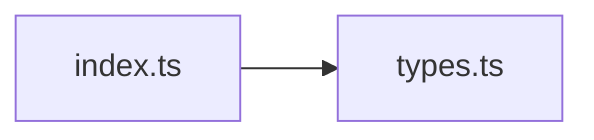

# CodeProof report

Commit: a33fba7330d23899346f25a459f17fab3c44f81b  |  run-id: c8b5e5f12186d9e0  |  mode: smoke

**Publishing rule:** a finding appears under *Verified findings* only if the deterministic citation gate (L1) passed and the adversarial verifier confirmed it. Refuted, uncertain and moderate findings are kept in separate sections - nothing is hidden, and nothing unproven is presented as verified.

## Summary

| Metric | Value |
|---|---|
| Files / LOC | 2 / 166 |
| Import edges / cycles | 1 / 0 |
| Findings proposed | 2 |
| Rejected at L1 (bad citation) | 0 |
| Verified | 2 |
| Moderate confidence | 0 |
| Refuted | 0 |
| Uncertain | 0 |
| Calls / retries | 3 / 0 |
| Tokens in / out | 7588 / 9650 |
| Cached input tokens | 1000 |
| Cost | $0.0962 |

## Verified findings

### F-001 - high - Leaked subscription ref-count on subscribe throw blocks resubscribe

**Claim:** Ref count is incremented before calling subscribe, but if subscribe throws or returns a non-function the effect throws before returning cleanup, so the increment is never decremented and future mounts see refCount!=0 and skip subscribing forever.

**Citation:** index.ts:71-82
```text
      // Increment the ref count.
      subscriptions.set(subscriptionKey, refCount + 1)

      if (!refCount) {
        const dispose = subscribe(args, { next })
        if (typeof dispose !== 'function') {
          throw new Error(
            'The `subscribe` function must return a function to unsubscribe.'
          )
        }
        disposers.set(subscriptionKey, dispose)
      }
```
**Citation:** index.ts:84-93
```text
      return () => {
        const count = subscriptions.get(subscriptionKey)! - 1

        subscriptions.set(subscriptionKey, count)

        // Dispose if it's the last one.
        if (!count) {
          const dispose = disposers.get(subscriptionKey)
          dispose?.()
        }
```

**Verifier (muse-wonder-1.0):** confirm - The code at index.ts:72 increments the count before index.ts:75 calls subscribe and index.ts:77-79 throws for a non-function return, with no try/catch/finally to roll back and no cleanup returned on that path, so the leaked count makes later effects skip the !refCount subscribe branch at index.ts:74.

### F-002 - medium - Disposed subscription handle never cleared from disposers map

**Claim:** Disposer function stored in module-level disposers map is invoked on last unsubscribe but never removed from the map, leaving a stale disposed handle stored after cleanup.

**Citation:** index.ts:81-81
```text
        disposers.set(subscriptionKey, dispose)
```
**Citation:** index.ts:89-93
```text
        // Dispose if it's the last one.
        if (!count) {
          const dispose = disposers.get(subscriptionKey)
          dispose?.()
        }
```

**Verifier (muse-wonder-1.0):** confirm - The code stores the disposer at index.ts:81 via disposers.set and invokes it at index.ts:90-92 on last unsubscribe with no disposers.delete anywhere in index.ts, so the disposed handle remains in the map.

## Architecture

Deterministic facts only: 2 files, 166 LOC, 1 import edges, 0 cycles. The diagram is generated from the import graph by code, never by the model.



## Limits

- Static analysis only: the analyzed code is never executed.
- No completeness claim; this report shows what passed the gate, not everything that exists in the repository.
- Only direct correctness defects; omission, security and style findings are out of scope for this milestone.
- The L1 gate proves that a citation exists in the commit; the semantic match is judged by the verifier model and presented as such.

