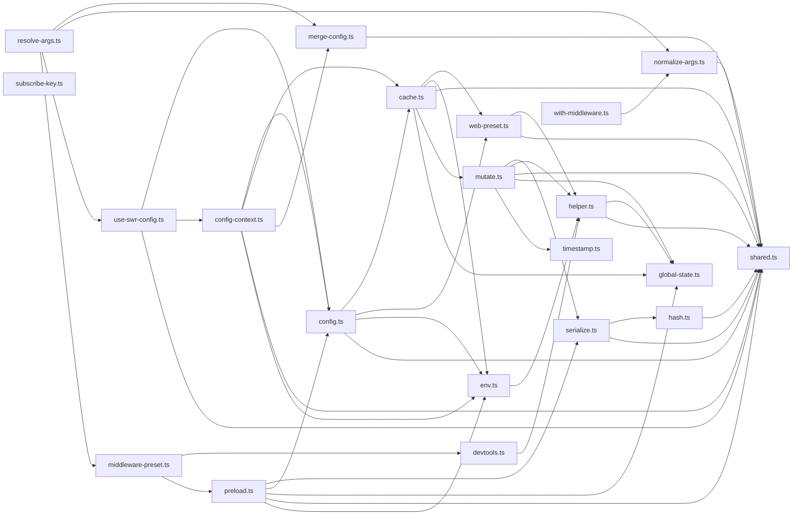

# CodeProof report

Commit: 46f3954a35c39771ba3dcc00af774e4002062418  |  run-id: 77f2fd26e9b9d043  |  mode: smoke

**Publishing rule:** a finding appears under *Verified findings* only if the deterministic citation gate (L1) passed and the adversarial verifier confirmed it. Refuted, uncertain and moderate findings are kept in separate sections - nothing is hidden, and nothing unproven is presented as verified.

## Summary

| Metric | Value |
|---|---|
| Files / LOC | 21 / 1026 |
| Import edges / cycles | 45 / 0 |
| Findings proposed | 1 |
| Rejected at L1 (bad citation) | 0 |
| Verified | 1 |
| Moderate confidence | 0 |
| Refuted | 0 |
| Uncertain | 0 |
| Calls / retries | 2 / 0 |
| Tokens in / out | 18431 / 5736 |
| Cached input tokens | 0 |
| Cost | $0.0860 |

## Verified findings

### F-001 - high - Unsubscribe splice without index check corrupts subscriber list

**Claim:** Unsubscribe does not guard against missing callback: subs.indexOf(callback) can be -1 on double-unsubscribe, and splice(-1,1) removes an unrelated subscriber.

**Citation:** cache.ts:51-60
```text
    const subscribe = (
      key: string,
      callback: (current: any, prev: any) => void
    ) => {
      const subs = subscriptions[key] || []
      subscriptions[key] = subs

      subs.push(callback)
      return () => subs.splice(subs.indexOf(callback), 1)
    }
```

**Verifier (muse-wonder-1.0):** confirm - The unsubscribe returned at cache.ts:59 is `subs.splice(subs.indexOf(callback), 1)` with no -1 check, so a second invocation splices at -1 and removes the last unrelated subscriber.

## Architecture

Deterministic facts only: 21 files, 1026 LOC, 45 import edges, 0 cycles. The diagram is generated from the import graph by code, never by the model.



## Limits

- Static analysis only: the analyzed code is never executed.
- No completeness claim; this report shows what passed the gate, not everything that exists in the repository.
- Only direct correctness defects; omission, security and style findings are out of scope for this milestone.
- The L1 gate proves that a citation exists in the commit; the semantic match is judged by the verifier model and presented as such.

