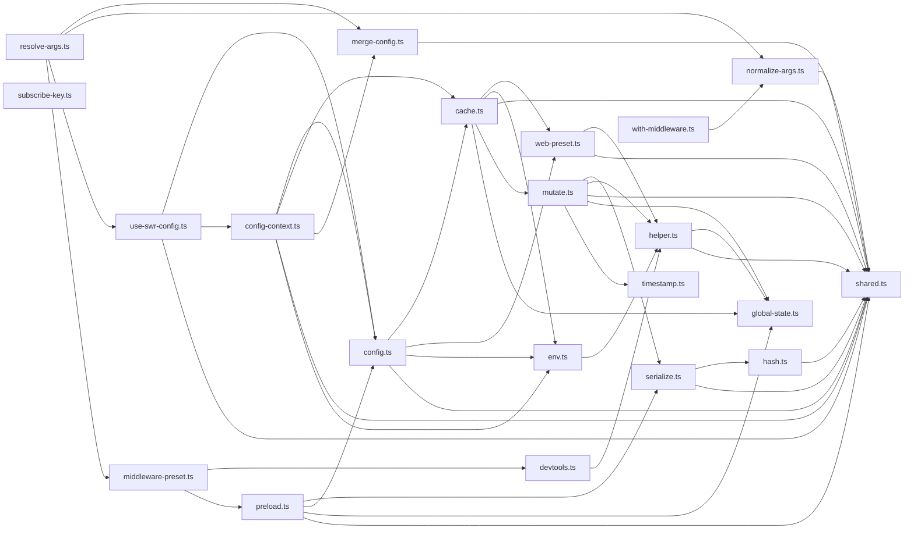

# CodeProof report

Commit: 1f93cc2c44adfc33a49b05715bf3bc2aedecbb22  |  run-id: a5d8f85f0577cbfa  |  mode: smoke

**Publishing rule:** a finding appears under *Verified findings* only if the deterministic citation gate (L1) passed and the adversarial verifier confirmed it. Refuted, uncertain and moderate findings are kept in separate sections - nothing is hidden, and nothing unproven is presented as verified.

## Summary

| Metric | Value |
|---|---|
| Files / LOC | 21 / 1020 |
| Import edges / cycles | 44 / 0 |
| Findings proposed | 4 |
| Rejected at L1 (bad citation) | 0 |
| Verified | 2 |
| Moderate confidence | 0 |
| Refuted | 1 |
| Uncertain | 1 |
| Calls / retries | 8 / 0 |
| Tokens in / out | 65880 / 31468 |
| Cached input tokens | 18092 |
| Cost | $0.6959 |

## Verified findings

### F-001 - high - Unsubscribe without index check removes wrong subscriber

**Claim:** cache.ts subscribe returns an unsubscribe that splices without checking indexOf; calling it twice or after removal splices index -1 and removes the wrong callback.

**Citation:** cache.ts:51-60
```text
    const subscribe = (
      key: string,
      callback: (current: any, prev: any) => void
    ) => {
      const subs = subscriptions[key] || []
      subscriptions[key] = subs

      subs.push(callback)
      return () => subs.splice(subs.indexOf(callback), 1)
    }
```

**Verifier (muse-wonder-1.0):** confirm - The unsubscribe at cache.ts:59 is `return () => subs.splice(subs.indexOf(callback), 1)` with no -1 guard, so a second call yields indexOf -1 and splice(-1, 1) removes the last remaining subscriber.

### F-002 - high - Module-level INITIAL_CACHE never reset shares stale snapshot

**Claim:** INITIAL_CACHE is module-level and only ever written, never cleared or scoped to a cache provider; once a key is stored the server snapshot getter returns that stale initial value forever across providers and remounts.

**Citation:** helper.ts:6-6
```text
const INITIAL_CACHE: Record<string, any> = {}
```
**Citation:** helper.ts:31-35
```text
        // Before writing to the store, we keep the value in the initial cache
        // if it's not there yet.
        if (!(key in INITIAL_CACHE)) {
          INITIAL_CACHE[key] = prev
        }
```
**Citation:** helper.ts:43-46
```text
      if (!isUndefined(key)) {
        // If the cache was updated on the client, we return the stored initial value.
        if (key in INITIAL_CACHE) return INITIAL_CACHE[key]
      }
```

**Verifier (muse-wonder-1.0):** confirm - Confirmed from helper.ts:6 where INITIAL_CACHE is a non-exported module-level Record, helper.ts:33-34 where it is only conditionally written, and helper.ts:46 where the server snapshot getter returns it by key alone without reference to the cache argument; the full 56-line helper.ts contains no delete, reassignment, or clearing, and it cannot be cleared externally since it is not exported.

## Architecture

Deterministic facts only: 21 files, 1020 LOC, 44 import edges, 0 cycles. The diagram is generated from the import graph by code, never by the model.



## Limits

- Static analysis only: the analyzed code is never executed.
- No completeness claim; this report shows what passed the gate, not everything that exists in the repository.
- Only direct correctness defects; omission, security and style findings are out of scope for this milestone.
- The L1 gate proves that a citation exists in the commit; the semantic match is judged by the verifier model and presented as such.

