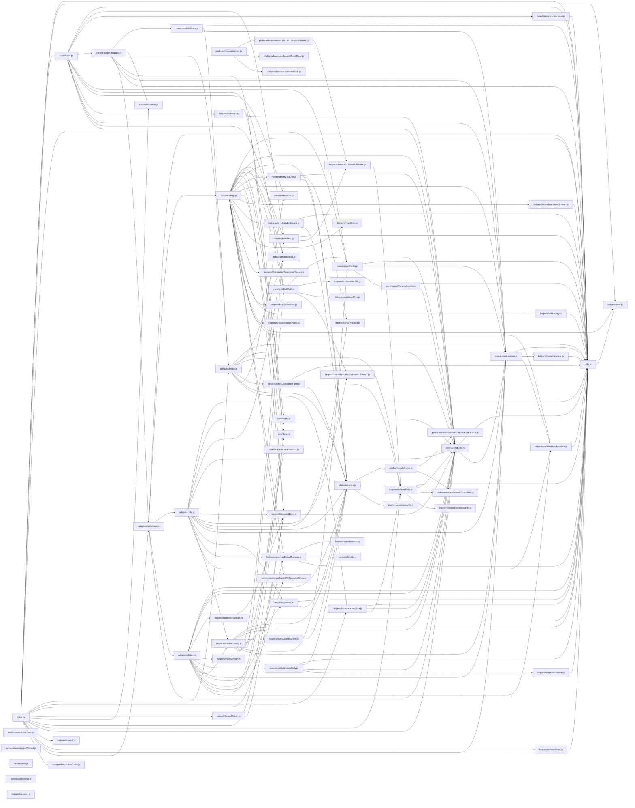

# CodeProof report

Commit: b2c8f4c90801b6c2260a43ce7550c22868a0fb82  |  run-id: 009a0139532f5f34  |  mode: smoke

**Publishing rule:** a finding appears under *Verified findings* only if every citation passed L1 and the adversarial verifier confirmed it. This checks provenance and model agreement, not semantic proof. Refuted, uncertain and moderate findings are in rejected.md.

## Summary

| Metric | Value |
|---|---|
| Files / LOC | 74 / 9564 |
| Import edges / cycles | 177 / 0 |
| Files in scanner prompt | 74 / 74 |
| Findings proposed | 8 |
| Rejected at L1 (bad citation) | 4 |
| Verified | 4 |
| Reproduced by execution (L3) | 3 |
| Moderate confidence | 0 |
| Refuted | 0 |
| Uncertain | 0 |
| Calls / retries | 9 / 0 |
| Tokens in / out | 129963 / 16940 |
| Cached input tokens | 488 |
| Cost | $0.5291 |

## Verified findings

### F-001 - critical - CancelToken cancel guard inverted

**Claim:** Cancel executor returns early when no cancellation has been requested, so token.reason is never set and cancel() never works.

**Proposed by:** Muse Spark

**Evidence level:** citation-proven + adversarially-confirmed

**Execution check:** inconclusive: reproducer failed L0: forbidden console output (it could mask the real failure class)

**Citation (from commit, lines 54-62):** cancel/CancelToken.js
```text
    executor(function cancel(message, config, request) {
      if (!token.reason) {
        // Cancellation has already been requested
        return;
      }

      token.reason = new CanceledError(message, config, request);
      resolvePromise(token.reason);
    });
```

**Verifier (muse-wonder-1.0):** confirm - The guard at cancel/CancelToken.js:55 returns when token.reason is falsy, which is its initial state, so the assignment at cancel/CancelToken.js:60 is unreachable and cancel() never sets token.reason.

### F-003 - high - spread does not spread arguments

**Claim:** spread passes the array as a single argument instead of spreading it, so f(x,y,z) receives [arr] not x,y,z.

**Proposed by:** Muse Spark

**Evidence level:** citation-proven + adversarially-confirmed + **execution-proven (generated test fails on the analyzed commit)**

**Execution check:** reproduced by execution (see Reproduced by execution)

**Citation (from commit, lines 24-28):** helpers/spread.js
```text
export default function spread(callback) {
  return function wrap(arr) {
    return callback.apply(null, [arr]);
  };
}
```

**Verifier (muse-wonder-1.0):** confirm - At helpers/spread.js:26 callback.apply(null, [arr]) uses [arr] as the argument list, so the callback receives the original array as its sole argument instead of its elements as separate arguments.

### F-004 - high - isAxiosError false-positive check

**Claim:** isAxiosError returns true for any object lacking the flag because undefined !== false, causing false positives.

**Proposed by:** Muse Spark

**Evidence level:** citation-proven + adversarially-confirmed + **execution-proven (generated test fails on the analyzed commit)**

**Execution check:** reproduced by execution (see Reproduced by execution)

**Citation (from commit, lines 12-14):** helpers/isAxiosError.js
```text
export default function isAxiosError(payload) {
  return utils.isObject(payload) && payload.isAxiosError !== false;
}
```

**Verifier (muse-wonder-1.0):** confirm - The implementation at helpers/isAxiosError.js:13 is `utils.isObject(payload) && payload.isAxiosError !== false`, so any object without the property yields `undefined !== false` and returns true.

### F-005 - high - combineURLs missing slash separator

**Claim:** combineURLs strips trailing slashes from base and leading slashes from relative then concatenates without adding '/', producing a missing separator.

**Proposed by:** Muse Spark

**Evidence level:** citation-proven + adversarially-confirmed + **execution-proven (generated test fails on the analyzed commit)**

**Execution check:** reproduced by execution (see Reproduced by execution)

**Citation (from commit, lines 11-23):** helpers/combineURLs.js
```text
export default function combineURLs(baseURL, relativeURL) {
  if (!relativeURL) {
    return baseURL;
  }

  let end = baseURL.length;

  while (end > 0 && baseURL.charCodeAt(end - 1) === 47) {
    end--;
  }

  return baseURL.slice(0, end) + relativeURL.replace(/^\/+/, '');
}
```

**Verifier (muse-wonder-1.0):** confirm - The code at helpers/combineURLs.js:18-22 strips trailing '/' from baseURL and leading '/' from relativeURL, then concatenates them directly with no '/' separator, so e.g. 'https://example.com/api/' + '/users' becomes 'https://example.com/apiusers'.

## Reproduced by execution

For each finding below, the verifier model wrote a standalone test. The test runs on a `git archive` snapshot of the analyzed commit inside a permission-model sandbox: no network, no writes, 2 s timeout, three runs. The finding is execution-proven only if the test fails 3/3 with an assertion error.

### F-003 - spread does not spread arguments

**Expected behavior:** spread(f)([1,2,3]) invokes f with arguments 1, 2, 3 (as documented: spread(function(x,y,z){})([1,2,3])), not with the array as a single argument.

**Generated test (fails on the analyzed commit):**
```js
import assert from 'node:assert/strict';
import spread from './helpers/spread.js';

let error = null;
let received = null;
let result = null;
try {
  result = spread(function (x, y, z) {
    received = [x, y, z];
    return x + y + z;
  })([1, 2, 3]);
} catch (e) {
  error = e;
}
assert.equal(error, null);
assert.deepEqual(received, [1, 2, 3]);
assert.equal(result, 6);

let received2 = null;
try {
  received2 = spread((...args) => args)(['a', 'b']);
} catch (e) {
  error = e;
}
assert.equal(error, null);
assert.deepEqual(received2, ['a', 'b']);
```

**Runner output (last of 3 attempts):**
```text
  ]

    at file:///tmp/codeproof-repro-EHNRNu/snapshot/.codeproof-repro.test.mjs:16:8
    at ModuleJob.run (node:internal/modules/esm/module_job:569:25)
    at async node:internal/modules/esm/loader:650:26
    at async asyncRunEntryPointWithESMLoader (node:internal/modules/run_main:101:5) {
  generatedMessage: true,
  code: 'ERR_ASSERTION',
  actual: [ [ 1, 2, 3 ], undefined, undefined ],
  expected: [ 1, 2, 3 ],
  operator: 'deepStrictEqual',
  diff: 'simple'
}

Node.js v26.8.2
```

### F-004 - isAxiosError false-positive check

**Expected behavior:** isAxiosError returns false for plain objects lacking the isAxiosError flag and true only for payloads marked as Axios errors

**Generated test (fails on the analyzed commit):**
```js
import assert from 'node:assert/strict';
import isAxiosError from './helpers/isAxiosError.js';

// Plain objects lacking the flag are not Axios errors
assert.equal(isAxiosError({}), false);
assert.equal(isAxiosError({ message: 'boom', code: 'ERR' }), false);
assert.equal(isAxiosError(new Error('boom')), false);
assert.equal(isAxiosError({ isAxiosError: undefined }), false);

// Explicitly marked / unmarked payloads
assert.equal(isAxiosError({ isAxiosError: true }), true);
assert.equal(isAxiosError({ isAxiosError: false }), false);

// Non-objects are not Axios errors
assert.equal(isAxiosError(null), false);
assert.equal(isAxiosError('error'), false);
assert.equal(isAxiosError(42), false);
```

**Runner output (last of 3 attempts):**
```text
true !== false

    at file:///tmp/codeproof-repro-a7sqvT/snapshot/.codeproof-repro.test.mjs:5:8
    at ModuleJob.run (node:internal/modules/esm/module_job:569:25)
    at async node:internal/modules/esm/loader:650:26
    at async asyncRunEntryPointWithESMLoader (node:internal/modules/run_main:101:5) {
  generatedMessage: true,
  code: 'ERR_ASSERTION',
  actual: true,
  expected: false,
  operator: 'strictEqual',
  diff: 'simple'
}

Node.js v26.8.2
```

### F-005 - combineURLs missing slash separator

**Expected behavior:** combineURLs joins base and relative URLs with exactly one '/' separator after stripping trailing slashes from base and leading slashes from relative

**Generated test (fails on the analyzed commit):**
```js
import assert from 'node:assert/strict';
import combineURLs from './helpers/combineURLs.js';

assert.equal(combineURLs('https://example.com/api', '/users'), 'https://example.com/api/users');
assert.equal(combineURLs('https://example.com/api/', '/users'), 'https://example.com/api/users');
assert.equal(combineURLs('https://example.com/api', 'users'), 'https://example.com/api/users');
assert.equal(combineURLs('https://example.com/api/', 'users'), 'https://example.com/api/users');
assert.equal(combineURLs('https://example.com/api///', '///users'), 'https://example.com/api/users');
assert.equal(combineURLs('https://example.com/api', ''), 'https://example.com/api');
```

**Runner output (last of 3 attempts):**
```text
                          ^

    at file:///tmp/codeproof-repro-srC7nN/snapshot/.codeproof-repro.test.mjs:4:8
    at ModuleJob.run (node:internal/modules/esm/module_job:569:25)
    at async node:internal/modules/esm/loader:650:26
    at async asyncRunEntryPointWithESMLoader (node:internal/modules/run_main:101:5) {
  generatedMessage: true,
  code: 'ERR_ASSERTION',
  actual: 'https://example.com/apiusers',
  expected: 'https://example.com/api/users',
  operator: 'strictEqual',
  diff: 'simple'
}

Node.js v26.8.2
```

## Architecture

Deterministic facts only: 74 files, 9564 LOC, 177 import edges, 0 cycles. The diagram is generated from the import graph by code, never by the model.



## Limits

- Scan and verify are static: the analyzed code is never executed while the scanner and verifier run. L3 runs only the generated test, on a git-archive snapshot, inside a permission-model sandbox (no network, no writes, 2 s timeout); isolation is process-level, not OS-level.
- No completeness claim; this report shows what passed the gate, not everything that exists in the repository.
- Only direct correctness defects; omission, security and style findings are out of scope for this milestone.
- The L1 gate proves that a citation exists in the commit; the semantic match is judged by the verifier model and presented as such.

