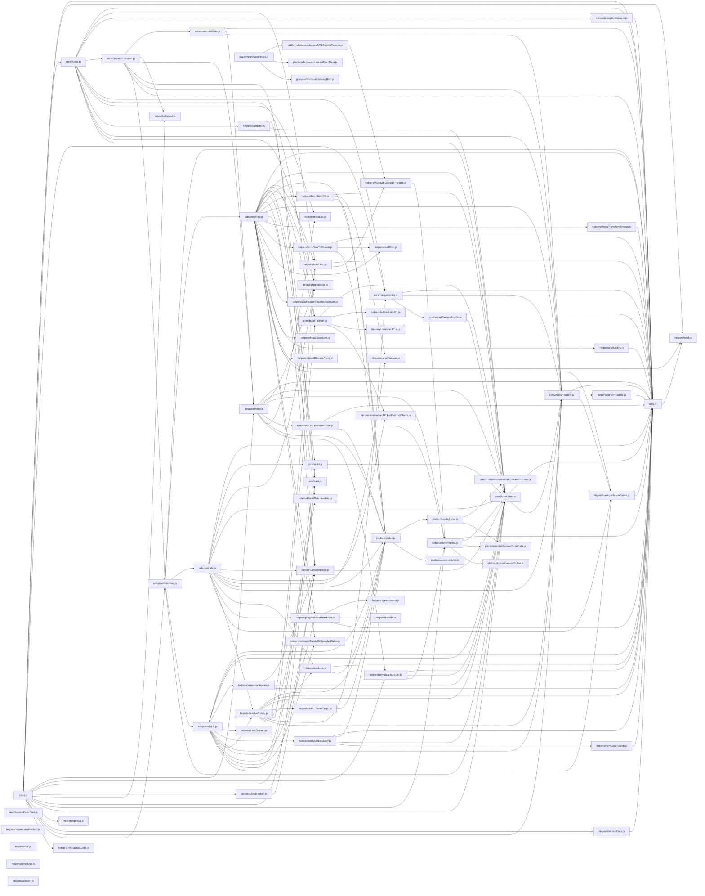

# CodeProof report

Commit: b2c8f4c90801b6c2260a43ce7550c22868a0fb82  |  run-id: 009a0139532f5f34  |  mode: smoke

**Publishing rule:** a finding appears under *Verified findings* only if every citation passed L1 and the adversarial verifier confirmed it. This checks provenance and model agreement, not semantic proof. Refuted, uncertain and moderate findings are in rejected.md.

## Summary

| Metric | Value |
|---|---|
| Files / LOC | 74 / 9564 |
| Import edges / cycles | 177 / 0 |
| Files in scanner prompt | 74 / 74 |
| Findings proposed | 8 |
| Rejected at L1 (bad citation) | 1 |
| Verified | 7 |
| Reproduced by execution (L3) | 5 |
| Moderate confidence | 0 |
| Refuted | 0 |
| Uncertain | 0 |
| Calls / retries | 15 / 0 |
| Tokens in / out | 157029 / 25113 |
| Cached input tokens | 2964 |
| Cost | $0.7808 |

## Verified findings

### F-001 - critical - CancelToken cancel guard inverted

**Claim:** CancelToken executor guard is inverted: it returns when no cancellation exists so reason is never set and cancel never works

**Proposed by:** Muse Spark

**Evidence level:** citation-proven + adversarially-confirmed + **execution-proven (generated test fails on the analyzed commit)**

**Execution check:** reproduced by execution (see Reproduced by execution)

**Citation (from commit, lines 54-62):** cancel/CancelToken.js
```text
    executor(function cancel(message, config, request) {
      if (!token.reason) {
        // Cancellation has already been requested
        return;
      }

      token.reason = new CanceledError(message, config, request);
      resolvePromise(token.reason);
    });
```

**Verifier (muse-wonder-1.0):** confirm - The guard at cancel/CancelToken.js:55 returns when token.reason is falsy, which is the initial state, so the assignments at cancel/CancelToken.js:60-61 are unreachable on first cancel and cancellation never takes effect.

### F-002 - critical - settle bypasses validateStatus for status <500

**Claim:** settle resolves any status <500 even when validateStatus returns false, so 4xx errors incorrectly resolve

**Proposed by:** Muse Spark

**Evidence level:** citation-proven + adversarially-confirmed + **execution-proven (generated test fails on the analyzed commit)**

**Execution check:** reproduced by execution (see Reproduced by execution)

**Citation (from commit, lines 14-17):** core/settle.js
```text
export default function settle(resolve, reject, response) {
  const validateStatus = response.config.validateStatus;
  if (!response.status || !validateStatus || validateStatus(response.status) || response.status < 500) {
    resolve(response);
```

**Verifier (muse-wonder-1.0):** confirm - The condition at core/settle.js:16 includes '|| response.status < 500' as an independent disjunct, so a 4xx response resolves at core/settle.js:17 even when validateStatus(response.status) is false.

### F-003 - high - spread does not spread array arguments

**Claim:** spread passes the array as a single argument instead of spreading it, breaking f(x,y,z) usage

**Proposed by:** Muse Spark

**Evidence level:** citation-proven + adversarially-confirmed + **execution-proven (generated test fails on the analyzed commit)**

**Execution check:** reproduced by execution (see Reproduced by execution)

**Citation (from commit, lines 24-28):** helpers/spread.js
```text
export default function spread(callback) {
  return function wrap(arr) {
    return callback.apply(null, [arr]);
  };
}
```

**Verifier (muse-wonder-1.0):** confirm - The code at helpers/spread.js:26 uses callback.apply(null, [arr]), which passes the whole array as the single first argument instead of spreading its elements, contradicting the documented spread(function(x, y, z) {})([1, 2, 3]) usage at helpers/spread.js:17.

### F-004 - high - combineURLs missing slash separator

**Claim:** combineURLs concatenates without inserting '/' so base without trailing slash plus relative produces missing separator

**Proposed by:** Muse Spark

**Evidence level:** citation-proven + adversarially-confirmed + **execution-proven (generated test fails on the analyzed commit)**

**Execution check:** reproduced by execution (see Reproduced by execution)

**Citation (from commit, lines 11-23):** helpers/combineURLs.js
```text
export default function combineURLs(baseURL, relativeURL) {
  if (!relativeURL) {
    return baseURL;
  }

  let end = baseURL.length;

  while (end > 0 && baseURL.charCodeAt(end - 1) === 47) {
    end--;
  }

  return baseURL.slice(0, end) + relativeURL.replace(/^\/+/, '');
}
```

**Verifier (muse-wonder-1.0):** confirm - The return at helpers/combineURLs.js:22 concatenates baseURL.slice(0, end) after stripping trailing slashes at helpers/combineURLs.js:18-20 directly with relativeURL after stripping leading slashes, inserting no '/' separator.

### F-005 - high - isAxiosError returns true for non-errors

**Claim:** isAxiosError checks !== false so any plain object without the flag is reported as AxiosError

**Proposed by:** Muse Spark

**Evidence level:** citation-proven + adversarially-confirmed

**Execution check:** inconclusive: reproducer failed L0: forbidden console output (it could mask the real failure class)

**Citation (from commit, lines 12-14):** helpers/isAxiosError.js
```text
export default function isAxiosError(payload) {
  return utils.isObject(payload) && payload.isAxiosError !== false;
}
```

**Verifier (muse-wonder-1.0):** confirm - The code at helpers/isAxiosError.js:13 returns utils.isObject(payload) && payload.isAxiosError !== false, so a plain object lacking the property (undefined !== false) yields true.

### F-006 - high - buildURL retains hash when appending params

**Claim:** buildURL keeps '#' when stripping fragment so serialized params are appended after fragment instead of as query

**Proposed by:** Muse Spark

**Evidence level:** citation-proven + adversarially-confirmed

**Execution check:** unavailable: the repository's own imports are not directly executable by Node without a build step (extensionless specifiers or missing packages)

**Citation (from commit, lines 59-66):** helpers/buildURL.js
```text
  if (serializedParams) {
    const hashmarkIndex = url.indexOf('#');

    if (hashmarkIndex !== -1) {
      url = url.slice(0, hashmarkIndex + 1);
    }
    url += (url.indexOf('?') === -1 ? '?' : '&') + serializedParams;
  }
```

**Verifier (muse-wonder-1.0):** confirm - At helpers/buildURL.js:63 the URL is sliced to hashmarkIndex + 1, retaining '#', and helpers/buildURL.js:65 then appends the serialized params after it, so params fall in the fragment rather than the query string.

### F-008 - medium - throttle replays stale args instead of lastArgs

**Claim:** throttle timer callback invokes stale captured args instead of latest lastArgs, dropping updates coalesced while throttled

**Proposed by:** Muse Spark

**Evidence level:** citation-proven + adversarially-confirmed + **execution-proven (generated test fails on the analyzed commit)**

**Execution check:** reproduced by execution (see Reproduced by execution)

**Citation (from commit, lines 23-37):** helpers/throttle.js
```text
  const throttled = (...args) => {
    const now = Date.now();
    const passed = now - timestamp;
    if (passed >= threshold) {
      invoke(args, now);
    } else {
      lastArgs = args;
      if (!timer) {
        timer = setTimeout(() => {
          timer = null;
          invoke(args);
        }, threshold - passed);
      }
    }
  };
```

**Verifier (muse-wonder-1.0):** confirm - The timer at helpers/throttle.js:31-33 invokes the per-call captured args, while later coalesced calls only update lastArgs at helpers/throttle.js:29, and invoke clears lastArgs at helpers/throttle.js:15, so the latest coalesced update is dropped.

## Reproduced by execution

For each finding below, the verifier model wrote a standalone test. The test runs on a `git archive` snapshot of the analyzed commit inside a permission-model sandbox: no network, no writes, 2 s timeout, three runs. The finding is execution-proven only if the test fails 3/3 with an assertion error.

### F-001 - CancelToken cancel guard inverted

**Expected behavior:** CancelToken.source().cancel(message) sets token.reason to a CanceledError with that message on first call, throwIfRequested() throws that reason, subscribe() immediately notifies with it, and a second cancel does not overwrite it.

**Generated test (fails on the analyzed commit):**
```js
import assert from 'node:assert/strict';
import CancelToken from './cancel/CancelToken.js';

const source = CancelToken.source();
assert.equal(source.token.reason, undefined);
source.cancel('Operation canceled by test');
assert.ok(source.token.reason);
assert.equal(source.token.reason.message, 'Operation canceled by test');

let thrown = null;
try {
  source.token.throwIfRequested();
} catch (err) {
  thrown = err;
}
assert.equal(thrown, source.token.reason);

let subscribed = null;
source.token.subscribe((reason) => { subscribed = reason; });
assert.equal(subscribed, source.token.reason);

source.cancel('second cancellation should be ignored');
assert.equal(source.token.reason.message, 'Operation canceled by test');
```

**Runner output (last of 3 attempts):**
```text
  assert.ok(source.token.reason)

    at file:///tmp/codeproof-repro-fJAO0U/snapshot/.codeproof-repro.test.mjs:7:8
    at ModuleJob.run (node:internal/modules/esm/module_job:569:25)
    at async node:internal/modules/esm/loader:650:26
    at async asyncRunEntryPointWithESMLoader (node:internal/modules/run_main:101:5) {
  generatedMessage: true,
  code: 'ERR_ASSERTION',
  actual: undefined,
  expected: true,
  operator: '==',
  diff: 'simple'
}

Node.js v26.8.2
```

### F-002 - settle bypasses validateStatus for status <500

**Expected behavior:** settle should reject when validateStatus returns false, even for 4xx statuses

**Generated test (fails on the analyzed commit):**
```js
import assert from 'node:assert/strict';
import settle from './core/settle.js';

function run(status, validateStatus) {
  let outcome = null;
  let value = null;
  let error = null;
  try {
    settle(
      (res) => { outcome = 'resolved'; value = res; },
      (err) => { outcome = 'rejected'; error = err; },
      { status, config: { validateStatus }, request: {} }
    );
  } catch (e) {
    outcome = 'threw';
    error = e;
  }
  return { outcome, value, error };
}

const ok = run(200, (s) => s >= 200 && s < 300);
assert.equal(ok.outcome, 'resolved');
assert.equal(ok.value.status, 200);

const r404 = run(404, (s) => s >= 200 && s < 300);
assert.equal(r404.outcome, 'rejected');
assert.ok(r404.error);
assert.match(String(r404.error.message), /404/);

const r403 = run(403, () => false);
assert.equal(r403.outcome, 'rejected');
assert.ok(r403.error);

const r301 = run(301, () => false);
assert.equal(r301.outcome, 'rejected');
assert.ok(r301.error);
```

**Runner output (last of 3 attempts):**
```text
     ^

    at file:///tmp/codeproof-repro-LXGbPM/snapshot/.codeproof-repro.test.mjs:26:8
    at ModuleJob.run (node:internal/modules/esm/module_job:569:25)
    at async node:internal/modules/esm/loader:650:26
    at async asyncRunEntryPointWithESMLoader (node:internal/modules/run_main:101:5) {
  generatedMessage: true,
  code: 'ERR_ASSERTION',
  actual: 'resolved',
  expected: 'rejected',
  operator: 'strictEqual',
  diff: 'simple'
}

Node.js v26.8.2
```

### F-003 - spread does not spread array arguments

**Expected behavior:** spread(fn)([1,2,3]) invokes fn with 1, 2, 3 as separate arguments (fn(x,y,z)), as documented in helpers/spread.js

**Generated test (fails on the analyzed commit):**
```js
import assert from 'node:assert/strict';
import spread from './helpers/spread.js';

let received;
let error = null;
try {
  received = spread(function (x, y, z) { return [x, y, z]; })([1, 2, 3]);
} catch (e) {
  error = e;
}
assert.equal(error, null);
assert.deepEqual(received, [1, 2, 3]);

let argCount;
let sumError = null;
let sum;
try {
  sum = spread(function (a, b) { argCount = arguments.length; return a + b; })([2, 3]);
} catch (e) {
  sumError = e;
}
assert.equal(sumError, null);
assert.equal(argCount, 2);
assert.equal(sum, 5);
```

**Runner output (last of 3 attempts):**
```text
  ]

    at file:///tmp/codeproof-repro-ipeVHR/snapshot/.codeproof-repro.test.mjs:12:8
    at ModuleJob.run (node:internal/modules/esm/module_job:569:25)
    at async node:internal/modules/esm/loader:650:26
    at async asyncRunEntryPointWithESMLoader (node:internal/modules/run_main:101:5) {
  generatedMessage: true,
  code: 'ERR_ASSERTION',
  actual: [ [ 1, 2, 3 ], undefined, undefined ],
  expected: [ 1, 2, 3 ],
  operator: 'deepStrictEqual',
  diff: 'simple'
}

Node.js v26.8.2
```

### F-004 - combineURLs missing slash separator

**Expected behavior:** combineURLs inserts exactly one '/' between base and relative URL regardless of trailing/leading slashes

**Generated test (fails on the analyzed commit):**
```js
import assert from 'node:assert/strict';
import combineURLs from './helpers/combineURLs.js';

assert.equal(combineURLs('https://example.com/api', '/users'), 'https://example.com/api/users');
assert.equal(combineURLs('https://example.com/api', 'users'), 'https://example.com/api/users');
assert.equal(combineURLs('https://example.com/api/', '/users'), 'https://example.com/api/users');
assert.equal(combineURLs('https://example.com/api/', 'users'), 'https://example.com/api/users');
assert.equal(combineURLs('https://example.com/api', ''), 'https://example.com/api');
```

**Runner output (last of 3 attempts):**
```text
                          ^

    at file:///tmp/codeproof-repro-Tq9SXF/snapshot/.codeproof-repro.test.mjs:4:8
    at ModuleJob.run (node:internal/modules/esm/module_job:569:25)
    at async node:internal/modules/esm/loader:650:26
    at async asyncRunEntryPointWithESMLoader (node:internal/modules/run_main:101:5) {
  generatedMessage: true,
  code: 'ERR_ASSERTION',
  actual: 'https://example.com/apiusers',
  expected: 'https://example.com/api/users',
  operator: 'strictEqual',
  diff: 'simple'
}

Node.js v26.8.2
```

### F-008 - throttle replays stale args instead of lastArgs

**Expected behavior:** After an immediate call, multiple calls coalesced during the throttle window should result in one trailing invocation using the latest arguments ('third'), not the first throttled arguments ('second').

**Generated test (fails on the analyzed commit):**
```js
import assert from 'node:assert/strict';
import throttle from './helpers/throttle.js';

const calls = [];
const [throttled] = throttle((value) => calls.push(value), 20);
throttled('first');
throttled('second');
throttled('third');
await new Promise((resolve) => setTimeout(resolve, 150));
assert.deepEqual(calls, ['first', 'third']);
```

**Runner output (last of 3 attempts):**
```text
    'first',
+   'second'
-   'third'
  ]

    at file:///tmp/codeproof-repro-lVVyKm/snapshot/.codeproof-repro.test.mjs:10:8 {
  generatedMessage: true,
  code: 'ERR_ASSERTION',
  actual: [ 'first', 'second' ],
  expected: [ 'first', 'third' ],
  operator: 'deepStrictEqual',
  diff: 'simple'
}

Node.js v26.8.2
```

## Architecture

Deterministic facts only: 74 files, 9564 LOC, 177 import edges, 0 cycles. The diagram is generated from the import graph by code, never by the model.



## Limits

- Scan and verify are static: the analyzed code is never executed while the scanner and verifier run. L3 runs only the generated test, on a git-archive snapshot, inside a permission-model sandbox (no network, no writes, 2 s timeout); isolation is process-level, not OS-level.
- No completeness claim; this report shows what passed the gate, not everything that exists in the repository.
- Only direct correctness defects; omission, security and style findings are out of scope for this milestone.
- The L1 gate proves that a citation exists in the commit; the semantic match is judged by the verifier model and presented as such.

