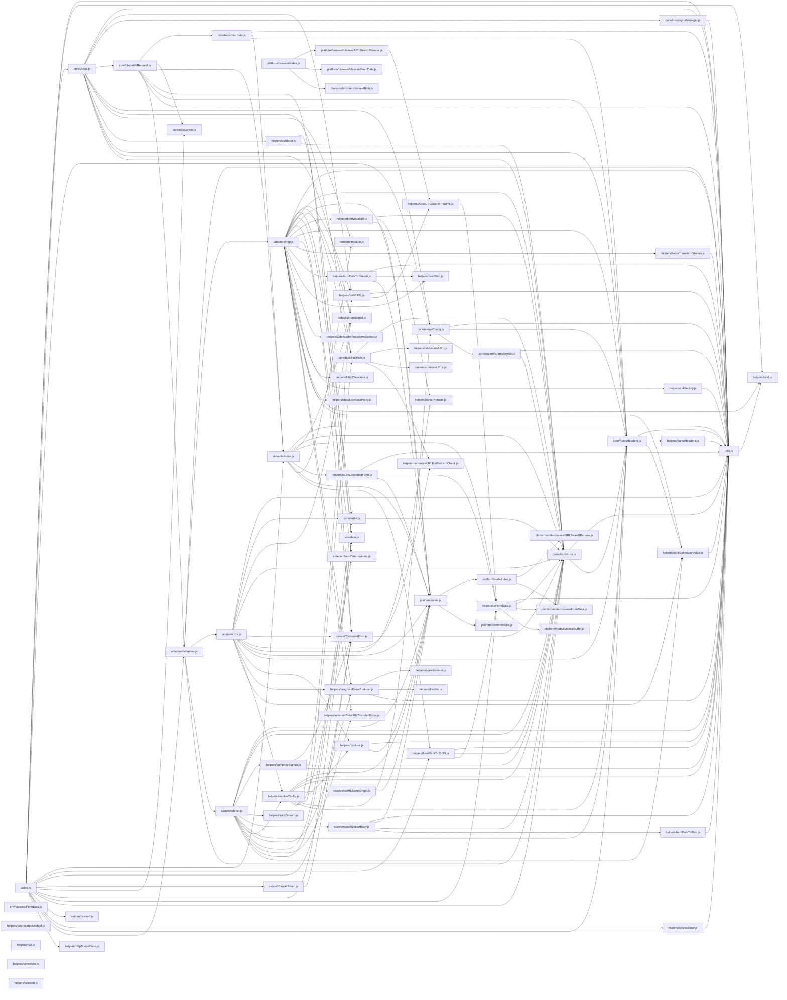

# CodeProof report

Commit: b2c8f4c90801b6c2260a43ce7550c22868a0fb82  |  run-id: 9b6c312a5ff5fb74  |  mode: smoke

**Publishing rule:** a finding appears under *Verified findings* only if every citation passed L1 and the adversarial verifier confirmed it. This checks provenance and model agreement, not semantic proof. Refuted, uncertain and moderate findings are in rejected.md.

## Summary

| Metric | Value |
|---|---|
| Files / LOC | 74 / 9564 |
| Import edges / cycles | 177 / 0 |
| Files in scanner prompt | 74 / 74 |
| Findings proposed | 10 |
| Rejected at L1 (bad citation) | 2 |
| Verified | 8 |
| Reproduced by execution (L3) | 7 |
| Moderate confidence | 0 |
| Refuted | 0 |
| Uncertain | 0 |
| Calls / retries | 19 / 0 |
| Tokens in / out | 353698 / 81645 |
| Cached input tokens | 97517 |
| Cost | $2.5190 |

## Verified findings

### F-001 - critical - CancelToken cancel guard inverted

**Claim:** CancelToken executor guard is inverted: it returns when no cancellation has been requested, so token.reason is never set and cancellation never fires.

**Proposed by:** Muse Spark + Muse Wonder

**Evidence level:** citation-proven + adversarially-confirmed + **execution-proven (generated test fails on the analyzed commit)**

**Execution check:** reproduced by execution (see Reproduced by execution)

**Citation (from commit, lines 54-62):** cancel/CancelToken.js
```text
    executor(function cancel(message, config, request) {
      if (!token.reason) {
        // Cancellation has already been requested
        return;
      }

      token.reason = new CanceledError(message, config, request);
      resolvePromise(token.reason);
    });
```

**Verifier (muse-wonder-1.0):** confirm - The guard at cancel/CancelToken.js:55 returns when token.reason is falsy (its initial state), so the assignment at cancel/CancelToken.js:60 and resolvePromise at cancel/CancelToken.js:61 are unreachable and cancellation never fires.

### F-002 - critical - settle bypasses validateStatus for status < 500

**Claim:** settle resolves any response with status < 500 regardless of validateStatus result, so custom validateStatus rejecting 4xx never rejects.

**Proposed by:** Muse Spark + Muse Wonder

**Evidence level:** citation-proven + adversarially-confirmed + **execution-proven (generated test fails on the analyzed commit)**

**Execution check:** reproduced by execution (see Reproduced by execution)

**Citation (from commit, lines 14-17):** core/settle.js
```text
export default function settle(resolve, reject, response) {
  const validateStatus = response.config.validateStatus;
  if (!response.status || !validateStatus || validateStatus(response.status) || response.status < 500) {
    resolve(response);
```

**Verifier (muse-wonder-1.0):** confirm - The condition at core/settle.js:16 includes '|| response.status < 500' as an independent disjunct, so any status below 500 resolves at core/settle.js:17 even when validateStatus(status) returns false, and reject at core/settle.js:19 is only reachable for status >= 500.

### F-003 - critical - spread does not spread array arguments

**Claim:** spread passes the array as a single argument instead of spreading it, so callback receives [arr] rather than ...arr.

**Proposed by:** Muse Spark + Muse Wonder

**Evidence level:** citation-proven + adversarially-confirmed + **execution-proven (generated test fails on the analyzed commit)**

**Execution check:** reproduced by execution (see Reproduced by execution)

**Citation (from commit, lines 24-28):** helpers/spread.js
```text
export default function spread(callback) {
  return function wrap(arr) {
    return callback.apply(null, [arr]);
  };
}
```

**Verifier (muse-wonder-1.0):** confirm - The code at helpers/spread.js:26 wraps the input array in another array for apply, so callback.apply(null, [arr]) passes arr as a single argument instead of spreading its elements as callback.apply(null, arr) would.

### F-004 - high - combineURLs missing separator slash

**Claim:** combineURLs strips trailing slashes from baseURL and leading slashes from relativeURL then concatenates without inserting '/', producing '...foobar' instead of '...foo/bar'.

**Proposed by:** Muse Spark + Muse Wonder

**Evidence level:** citation-proven + adversarially-confirmed + **execution-proven (generated test fails on the analyzed commit)**

**Execution check:** reproduced by execution (see Reproduced by execution)

**Citation (from commit, lines 16-22):** helpers/combineURLs.js
```text
  let end = baseURL.length;

  while (end > 0 && baseURL.charCodeAt(end - 1) === 47) {
    end--;
  }

  return baseURL.slice(0, end) + relativeURL.replace(/^\/+/, '');
```

**Verifier (muse-wonder-1.0):** confirm - The code at helpers/combineURLs.js:22 returns baseURL.slice(0, end) + relativeURL.replace(/^\/+/, '') with no '/' separator after stripping trailing slashes at helpers/combineURLs.js:18-20, so combining 'foo' and '/bar' yields 'foobar'.

### F-005 - high - buildURL appends query after hash fragment

**Claim:** buildURL keeps the '#' when stripping the fragment (slice to hashmarkIndex+1) and then appends query after '#', placing query inside the fragment.

**Proposed by:** Muse Spark + Muse Wonder

**Evidence level:** citation-proven + adversarially-confirmed

**Execution check:** unavailable: the repository's own imports are not directly executable by Node without a build step (extensionless specifiers or missing packages)

**Citation (from commit, lines 59-66):** helpers/buildURL.js
```text
  if (serializedParams) {
    const hashmarkIndex = url.indexOf('#');

    if (hashmarkIndex !== -1) {
      url = url.slice(0, hashmarkIndex + 1);
    }
    url += (url.indexOf('?') === -1 ? '?' : '&') + serializedParams;
  }
```

**Verifier (muse-wonder-1.0):** confirm - The code at helpers/buildURL.js:63 slices to hashmarkIndex+1 retaining the '#', and helpers/buildURL.js:65 then appends the serialized params after it, so a URL like 'http://x/#frag' becomes 'http://x/#?a=1' with the query inside the fragment.

### F-006 - high - isAxiosError true for plain objects

**Claim:** isAxiosError returns true for any object whose isAxiosError is undefined because it checks !== false instead of truthiness.

**Proposed by:** Muse Spark + Muse Wonder

**Evidence level:** citation-proven + adversarially-confirmed + **execution-proven (generated test fails on the analyzed commit)**

**Execution check:** reproduced by execution (see Reproduced by execution)

**Citation (from commit, lines 12-14):** helpers/isAxiosError.js
```text
export default function isAxiosError(payload) {
  return utils.isObject(payload) && payload.isAxiosError !== false;
}
```

**Verifier (muse-wonder-1.0):** confirm - At helpers/isAxiosError.js:13 the function returns utils.isObject(payload) && payload.isAxiosError !== false, so a plain object with no isAxiosError property (undefined !== false) passes both conditions and returns true.

### F-008 - medium - parseHeaders duplicate check is case-sensitive

**Claim:** parseHeaders keeps original header case but checks duplicates against lowercase ignore list, so duplicate headers with different casing are not ignored.

**Proposed by:** Muse Spark + Muse Wonder

**Evidence level:** citation-proven + adversarially-confirmed + **execution-proven (generated test fails on the analyzed commit)**

**Execution check:** reproduced by execution (see Reproduced by execution)

**Citation (from commit, lines 50-58):** helpers/parseHeaders.js
```text
      i = line.indexOf(':');
      key = line.substring(0, i).trim();
      val = line.substring(i + 1).trim();

      const hasKey = utils.hasOwnProp(parsed, key);

      if (!key || (hasKey && utils.hasOwnProp(ignoreDuplicateOf, key))) {
        return;
      }
```

**Verifier (muse-wonder-1.0):** confirm - Confirmed: helpers/parseHeaders.js:51 extracts key without lowercasing, helpers/parseHeaders.js:54-56 checks it case-sensitively against parsed and ignoreDuplicateOf, while helpers/parseHeaders.js:7-25 defines ignoreDuplicateOf only with lowercase names, so capitalized duplicates are combined instead of ignored.

### F-010 - high - InterceptorManager.forEach does not skip ejected null handlers

**Claim:** InterceptorManager.forEach passes every handlers entry to the callback, including null entries left by eject, causing request dispatch to dereference a null interceptor.

**Proposed by:** Muse Wonder

**Evidence level:** citation-proven + adversarially-confirmed + **execution-proven (generated test fails on the analyzed commit)**

**Execution check:** reproduced by execution (see Reproduced by execution)

**Citation (from commit, lines 159-169):** core/InterceptorManager.js
```text
  forEach(fn) {
    const internals = this[$internals];

    syncHandlerEntries(this, internals);

    internals.iterationDepth++;

    try {
      utils.forEach(this.handlers, function forEachHandler(h) {
        fn(h);
      });
```

**Verifier (muse-spark-1.3):** confirm - core/InterceptorManager.js:167-169 calls fn(h) unconditionally with no null check, while core/InterceptorManager.js:127 leaves null entries via eject and core/InterceptorManager.js:152-153 documents that forEach should skip nulls, confirming the claim.

## Reproduced by execution

For each finding below, the verifier model wrote a standalone test. The test runs on a `git archive` snapshot of the analyzed commit inside a permission-model sandbox: no network, no writes, 2 s timeout, three runs. The finding is execution-proven only if the test fails 3/3 with an assertion error.

### F-001 - CancelToken cancel guard inverted

**Expected behavior:** Calling the cancel function from CancelToken.source() sets token.reason to a CanceledError with the given message, makes throwIfRequested() throw that reason, notifies subscribers with it, and ignores subsequent cancels.

**Generated test (fails on the analyzed commit):**
```js
import assert from 'node:assert/strict';
import CancelToken from './cancel/CancelToken.js';

const { token, cancel } = CancelToken.source();
assert.equal(token.reason, undefined);

cancel('Operation canceled by test');

assert.ok(token.reason);
assert.equal(token.reason.message, 'Operation canceled by test');

let thrown = null;
try {
  token.throwIfRequested();
} catch (err) {
  thrown = err;
}
assert.equal(thrown, token.reason);

let notified = null;
token.subscribe((reason) => {
  notified = reason;
});
assert.equal(notified, token.reason);

const firstReason = token.reason;
cancel('second cancel');
assert.equal(token.reason, firstReason);
assert.equal(token.reason.message, 'Operation canceled by test');
```

**Runner output (last of 3 attempts):**
```text
  assert.ok(token.reason)

    at file:///tmp/codeproof-repro-j1gXLs/snapshot/.codeproof-repro.test.mjs:9:8
    at ModuleJob.run (node:internal/modules/esm/module_job:569:25)
    at async node:internal/modules/esm/loader:650:26
    at async asyncRunEntryPointWithESMLoader (node:internal/modules/run_main:101:5) {
  generatedMessage: true,
  code: 'ERR_ASSERTION',
  actual: undefined,
  expected: true,
  operator: '==',
  diff: 'simple'
}

Node.js v26.8.2
```

### F-002 - settle bypasses validateStatus for status < 500

**Expected behavior:** settle must reject when validateStatus returns false for a 4xx status (e.g. 404 with validateStatus accepting only 2xx), instead of resolving because status < 500.

**Generated test (fails on the analyzed commit):**
```js
import assert from 'node:assert/strict';
import settle from './core/settle.js';

function run(status, validateStatus) {
  let outcome = null;
  let error = null;
  let value = null;
  try {
    settle(
      (res) => { outcome = 'resolved'; value = res; },
      (err) => { outcome = 'rejected'; error = err; },
      { status, config: { validateStatus }, request: {} }
    );
  } catch (e) {
    outcome = 'threw';
    error = e;
  }
  return { outcome, error, value };
}

// Custom validateStatus accepts only 2xx, so 404 must reject (not resolve).
const r404 = run(404, (s) => s >= 200 && s < 300);
assert.equal(r404.outcome, 'rejected');
assert.equal(r404.error && r404.error.response && r404.error.response.status, 404);

// A validateStatus accepting only 200 must reject 403.
const r403 = run(403, (s) => s === 200);
assert.equal(r403.outcome, 'rejected');

// Sanity: a status accepted by validateStatus resolves.
const ok = run(200, (s) => s >= 200 && s < 300);
assert.equal(ok.outcome, 'resolved');
```

**Runner output (last of 3 attempts):**
```text
     ^

    at file:///tmp/codeproof-repro-YhaE04/snapshot/.codeproof-repro.test.mjs:23:8
    at ModuleJob.run (node:internal/modules/esm/module_job:569:25)
    at async node:internal/modules/esm/loader:650:26
    at async asyncRunEntryPointWithESMLoader (node:internal/modules/run_main:101:5) {
  generatedMessage: true,
  code: 'ERR_ASSERTION',
  actual: 'resolved',
  expected: 'rejected',
  operator: 'strictEqual',
  diff: 'simple'
}

Node.js v26.8.2
```

### F-003 - spread does not spread array arguments

**Expected behavior:** spread(fn)([1,2,3]) invokes fn with 1, 2, 3 as separate arguments (fn.apply(null, arr)), per the documented example in helpers/spread.js.

**Generated test (fails on the analyzed commit):**
```js
import assert from 'node:assert/strict';
import spread from './helpers/spread.js';

let received = null;
let returned = null;
let error = null;
try {
  returned = spread(function (...args) {
    received = args;
    return args;
  })([1, 2, 3]);
} catch (e) {
  error = e;
}
assert.equal(error, null);
assert.deepEqual(received, [1, 2, 3]);
assert.deepEqual(returned, [1, 2, 3]);

let xyz = null;
let error2 = null;
try {
  xyz = spread(function (x, y, z) { return [x, y, z]; })(['a', 'b', 'c']);
} catch (e) {
  error2 = e;
}
assert.equal(error2, null);
assert.deepEqual(xyz, ['a', 'b', 'c']);
```

**Runner output (last of 3 attempts):**
```text
  ]

    at file:///tmp/codeproof-repro-68KRCK/snapshot/.codeproof-repro.test.mjs:16:8
    at ModuleJob.run (node:internal/modules/esm/module_job:569:25)
    at async node:internal/modules/esm/loader:650:26
    at async asyncRunEntryPointWithESMLoader (node:internal/modules/run_main:101:5) {
  generatedMessage: true,
  code: 'ERR_ASSERTION',
  actual: [ [ 1, 2, 3 ] ],
  expected: [ 1, 2, 3 ],
  operator: 'deepStrictEqual',
  diff: 'simple'
}

Node.js v26.8.2
```

### F-004 - combineURLs missing separator slash

**Expected behavior:** combineURLs joins base and relative URLs with exactly one '/' separator, e.g. combineURLs('https://example.com/foo', 'bar') === 'https://example.com/foo/bar' regardless of trailing/leading slashes.

**Generated test (fails on the analyzed commit):**
```js
import assert from 'node:assert/strict';
import combineURLs from './helpers/combineURLs.js';

assert.equal(combineURLs('https://example.com/foo', 'bar'), 'https://example.com/foo/bar');
assert.equal(combineURLs('https://example.com/foo/', 'bar'), 'https://example.com/foo/bar');
assert.equal(combineURLs('https://example.com/foo', '/bar'), 'https://example.com/foo/bar');
assert.equal(combineURLs('https://example.com/foo/', '/bar'), 'https://example.com/foo/bar');
assert.equal(combineURLs('https://example.com/foo///', '///bar'), 'https://example.com/foo/bar');
assert.equal(combineURLs('https://example.com/foo', ''), 'https://example.com/foo');
```

**Runner output (last of 3 attempts):**
```text
                          ^

    at file:///tmp/codeproof-repro-RquqU8/snapshot/.codeproof-repro.test.mjs:4:8
    at ModuleJob.run (node:internal/modules/esm/module_job:569:25)
    at async node:internal/modules/esm/loader:650:26
    at async asyncRunEntryPointWithESMLoader (node:internal/modules/run_main:101:5) {
  generatedMessage: true,
  code: 'ERR_ASSERTION',
  actual: 'https://example.com/foobar',
  expected: 'https://example.com/foo/bar',
  operator: 'strictEqual',
  diff: 'simple'
}

Node.js v26.8.2
```

### F-006 - isAxiosError true for plain objects

**Expected behavior:** isAxiosError returns false for plain objects without a truthy isAxiosError flag, and true only for payloads marked as Axios errors

**Generated test (fails on the analyzed commit):**
```js
import assert from 'node:assert/strict';
import isAxiosError from './helpers/isAxiosError.js';

// Plain objects are not Axios errors and must return false
assert.equal(isAxiosError({}), false);
assert.equal(isAxiosError({ foo: 'bar' }), false);
assert.equal(isAxiosError({ isAxiosError: undefined }), false);
assert.equal(isAxiosError({ message: 'boom', name: 'Error' }), false);

// Positive and explicit-negative controls
assert.equal(isAxiosError({ isAxiosError: true }), true);
assert.equal(isAxiosError({ isAxiosError: false }), false);
assert.equal(isAxiosError(null), false);
assert.equal(isAxiosError('error'), false);
assert.equal(isAxiosError(42), false);
```

**Runner output (last of 3 attempts):**
```text
true !== false

    at file:///tmp/codeproof-repro-mJ6u0l/snapshot/.codeproof-repro.test.mjs:5:8
    at ModuleJob.run (node:internal/modules/esm/module_job:569:25)
    at async node:internal/modules/esm/loader:650:26
    at async asyncRunEntryPointWithESMLoader (node:internal/modules/run_main:101:5) {
  generatedMessage: true,
  code: 'ERR_ASSERTION',
  actual: true,
  expected: false,
  operator: 'strictEqual',
  diff: 'simple'
}

Node.js v26.8.2
```

### F-008 - parseHeaders duplicate check is case-sensitive

**Expected behavior:** parseHeaders should ignore duplicates of headers in the lowercase ignoreDuplicateOf list (e.g. Content-Type, Authorization) even when the raw header names are capitalized, keeping only the first value.

**Generated test (fails on the analyzed commit):**
```js
import assert from 'node:assert/strict';
import parseHeaders from './helpers/parseHeaders.js';

function valuesFor(parsed, lowerName) {
  return Object.keys(parsed)
    .filter((key) => key.toLowerCase() === lowerName)
    .map((key) => parsed[key]);
}

// ignoreDuplicateOf entries are lowercase, but raw headers commonly use
// capitalized names. Duplicates must be ignored (first value wins).
const contentType = parseHeaders(
  'Content-Type: text/html\nContent-Type: application/json'
);
assert.deepEqual(valuesFor(contentType, 'content-type'), ['text/html']);

const authorization = parseHeaders(
  'Authorization: Bearer first\nAuthorization: Bearer second'
);
assert.deepEqual(valuesFor(authorization, 'authorization'), ['Bearer first']);
```

**Runner output (last of 3 attempts):**
```text
  ]

    at file:///tmp/codeproof-repro-eF7lT5/snapshot/.codeproof-repro.test.mjs:15:8
    at ModuleJob.run (node:internal/modules/esm/module_job:569:25)
    at async node:internal/modules/esm/loader:650:26
    at async asyncRunEntryPointWithESMLoader (node:internal/modules/run_main:101:5) {
  generatedMessage: true,
  code: 'ERR_ASSERTION',
  actual: [ 'text/html, application/json' ],
  expected: [ 'text/html' ],
  operator: 'deepStrictEqual',
  diff: 'simple'
}

Node.js v26.8.2
```

### F-010 - InterceptorManager.forEach does not skip ejected null handlers

**Expected behavior:** InterceptorManager.forEach skips null entries left by eject (as documented), invoking the callback only for remaining interceptors.

**Generated test (fails on the analyzed commit):**
```js
import assert from 'node:assert/strict';
import InterceptorManager from './core/InterceptorManager.js';

const manager = new InterceptorManager();
function fulfilledA() {}
function fulfilledB() {}
function fulfilledC() {}
const idA = manager.use(fulfilledA);
const idB = manager.use(fulfilledB);
const idC = manager.use(fulfilledC);
assert.equal(typeof idA, 'number');
assert.equal(typeof idC, 'number');
manager.eject(idB);

const seen = [];
let caught = null;
try {
  manager.forEach((h) => {
    seen.push(h);
  });
} catch (err) {
  caught = err;
}
assert.equal(caught, null);
assert.equal(seen.length, 2);
assert.equal(seen.includes(null), false);
assert.deepEqual(seen.map((h) => h && h.fulfilled), [fulfilledA, fulfilledC]);
```

**Runner output (last of 3 attempts):**
```text
3 !== 2

    at file:///tmp/codeproof-repro-c2HXpc/snapshot/.codeproof-repro.test.mjs:25:8
    at ModuleJob.run (node:internal/modules/esm/module_job:569:25)
    at async node:internal/modules/esm/loader:650:26
    at async asyncRunEntryPointWithESMLoader (node:internal/modules/run_main:101:5) {
  generatedMessage: true,
  code: 'ERR_ASSERTION',
  actual: 3,
  expected: 2,
  operator: 'strictEqual',
  diff: 'simple'
}

Node.js v26.8.2
```

## Architecture

Deterministic facts only: 74 files, 9564 LOC, 177 import edges, 0 cycles. The diagram is generated from the import graph by code, never by the model.



## Limits

- Scan and verify are static: the analyzed code is never executed while the scanner and verifier run. L3 runs only the generated test, on a git-archive snapshot, inside a permission-model sandbox (no network, no writes, 2 s timeout); isolation is process-level, not OS-level.
- No completeness claim; this report shows what passed the gate, not everything that exists in the repository.
- Only direct correctness defects; omission, security and style findings are out of scope for this milestone.
- The L1 gate proves that a citation exists in the commit; the semantic match is judged by the verifier model and presented as such.

