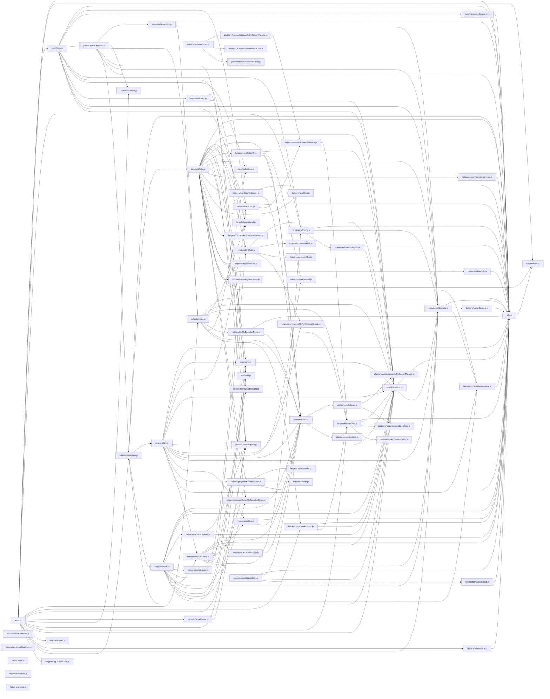

# CodeProof report

Commit: b2c8f4c90801b6c2260a43ce7550c22868a0fb82  |  run-id: 33bb4da404e0a3aa  |  mode: smoke

**Publishing rule:** a finding appears under *Verified findings* only if every citation passed L1 and the adversarial verifier confirmed it. This checks provenance and model agreement, not semantic proof. Refuted, uncertain and moderate findings are in rejected.md.

## Summary

| Metric | Value |
|---|---|
| Files / LOC | 74 / 9564 |
| Import edges / cycles | 177 / 0 |
| Files in scanner prompt | 74 / 74 |
| Findings proposed | 14 |
| Rejected at L1 (bad citation) | 0 |
| Verified | 14 |
| Reproduced by execution (L3) | 13 |
| Moderate confidence | 0 |
| Refuted | 0 |
| Uncertain | 0 |
| Calls / retries | 37 / 0 |
| Tokens in / out | 256866 / 118188 |
| Cached input tokens | 8833 |
| Cost | $2.3107 |

## Verified findings

### F-001 - critical - matchAll infinite loop on zero-length match

**Claim:** matchAll loops on regExp.exec without advancing lastIndex on empty matches, so a global regex that can match an empty string (e.g. /a*/g) returns the same empty match forever and never terminates; a non-global regex also never terminates.

**Proposed by:** Muse Spark

**Evidence level:** citation-proven + adversarially-confirmed + **execution-proven (generated test fails on the analyzed commit)**

**Execution check:** reproduced by execution (see Reproduced by execution)

**Citation (from commit, lines 879-888):** utils.js
```text
const matchAll = (regExp, str) => {
  let matches;
  const arr = [];

  while ((matches = regExp.exec(str)) !== null) {
    arr.push(matches);
  }

  return arr;
};
```

**Verifier (muse-wonder-1.0):** confirm - The code at utils.js:879-888 loops on regExp.exec at utils.js:883 and only pushes the result at utils.js:884, with no lastIndex advancement or empty-match guard, so a global empty-matching regex repeats the same match and a matching non-global regex repeats its first match indefinitely.

### F-002 - high - toFlatObject skips own constructor/prototype-chain names

**Claim:** toFlatObject uses a plain {} as the seen-set and tests !merged[prop]. Inherited Object.prototype members like 'constructor', 'toString', 'hasOwnProperty' are therefore truthy before any copy, so own source properties with those names are never copied to destObj.

**Proposed by:** Muse Spark

**Evidence level:** citation-proven + adversarially-confirmed + **execution-proven (generated test fails on the analyzed commit)**

**Execution check:** reproduced by execution (see Reproduced by execution)

**Citation (from commit, lines 744-758):** utils.js
```text
  const merged = {};

  destObj = destObj || {};
  // eslint-disable-next-line no-eq-null,eqeqeq
  if (sourceObj == null) return destObj;

  do {
    props = Object.getOwnPropertyNames(sourceObj);
    i = props.length;
    while (i-- > 0) {
      prop = props[i];
      if ((!propFilter || propFilter(prop, sourceObj, destObj)) && !merged[prop]) {
        destObj[prop] = sourceObj[prop];
        merged[prop] = true;
      }
```

**Verifier (muse-wonder-1.0):** confirm - The code at utils.js:744 creates the seen-set as a plain {} and at utils.js:755 gates copying on !merged[prop], so inherited truthy Object.prototype members such as 'constructor', 'toString', and 'hasOwnProperty' block copying own source properties with those names.

### F-003 - critical - Inverted cancel guard prevents cancellation

**Claim:** The cancel function returns early when token.reason is falsy, so the first cancel request never sets reason or resolves the promise and cancellation never happens.

**Proposed by:** Muse Spark

**Evidence level:** citation-proven + adversarially-confirmed + **execution-proven (generated test fails on the analyzed commit)**

**Execution check:** reproduced by execution (see Reproduced by execution)

**Citation (from commit, lines 54-62):** cancel/CancelToken.js
```text
    executor(function cancel(message, config, request) {
      if (!token.reason) {
        // Cancellation has already been requested
        return;
      }

      token.reason = new CanceledError(message, config, request);
      resolvePromise(token.reason);
    });
```

**Verifier (muse-wonder-1.0):** confirm - The guard at cancel/CancelToken.js:55 returns early when token.reason is falsy, which is the initial state since reason is never initialized elsewhere, so the assignments at cancel/CancelToken.js:60-61 are unreachable on the first and every subsequent cancel call.

### F-004 - critical - settle ignores validateStatus for status < 500

**Claim:** Extra `|| response.status < 500` makes any 4xx resolve even when custom validateStatus returns false.

**Proposed by:** Muse Spark

**Evidence level:** citation-proven + adversarially-confirmed + **execution-proven (generated test fails on the analyzed commit)**

**Execution check:** reproduced by execution (see Reproduced by execution)

**Citation (from commit, lines 14-17):** core/settle.js
```text
export default function settle(resolve, reject, response) {
  const validateStatus = response.config.validateStatus;
  if (!response.status || !validateStatus || validateStatus(response.status) || response.status < 500) {
    resolve(response);
```

**Verifier (muse-wonder-1.0):** confirm - The condition at core/settle.js:16 adds `|| response.status < 500` after validateStatus(response.status), so any 400-499 status satisfies the branch and calls resolve(response) at core/settle.js:17 even when validateStatus returns false.

### F-005 - high - normalize deletes duplicate header when spellings match

**Claim:** When a duplicate header has the same spelling as the stored key, it assigns self[key] then deletes self[header] which is the same property, deleting the header.

**Proposed by:** Muse Spark

**Evidence level:** citation-proven + adversarially-confirmed + **execution-proven (generated test fails on the analyzed commit)**

**Execution check:** reproduced by execution (see Reproduced by execution)

**Citation (from commit, lines 361-372):** core/AxiosHeaders.js
```text
  normalize(format) {
    const self = this;
    const headers = Object.create(null);

    utils.forEach(this, (value, header) => {
      const key = utils.findKey(headers, header);

      if (key) {
        self[key] = normalizeValue(value);
        delete self[header];
        return;
      }
```

**Verifier (muse-wonder-1.0):** confirm - At core/AxiosHeaders.js:368-370 the duplicate branch unconditionally assigns self[key] and then deletes self[header] with no key !== header guard, unlike the guard at core/AxiosHeaders.js:376-378, so when the stored key and current header spelling are identical the just-assigned header is deleted.

### F-006 - medium - accessor resets internals on every call

**Claim:** Every call unconditionally replaces this[$internals] with a fresh {accessors:{}} instead of reusing existing map, discarding previously registered accessors.

**Proposed by:** Muse Spark

**Evidence level:** citation-proven + adversarially-confirmed + **execution-proven (generated test fails on the analyzed commit)**

**Execution check:** reproduced by execution (see Reproduced by execution)

**Citation (from commit, lines 439-445):** core/AxiosHeaders.js
```text
  static accessor(header) {
    const internals =
      (this[$internals] =
      this[$internals] =
        {
          accessors: {},
        });
```

**Verifier (muse-wonder-1.0):** confirm - The code at core/AxiosHeaders.js:440-445 unconditionally assigns a fresh {accessors:{}} object to this[$internals] with no fallback or guard, discarding the previous accessors map on every call.

### F-007 - critical - combineURLs missing separator slash

**Claim:** combineURLs concatenates base and relative without inserting '/' so 'http://a'+'/foo' becomes 'http://afoo'.

**Proposed by:** Muse Spark

**Evidence level:** citation-proven + adversarially-confirmed + **execution-proven (generated test fails on the analyzed commit)**

**Execution check:** reproduced by execution (see Reproduced by execution)

**Citation (from commit, lines 22-22):** helpers/combineURLs.js
```text
  return baseURL.slice(0, end) + relativeURL.replace(/^\/+/, '');
```

**Verifier (muse-wonder-1.0):** confirm - At helpers/combineURLs.js:22 the return concatenates baseURL.slice(0, end) directly with relativeURL.replace(/^\/+/, '') and inserts no '/' separator, while helpers/combineURLs.js:18-20 also strips trailing slashes from the base, so 'http://a' + '/foo' yields 'http://afoo'.

### F-008 - critical - isAxiosError true for any object

**Claim:** isAxiosError uses !== false so any object without isAxiosError (undefined !== false) returns true.

**Proposed by:** Muse Spark

**Evidence level:** citation-proven + adversarially-confirmed + **execution-proven (generated test fails on the analyzed commit)**

**Execution check:** reproduced by execution (see Reproduced by execution)

**Citation (from commit, lines 12-14):** helpers/isAxiosError.js
```text
export default function isAxiosError(payload) {
  return utils.isObject(payload) && payload.isAxiosError !== false;
}
```

**Verifier (muse-wonder-1.0):** confirm - The code at helpers/isAxiosError.js:13 returns utils.isObject(payload) && payload.isAxiosError !== false, so an object lacking the property yields undefined !== false and therefore returns true.

### F-009 - high - buildURL retains hash when appending params

**Claim:** buildURL keeps '#' when stripping fragment (slice to hashmarkIndex+1) so serialized params are appended after '#' into the fragment instead of the query.

**Proposed by:** Muse Spark

**Evidence level:** citation-proven + adversarially-confirmed

**Execution check:** unavailable: the repository's own imports are not directly executable by Node without a build step (extensionless specifiers or missing packages)

**Citation (from commit, lines 60-65):** helpers/buildURL.js
```text
    const hashmarkIndex = url.indexOf('#');

    if (hashmarkIndex !== -1) {
      url = url.slice(0, hashmarkIndex + 1);
    }
    url += (url.indexOf('?') === -1 ? '?' : '&') + serializedParams;
```

**Verifier (muse-wonder-1.0):** confirm - The code at helpers/buildURL.js:63 slices to hashmarkIndex+1, retaining the '#', and helpers/buildURL.js:65 then appends '?/&' plus serializedParams, so params are placed after '#' in the fragment.

### F-010 - high - spread does not expand array arguments

**Claim:** spread passes the array as a single argument ([arr]) instead of spreading it, so f(x,y,z) receives [1,2,3] as x.

**Proposed by:** Muse Spark

**Evidence level:** citation-proven + adversarially-confirmed + **execution-proven (generated test fails on the analyzed commit)**

**Execution check:** reproduced by execution (see Reproduced by execution)

**Citation (from commit, lines 24-27):** helpers/spread.js
```text
export default function spread(callback) {
  return function wrap(arr) {
    return callback.apply(null, [arr]);
  };
```

**Verifier (muse-wonder-1.0):** confirm - The code at helpers/spread.js:26 uses callback.apply(null, [arr]), wrapping the input array in another array so the callback receives [1,2,3] as its single first argument instead of 1, 2, 3 as separate arguments.

### F-011 - high - parseHeaders case-sensitive header names

**Claim:** parseHeaders never lowercases header names so duplicate detection and set-cookie handling are case-sensitive, splitting case-variant duplicates into separate keys.

**Proposed by:** Muse Spark

**Evidence level:** citation-proven + adversarially-confirmed + **execution-proven (generated test fails on the analyzed commit)**

**Execution check:** reproduced by execution (see Reproduced by execution)

**Citation (from commit, lines 50-52):** helpers/parseHeaders.js
```text
      i = line.indexOf(':');
      key = line.substring(0, i).trim();
      val = line.substring(i + 1).trim();
```
**Citation (from commit, lines 60-60):** helpers/parseHeaders.js
```text
      if (key === 'set-cookie') {
```

**Verifier (muse-wonder-1.0):** confirm - Confirmed: helpers/parseHeaders.js:51 assigns key via trim() only with no lowercasing, and helpers/parseHeaders.js:54-60 uses that raw key for hasOwnProp duplicate checks, ignoreDuplicateOf lookup, and the strict 'set-cookie' comparison, so case-variant names become distinct object keys.

### F-012 - high - rotateAndRead missing await on save

**Claim:** rotateAndRead does not await store.save before store.get, so the read can race the write and return the old token.

**Proposed by:** Muse Spark

**Evidence level:** citation-proven + adversarially-confirmed + **execution-proven (generated test fails on the analyzed commit)**

**Execution check:** reproduced by execution (see Reproduced by execution)

**Citation (from commit, lines 3-5):** helpers/session.js
```text
export async function rotateAndRead(store) {
  store.save({ token: 'next' });
  return store.get('token');
```

**Verifier (muse-wonder-1.0):** confirm - The code at helpers/session.js:4 calls store.save without await and immediately returns store.get('token') at helpers/session.js:5, so an asynchronous save can still be pending when the read occurs.

### F-013 - medium - throttle replays stale args

**Claim:** throttle timer callback invokes stale captured args instead of lastArgs, so updates made while throttled are lost.

**Proposed by:** Muse Spark

**Evidence level:** citation-proven + adversarially-confirmed + **execution-proven (generated test fails on the analyzed commit)**

**Execution check:** reproduced by execution (see Reproduced by execution)

**Citation (from commit, lines 28-34):** helpers/throttle.js
```text
    } else {
      lastArgs = args;
      if (!timer) {
        timer = setTimeout(() => {
          timer = null;
          invoke(args);
        }, threshold - passed);
```

**Verifier (muse-wonder-1.0):** confirm - Confirmed at helpers/throttle.js:29-33: each throttled call overwrites lastArgs, but the timer closure captures the first call's args and calls invoke(args), so later args are never delivered by the timer and are cleared by invoke at helpers/throttle.js:13-15.

### F-014 - medium - scheduler start replaces timer without clear

**Claim:** createScheduler.start overwrites this.timer with a new setInterval without clearing an existing interval, leaking the prior handle.

**Proposed by:** Muse Spark

**Evidence level:** citation-proven + adversarially-confirmed + **execution-proven (generated test fails on the analyzed commit)**

**Execution check:** reproduced by execution (see Reproduced by execution)

**Citation (from commit, lines 6-8):** helpers/scheduler.js
```text
    start(callback, intervalMs) {
      this.timer = setInterval(callback, intervalMs);
    },
```

**Verifier (muse-wonder-1.0):** confirm - The code at helpers/scheduler.js:6-7 assigns this.timer = setInterval(callback, intervalMs) with no preceding clearInterval, and stop at helpers/scheduler.js:9-11 only clears the current handle, so a second start loses the prior interval handle.

## Reproduced by execution

For each finding below, the verifier model wrote a standalone test. The test runs on a `git archive` snapshot of the analyzed commit inside a permission-model sandbox: no network, no writes, 2 s timeout, three runs. The finding is execution-proven only if the test fails 3/3 with an assertion error.

### F-001 - matchAll infinite loop on zero-length match

**Expected behavior:** matchAll(/a*/g,'b') terminates with empty matches at indexes 0 and 1, and matchAll(/a*/g,'aaa') terminates with 'aaa' at 0 and '' at 3, matching native global matchAll semantics.

**Generated test (fails on the analyzed commit):**
```js
import assert from 'node:assert/strict';
import utils from './utils.js';

const { matchAll } = utils;
assert.equal(typeof matchAll, 'function');

function bounded(re, limit = 20) {
  let calls = 0;
  const orig = re.exec.bind(re);
  re.exec = (str) => {
    calls += 1;
    if (calls > limit) return null;
    return orig(str);
  };
  return re;
}

let error = null;
let result = null;
try {
  result = matchAll(bounded(/a*/g), 'b');
} catch (e) {
  error = e;
}
assert.equal(error, null);
assert.deepEqual(
  result.map((m) => [m[0], m.index]),
  [['', 0], ['', 1]]
);

error = null;
result = null;
try {
  result = matchAll(bounded(/a*/g), 'aaa');
} catch (e) {
  error = e;
}
assert.equal(error, null);
assert.deepEqual(
  result.map((m) => [m[0], m.index]),
  [['aaa', 0], ['', 3]]
);
```

**Runner output (last of 3 attempts):**
```text
  actual: [
    [ '', 0 ], [ '', 0 ], [ '', 0 ],
    [ '', 0 ], [ '', 0 ], [ '', 0 ],
    [ '', 0 ], [ '', 0 ], [ '', 0 ],
    [ '', 0 ], [ '', 0 ], [ '', 0 ],
    [ '', 0 ], [ '', 0 ], [ '', 0 ],
    [ '', 0 ], [ '', 0 ], [ '', 0 ],
    [ '', 0 ], [ '', 0 ]
  ],
  expected: [ [ '', 0 ], [ '', 1 ] ],
  operator: 'deepStrictEqual',
  diff: 'simple'
}

Node.js v26.8.2
```

### F-002 - toFlatObject skips own constructor/prototype-chain names

**Expected behavior:** toFlatObject copies own and prototype-chain properties named constructor, toString, hasOwnProperty, and valueOf to the destination as own properties.

**Generated test (fails on the analyzed commit):**
```js
import assert from 'node:assert/strict';
import utils from './utils.js';

const { toFlatObject } = utils;

const source = {
  constructor: 'own-constructor',
  toString: 'own-toString',
  hasOwnProperty: 'own-hasOwnProperty',
  valueOf: 'own-valueOf',
  normal: 42,
};

const dest = toFlatObject(source);
assert.equal(Object.prototype.hasOwnProperty.call(dest, 'constructor'), true);
assert.equal(dest.constructor, 'own-constructor');
assert.equal(Object.prototype.hasOwnProperty.call(dest, 'toString'), true);
assert.equal(dest.toString, 'own-toString');
assert.equal(Object.prototype.hasOwnProperty.call(dest, 'hasOwnProperty'), true);
assert.equal(dest.hasOwnProperty, 'own-hasOwnProperty');
assert.equal(Object.prototype.hasOwnProperty.call(dest, 'valueOf'), true);
assert.equal(dest.valueOf, 'own-valueOf');
assert.equal(dest.normal, 42);

const proto = { toString: 'proto-toString', inherited: 'yes' };
const chained = Object.create(proto);
chained.own = 1;
const dest2 = toFlatObject(chained);
assert.equal(dest2.own, 1);
assert.equal(dest2.inherited, 'yes');
assert.equal(Object.prototype.hasOwnProperty.call(dest2, 'toString'), true);
assert.equal(dest2.toString, 'proto-toString');
```

**Runner output (last of 3 attempts):**
```text
false !== true

    at file:///tmp/codeproof-repro-cpikPi/snapshot/.codeproof-repro.test.mjs:15:8
    at ModuleJob.run (node:internal/modules/esm/module_job:569:25)
    at async node:internal/modules/esm/loader:650:26
    at async asyncRunEntryPointWithESMLoader (node:internal/modules/run_main:101:5) {
  generatedMessage: true,
  code: 'ERR_ASSERTION',
  actual: false,
  expected: true,
  operator: 'strictEqual',
  diff: 'simple'
}

Node.js v26.8.2
```

### F-003 - Inverted cancel guard prevents cancellation

**Expected behavior:** First cancel() sets token.reason to a CanceledError with the given message, resolves/notifies the token promise and subscribers, makes throwIfRequested() throw that reason, and subsequent cancels are no-ops.

**Generated test (fails on the analyzed commit):**
```js
import assert from 'node:assert/strict';
import CancelToken from './cancel/CancelToken.js';

const source = CancelToken.source();
assert.equal(typeof source.cancel, 'function');
assert.equal(source.token.reason, undefined);

let promiseReason = null;
source.token.promise.then((reason) => { promiseReason = reason; });

source.cancel('first cancel');

assert.ok(source.token.reason);
assert.equal(source.token.reason.message, 'first cancel');

await new Promise((resolve) => setTimeout(resolve, 20));
assert.equal(promiseReason, source.token.reason);

let notified = null;
source.token.subscribe((reason) => { notified = reason; });
assert.equal(notified, source.token.reason);

let thrown = null;
try {
  source.token.throwIfRequested();
} catch (err) {
  thrown = err;
}
assert.equal(thrown, source.token.reason);

const firstReason = source.token.reason;
source.cancel('second cancel');
assert.equal(source.token.reason, firstReason);
assert.equal(source.token.reason.message, 'first cancel');
```

**Runner output (last of 3 attempts):**
```text
  assert.ok(source.token.reason)

    at file:///tmp/codeproof-repro-7QzBFA/snapshot/.codeproof-repro.test.mjs:13:8
    at ModuleJob.run (node:internal/modules/esm/module_job:569:25)
    at async node:internal/modules/esm/loader:650:26
    at async asyncRunEntryPointWithESMLoader (node:internal/modules/run_main:101:5) {
  generatedMessage: true,
  code: 'ERR_ASSERTION',
  actual: undefined,
  expected: true,
  operator: '==',
  diff: 'simple'
}

Node.js v26.8.2
```

### F-004 - settle ignores validateStatus for status < 500

**Expected behavior:** settle must reject a 404 response when custom validateStatus returns false for it (e.g. only 2xx accepted), instead of resolving all statuses < 500.

**Generated test (fails on the analyzed commit):**
```js
import assert from 'node:assert/strict';
import settle from './core/settle.js';

function run(status, validateStatus) {
  let resolved = null;
  let rejected = null;
  let thrown = null;
  try {
    settle(
      (v) => { resolved = v; },
      (e) => { rejected = e; },
      { status, config: { validateStatus }, request: {} }
    );
  } catch (e) {
    thrown = e;
  }
  return { resolved, rejected, thrown };
}

const r404 = run(404, (s) => s >= 200 && s < 300);
assert.strictEqual(r404.thrown, null);
assert.strictEqual(r404.resolved, null);
assert.ok(r404.rejected);
assert.strictEqual(r404.rejected.response.status, 404);

const r400 = run(400, () => false);
assert.strictEqual(r400.thrown, null);
assert.strictEqual(r400.resolved, null);
assert.ok(r400.rejected);
assert.strictEqual(r400.rejected.response.status, 400);

const r200 = run(200, (s) => s >= 200 && s < 300);
assert.strictEqual(r200.thrown, null);
assert.ok(r200.resolved);
assert.strictEqual(r200.rejected, null);
```

**Runner output (last of 3 attempts):**
```text
    at async node:internal/modules/esm/loader:650:26
    at async asyncRunEntryPointWithESMLoader (node:internal/modules/run_main:101:5) {
  generatedMessage: true,
  code: 'ERR_ASSERTION',
  actual: {
    status: 404,
    config: { validateStatus: [Function (anonymous)] },
    request: {}
  },
  expected: null,
  operator: 'strictEqual',
  diff: 'simple'
}

Node.js v26.8.2
```

### F-005 - normalize deletes duplicate header when spellings match

**Expected behavior:** normalize(true) should retain a single Content-Type header when a duplicate's spelling matches the normalized key, instead of deleting it.

**Generated test (fails on the analyzed commit):**
```js
import assert from 'node:assert/strict';
import AxiosHeaders from './core/AxiosHeaders.js';

const headers = new AxiosHeaders();
headers['content-type'] = 'first';
headers['Content-Type'] = 'second';
headers.normalize(true);

assert.equal(headers.has('Content-Type'), true);
assert.notEqual(headers.get('Content-Type'), undefined);
assert.equal(typeof headers.get('Content-Type'), 'string');
assert.deepEqual(Object.keys(headers.toJSON()), ['Content-Type']);
```

**Runner output (last of 3 attempts):**
```text
false !== true

    at file:///tmp/codeproof-repro-ieNnRX/snapshot/.codeproof-repro.test.mjs:9:8
    at ModuleJob.run (node:internal/modules/esm/module_job:569:25)
    at async node:internal/modules/esm/loader:650:26
    at async asyncRunEntryPointWithESMLoader (node:internal/modules/run_main:101:5) {
  generatedMessage: true,
  code: 'ERR_ASSERTION',
  actual: false,
  expected: true,
  operator: 'strictEqual',
  diff: 'simple'
}

Node.js v26.8.2
```

### F-006 - accessor resets internals on every call

**Expected behavior:** AxiosHeaders.accessor() reuses the existing internals accessors map, so re-registering a previously registered header after registering another header is a no-op and does not rebuild/clobber its prototype accessor.

**Generated test (fails on the analyzed commit):**
```js
import assert from 'node:assert/strict';
import AxiosHeaders from './core/AxiosHeaders.js';

class SubHeaders extends AxiosHeaders {}

let error = null;
const custom = () => 'custom';
try {
  SubHeaders.accessor('X-Repro-One');
  Object.defineProperty(SubHeaders.prototype, 'getXReproOne', {
    value: custom,
    configurable: true,
    writable: true,
  });
  SubHeaders.accessor('X-Repro-Two');
  SubHeaders.accessor('X-Repro-One');
} catch (e) {
  error = e;
}

assert.equal(error, null);
assert.equal(typeof SubHeaders.prototype.getXReproTwo, 'function');
assert.equal(SubHeaders.prototype.getXReproOne, custom);

const headers = new SubHeaders();
headers.setXReproTwo('two-value');
assert.equal(headers.getXReproTwo(), 'two-value');
```

**Runner output (last of 3 attempts):**
```text
             ^

    at file:///tmp/codeproof-repro-keyEZL/snapshot/.codeproof-repro.test.mjs:23:8
    at ModuleJob.run (node:internal/modules/esm/module_job:569:25)
    at async node:internal/modules/esm/loader:650:26
    at async asyncRunEntryPointWithESMLoader (node:internal/modules/run_main:101:5) {
  generatedMessage: true,
  code: 'ERR_ASSERTION',
  actual: [Function: value],
  expected: [Function: custom],
  operator: 'strictEqual',
  diff: 'simple'
}

Node.js v26.8.2
```

### F-007 - combineURLs missing separator slash

**Expected behavior:** combineURLs('http://a', '/foo') returns 'http://a/foo' with exactly one separator slash between base and relative parts

**Generated test (fails on the analyzed commit):**
```js
import assert from 'node:assert/strict';
import combineURLs from './helpers/combineURLs.js';

assert.equal(combineURLs('http://a', '/foo'), 'http://a/foo');
assert.equal(combineURLs('http://a/', '/foo'), 'http://a/foo');
assert.equal(combineURLs('http://a', 'foo'), 'http://a/foo');
assert.equal(combineURLs('http://a/', 'foo'), 'http://a/foo');
assert.equal(combineURLs('http://a/base', '/foo/bar'), 'http://a/base/foo/bar');
assert.equal(combineURLs('http://a/base/', '/foo'), 'http://a/base/foo');
```

**Runner output (last of 3 attempts):**
```text
           ^

    at file:///tmp/codeproof-repro-7dgZsr/snapshot/.codeproof-repro.test.mjs:4:8
    at ModuleJob.run (node:internal/modules/esm/module_job:569:25)
    at async node:internal/modules/esm/loader:650:26
    at async asyncRunEntryPointWithESMLoader (node:internal/modules/run_main:101:5) {
  generatedMessage: true,
  code: 'ERR_ASSERTION',
  actual: 'http://afoo',
  expected: 'http://a/foo',
  operator: 'strictEqual',
  diff: 'simple'
}

Node.js v26.8.2
```

### F-008 - isAxiosError true for any object

**Expected behavior:** isAxiosError returns false for plain objects and true only when isAxiosError is true

**Generated test (fails on the analyzed commit):**
```js
import assert from 'node:assert/strict';
import isAxiosError from './helpers/isAxiosError.js';

let caught = null;
let plain, arbitrary, plainError, explicitTrue, explicitFalse, nonObject;
try {
  plain = isAxiosError({});
  arbitrary = isAxiosError({message: 'boom', code: 'ERR'});
  plainError = isAxiosError(new Error('boom'));
  explicitTrue = isAxiosError({isAxiosError: true});
  explicitFalse = isAxiosError({isAxiosError: false});
  nonObject = isAxiosError(null);
} catch (err) {
  caught = err;
}
assert.equal(caught, null);
assert.equal(plain, false);
assert.equal(arbitrary, false);
assert.equal(plainError, false);
assert.equal(explicitTrue, true);
assert.equal(explicitFalse, false);
assert.equal(nonObject, false);
```

**Runner output (last of 3 attempts):**
```text
true !== false

    at file:///tmp/codeproof-repro-EIbJOt/snapshot/.codeproof-repro.test.mjs:17:8
    at ModuleJob.run (node:internal/modules/esm/module_job:569:25)
    at async node:internal/modules/esm/loader:650:26
    at async asyncRunEntryPointWithESMLoader (node:internal/modules/run_main:101:5) {
  generatedMessage: true,
  code: 'ERR_ASSERTION',
  actual: true,
  expected: false,
  operator: 'strictEqual',
  diff: 'simple'
}

Node.js v26.8.2
```

### F-010 - spread does not expand array arguments

**Expected behavior:** spread(f)([1,2,3]) invokes f with x=1, y=2, z=3 (array expanded via apply), per the documented example in helpers/spread.js.

**Generated test (fails on the analyzed commit):**
```js
import assert from 'node:assert/strict';
import spread from './helpers/spread.js';

let error = null;
let received = null;
try {
  received = spread(function (x, y, z) {
    return [x, y, z];
  })([1, 2, 3]);
} catch (e) {
  error = e;
}
assert.equal(error, null);
assert.deepEqual(received, [1, 2, 3]);

let received2 = null;
try {
  received2 = spread((a, b) => [a, b])(['a', 'b']);
} catch (e) {
  error = e;
}
assert.equal(error, null);
assert.deepEqual(received2, ['a', 'b']);
```

**Runner output (last of 3 attempts):**
```text
  ]

    at file:///tmp/codeproof-repro-jzgeRN/snapshot/.codeproof-repro.test.mjs:14:8
    at ModuleJob.run (node:internal/modules/esm/module_job:569:25)
    at async node:internal/modules/esm/loader:650:26
    at async asyncRunEntryPointWithESMLoader (node:internal/modules/run_main:101:5) {
  generatedMessage: true,
  code: 'ERR_ASSERTION',
  actual: [ [ 1, 2, 3 ], undefined, undefined ],
  expected: [ 1, 2, 3 ],
  operator: 'deepStrictEqual',
  diff: 'simple'
}

Node.js v26.8.2
```

### F-011 - parseHeaders case-sensitive header names

**Expected behavior:** parseHeaders lowercases header names: case-variant duplicates share one lowercase key, ignoreDuplicateOf headers keep only the first value, and Set-Cookie in any case collects values into an array under 'set-cookie'.

**Generated test (fails on the analyzed commit):**
```js
import assert from 'node:assert/strict';
import parseHeaders from './helpers/parseHeaders.js';

const cookies = parseHeaders('Set-Cookie: a=1\nSET-COOKIE: b=2');
assert.deepEqual(cookies['set-cookie'], ['a=1', 'b=2']);
assert.deepEqual(Object.keys(cookies), ['set-cookie']);

const dup = parseHeaders('Content-Type: text/html\ncontent-type: application/json');
assert.equal(dup['content-type'], 'text/html');
assert.deepEqual(Object.keys(dup), ['content-type']);

const merged = parseHeaders('X-Custom: 1\nx-custom: 2');
assert.equal(merged['x-custom'], '1, 2');
assert.deepEqual(Object.keys(merged), ['x-custom']);
```

**Runner output (last of 3 attempts):**
```text
- ]

    at file:///tmp/codeproof-repro-Scm0BH/snapshot/.codeproof-repro.test.mjs:5:8
    at ModuleJob.run (node:internal/modules/esm/module_job:569:25)
    at async node:internal/modules/esm/loader:650:26
    at async asyncRunEntryPointWithESMLoader (node:internal/modules/run_main:101:5) {
  generatedMessage: true,
  code: 'ERR_ASSERTION',
  actual: undefined,
  expected: [ 'a=1', 'b=2' ],
  operator: 'deepStrictEqual',
  diff: 'simple'
}

Node.js v26.8.2
```

### F-012 - rotateAndRead missing await on save

**Expected behavior:** rotateAndRead awaits store.save({token:'next'}) before store.get('token'), so it returns 'next' rather than the previous token.

**Generated test (fails on the analyzed commit):**
```js
import assert from 'node:assert/strict';
import { rotateAndRead } from './helpers/session.js';

let token = 'old';
const store = {
  async save(obj) {
    await new Promise((resolve) => setTimeout(resolve, 20));
    token = obj.token;
  },
  get(key) {
    return key === 'token' ? token : undefined;
  },
};

let result;
let error = null;
try {
  result = await rotateAndRead(store);
} catch (e) {
  error = e;
}
assert.equal(error, null);
assert.equal(result, 'next');
```

**Runner output (last of 3 attempts):**
```text

AssertionError [ERR_ASSERTION]: Expected values to be strictly equal:

'old' !== 'next'

    at file:///tmp/codeproof-repro-rQhTcz/snapshot/.codeproof-repro.test.mjs:23:8 {
  generatedMessage: true,
  code: 'ERR_ASSERTION',
  actual: 'old',
  expected: 'next',
  operator: 'strictEqual',
  diff: 'simple'
}

Node.js v26.8.2
```

### F-013 - throttle replays stale args

**Expected behavior:** After the throttle window expires, the trailing invocation must use the most recent arguments ('third'), not the first throttled arguments ('second').

**Generated test (fails on the analyzed commit):**
```js
import assert from 'node:assert/strict';
import throttle from './helpers/throttle.js';

const calls = [];
const [throttled] = throttle((value) => calls.push(value), 100);

throttled('first');
throttled('second');
throttled('third');

await new Promise((resolve) => setTimeout(resolve, 50));

assert.deepEqual(calls, ['first', 'third']);
```

**Runner output (last of 3 attempts):**
```text
    'first',
+   'second'
-   'third'
  ]

    at file:///tmp/codeproof-repro-GBxtjB/snapshot/.codeproof-repro.test.mjs:13:8 {
  generatedMessage: true,
  code: 'ERR_ASSERTION',
  actual: [ 'first', 'second' ],
  expected: [ 'first', 'third' ],
  operator: 'deepStrictEqual',
  diff: 'simple'
}

Node.js v26.8.2
```

### F-014 - scheduler start replaces timer without clear

**Expected behavior:** Calling start() a second time clears the previous interval so only the new timer remains active and no handle is leaked.

**Generated test (fails on the analyzed commit):**
```js
import assert from 'node:assert/strict';
import { createScheduler } from './helpers/scheduler.js';

const origSetInterval = globalThis.setInterval;
const origClearInterval = globalThis.clearInterval;
let nextId = 1;
const cleared = [];
const active = new Set();
globalThis.setInterval = (cb, ms) => {
  const id = nextId++;
  active.add(id);
  return id;
};
globalThis.clearInterval = (id) => {
  cleared.push(id);
  active.delete(id);
};
let first;
let second;
let clearedAfterSecond;
let activeAfterSecond;
let caught = null;
try {
  const scheduler = createScheduler();
  scheduler.start(() => {}, 10);
  first = scheduler.timer;
  scheduler.start(() => {}, 10);
  second = scheduler.timer;
  clearedAfterSecond = [...cleared];
  activeAfterSecond = new Set(active);
  scheduler.stop();
} catch (e) {
  caught = e;
} finally {
  globalThis.setInterval = origSetInterval;
  globalThis.clearInterval = origClearInterval;
}
assert.equal(caught, null);
assert.notEqual(first, undefined);
assert.notEqual(first, second);
assert.ok(
  clearedAfterSecond.includes(first),
  `first timer ${first} should be cleared when start() replaces it, cleared=${JSON.stringify(clearedAfterSecond)}`
);
assert.equal(activeAfterSecond.size, 1);
assert.ok(activeAfterSecond.has(second));
```

**Runner output (last of 3 attempts):**
```text

AssertionError [ERR_ASSERTION]: first timer 1 should be cleared when start() replaces it, cleared=[]
    at file:///tmp/codeproof-repro-PFAuF0/snapshot/.codeproof-repro.test.mjs:41:8
    at ModuleJob.run (node:internal/modules/esm/module_job:569:25)
    at async node:internal/modules/esm/loader:650:26
    at async asyncRunEntryPointWithESMLoader (node:internal/modules/run_main:101:5) {
  generatedMessage: false,
  code: 'ERR_ASSERTION',
  actual: false,
  expected: true,
  operator: '==',
  diff: 'simple'
}

Node.js v26.8.2
```

## Architecture

Deterministic facts only: 74 files, 9564 LOC, 177 import edges, 0 cycles. The diagram is generated from the import graph by code, never by the model.



## Limits

- Scan and verify are static: the analyzed code is never executed while the scanner and verifier run. L3 runs only the generated test, on a git-archive snapshot, inside a permission-model sandbox (no network, no writes, 2 s timeout); isolation is process-level, not OS-level.
- No completeness claim; this report shows what passed the gate, not everything that exists in the repository.
- Only direct correctness defects; omission, security and style findings are out of scope for this milestone.
- The L1 gate proves that a citation exists in the commit; the semantic match is judged by the verifier model and presented as such.

