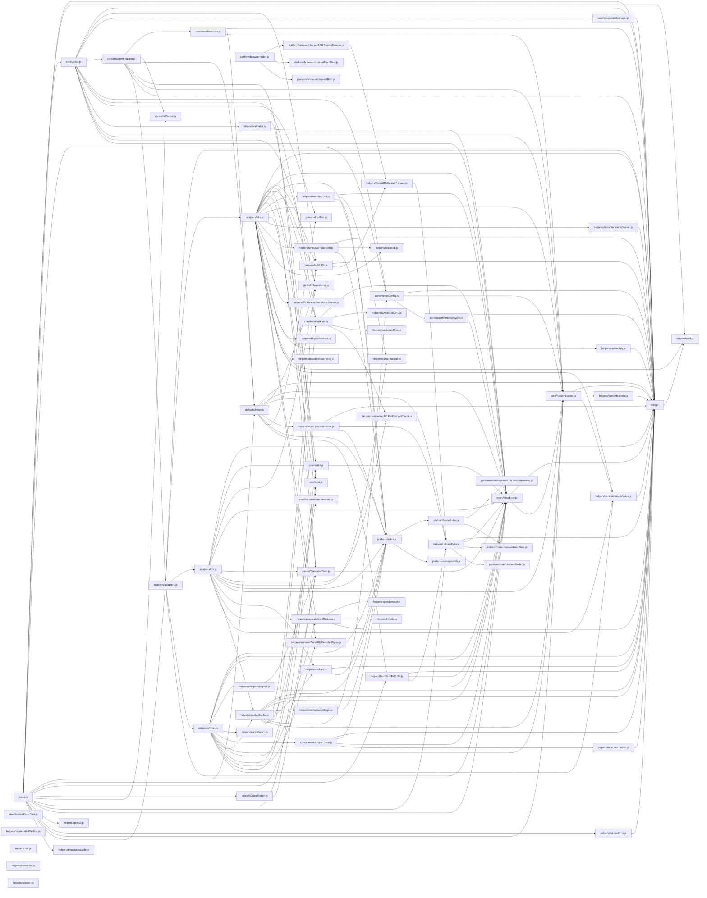

# CodeProof report

Commit: b2c8f4c90801b6c2260a43ce7550c22868a0fb82  |  run-id: 33bb4da404e0a3aa  |  mode: smoke

**Publishing rule:** a finding appears under *Verified findings* only if every citation passed L1 and the adversarial verifier confirmed it. This checks provenance and model agreement, not semantic proof. Refuted, uncertain and moderate findings are in rejected.md.

## Summary

| Metric | Value |
|---|---|
| Files / LOC | 74 / 9564 |
| Import edges / cycles | 177 / 0 |
| Files in scanner prompt | 74 / 74 |
| Findings proposed | 14 |
| Rejected at L1 (bad citation) | 2 |
| Verified | 12 |
| Reproduced by execution (L3) | 10 |
| Moderate confidence | 0 |
| Refuted | 0 |
| Uncertain | 0 |
| Calls / retries | 32 / 0 |
| Tokens in / out | 236380 / 100014 |
| Cached input tokens | 87969 |
| Cost | $1.8460 |

## Verified findings

### F-001 - critical - matchAll infinite loop on non-global or empty match

**Claim:** matchAll loops on regExp.exec without requiring a global flag or advancing past empty matches, so a non-global regex or a zero-length global match makes exec return the same match forever and the while loop never terminates.

**Proposed by:** Muse Spark

**Evidence level:** citation-proven + adversarially-confirmed + **execution-proven (generated test fails on the analyzed commit)**

**Execution check:** reproduced by execution (see Reproduced by execution)

**Citation (from commit, lines 879-888):** utils.js
```text
const matchAll = (regExp, str) => {
  let matches;
  const arr = [];

  while ((matches = regExp.exec(str)) !== null) {
    arr.push(matches);
  }

  return arr;
};
```

**Verifier (muse-wonder-1.0):** confirm - The loop at utils.js:883 repeatedly calls regExp.exec with no global-flag check, lastIndex advancement, or empty-match guard in utils.js:879-888, so a non-global or empty-matching global regex returns the same match indefinitely.

### F-003 - high - merge recursion drops caseless/skipUndefined context

**Claim:** merge reads caseless/skipUndefined from this but its recursive calls for nested plain objects invoke merge(...) without preserving this, so nested merges lose those options.

**Proposed by:** Muse Spark

**Evidence level:** citation-proven + adversarially-confirmed + **execution-proven (generated test fails on the analyzed commit)**

**Execution check:** reproduced by execution (see Reproduced by execution)

**Citation (from commit, lines 587-589):** utils.js
```text
function merge(...objs) {
  const { caseless, skipUndefined } = (isContextDefined(this) && this) || {};
  const result = {};
```
**Citation (from commit, lines 618-621):** utils.js
```text
    if (isPlainObject(existing) && isPlainObject(val)) {
      result[targetKey] = merge(existing, val);
    } else if (isPlainObject(val)) {
      result[targetKey] = merge({}, val);
```

**Verifier (muse-wonder-1.0):** confirm - Merge extracts caseless/skipUndefined from this at utils.js:588, but the nested plain-object branches at utils.js:619 and utils.js:621 invoke merge(existing, val) and merge({}, val) as bare calls without .call(this) or binding, so recursion receives undefined/global this and loses those options.

### F-004 - medium - toObjectSet uses prototype-inheriting object as set

**Claim:** toObjectSet builds the membership set in a plain {} via obj[value]=true, so uninherited prototype keys read truthy without being added and __proto__ assignment does not create an own entry, corrupting membership tests.

**Proposed by:** Muse Spark

**Evidence level:** citation-proven + adversarially-confirmed + **execution-proven (generated test fails on the analyzed commit)**

**Execution check:** reproduced by execution (see Reproduced by execution)

**Citation (from commit, lines 963-970):** utils.js
```text
const toObjectSet = (arrayOrString, delimiter) => {
  const obj = {};

  const define = (arr) => {
    arr.forEach((value) => {
      obj[value] = true;
    });
  };
```

**Verifier (muse-wonder-1.0):** confirm - The cited code at utils.js:963-968 creates a plain prototype-inheriting object with const obj = {} and populates it via obj[value] = true, so prototype keys such as toString/constructor read truthy without insertion and __proto__ assignment creates no own entry, exactly as claimed.

### F-005 - critical - Inverted guard prevents CancelToken cancellation

**Claim:** The cancel function returns early when `token.reason` is falsy, so the first (and normally only) cancellation request is ignored and `token.reason` is never set; cancellation can never occur.

**Proposed by:** Muse Spark

**Evidence level:** citation-proven + adversarially-confirmed + **execution-proven (generated test fails on the analyzed commit)**

**Execution check:** reproduced by execution (see Reproduced by execution)

**Citation (from commit, lines 54-62):** cancel/CancelToken.js
```text
    executor(function cancel(message, config, request) {
      if (!token.reason) {
        // Cancellation has already been requested
        return;
      }

      token.reason = new CanceledError(message, config, request);
      resolvePromise(token.reason);
    });
```

**Verifier (muse-wonder-1.0):** confirm - The cancel executor at cancel/CancelToken.js:55 returns early when `!token.reason` is true, which is the initial unset state, so the assignment at cancel/CancelToken.js:60 and resolve at cancel/CancelToken.js:61 are unreachable on the first cancellation request.

### F-006 - critical - settle bypasses validateStatus for status <500

**Claim:** settle resolves any status <500 even when validateStatus returns false, so 4xx rejections never occur and ERR_BAD_REQUEST is unreachable.

**Proposed by:** Muse Spark

**Evidence level:** citation-proven + adversarially-confirmed + **execution-proven (generated test fails on the analyzed commit)**

**Execution check:** reproduced by execution (see Reproduced by execution)

**Citation (from commit, lines 14-17):** core/settle.js
```text
export default function settle(resolve, reject, response) {
  const validateStatus = response.config.validateStatus;
  if (!response.status || !validateStatus || validateStatus(response.status) || response.status < 500) {
    resolve(response);
```

**Verifier (muse-wonder-1.0):** confirm - The condition at core/settle.js:16 includes 'response.status < 500' as an independent resolve disjunct, so any status below 500 resolves regardless of validateStatus, and rejection at core/settle.js:18-21 therefore requires status >= 500, making the ERR_BAD_REQUEST branch for 400-499 unreachable.

### F-007 - critical - combineURLs missing '/' separator

**Claim:** combineURLs strips trailing slashes from baseURL then concatenates relativeURL without inserting '/', producing 'http://a/bc' instead of 'http://a/b/c'.

**Proposed by:** Muse Spark

**Evidence level:** citation-proven + adversarially-confirmed + **execution-proven (generated test fails on the analyzed commit)**

**Execution check:** reproduced by execution (see Reproduced by execution)

**Citation (from commit, lines 22-22):** helpers/combineURLs.js
```text
  return baseURL.slice(0, end) + relativeURL.replace(/^\/+/, '');
```

**Verifier (muse-wonder-1.0):** confirm - The code at helpers/combineURLs.js:22 concatenates baseURL.slice(0, end) directly with relativeURL stripped of leading slashes and no '/' inserted, after helpers/combineURLs.js:18-20 strips trailing slashes from baseURL, so 'http://a/b' combined with '/c' yields 'http://a/bc'.

### F-008 - critical - isAxiosError true for any object

**Claim:** isAxiosError uses !== false so any plain object without isAxiosError (undefined !== false) returns true instead of only true AxiosErrors.

**Proposed by:** Muse Spark

**Evidence level:** citation-proven + adversarially-confirmed + **execution-proven (generated test fails on the analyzed commit)**

**Execution check:** reproduced by execution (see Reproduced by execution)

**Citation (from commit, lines 12-14):** helpers/isAxiosError.js
```text
export default function isAxiosError(payload) {
  return utils.isObject(payload) && payload.isAxiosError !== false;
}
```

**Verifier (muse-wonder-1.0):** confirm - The code at helpers/isAxiosError.js:13 returns utils.isObject(payload) && payload.isAxiosError !== false, so a plain object lacking the property yields undefined !== false and returns true.

### F-009 - high - buildURL retains '#' when stripping fragment

**Claim:** buildURL keeps the '#' when stripping the fragment (slice to hashmarkIndex+1), so serialized params are appended after '#' into the fragment instead of the query string.

**Proposed by:** Muse Spark

**Evidence level:** citation-proven + adversarially-confirmed

**Execution check:** unavailable: the repository's own imports are not directly executable by Node without a build step (extensionless specifiers or missing packages)

**Citation (from commit, lines 60-65):** helpers/buildURL.js
```text
    const hashmarkIndex = url.indexOf('#');

    if (hashmarkIndex !== -1) {
      url = url.slice(0, hashmarkIndex + 1);
    }
    url += (url.indexOf('?') === -1 ? '?' : '&') + serializedParams;
```

**Verifier (muse-wonder-1.0):** confirm - The code at helpers/buildURL.js:63 uses url.slice(0, hashmarkIndex + 1), which retains the '#' character, and helpers/buildURL.js:65 then appends '?'+serializedParams after it, so params are placed in the fragment rather than the query string.

### F-010 - high - parseHeaders case-sensitive header names

**Claim:** parseHeaders does not lowercase header names, so case variants are stored as distinct keys and duplicate-ignore and set-cookie array logic fail.

**Proposed by:** Muse Spark

**Evidence level:** citation-proven + adversarially-confirmed + **execution-proven (generated test fails on the analyzed commit)**

**Execution check:** reproduced by execution (see Reproduced by execution)

**Citation (from commit, lines 50-52):** helpers/parseHeaders.js
```text
      i = line.indexOf(':');
      key = line.substring(0, i).trim();
      val = line.substring(i + 1).trim();
```
**Citation (from commit, lines 60-65):** helpers/parseHeaders.js
```text
      if (key === 'set-cookie') {
        if (hasKey) {
          parsed[key].push(val);
        } else {
          parsed[key] = [val];
        }
```

**Verifier (muse-wonder-1.0):** confirm - parseHeaders extracts the key with only trim() at helpers/parseHeaders.js:51, checks it case-sensitively against the lowercase ignoreDuplicateOf set at helpers/parseHeaders.js:56, and requires exact 'set-cookie' at helpers/parseHeaders.js:60, so case variants are stored distinctly and bypass both duplicate-ignore and set-cookie array handling.

### F-011 - high - spread does not spread arguments

**Claim:** spread wraps the array in another array ([arr]) so callback receives a single array argument instead of spread arguments.

**Proposed by:** Muse Spark

**Evidence level:** citation-proven + adversarially-confirmed + **execution-proven (generated test fails on the analyzed commit)**

**Execution check:** reproduced by execution (see Reproduced by execution)

**Citation (from commit, lines 24-28):** helpers/spread.js
```text
export default function spread(callback) {
  return function wrap(arr) {
    return callback.apply(null, [arr]);
  };
}
```

**Verifier (muse-wonder-1.0):** confirm - The code at helpers/spread.js:26 uses callback.apply(null, [arr]), which passes arr itself as a single argument instead of spreading its elements as callback.apply(null, arr) would.

### F-013 - medium - scheduler.start leaks prior interval

**Claim:** createScheduler.start replaces this.timer with a new setInterval without clearing an existing interval, leaking the previous handle.

**Proposed by:** Muse Spark

**Evidence level:** citation-proven + adversarially-confirmed + **execution-proven (generated test fails on the analyzed commit)**

**Execution check:** reproduced by execution (see Reproduced by execution)

**Citation (from commit, lines 6-8):** helpers/scheduler.js
```text
    start(callback, intervalMs) {
      this.timer = setInterval(callback, intervalMs);
    },
```

**Verifier (muse-wonder-1.0):** confirm - The cited code at helpers/scheduler.js:6-7 assigns this.timer = setInterval(callback, intervalMs) with no prior clearInterval, while stop at helpers/scheduler.js:9-11 can only clear the currently stored handle, so a second start without stop loses and leaks the previous interval.

### F-014 - medium - cookie split misses ';' without space

**Claim:** cookies.read splits only on '; ' so a cookie string serialized with ';' and no space is not split and later cookies are never matched.

**Proposed by:** Muse Spark

**Evidence level:** citation-proven + adversarially-confirmed

**Execution check:** inconclusive: reproducer failed L0: testCode must bind at least one named or default symbol from the repository import

**Citation (from commit, lines 48-50):** helpers/cookies.js
```text
        const cookies = cookieString.split('; ');
        for (let i = 0; i < cookies.length; i++) {
          const cookie = cookies[i].replace(/^\s+/, '');
```

**Verifier (muse-wonder-1.0):** confirm - The code at helpers/cookies.js:48 splits only on '; ' and at helpers/cookies.js:52 compares only the substring before the first '=' in each chunk, so a ';'-only serialized string remains a single chunk and later cookie names are never matched.

## Reproduced by execution

For each finding below, the verifier model wrote a standalone test. The test runs on a `git archive` snapshot of the analyzed commit inside a permission-model sandbox: no network, no writes, 2 s timeout, three runs. The finding is execution-proven only if the test fails 3/3 with an assertion error.

### F-001 - matchAll infinite loop on non-global or empty match

**Expected behavior:** matchAll(/a*/g, 'b') should terminate and return the two empty matches at indices 0 and 1, advancing past zero-length matches like String.prototype.matchAll.

**Generated test (fails on the analyzed commit):**
```js
import assert from 'node:assert/strict';
import utils from './utils.js';

const { matchAll } = utils;
assert.equal(typeof matchAll, 'function');

// Bound exec so a non-advancing implementation terminates in the harness
// instead of hanging forever: after 10 calls it reports no further match.
// A correct matchAll must advance past zero-length matches on its own.
let calls = 0;
const regExp = /a*/g;
const originalExec = regExp.exec.bind(regExp);
regExp.exec = (str) => {
  calls += 1;
  if (calls > 10) {
    return null;
  }
  return originalExec(str);
};

let result;
let thrown = null;
try {
  result = matchAll(regExp, 'b');
} catch (err) {
  thrown = err;
}

assert.equal(thrown, null);
assert.equal(Array.isArray(result), true);
// Native matchAll semantics: empty matches at index 0 and index 1.
assert.equal(result.length, 2);
assert.equal(result[0][0], '');
assert.equal(result[0].index, 0);
assert.equal(result[1][0], '');
assert.equal(result[1].index, 1);
assert.equal(calls <= 3, true);
```

**Runner output (last of 3 attempts):**
```text
10 !== 2

    at file:///tmp/codeproof-repro-nwV3pb/snapshot/.codeproof-repro.test.mjs:32:8
    at ModuleJob.run (node:internal/modules/esm/module_job:569:25)
    at async node:internal/modules/esm/loader:650:26
    at async asyncRunEntryPointWithESMLoader (node:internal/modules/run_main:101:5) {
  generatedMessage: true,
  code: 'ERR_ASSERTION',
  actual: 10,
  expected: 2,
  operator: 'strictEqual',
  diff: 'simple'
}

Node.js v26.8.2
```

### F-003 - merge recursion drops caseless/skipUndefined context

**Expected behavior:** merge.call({caseless:true, skipUndefined:true}, ...) applies caseless key deduplication and skipUndefined recursively to nested plain objects, both when merging two nested objects and when copying a new nested object.

**Generated test (fails on the analyzed commit):**
```js
import assert from 'node:assert/strict';
import utils from './utils.js';

const merge = utils.merge;

const caselessResult = merge.call(
  { caseless: true },
  { headers: { 'Content-Type': 'a', 'X-Test': '1' } },
  { headers: { 'content-type': 'b' } }
);
assert.deepEqual(caselessResult, {
  headers: { 'Content-Type': 'b', 'X-Test': '1' },
});

const skipResult = merge.call(
  { skipUndefined: true },
  { nested: { a: 1, b: 2 } },
  { nested: { a: undefined } }
);
assert.deepEqual(skipResult, { nested: { a: 1, b: 2 } });

const copyResult = merge.call(
  { caseless: true, skipUndefined: true },
  {},
  { nested: { 'X-A': 1, 'x-a': 2, gone: undefined } }
);
assert.deepEqual(copyResult, { nested: { 'X-A': 2 } });
```

**Runner output (last of 3 attempts):**
```text
    at file:///tmp/codeproof-repro-ZlKg1M/snapshot/.codeproof-repro.test.mjs:11:8
    at ModuleJob.run (node:internal/modules/esm/module_job:569:25)
    at async node:internal/modules/esm/loader:650:26
    at async asyncRunEntryPointWithESMLoader (node:internal/modules/run_main:101:5) {
  generatedMessage: true,
  code: 'ERR_ASSERTION',
  actual: {
    headers: { 'Content-Type': 'a', 'X-Test': '1', 'content-type': 'b' }
  },
  expected: { headers: { 'Content-Type': 'b', 'X-Test': '1' } },
  operator: 'deepStrictEqual',
  diff: 'simple'
}

Node.js v26.8.2
```

### F-004 - toObjectSet uses prototype-inheriting object as set

**Expected behavior:** toObjectSet returns a membership set where only added keys read true: uninherited Object.prototype keys (toString, constructor, hasOwnProperty, valueOf) read undefined on an empty set, and '__proto__' added to the set is stored as an own property with value true.

**Generated test (fails on the analyzed commit):**
```js
import assert from 'node:assert/strict';
import utils from './utils.js';

const { toObjectSet } = utils;

const present = toObjectSet(['alpha', 'beta']);
assert.equal(present.alpha, true);
assert.equal(present.beta, true);
assert.equal(present.gamma, undefined);

const empty = toObjectSet([]);
assert.equal(empty.toString, undefined);
assert.equal(empty.constructor, undefined);
assert.equal(empty.hasOwnProperty, undefined);
assert.equal(empty.valueOf, undefined);

const protoSet = toObjectSet(['__proto__']);
assert.equal(Object.prototype.hasOwnProperty.call(protoSet, '__proto__'), true);
assert.equal(protoSet['__proto__'], true);
assert.deepEqual(Object.keys(protoSet), ['__proto__']);

const fromString = toObjectSet('__proto__,constructor', ',');
assert.equal(Object.prototype.hasOwnProperty.call(fromString, '__proto__'), true);
assert.equal(fromString['__proto__'], true);
assert.equal(fromString.constructor, true);
assert.deepEqual(Object.keys(fromString).sort(), ['__proto__', 'constructor']);
```

**Runner output (last of 3 attempts):**
```text
- undefined

    at file:///tmp/codeproof-repro-QTZ3bR/snapshot/.codeproof-repro.test.mjs:12:8
    at ModuleJob.run (node:internal/modules/esm/module_job:569:25)
    at async node:internal/modules/esm/loader:650:26
    at async asyncRunEntryPointWithESMLoader (node:internal/modules/run_main:101:5) {
  generatedMessage: true,
  code: 'ERR_ASSERTION',
  actual: [Function: toString],
  expected: undefined,
  operator: 'strictEqual',
  diff: 'simple'
}

Node.js v26.8.2
```

### F-005 - Inverted guard prevents CancelToken cancellation

**Expected behavior:** Calling cancel() from CancelToken.source() sets token.reason to a CanceledError with the given message, throwIfRequested() throws that reason, subscribers are notified, and token.promise resolves with it.

**Generated test (fails on the analyzed commit):**
```js
import assert from 'node:assert/strict';
import CancelToken from './cancel/CancelToken.js';

const { token, cancel } = CancelToken.source();
assert.equal(token.reason, undefined);
cancel('Operation canceled by test');
assert.ok(token.reason, 'cancel() should set token.reason on first call');
assert.equal(token.reason.message, 'Operation canceled by test');
assert.equal(token.reason.name, 'CanceledError');

let thrown = null;
try {
  token.throwIfRequested();
} catch (err) {
  thrown = err;
}
assert.ok(thrown, 'throwIfRequested() should throw after cancellation');
assert.equal(thrown, token.reason);

let notified = null;
token.subscribe((reason) => { notified = reason; });
assert.equal(notified, token.reason);

const resolved = await token.promise;
assert.equal(resolved, token.reason);

cancel('second cancellation');
assert.equal(token.reason.message, 'Operation canceled by test');
```

**Runner output (last of 3 attempts):**
```text

AssertionError [ERR_ASSERTION]: cancel() should set token.reason on first call
    at file:///tmp/codeproof-repro-DG3C2M/snapshot/.codeproof-repro.test.mjs:7:8
    at ModuleJob.run (node:internal/modules/esm/module_job:569:25)
    at async node:internal/modules/esm/loader:650:26
    at async asyncRunEntryPointWithESMLoader (node:internal/modules/run_main:101:5) {
  generatedMessage: false,
  code: 'ERR_ASSERTION',
  actual: undefined,
  expected: true,
  operator: '==',
  diff: 'simple'
}

Node.js v26.8.2
```

### F-006 - settle bypasses validateStatus for status <500

**Expected behavior:** settle should reject a 404/403 response when validateStatus returns false, producing an AxiosError with code ERR_BAD_REQUEST, while still resolving 2xx responses.

**Generated test (fails on the analyzed commit):**
```js
import assert from 'node:assert/strict';
import settle from './core/settle.js';

function run(status, validateStatus) {
  const result = { type: null, value: null, thrown: null };
  try {
    settle(
      (res) => { result.type = 'resolved'; result.value = res; },
      (err) => { result.type = 'rejected'; result.value = err; },
      { status, config: { validateStatus }, request: {} }
    );
  } catch (e) {
    result.thrown = e;
    result.type = 'thrown';
  }
  return result;
}

const validate = (s) => s >= 200 && s < 300;

const ok = run(200, validate);
assert.equal(ok.thrown, null);
assert.equal(ok.type, 'resolved');

const notFound = run(404, validate);
assert.equal(notFound.thrown, null);
assert.equal(notFound.type, 'rejected');
assert.equal(notFound.value && notFound.value.code, 'ERR_BAD_REQUEST');
assert.match(notFound.value ? notFound.value.message : '', /404/);

const forbidden = run(403, validate);
assert.equal(forbidden.thrown, null);
assert.equal(forbidden.type, 'rejected');
assert.equal(forbidden.value && forbidden.value.code, 'ERR_BAD_REQUEST');
```

**Runner output (last of 3 attempts):**
```text
     ^

    at file:///tmp/codeproof-repro-Ji4jNz/snapshot/.codeproof-repro.test.mjs:27:8
    at ModuleJob.run (node:internal/modules/esm/module_job:569:25)
    at async node:internal/modules/esm/loader:650:26
    at async asyncRunEntryPointWithESMLoader (node:internal/modules/run_main:101:5) {
  generatedMessage: true,
  code: 'ERR_ASSERTION',
  actual: 'resolved',
  expected: 'rejected',
  operator: 'strictEqual',
  diff: 'simple'
}

Node.js v26.8.2
```

### F-007 - combineURLs missing '/' separator

**Expected behavior:** combineURLs('http://a/b', 'c') returns 'http://a/b/c' with a '/' separator between base and relative parts

**Generated test (fails on the analyzed commit):**
```js
import assert from 'node:assert/strict';
import combineURLs from './helpers/combineURLs.js';

assert.equal(combineURLs('http://a/b', 'c'), 'http://a/b/c');
assert.equal(combineURLs('http://a/b/', 'c'), 'http://a/b/c');
assert.equal(combineURLs('http://a/b', '/c'), 'http://a/b/c');
assert.equal(combineURLs('http://a/b/', '/c'), 'http://a/b/c');
assert.equal(combineURLs('http://a/b', ''), 'http://a/b');
```

**Runner output (last of 3 attempts):**
```text
             ^

    at file:///tmp/codeproof-repro-Y30Eyv/snapshot/.codeproof-repro.test.mjs:4:8
    at ModuleJob.run (node:internal/modules/esm/module_job:569:25)
    at async node:internal/modules/esm/loader:650:26
    at async asyncRunEntryPointWithESMLoader (node:internal/modules/run_main:101:5) {
  generatedMessage: true,
  code: 'ERR_ASSERTION',
  actual: 'http://a/bc',
  expected: 'http://a/b/c',
  operator: 'strictEqual',
  diff: 'simple'
}

Node.js v26.8.2
```

### F-008 - isAxiosError true for any object

**Expected behavior:** isAxiosError returns false for plain objects without isAxiosError=true and true only for payloads marked as Axios errors

**Generated test (fails on the analyzed commit):**
```js
import assert from 'node:assert/strict';
import isAxiosError from './helpers/isAxiosError.js';

assert.equal(isAxiosError({ isAxiosError: true }), true);
assert.equal(isAxiosError({ isAxiosError: false }), false);
assert.equal(isAxiosError({}), false);
assert.equal(isAxiosError({ name: 'Error', message: 'boom' }), false);
assert.equal(isAxiosError({ isAxiosError: undefined }), false);
assert.equal(isAxiosError([]), false);
assert.equal(isAxiosError(null), false);
assert.equal(isAxiosError('boom'), false);
```

**Runner output (last of 3 attempts):**
```text
true !== false

    at file:///tmp/codeproof-repro-3aDVka/snapshot/.codeproof-repro.test.mjs:6:8
    at ModuleJob.run (node:internal/modules/esm/module_job:569:25)
    at async node:internal/modules/esm/loader:650:26
    at async asyncRunEntryPointWithESMLoader (node:internal/modules/run_main:101:5) {
  generatedMessage: true,
  code: 'ERR_ASSERTION',
  actual: true,
  expected: false,
  operator: 'strictEqual',
  diff: 'simple'
}

Node.js v26.8.2
```

### F-010 - parseHeaders case-sensitive header names

**Expected behavior:** parseHeaders lowercases header names so case variants merge, duplicate-ignore headers keep the first value, and Set-Cookie values collect into an array under 'set-cookie'

**Generated test (fails on the analyzed commit):**
```js
import assert from 'node:assert/strict';
import parseHeaders from './helpers/parseHeaders.js';

const cookies = parseHeaders('Set-Cookie: a=1\nSet-Cookie: b=2\nSET-COOKIE: c=3');
assert.deepEqual(cookies['set-cookie'], ['a=1', 'b=2', 'c=3']);
assert.deepEqual(Object.keys(cookies), ['set-cookie']);

const dup = parseHeaders('Content-Type: text/html\ncontent-type: application/json\nCONTENT-TYPE: text/plain');
assert.equal(dup['content-type'], 'text/html');
assert.deepEqual(Object.keys(dup), ['content-type']);

const merged = parseHeaders('X-Custom: a\nx-custom: b');
assert.equal(merged['x-custom'], 'a, b');
assert.deepEqual(Object.keys(merged), ['x-custom']);

const simple = parseHeaders('Date: Wed, 27 Aug 2014 08:58:49 GMT');
assert.equal(simple['date'], 'Wed, 27 Aug 2014 08:58:49 GMT');
assert.deepEqual(Object.keys(simple), ['date']);
```

**Runner output (last of 3 attempts):**
```text
- ]

    at file:///tmp/codeproof-repro-ttBoTs/snapshot/.codeproof-repro.test.mjs:5:8
    at ModuleJob.run (node:internal/modules/esm/module_job:569:25)
    at async node:internal/modules/esm/loader:650:26
    at async asyncRunEntryPointWithESMLoader (node:internal/modules/run_main:101:5) {
  generatedMessage: true,
  code: 'ERR_ASSERTION',
  actual: undefined,
  expected: [ 'a=1', 'b=2', 'c=3' ],
  operator: 'deepStrictEqual',
  diff: 'simple'
}

Node.js v26.8.2
```

### F-011 - spread does not spread arguments

**Expected behavior:** spread(fn)([1,2,3]) invokes fn with 1, 2, 3 as separate arguments (as documented), not a single array argument.

**Generated test (fails on the analyzed commit):**
```js
import assert from 'node:assert/strict';
import spread from './helpers/spread.js';

let args;
const result = spread(function (x, y, z) {
  args = [x, y, z];
  return x + y + z;
})([1, 2, 3]);
assert.deepEqual(args, [1, 2, 3]);
assert.equal(result, 6);

let count;
let first;
spread(function () {
  count = arguments.length;
  first = arguments[0];
})([1, 2, 3]);
assert.equal(count, 3);
assert.equal(first, 1);
```

**Runner output (last of 3 attempts):**
```text
  ]

    at file:///tmp/codeproof-repro-Gq7MQl/snapshot/.codeproof-repro.test.mjs:9:8
    at ModuleJob.run (node:internal/modules/esm/module_job:569:25)
    at async node:internal/modules/esm/loader:650:26
    at async asyncRunEntryPointWithESMLoader (node:internal/modules/run_main:101:5) {
  generatedMessage: true,
  code: 'ERR_ASSERTION',
  actual: [ [ 1, 2, 3 ], undefined, undefined ],
  expected: [ 1, 2, 3 ],
  operator: 'deepStrictEqual',
  diff: 'simple'
}

Node.js v26.8.2
```

### F-013 - scheduler.start leaks prior interval

**Expected behavior:** Calling start() a second time clears the previous interval before replacing timer, so stop() cannot leak it.

**Generated test (fails on the analyzed commit):**
```js
import assert from 'node:assert/strict';
import { createScheduler } from './helpers/scheduler.js';

const origSetInterval = globalThis.setInterval;
const origClearInterval = globalThis.clearInterval;
const created = [];
const cleared = [];
globalThis.setInterval = (cb, ms, ...args) => {
  const handle = origSetInterval(cb, ms, ...args);
  created.push(handle);
  return handle;
};
globalThis.clearInterval = (handle) => {
  cleared.push(handle);
  return origClearInterval(handle);
};
const scheduler = createScheduler();
scheduler.start(() => {}, 100);
const first = scheduler.timer;
scheduler.start(() => {}, 100);
const second = scheduler.timer;
const firstClearedOnRestart = cleared.includes(first);
const distinct = first !== second;
globalThis.setInterval = origSetInterval;
globalThis.clearInterval = origClearInterval;
for (const h of created) origClearInterval(h);
scheduler.timer = null;
assert.strictEqual(distinct, true);
assert.strictEqual(firstClearedOnRestart, true, 'start() must clear previous interval before replacing timer');
```

**Runner output (last of 3 attempts):**
```text
false !== true

    at file:///tmp/codeproof-repro-OxIef3/snapshot/.codeproof-repro.test.mjs:29:8
    at ModuleJob.run (node:internal/modules/esm/module_job:569:25)
    at async node:internal/modules/esm/loader:650:26
    at async asyncRunEntryPointWithESMLoader (node:internal/modules/run_main:101:5) {
  generatedMessage: false,
  code: 'ERR_ASSERTION',
  actual: false,
  expected: true,
  operator: 'strictEqual',
  diff: 'simple'
}

Node.js v26.8.2
```

## Architecture

Deterministic facts only: 74 files, 9564 LOC, 177 import edges, 0 cycles. The diagram is generated from the import graph by code, never by the model.



## Limits

- Scan and verify are static: the analyzed code is never executed while the scanner and verifier run. L3 runs only the generated test, on a git-archive snapshot, inside a permission-model sandbox (no network, no writes, 2 s timeout); isolation is process-level, not OS-level.
- No completeness claim; this report shows what passed the gate, not everything that exists in the repository.
- Only direct correctness defects; omission, security and style findings are out of scope for this milestone.
- The L1 gate proves that a citation exists in the commit; the semantic match is judged by the verifier model and presented as such.

