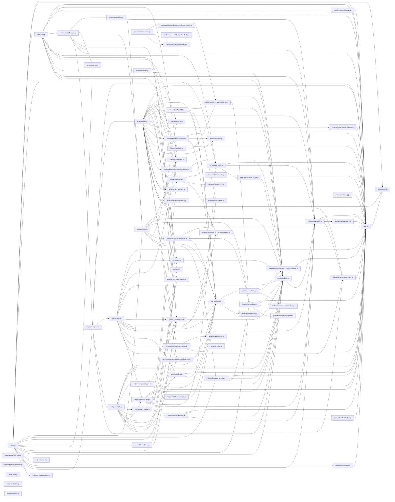

# CodeProof report

Commit: 776d018340e310ab877a1ee9dada071b4f480b71  |  run-id: b67b6fc081d9302f  |  mode: smoke

**Publishing rule:** a finding appears under *Verified findings* only if the deterministic citation gate (L1) passed and the adversarial verifier confirmed it. Refuted, uncertain and moderate findings are kept in separate sections - nothing is hidden, and nothing unproven is presented as verified.

## Summary

| Metric | Value |
|---|---|
| Files / LOC | 74 / 9564 |
| Import edges / cycles | 177 / 0 |
| Findings proposed | 4 |
| Rejected at L1 (bad citation) | 0 |
| Verified | 4 |
| Moderate confidence | 0 |
| Refuted | 0 |
| Uncertain | 0 |
| Calls / retries | 5 / 0 |
| Tokens in / out | 123990 / 10858 |
| Cached input tokens | 1000 |
| Cost | $0.3448 |

## Verified findings

### F-001 - critical - combineURLs omits '/' separator

**Claim:** combineURLs strips trailing slashes from baseURL and leading slashes from relativeURL then concatenates without inserting a separator, producing e.g. base+relative without '/'

**Citation:** helpers/combineURLs.js:11-23
```text
export default function combineURLs(baseURL, relativeURL) {
  if (!relativeURL) {
    return baseURL;
  }

  let end = baseURL.length;

  while (end > 0 && baseURL.charCodeAt(end - 1) === 47) {
    end--;
  }

  return baseURL.slice(0, end) + relativeURL.replace(/^\/+/, '');
}
```

**Verifier (muse-wonder-1.0):** confirm - The code at helpers/combineURLs.js:22 returns baseURL.slice(0, end) + relativeURL.replace(/^\/+/, '') with no '/' inserted after trimming trailing slashes at helpers/combineURLs.js:18-20 and leading slashes, so e.g. 'https://x/api/' + '/users' becomes 'https://x/apiusers', and core/buildFullPath.js:73 passes the result through directly.

### F-002 - high - buildURL appends query after fragment

**Claim:** buildURL keeps the '#' when stripping the fragment before appending serialized params, so query string is appended after '#' and becomes part of the fragment instead of the query

**Citation:** helpers/buildURL.js:59-66
```text
  if (serializedParams) {
    const hashmarkIndex = url.indexOf('#');

    if (hashmarkIndex !== -1) {
      url = url.slice(0, hashmarkIndex + 1);
    }
    url += (url.indexOf('?') === -1 ? '?' : '&') + serializedParams;
  }
```

**Verifier (muse-wonder-1.0):** confirm - At helpers/buildURL.js:63 url.slice(0, hashmarkIndex + 1) retains the '#' character, and helpers/buildURL.js:65 then appends '?/&' plus serializedParams after it, so the params fall inside the fragment rather than the query string.

### F-003 - high - ArrayBufferView loses offset/length

**Claim:** transformRequest returns data.buffer for any ArrayBuffer view, discarding byteOffset and byteLength so a subarray/view sends the whole underlying buffer

**Citation:** defaults/index.js:70-72
```text
      if (utils.isArrayBufferView(data)) {
        return data.buffer;
      }
```

**Verifier (muse-wonder-1.0):** confirm - The branch at defaults/index.js:70-72 unconditionally returns data.buffer for isArrayBufferView data without applying byteOffset or byteLength, so a subarray or offset view is expanded to its entire underlying buffer.

### F-004 - medium - Scheduler start replaces timer without clear

**Claim:** createScheduler.start overwrites this.timer with a new setInterval without clearing an existing interval, leaking the previous timer

**Citation:** helpers/scheduler.js:3-13
```text
export function createScheduler() {
  return {
    timer: null,
    start(callback, intervalMs) {
      this.timer = setInterval(callback, intervalMs);
    },
    stop() {
      clearInterval(this.timer);
      this.timer = null;
    }
```

**Verifier (muse-wonder-1.0):** confirm - The code at helpers/scheduler.js:6-7 assigns this.timer = setInterval(callback, intervalMs) with no prior clearInterval or guard, while helpers/scheduler.js:9-11 stop() can only clear the most recent timer, so a second start() loses the previous interval reference and leaks it.

## Architecture

Deterministic facts only: 74 files, 9564 LOC, 177 import edges, 0 cycles. The diagram is generated from the import graph by code, never by the model.



## Limits

- Static analysis only: the analyzed code is never executed.
- No completeness claim; this report shows what passed the gate, not everything that exists in the repository.
- Only direct correctness defects; omission, security and style findings are out of scope for this milestone.
- The L1 gate proves that a citation exists in the commit; the semantic match is judged by the verifier model and presented as such.

