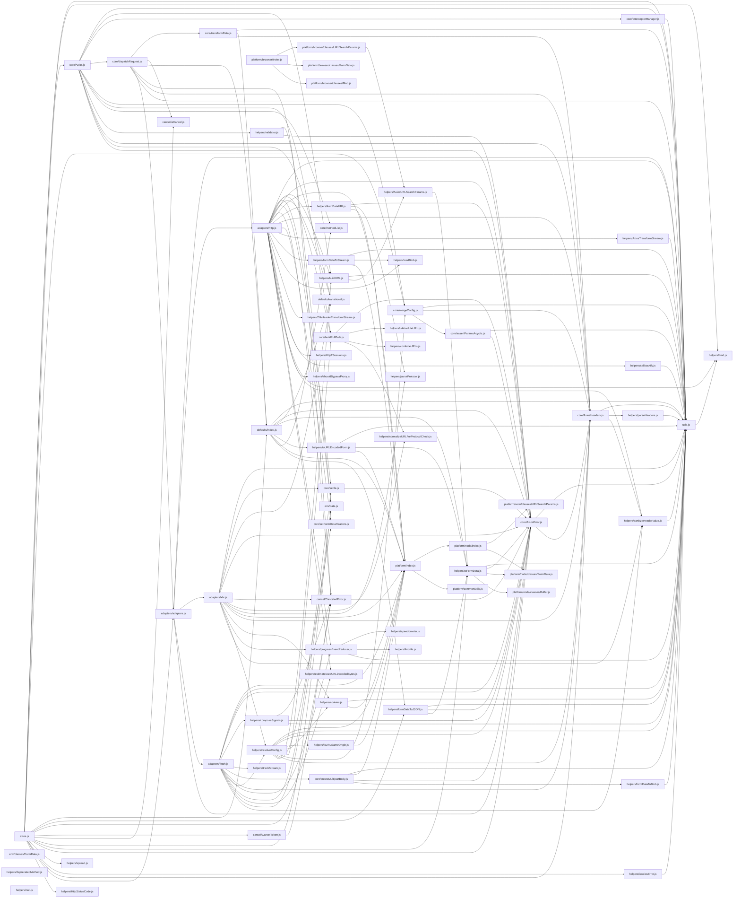

# CodeProof report

Commit: 790b5ba1d95a95e93d59b76995595c37f2b90a66  |  run-id: 7cdaefe97b62f85e  |  mode: smoke

**Publishing rule:** a finding appears under *Verified findings* only if the deterministic citation gate (L1) passed and the adversarial verifier confirmed it. Refuted, uncertain and moderate findings are kept in separate sections - nothing is hidden, and nothing unproven is presented as verified.

## Summary

| Metric | Value |
|---|---|
| Files / LOC | 72 / 9546 |
| Import edges / cycles | 177 / 0 |
| Findings proposed | 0 |
| Rejected at L1 (bad citation) | 0 |
| Verified | 0 |
| Moderate confidence | 0 |
| Refuted | 0 |
| Uncertain | 0 |
| Calls / retries | 1 / 0 |
| Tokens in / out | 93127 / 8731 |
| Cached input tokens | 0 |
| Cost | $0.1535 |

## Verified findings

_None this run._

## Architecture

Deterministic facts only: 72 files, 9546 LOC, 177 import edges, 0 cycles. The diagram is generated from the import graph by code, never by the model.

## Limits

- Static analysis only: the analyzed code is never executed.
- No completeness claim; this report shows what passed the gate, not everything that exists in the repository.
- Only direct correctness defects; omission, security and style findings are out of scope for this milestone.
- The L1 gate proves that a citation exists in the commit; the semantic match is judged by the verifier model and presented as such.

