# CodeProof report

Commit: 247faa0ff0641020e8790475989cee72df85d62b  |  run-id: 53a8f2896df35337  |  mode: smoke

**Publishing rule:** a finding appears under *Verified findings* only if the deterministic citation gate (L1) passed and the adversarial verifier confirmed it. Refuted, uncertain and moderate findings are kept in separate sections - nothing is hidden, and nothing unproven is presented as verified.

## Summary

| Metric | Value |
|---|---|
| Files / LOC | 110 / 8227 |
| Import edges / cycles | 300 / 5 |
| Findings proposed | 1 |
| Rejected at L1 (bad citation) | 0 |
| Verified | 1 |
| Moderate confidence | 0 |
| Refuted | 0 |
| Uncertain | 0 |
| Calls / retries | 3 / 0 |
| Tokens in / out | 115509 / 20793 |
| Cached input tokens | 108005 |
| Cost | $0.2945 |

## Verified findings

### F-001 - high - Shebang interpreter arguments truncated and combined into file path

**Claim:** Shebang parsing uses split(' ', 2), so any interpreter arguments beyond the first are dropped, and for non-env interpreters the interpreter plus argument are returned as a single space-containing file path which cannot resolve correctly.

**Citation:** arguments/command-file.js:156-162
```text
  const [interpreterPath, argument] = shebangLine.split(' ', 2);
  const interpreter = interpreterPath.split('/').at(-1);
  if (interpreter === 'env') {
    return argument;
  }

  return argument ? `${interpreter} ${argument}` : interpreter;
```

**Verifier (muse-wonder-1.0):** confirm - The code at arguments/command-file.js:156 uses split(' ', 2), which discards all tokens after the second, and at arguments/command-file.js:157-162 it returns only the single argument for env or a space-joined `${interpreter} ${argument}` string as the interpreter value described at arguments/command-file.js:147-149, confirming truncation and the space-containing return.

## Architecture

Deterministic facts only: 110 files, 8227 LOC, 300 import edges, 5 cycles. The diagram is generated from the import graph by code, never by the model.

```mermaid
graph LR
  n0["arguments/command-file.js"]
  n1["arguments/command.js"]
  n2["arguments/cwd.js"]
  n3["arguments/encoding-option.js"]
  n4["arguments/escape.js"]
  n5["arguments/fd-options.js"]
  n6["arguments/file-url.js"]
  n7["arguments/options.js"]
  n8["arguments/shell.js"]
  n9["arguments/specific.js"]
  n10["convert/add.js"]
  n11["convert/concurrent.js"]
  n12["convert/duplex.js"]
  n13["convert/iterable.js"]
  n14["convert/readable.js"]
  n15["convert/shared.js"]
  n16["convert/web.js"]
  n17["convert/writable.js"]
  n18["io/contents.js"]
  n19["io/input-sync.js"]
  n20["io/iterate.js"]
  n21["io/max-buffer.js"]
  n22["io/output-async.js"]
  n23["io/output-sync.js"]
  n24["io/pipeline.js"]
  n25["io/strip-newline.js"]
  n26["ipc/array.js"]
  n27["ipc/buffer-messages.js"]
  n28["ipc/forward.js"]
  n29["ipc/get-each.js"]
  n30["ipc/get-one.js"]
  n31["ipc/graceful.js"]
  n32["ipc/incoming.js"]
  n33["ipc/ipc-input.js"]
  n34["ipc/methods.js"]
  n35["ipc/outgoing.js"]
  n36["ipc/reference.js"]
  n37["ipc/send.js"]
  n38["ipc/strict.js"]
  n39["ipc/validation.js"]
  n40["methods/bind.js"]
  n41["methods/command.js"]
  n42["methods/create.js"]
  n43["methods/main-async.js"]
  n44["methods/main-sync.js"]
  n45["methods/node.js"]
  n46["methods/parameters.js"]
  n47["methods/promise.js"]
  n48["methods/script.js"]
  n49["methods/template.js"]
  n50["pipe/abort.js"]
  n51["pipe/pipe-arguments.js"]
  n52["pipe/sequence.js"]
  n53["pipe/setup.js"]
  n54["pipe/streaming.js"]
  n55["pipe/throw.js"]
  n56["resolve/all-async.js"]
  n57["resolve/all-sync.js"]
  n58["resolve/exit-async.js"]
  n59["resolve/exit-sync.js"]
  n60["resolve/stdio.js"]
  n61["resolve/wait-stream.js"]
  n62["resolve/wait-subprocess.js"]
  n63["return/duration.js"]
  n64["return/early-error.js"]
  n65["return/final-error.js"]
  n66["return/message.js"]
  n67["return/reject.js"]
  n68["return/result.js"]
  n69["stdio/direction.js"]
  n70["stdio/duplicate.js"]
  n71["stdio/handle-async.js"]
  n72["stdio/handle-sync.js"]
  n73["stdio/handle.js"]
  n74["stdio/input-option.js"]
  n75["stdio/native.js"]
  n76["stdio/stdio-option.js"]
  n77["stdio/type.js"]
  n78["terminate/cancel.js"]
  n79["terminate/cleanup.js"]
  n80["terminate/graceful.js"]
  n81["terminate/kill-descendants.js"]
  n82["terminate/kill.js"]
  n83["terminate/signal.js"]
  n84["terminate/timeout.js"]
  n85["transform/encoding-transform.js"]
  n86["transform/generator.js"]
  n87["transform/normalize.js"]
  n88["transform/object-mode.js"]
  n89["transform/run-async.js"]
  n90["transform/run-sync.js"]
  n91["transform/split.js"]
  n92["transform/validate.js"]
  n93["utils/abort-signal.js"]
  n94["utils/deferred.js"]
  n95["utils/max-listeners.js"]
  n96["utils/options.js"]
  n97["utils/standard-stream.js"]
  n98["utils/type-name.js"]
  n99["utils/uint-array.js"]
  n100["verbose/complete.js"]
  n101["verbose/custom.js"]
  n102["verbose/default.js"]
  n103["verbose/error.js"]
  n104["verbose/info.js"]
  n105["verbose/ipc.js"]
  n106["verbose/log.js"]
  n107["verbose/output.js"]
  n108["verbose/start.js"]
  n109["verbose/values.js"]
  n1 --> n108
  n1 --> n104
  n1 --> n63
  n1 --> n4
  n1 --> n9
  n2 --> n6
  n5 --> n9
  n7 --> n82
  n7 --> n83
  n7 --> n78
  n7 --> n80
  n7 --> n84
  n7 --> n45
  n7 --> n33
  n7 --> n96
  n7 --> n3
  n7 --> n0
  n7 --> n2
  n7 --> n6
  n7 --> n9
  n9 --> n97
  n9 --> n96
  n10 --> n11
  n10 --> n14
  n10 --> n17
  n10 --> n12
  n10 --> n16
  n10 --> n13
  n11 --> n94
  n12 --> n3
  n12 --> n5
  n12 --> n96
  n12 --> n11
  n12 --> n14
  n12 --> n17
  n13 --> n3
  n13 --> n5
  n13 --> n20
  n13 --> n96
  n14 --> n3
  n14 --> n5
  n14 --> n20
  n14 --> n94
  n14 --> n96
  n14 --> n11
  n14 --> n15
  n15 --> n61
  n17 --> n5
  n17 --> n61
  n17 --> n96
  n17 --> n11
  n17 --> n15
  n18 --> n99
  n18 --> n107
  n18 --> n20
  n18 --> n21
  n18 --> n25
  n19 --> n86
  n19 --> n99
  n19 --> n77
  n19 --> n3
  n20 --> n85
  n20 --> n91
  n20 --> n90
  n21 --> n97
  n21 --> n9
  n22 --> n97
  n22 --> n95
  n22 --> n77
  n22 --> n24
  n23 --> n107
  n23 --> n86
  n23 --> n91
  n23 --> n99
  n23 --> n77
  n23 --> n70
  n23 --> n21
  n24 --> n97
  n27 --> n21
  n27 --> n105
  n27 --> n9
  n27 --> n29
  n28 --> n32
  n28 --> n36
  n29 --> n96
  n29 --> n39
  n29 --> n28
  n29 --> n36
  n30 --> n96
  n30 --> n39
  n30 --> n28
  n30 --> n36
  n31 --> n37
  n31 --> n28
  n31 --> n39
  n32 --> n35
  n32 --> n36
  n32 --> n38
  n32 --> n31
  n33 --> n37
  n34 --> n37
  n34 --> n30
  n34 --> n29
  n34 --> n31
  n35 --> n94
  n35 --> n9
  n35 --> n38
  n37 --> n96
  n37 --> n39
  n37 --> n35
  n37 --> n38
  n38 --> n94
  n38 --> n95
  n38 --> n37
  n38 --> n39
  n38 --> n28
  n38 --> n35
  n40 --> n9
  n42 --> n46
  n42 --> n49
  n42 --> n44
  n42 --> n43
  n42 --> n40
  n43 --> n1
  n43 --> n7
  n43 --> n5
  n43 --> n8
  n43 --> n34
  n43 --> n35
  n43 --> n68
  n43 --> n67
  n43 --> n64
  n43 --> n71
  n43 --> n25
  n43 --> n22
  n43 --> n82
  n43 --> n81
  n43 --> n79
  n43 --> n53
  n43 --> n56
  n43 --> n62
  n43 --> n10
  n43 --> n94
  n43 --> n47
  n44 --> n1
  n44 --> n7
  n44 --> n8
  n44 --> n68
  n44 --> n67
  n44 --> n72
  n44 --> n25
  n44 --> n19
  n44 --> n23
  n44 --> n21
  n44 --> n57
  n44 --> n59
  n45 --> n6
  n46 --> n6
  n49 --> n4
  n49 --> n99
  n49 --> n65
  n49 --> n98
  n50 --> n55
  n50 --> n54
  n51 --> n46
  n51 --> n63
  n51 --> n5
  n51 --> n6
  n51 --> n96
  n51 --> n93
  n53 --> n5
  n53 --> n11
  n53 --> n13
  n53 --> n14
  n53 --> n16
  n53 --> n30
  n53 --> n29
  n53 --> n51
  n53 --> n55
  n53 --> n52
  n53 --> n54
  n53 --> n50
  n54 --> n95
  n54 --> n24
  n55 --> n68
  n55 --> n24
  n56 --> n97
  n56 --> n18
  n56 --> n60
  n57 --> n99
  n57 --> n91
  n57 --> n25
  n58 --> n65
  n59 --> n65
  n59 --> n21
  n59 --> n58
  n60 --> n18
  n60 --> n61
  n62 --> n84
  n62 --> n78
  n62 --> n80
  n62 --> n97
  n62 --> n77
  n62 --> n18
  n62 --> n27
  n62 --> n33
  n62 --> n56
  n62 --> n60
  n62 --> n58
  n62 --> n61
  n64 --> n73
  n64 --> n68
  n64 --> n67
  n66 --> n99
  n66 --> n2
  n66 --> n4
  n66 --> n21
  n66 --> n83
  n66 --> n65
  n67 --> n100
  n68 --> n83
  n68 --> n57
  n68 --> n63
  n68 --> n65
  n68 --> n66
  n69 --> n77
  n70 --> n77
  n71 --> n86
  n71 --> n3
  n71 --> n19
  n71 --> n73
  n71 --> n77
  n72 --> n99
  n72 --> n73
  n72 --> n77
  n73 --> n97
  n73 --> n96
  n73 --> n87
  n73 --> n88
  n73 --> n77
  n73 --> n69
  n73 --> n76
  n73 --> n75
  n73 --> n74
  n73 --> n70
  n74 --> n99
  n74 --> n77
  n75 --> n97
  n75 --> n99
  n75 --> n5
  n76 --> n97
  n76 --> n26
  n76 --> n109
  n76 --> n98
  n76 --> n77
  n77 --> n99
  n77 --> n96
  n78 --> n93
  n80 --> n93
  n80 --> n31
  n80 --> n82
  n82 --> n65
  n82 --> n83
  n82 --> n84
  n84 --> n65
  n84 --> n98
  n85 --> n3
  n85 --> n99
  n86 --> n3
  n86 --> n77
  n86 --> n91
  n86 --> n92
  n86 --> n85
  n86 --> n89
  n86 --> n90
  n87 --> n3
  n87 --> n77
  n87 --> n88
  n88 --> n77
  n91 --> n3
  n92 --> n99
  n100 --> n109
  n100 --> n106
  n100 --> n103
  n101 --> n109
  n103 --> n106
  n104 --> n109
  n105 --> n106
  n105 --> n109
  n106 --> n4
  n106 --> n102
  n106 --> n101
  n107 --> n3
  n107 --> n77
  n107 --> n97
  n107 --> n106
  n107 --> n109
  n108 --> n109
  n108 --> n106
  n109 --> n9
  %% cycle: ipc/send.js -> ipc/outgoing.js -> ipc/strict.js -> ipc/send.js
  %% cycle: ipc/outgoing.js -> ipc/strict.js -> ipc/forward.js -> ipc/incoming.js -> ipc/outgoing.js
  %% cycle: ipc/strict.js -> ipc/forward.js -> ipc/incoming.js -> ipc/strict.js
  %% cycle: ipc/graceful.js -> ipc/send.js -> ipc/outgoing.js -> ipc/strict.js -> ipc/forward.js -> ipc/incoming.js -> ipc/graceful.js
  %% cycle: ipc/outgoing.js -> ipc/strict.js -> ipc/outgoing.js
```



## Limits

- Static analysis only: the analyzed code is never executed.
- No completeness claim; this report shows what passed the gate, not everything that exists in the repository.
- Only direct correctness defects; omission, security and style findings are out of scope for this milestone.
- The L1 gate proves that a citation exists in the commit; the semantic match is judged by the verifier model and presented as such.

