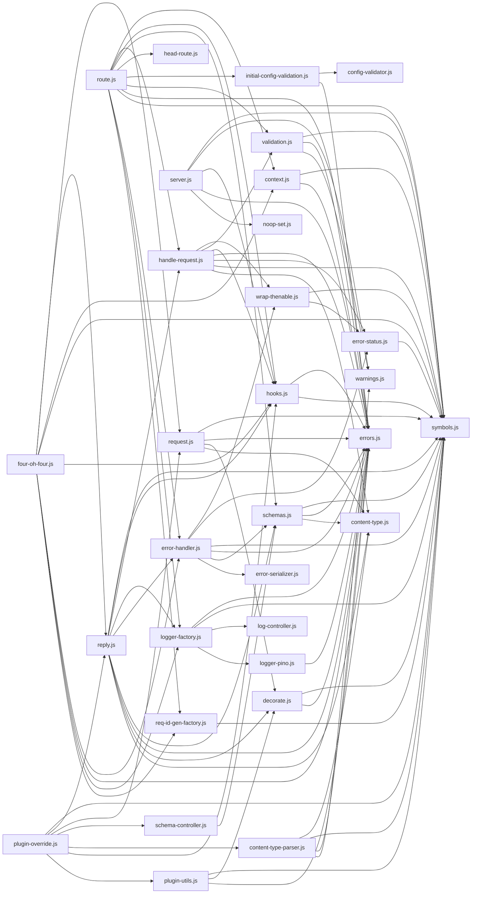

# CodeProof report

Commit: 5df959f3af698823dd582f1c3661f3e80df0b5da  |  run-id: 2bd3069c497fbca0  |  mode: smoke

**Publishing rule:** a finding appears under *Verified findings* only if the deterministic citation gate (L1) passed and the adversarial verifier confirmed it. Refuted, uncertain and moderate findings are kept in separate sections - nothing is hidden, and nothing unproven is presented as verified.

## Summary

| Metric | Value |
|---|---|
| Files / LOC | 31 / 8351 |
| Import edges / cycles | 90 / 0 |
| Findings proposed | 3 |
| Rejected at L1 (bad citation) | 0 |
| Verified | 3 |
| Moderate confidence | 0 |
| Refuted | 0 |
| Uncertain | 0 |
| Calls / retries | 6 / 0 |
| Tokens in / out | 121366 / 37756 |
| Cached input tokens | 1500 |
| Cost | $0.7588 |

## Verified findings

### F-001 - high - ContentTypeParser.remove does not clear cache

**Claim:** ContentTypeParser.remove deletes the parser but never invalidates the lookup cache, so getParser keeps returning the removed parser from cache on subsequent requests.

**Citation:** content-type-parser.js:170-190
```text
ContentTypeParser.prototype.remove = function (contentType) {
  let parsers

  if (typeof contentType === 'string') {
    contentType = new ContentType(contentType).toString()
    parsers = this.parserList
  } else {
    if (!(contentType instanceof RegExp)) throw new FST_ERR_CTP_INVALID_TYPE()
    contentType = contentType.toString()
    parsers = this.parserRegExpList
  }

  const removed = this.customParsers.delete(contentType)
  const idx = parsers.findIndex(ct => ct.toString() === contentType)
```
**Citation:** content-type-parser.js:119-133
```text
ContentTypeParser.prototype.getParser = function (contentType) {
  if (typeof contentType === 'string') {
    const cached = this.cache.get(contentType)
    if (cached !== undefined) return cached
    contentType = new ContentType(contentType)
  }
  const ct = contentType.toString()

  let parser = this.cache.get(ct)
  if (parser !== undefined) return parser
  parser = this.customParsers.get(ct)
  if (parser !== undefined) {
    this.cache.set(ct, parser)
    return parser
```

**Verifier (muse-wonder-1.0):** confirm - Confirmed: getParser returns this.cache entries before consulting customParsers at content-type-parser.js:119-132, while remove at content-type-parser.js:170-190 only deletes from customParsers and splices parserList/parserRegExpList without clearing this.cache, unlike removeAll which resets the cache at content-type-parser.js:163-168.

### F-002 - high - 404 defaultRoute double-bind loses instance

**Claim:** arrange404 re-binds an already-bound defaultRoute, so the second prefixed instance has no effect and 404 fallback keeps the first instance as `this`.

**Citation:** four-oh-four.js:44-50
```text
  function arrange404 (instance) {
    // Change the pointer of the fastify instance to itself, so register + prefix can add new 404 handler
    instance[kFourOhFourLevelInstance] = instance
    instance[kCanSetNotFoundHandler] = true
    // we need to bind instance for the context
    router.defaultRoute = router.defaultRoute.bind(instance)
  }
```

**Verifier (muse-wonder-1.0):** confirm - The router is created with the unbound fourOhFourFallBack at four-oh-four.js:36, arrange404 unconditionally replaces router.defaultRoute with router.defaultRoute.bind(instance) at four-oh-four.js:49, and fourOhFourFallBack dereferences this[kFourOhFourLevelInstance] at four-oh-four.js:165; under Function.prototype.bind semantics a second bind cannot change the first bound this.

### F-003 - medium - Socket onTimeout handle replaced without guaranteed cleanup

**Claim:** Socket timeout state stored on the reused keep-alive socket is overwritten per request and its cleanup only runs inside setupResponseListeners, which is skipped unless logger/onResponse/handlerTimeout is set, leaving stale request/reply and listener.

**Citation:** route.js:559-568
```text
    if (hasLogger === true || context.onResponse !== null || handlerTimeout > 0) {
      setupResponseListeners(reply)
    }

    if (context.onTimeout !== null) {
      if (!request.raw.socket._meta) {
        request.raw.socket.on('timeout', handleTimeout)
      }
      request.raw.socket._meta = { context, request, reply, onTimeout: handleTimeout }
    }
```
**Citation:** reply.js:997-1001
```text
    const socket = reply.request.raw.socket
    if (socket && socket._meta && socket._meta.request === reply.request) {
      socket.removeListener('timeout', socket._meta.onTimeout)
      socket._meta = null
    }
```

**Verifier (muse-wonder-1.0):** confirm - Route.js:559-561 gates setupResponseListeners on hasLogger/onResponse/handlerTimeout while route.js:563-568 unconditionally overwrites socket._meta for onTimeout, and the cited cleanup at reply.js:997-1001 is the normal-path removal, so a logger-disabled onTimeout route retains stale request/reply and the timeout listener; the hijack cleanup at reply.js:148-152 only covers hijacked replies, not normal completion.

## Architecture

Deterministic facts only: 31 files, 8351 LOC, 90 import edges, 0 cycles. The diagram is generated from the import graph by code, never by the model.



## Limits

- Static analysis only: the analyzed code is never executed.
- No completeness claim; this report shows what passed the gate, not everything that exists in the repository.
- Only direct correctness defects; omission, security and style findings are out of scope for this milestone.
- The L1 gate proves that a citation exists in the commit; the semantic match is judged by the verifier model and presented as such.

