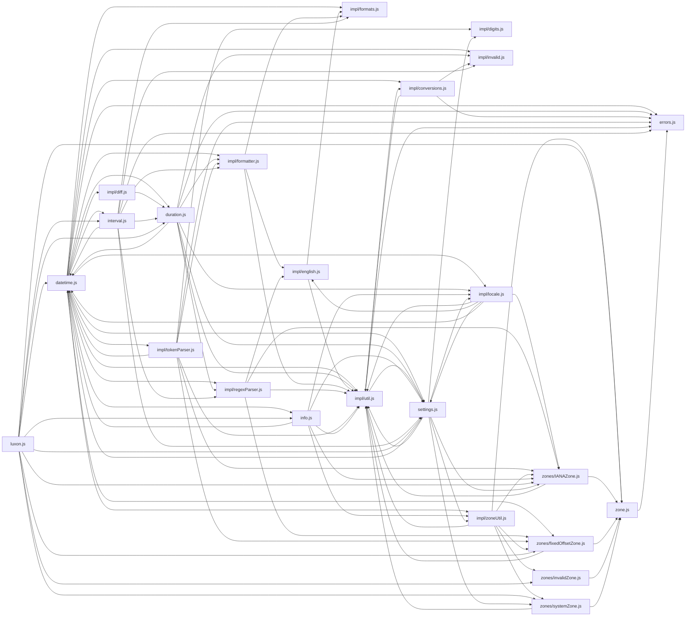

# CodeProof report

Commit: f427515a38f6a671f8de663e6bcc040ed81f114e  |  run-id: 05c5c12c8485a80c  |  mode: smoke

**Publishing rule:** a finding appears under *Verified findings* only if the deterministic citation gate (L1) passed and the adversarial verifier confirmed it. Refuted, uncertain and moderate findings are kept in separate sections - nothing is hidden, and nothing unproven is presented as verified.

## Summary

| Metric | Value |
|---|---|
| Files / LOC | 24 / 8582 |
| Import edges / cycles | 97 / 15 |
| Findings proposed | 2 |
| Rejected at L1 (bad citation) | 0 |
| Verified | 1 |
| Moderate confidence | 0 |
| Refuted | 1 |
| Uncertain | 0 |
| Calls / retries | 6 / 0 |
| Tokens in / out | 229537 / 44903 |
| Cached input tokens | 107469 |
| Cost | $0.6781 |

## Verified findings

### F-001 - critical - uncomputeOrdinal finds first instead of last ladder entry

**Claim:** uncomputeOrdinal uses findIndex(i < ordinal) which always returns 0 for ordinal>0, so any ordinal>31 yields month 1 and day=ordinal instead of the correct month/day.

**Citation:** impl/conversions.js:40-45
```text
function uncomputeOrdinal(year, ordinal) {
  const table = isLeapYear(year) ? leapLadder : nonLeapLadder,
    month0 = table.findIndex((i) => i < ordinal),
    day = ordinal - table[month0];
  return { month: month0 + 1, day };
}
```

**Verifier (muse-wonder-1.0):** confirm - The code at impl/conversions.js:42 uses table.findIndex((i) => i < ordinal) on ladders starting with 0 at impl/conversions.js:14, so for any ordinal>0 the first element satisfies the predicate, month0 is always 0, and impl/conversions.js:43-44 therefore return month 1 with day=ordinal.

## Architecture

Deterministic facts only: 24 files, 8582 LOC, 97 import edges, 15 cycles. The diagram is generated from the import graph by code, never by the model.



## Limits

- Static analysis only: the analyzed code is never executed.
- No completeness claim; this report shows what passed the gate, not everything that exists in the repository.
- Only direct correctness defects; omission, security and style findings are out of scope for this milestone.
- The L1 gate proves that a citation exists in the commit; the semantic match is judged by the verifier model and presented as such.

