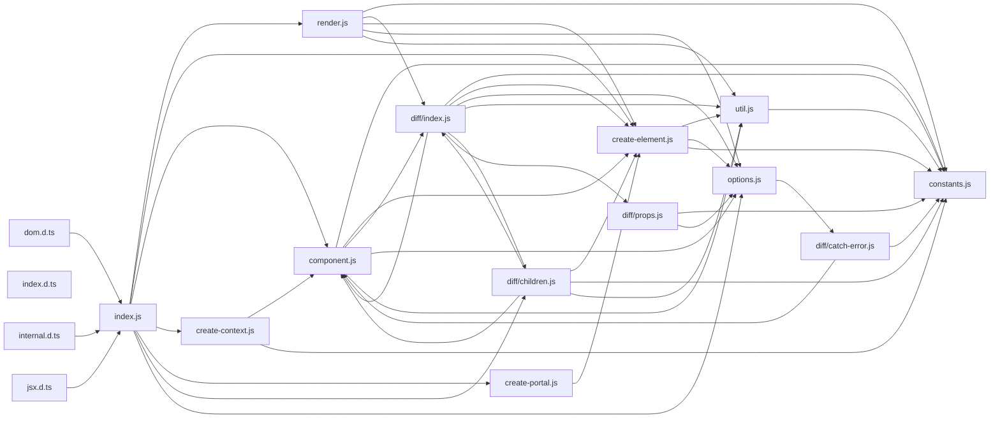

# CodeProof report

Commit: 1c0f1f82340f096e5850386d617d6a3885693001  |  run-id: f70bdd8da0dee52d  |  mode: smoke

**Publishing rule:** a finding appears under *Verified findings* only if the deterministic citation gate (L1) passed and the adversarial verifier confirmed it. Refuted, uncertain and moderate findings are kept in separate sections - nothing is hidden, and nothing unproven is presented as verified.

## Summary

| Metric | Value |
|---|---|
| Files / LOC | 17 / 6214 |
| Import edges / cycles | 44 / 4 |
| Findings proposed | 3 |
| Rejected at L1 (bad citation) | 0 |
| Verified | 1 |
| Moderate confidence | 0 |
| Refuted | 0 |
| Uncertain | 2 |
| Calls / retries | 5 / 0 |
| Tokens in / out | 105869 / 32164 |
| Cached input tokens | 81741 |
| Cost | $0.5235 |

## Verified findings

### F-001 - high - refQueue not rolled back on diff error

**Claim:** diff() truncates commitQueue on error but never truncates refQueue, so refs queued by the failed subtree remain and are still applied in commitRoot.

**Citation:** diff/index.js:368-368
```text
commitQueue.length = oldCommitQueueLength;
```
**Citation:** diff/children.js:119-125
```text
if (childVNode.ref) {
				refQueue.push(
					childVNode.ref,
					childVNode._component || newDom,
					childVNode
				);
```

**Verifier (muse-wonder-1.0):** confirm - The catch at diff/index.js:368 only resets commitQueue.length with no refQueue rollback in the shown handler, while diff/children.js:119-125 pushes ref triples into the shared refQueue during a subtree diff, and component.js:154 passes that same refQueue to commitRoot after diff returns.

## Architecture

Deterministic facts only: 17 files, 6214 LOC, 44 import edges, 4 cycles. The diagram is generated from the import graph by code, never by the model.



## Limits

- Static analysis only: the analyzed code is never executed.
- No completeness claim; this report shows what passed the gate, not everything that exists in the repository.
- Only direct correctness defects; omission, security and style findings are out of scope for this milestone.
- The L1 gate proves that a citation exists in the commit; the semantic match is judged by the verifier model and presented as such.

