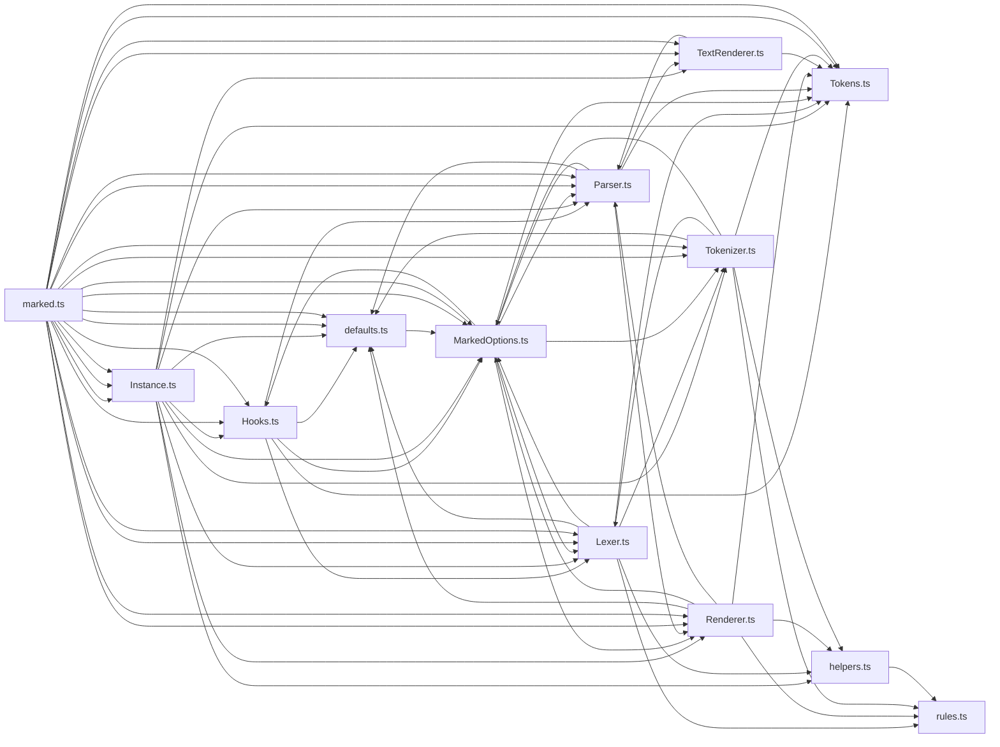

# CodeProof report

Commit: 4bdd7e0c4329ad0d6fb4b4139a25fb7aeed251ea  |  run-id: 2d8a93e9b019f92a  |  mode: smoke

**Publishing rule:** a finding appears under *Verified findings* only if every citation passed L1 and the adversarial verifier confirmed it. This checks provenance and model agreement, not semantic proof. Refuted, uncertain and moderate findings are in rejected.md.

## Summary

| Metric | Value |
|---|---|
| Files / LOC | 13 / 4070 |
| Import edges / cycles | 69 / 12 |
| Findings proposed | 3 |
| Rejected at L1 (bad citation) | 0 |
| Verified | 2 |
| Reproduced by execution (L3) | 2 |
| Moderate confidence | 0 |
| Refuted | 0 |
| Uncertain | 1 |
| Calls / retries | 8 / 0 |
| Tokens in / out | 132098 / 52294 |
| Cached input tokens | 0 |
| Cost | $1.2403 |

## Verified findings

### F-002 - high - Lexer tokens accumulator never reset on reuse

**Claim:** Lexer.lex reuses this.tokens without clearing it, so a second lex() call on the same Lexer instance appends to the first call's tokens and links instead of returning only the new result.

**Proposed by:** Muse Spark

**Evidence level:** citation-proven + adversarially-confirmed + **execution-proven (generated test fails on the analyzed commit)**

**Execution check:** reproduced by execution (see Reproduced by execution)

**Citation (from commit, lines 32-35):** Lexer.ts
```text
  constructor(options?: MarkedOptions<ParserOutput, RendererOutput>) {
    // TokenList cannot be created in one go
    this.tokens = [] as unknown as TokensList;
    this.tokens.links = Object.create(null);
```
**Citation (from commit, lines 99-102):** Lexer.ts
```text
  lex(src: string) {
    src = src.replace(other.carriageReturn, '\n');

    this.blockTokens(src, this.tokens);
```

**Verifier (muse-wonder-1.0):** confirm - The constructor initializes this.tokens and its links once at Lexer.ts:32, and lex() at Lexer.ts:99 passes that same this.tokens to blockTokens without any intervening reset, so reuse appends to the prior array.

### F-003 - medium - Extension returning false for unknown token is swallowed

**Claim:** Parser extension fallback uses `ret !== false || !knownList.includes(type)`, so when an extension renderer exists for an unknown token type and returns false the parser outputs empty string and continues instead of falling through to the unknown-token error.

**Proposed by:** Muse Spark

**Evidence level:** citation-proven + adversarially-confirmed + **execution-proven (generated test fails on the analyzed commit)**

**Execution check:** reproduced by execution (see Reproduced by execution)

**Citation (from commit, lines 51-57):** Parser.ts
```text
      if (this.options.extensions?.renderers?.[anyToken.type]) {
        const genericToken = anyToken as Tokens.Generic;
        const ret = this.options.extensions.renderers[genericToken.type].call({ parser: this }, genericToken);
        if (ret !== false || !['space', 'hr', 'heading', 'code', 'table', 'blockquote', 'list', 'checkbox', 'html', 'def', 'paragraph', 'text'].includes(genericToken.type)) {
          out += ret || '';
          continue;
        }
```
**Citation (from commit, lines 138-144):** Parser.ts
```text
      if (this.options.extensions?.renderers?.[anyToken.type]) {
        const ret = this.options.extensions.renderers[anyToken.type].call({ parser: this }, anyToken);
        if (ret !== false || !['escape', 'html', 'link', 'image', 'checkbox', 'strong', 'em', 'codespan', 'br', 'del', 'text'].includes(anyToken.type)) {
          out += ret || '';
          continue;
        }
      }
```

**Verifier (muse-wonder-1.0):** confirm - Confirmed: at Parser.ts:54 the condition is true when ret===false and the type is not in the built-in list, so Parser.ts:55-56 appends '' and continues, bypassing the unknown-token error at Parser.ts:112-119; the same pattern at Parser.ts:140-142 bypasses Parser.ts:193-200.

## Reproduced by execution

For each finding below, the verifier model wrote a standalone test. The test runs on a `git archive` snapshot of the analyzed commit inside a permission-model sandbox: no network, no writes, 2 s timeout, three runs. The finding is execution-proven only if the test fails 3/3 with an assertion error.

### F-002 - Lexer tokens accumulator never reset on reuse

**Expected behavior:** A second lex() call on the same _Lexer instance returns only the tokens and links produced from the second source.

**Generated test (fails on the analyzed commit):**
```js
import assert from 'node:assert/strict';
import { _Lexer } from './Lexer.ts';

const lexer = new _Lexer();
const first = lexer.lex('# Alpha\n\n[a]: /first\n');
const firstTypes = first.map((token) => token.type);
assert.ok(firstTypes.includes('heading'));
assert.deepEqual(Object.keys(first.links), ['a']);

const second = lexer.lex('# Beta\n');
assert.equal(second.length, 1);
assert.equal(second[0].type, 'heading');
assert.equal(second[0].text, 'Beta');
assert.deepEqual(Object.keys(second.links), []);
```

**Runner output (last of 3 attempts):**
```text
4 !== 1

    at file:///tmp/codeproof-repro-LJhB6A/snapshot/.codeproof-repro.test.mjs:11:8
    at ModuleJob.run (node:internal/modules/esm/module_job:569:25)
    at async node:internal/modules/esm/loader:650:26
    at async asyncRunEntryPointWithESMLoader (node:internal/modules/run_main:101:5) {
  generatedMessage: true,
  code: 'ERR_ASSERTION',
  actual: 4,
  expected: 1,
  operator: 'strictEqual',
  diff: 'simple'
}

Node.js v26.8.2
```

### F-003 - Extension returning false for unknown token is swallowed

**Expected behavior:** An extension renderer returning false for an unknown token type falls through to the default case and throws 'Token with "<type>" type was not found.' in both parse and parseInline, instead of outputting an empty string.

**Generated test (fails on the analyzed commit):**
```js
import assert from 'node:assert/strict';
import { _Parser } from './Parser.ts';

function makeParser() {
  return new _Parser({
    extensions: {
      renderers: {
        unknownBlock() { return false; },
        unknownInline() { return false; },
      },
    },
  });
}

let blockError = null;
let blockResult;
try {
  blockResult = makeParser().parse([{ type: 'unknownBlock', raw: 'x' }]);
} catch (err) {
  blockError = err;
}
assert.ok(blockError instanceof Error, `unknown block token returning false should throw, got ${JSON.stringify(blockResult)}`);
assert.match(blockError.message, /Token with "unknownBlock" type was not found\./);

let inlineError = null;
let inlineResult;
try {
  inlineResult = makeParser().parseInline([{ type: 'unknownInline', raw: 'x' }]);
} catch (err) {
  inlineError = err;
}
assert.ok(inlineError instanceof Error, `unknown inline token returning false should throw, got ${JSON.stringify(inlineResult)}`);
assert.match(inlineError.message, /Token with "unknownInline" type was not found\./);
```

**Runner output (last of 3 attempts):**
```text

AssertionError [ERR_ASSERTION]: unknown block token returning false should throw, got ""
    at file:///tmp/codeproof-repro-jLknbx/snapshot/.codeproof-repro.test.mjs:22:8
    at ModuleJob.run (node:internal/modules/esm/module_job:569:25)
    at async node:internal/modules/esm/loader:650:26
    at async asyncRunEntryPointWithESMLoader (node:internal/modules/run_main:101:5) {
  generatedMessage: false,
  code: 'ERR_ASSERTION',
  actual: false,
  expected: true,
  operator: '==',
  diff: 'simple'
}

Node.js v26.8.2
```

## Architecture

Deterministic facts only: 13 files, 4070 LOC, 69 import edges, 12 cycles. The diagram is generated from the import graph by code, never by the model.



## Limits

- Scan and verify are static: the analyzed code is never executed while the scanner and verifier run. L3 runs only the generated test, on a git-archive snapshot, inside a permission-model sandbox (no network, no writes, 2 s timeout); isolation is process-level, not OS-level.
- No completeness claim; this report shows what passed the gate, not everything that exists in the repository.
- Only direct correctness defects; omission, security and style findings are out of scope for this milestone.
- The L1 gate proves that a citation exists in the commit; the semantic match is judged by the verifier model and presented as such.

