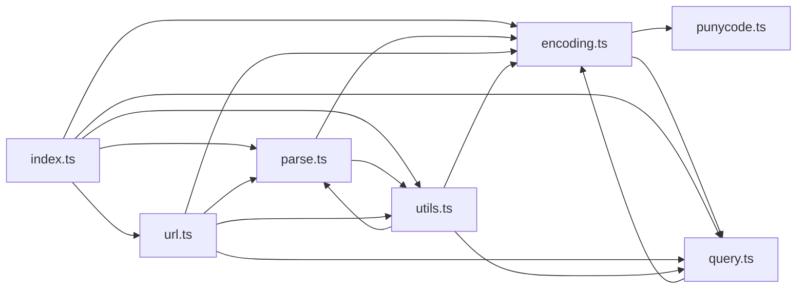

# CodeProof report

Commit: f06c800d0c59f2a4a1b9ba65eb6cb61a84419be6  |  run-id: ced2e69aa61578a4  |  mode: smoke

**Publishing rule:** a finding appears under *Verified findings* only if every citation passed L1 and the adversarial verifier confirmed it. This checks provenance and model agreement, not semantic proof. Refuted, uncertain and moderate findings are in rejected.md.

## Summary

| Metric | Value |
|---|---|
| Files / LOC | 7 / 1571 |
| Import edges / cycles | 17 / 2 |
| Findings proposed | 10 |
| Rejected at L1 (bad citation) | 0 |
| Verified | 10 |
| Reproduced by execution (L3) | 0 |
| Moderate confidence | 0 |
| Refuted | 0 |
| Uncertain | 0 |
| Calls / retries | 23 / 0 |
| Tokens in / out | 176336 / 91606 |
| Cached input tokens | 976 |
| Cost | $2.0685 |

## Verified findings

### F-001 - high - withFragment empty hash never clears fragment

**Claim:** withFragment cannot clear a fragment with empty string: early return on falsy hash makes the later hash==='' branch unreachable, contradicting documented withFragment("/foo#bar","") => "/foo".

**Proposed by:** Muse Spark + Muse Wonder

**Evidence level:** citation-proven + adversarially-confirmed

**Execution check:** unavailable: the repository's own imports are not directly executable by Node without a build step (extensionless specifiers)

**Citation (from commit, lines 736-743):** utils.ts
```text
export function withFragment(input: string, hash: string): string {
  if (!hash || hash === "#") {
    return input;
  }
  const parsed = parseURL(input);
  parsed.hash = hash === "" ? "" : "#" + encodeHash(hash);
  return stringifyParsedURL(parsed);
}
```

**Verifier (muse-wonder-1.0):** confirm - Confirmed: utils.ts:737 returns input unchanged when hash is empty because !hash is true for "", so the hash==="" clearing branch at utils.ts:741 is unreachable and contradicts the documented example at utils.ts:731.

### F-002 - high - withoutLeadingSlash returns slash for empty input

**Claim:** withoutLeadingSlash coerces empty result to "/": withoutLeadingSlash("") and withoutLeadingSlash("/") both return "/" instead of "", corrupting root/empty segments and append/join results.

**Proposed by:** Muse Spark

**Evidence level:** citation-proven + adversarially-confirmed

**Execution check:** unavailable: the repository's own imports are not directly executable by Node without a build step (extensionless specifiers)

**Citation (from commit, lines 235-237):** utils.ts
```text
export function withoutLeadingSlash(input = ""): string {
  return (hasLeadingSlash(input) ? input.slice(1) : input) || "/";
}
```

**Verifier (muse-wonder-1.0):** confirm - The implementation at utils.ts:235-236 returns `(hasLeadingSlash(input) ? input.slice(1) : input) || "/"`, so both "" and "/" (which slices to "") coerce to "/", and url.ts:126 appends that result after withTrailingSlash, yielding a double slash for a root pathname.

### F-003 - medium - parseAuth drops extra colons in password

**Claim:** parseAuth splits on every colon and keeps only the second segment, so password containing colon loses data: "user:pass:word" parses password as "pass" instead of "pass:word".

**Proposed by:** Muse Spark + Muse Wonder

**Evidence level:** citation-proven + adversarially-confirmed

**Execution check:** inconclusive: reproducer failed L0: testCode must bind at least one named or default symbol from the repository import

**Citation (from commit, lines 133-139):** parse.ts
```text
export function parseAuth(input = ""): ParsedAuth {
  const [username, password] = input.split(":");
  return {
    username: decode(username),
    password: decode(password),
  };
}
```

**Verifier (muse-wonder-1.0):** confirm - The code at parse.ts:134 destructures only the first two elements of input.split(":"), so "user:pass:word" yields username "user" and password "pass" with "word" discarded, exactly as claimed.

### F-004 - medium - withBase/withoutBase ignore hash delimiter

**Claim:** Base prefix checks accept only "/" and "?" as delimiters and ignore "#": withBase("/foo#bar","/foo") duplicates the base instead of returning input, and withoutBase is inconsistent for hash-suffixed paths.

**Proposed by:** Muse Spark

**Evidence level:** citation-proven + adversarially-confirmed

**Execution check:** unavailable: the repository's own imports are not directly executable by Node without a build step (extensionless specifiers)

**Citation (from commit, lines 294-302):** utils.ts
```text
  const _base = withoutTrailingSlash(base);
  if (input.startsWith(_base)) {
    const nextChar = input[_base.length];
    // Ensure '/admin-dashboard' is not considered as having base '/admin/'
    if (!nextChar || nextChar === "/" || nextChar === "?") {
      return input;
    }
  }
  return joinURL(_base, input);
```
**Citation (from commit, lines 322-330):** utils.ts
```text
  const _base = withoutTrailingSlash(base);
  if (!input.startsWith(_base)) {
    return input;
  }
  // Ensure '/admin-dashboard' is not considered as having base '/admin/'
  const nextChar = input[_base.length];
  if (nextChar && nextChar !== "/" && nextChar !== "?") {
    return input;
  }
```

**Verifier (muse-wonder-1.0):** confirm - The code at utils.ts:298 accepts only '/', '?' or end-of-string after the base in withBase, so '/foo#bar' falls through to joinURL at utils.ts:302, and utils.ts:328 similarly rejects '#' in withoutBase, returning the unstripped input.

### F-005 - high - parseURL drops non-hierarchical protocol URLs

**Claim:** parseURL loses opaque-protocol URLs such as mailto:foo@example.com: hasProtocol accepts a scheme without //, but the subsequent match requires //, so the match fails and protocol, hostAndPath, pathname, search and hash all default to empty.

**Proposed by:** Muse Wonder

**Evidence level:** citation-proven + adversarially-confirmed

**Execution check:** unavailable: the repository's own imports are not directly executable by Node without a build step (extensionless specifiers)

**Citation (from commit, lines 68-75):** parse.ts
```text
  if (!hasProtocol(input, { acceptRelative: true })) {
    return defaultProto ? parseURL(defaultProto + input) : parsePath(input);
  }

  const [, protocol = "", auth, hostAndPath = ""] =
    input
      .replace(/\\/g, "/")
      .match(/^[\s\0]*([\w+.-]{2,}:)?\/\/([^/@]+@)?(.*)/) || [];
```

**Verifier (muse-spark-1.3):** confirm - utils.ts:12 PROTOCOL_REGEX makes hasProtocol true for mailto: without //, so parse.ts:68 does not early-return, but parse.ts:75 match requires // and fails, falling back to || [] with protocol="" and hostAndPath="" leading to empty pathname/search/hash.

### F-006 - high - joinRelativeURL discards leading ../ segments

**Claim:** joinRelativeURL("../a", "b") returns "a/b" instead of "../a/b": the ".." decrements segmentsDepth to -1, but pushing the following normal segment increments it back to 0, so the later leading-../ prefix logic is skipped and the parent reference is lost.

**Proposed by:** Muse Wonder

**Evidence level:** citation-proven + adversarially-confirmed

**Execution check:** unavailable: the repository's own imports are not directly executable by Node without a build step (extensionless specifiers)

**Citation (from commit, lines 474-488):** utils.ts
```text
      if (s === "..") {
        if (segments.length === 1 && hasProtocol(segments[0])) {
          continue;
        }
        segments.pop();
        segmentsDepth--;
        continue;
      }
      // eslint-disable-next-line unicorn/prefer-at
      if (sindex === 1 && segments[segments.length - 1]?.endsWith(":/")) {
        segments[segments.length - 1] += "/" + s;
        continue;
      }
      segments.push(s);
      segmentsDepth++;
```

**Verifier (muse-spark-1.3):** confirm - Trace of utils.ts:474-488 confirms the bug: '..' does segments.pop() and segmentsDepth-- to -1, then 'a' does segments.push() and segmentsDepth++ back to 0, so utils.ts:494 takes the >=0 branch and never adds the '../' prefix, yielding 'a/b'.

### F-007 - medium - stringifyParsedURL adds // to opaque protocols

**Claim:** stringifyParsedURL(parseURL("data:text/plain,hello")) produces "data://text/plain,hello": parseURL special-cases data:/blob: URLs without //, but stringifyParsedURL unconditionally appends // to every protocol, corrupting opaque-scheme URLs on round-trip.

**Proposed by:** Muse Wonder

**Evidence level:** citation-proven + adversarially-confirmed

**Execution check:** unavailable: the repository's own imports are not directly executable by Node without a build step (extensionless specifiers)

**Citation (from commit, lines 190-194):** parse.ts
```text
  const proto =
    parsed.protocol || parsed[protocolRelative]
      ? (parsed.protocol || "") + "//"
      : "";
  return proto + auth + host + pathname + search + hash;
```

**Verifier (muse-spark-1.3):** confirm - parse.ts:190-194 shows proto is built as (parsed.protocol || "") + "//" whenever protocol is truthy with no exemption for opaque schemes, so a data: parsed object with empty host stringifies to data://...

### F-008 - medium - $URL href drops host for protocol-relative URLs

**Claim:** new $URL("//example.com/foo").href returns "/foo" and loses the host: parseURL stores host "example.com" with an empty protocol, so hasProtocol is falsy and href returns only fullpath instead of the protocol-relative URL.

**Proposed by:** Muse Wonder

**Evidence level:** citation-proven + adversarially-confirmed

**Execution check:** inconclusive: reproducer failed L0: testCode must call an imported repository symbol outside the import statements (imported: $URL)

**Citation (from commit, lines 106-115):** url.ts
```text
  get href(): string {
    const auth = this.encodedAuth;
    const originWithAuth =
      (this.protocol ? this.protocol + "//" : "") +
      (auth ? auth + "@" : "") +
      encodeHost(this.host);
    return this.hasProtocol && this.isAbsolute
      ? originWithAuth + this.fullpath
      : this.fullpath;
  }
```

**Verifier (muse-spark-1.3):** confirm - parse.ts:87-93 stores protocol "" with host "example.com" for "//example.com/foo", so url.ts:56-57 hasProtocol is 0 (falsy) and url.ts:112-114 `hasProtocol && isAbsolute` fails, returning only fullpath "/foo" and dropping the host.

### F-009 - medium - parseHost breaks IPv6 literal hosts

**Claim:** parseHost("[::1]:8080") returns hostname "[" and no port because [^/:]* stops at the first colon inside the IPv6 brackets; this also breaks $URL hostname/port getters for IPv6 hosts that parseURL otherwise preserves.

**Proposed by:** Muse Wonder

**Evidence level:** citation-proven + adversarially-confirmed

**Execution check:** unavailable: the repository's own imports are not directly executable by Node without a build step (extensionless specifiers)

**Citation (from commit, lines 157-163):** parse.ts
```text
export function parseHost(input = ""): ParsedHost {
  const [hostname, port] = (input.match(/([^/:]*):?(\d+)?/) || []).splice(1);
  return {
    hostname: decode(hostname),
    port,
  };
}
```

**Verifier (muse-spark-1.3):** confirm - parse.ts:158 uses /([^/:]*):?(\d+)?/ which on "[::1]:8080" stops at the first colon and captures hostname "[" with undefined port, and url.ts:41-45 shows $URL hostname/port getters delegate directly to parseHost so they inherit the breakage.

### F-010 - low - withoutBase does not recognize fragment as path boundary

**Claim:** withoutBase("/foo#section", "/foo") returns the input unchanged instead of "/#section": the boundary check accepts "/" and "?" after the base but not "#", even though a fragment terminates the path just like a query does.

**Proposed by:** Muse Wonder

**Evidence level:** citation-proven + adversarially-confirmed

**Execution check:** unavailable: the repository's own imports are not directly executable by Node without a build step (extensionless specifiers)

**Citation (from commit, lines 322-330):** utils.ts
```text
  const _base = withoutTrailingSlash(base);
  if (!input.startsWith(_base)) {
    return input;
  }
  // Ensure '/admin-dashboard' is not considered as having base '/admin/'
  const nextChar = input[_base.length];
  if (nextChar && nextChar !== "/" && nextChar !== "?") {
    return input;
  }
```

**Verifier (muse-spark-1.3):** confirm - utils.ts:328 checks `nextChar !== "/" && nextChar !== "?"` with no `#` case, so utils.ts:329 returns the input unchanged for `/foo#section` with base `/foo`, confirming the fragment boundary is missed.

## Architecture

Deterministic facts only: 7 files, 1571 LOC, 17 import edges, 2 cycles. The diagram is generated from the import graph by code, never by the model.



## Limits

- Scan and verify are static: the analyzed code is never executed while the scanner and verifier run. L3 runs only the generated test, on a git-archive snapshot, inside a permission-model sandbox (no network, no writes, 2 s timeout); isolation is process-level, not OS-level.
- No completeness claim; this report shows what passed the gate, not everything that exists in the repository.
- Only direct correctness defects; omission, security and style findings are out of scope for this milestone.
- The L1 gate proves that a citation exists in the commit; the semantic match is judged by the verifier model and presented as such.

