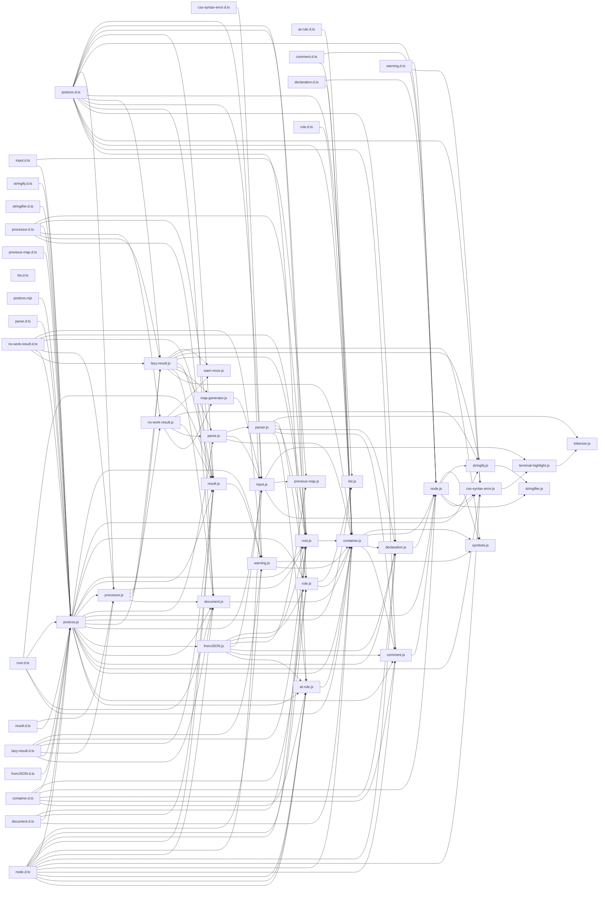

# CodeProof report

Commit: 2455ac8212fe66bc3248aa01186a52c27c87da5a  |  run-id: e8eea43af88affea  |  mode: smoke

**Publishing rule:** a finding appears under *Verified findings* only if every citation passed L1 and the adversarial verifier confirmed it. This checks provenance and model agreement, not semantic proof. Refuted, uncertain and moderate findings are in rejected.md.

## Summary

| Metric | Value |
|---|---|
| Files / LOC | 51 / 8485 |
| Import edges / cycles | 157 / 0 |
| Files in scanner prompt | 51 / 51 |
| Findings proposed | 3 |
| Rejected at L1 (bad citation) | 0 |
| Verified | 3 |
| Reproduced by execution (L3) | 0 |
| Moderate confidence | 0 |
| Refuted | 0 |
| Uncertain | 0 |
| Calls / retries | 7 / 0 |
| Tokens in / out | 105143 / 30910 |
| Cached input tokens | 0 |
| Cost | $0.5961 |

## Verified findings

### F-001 - high - fromJSON throws for Document type

**Claim:** fromJSON cannot rehydrate Document nodes: it handles root/decl/rule/comment/atrule but throws for type document even though Document with type document exists.

**Proposed by:** Muse Spark

**Evidence level:** citation-proven + adversarially-confirmed

**Execution check:** inconclusive: test did not demonstrate the claim consistently

**Citation (from commit, lines 38-50):** fromJSON.js
```text
  if (defaults.type === 'root') {
    node = new Root(defaults)
  } else if (defaults.type === 'decl') {
    node = new Declaration(defaults)
  } else if (defaults.type === 'rule') {
    node = new Rule(defaults)
  } else if (defaults.type === 'comment') {
    node = new Comment(defaults)
  } else if (defaults.type === 'atrule') {
    node = new AtRule(defaults)
  } else {
    throw new Error('Unknown node type: ' + json.type)
  }
```

**Verifier (muse-wonder-1.0):** confirm - fromJSON.js:38-50 branches only on root/decl/rule/comment/atrule and throws 'Unknown node type' in the else branch, while postcss.js:8 and postcss.js:82-88 require, export, and instantiate a Document class, so a type 'document' payload hits the throw.

### F-002 - medium - showSourceCode NaN when endColumn undefined

**Claim:** Long-line truncation computes subLineEnd with this.endColumn + padding without guarding undefined, producing NaN and an empty snippet when error has no range.

**Proposed by:** Muse Spark

**Evidence level:** citation-proven + adversarially-confirmed

**Execution check:** inconclusive: test did not demonstrate the claim consistently

**Citation (from commit, lines 79-85):** css-syntax-error.js
```text
          if (line.length > 160) {
            let padding = 20
            let subLineStart = Math.max(0, this.column - padding)
            let subLineEnd = Math.max(
              this.column + padding,
              this.endColumn + padding
            )
```

**Verifier (muse-wonder-1.0):** confirm - Confirmed: css-syntax-error.js:22-25 sets only line/column for numeric arguments leaving endColumn undefined, and css-syntax-error.js:82-86 computes Math.max(this.column+padding, this.endColumn+padding) unguarded, so undefined+padding yields NaN, Math.max yields NaN, and line.slice(subLineStart, NaN) yields an empty truncated line.

### F-003 - medium - NoWorkResult toString bypasses processed css

**Claim:** NoWorkResult.toString returns raw _css while css getter returns result.css which was stripped/updated via MapGenerator, so string coercion diverges from css.

**Proposed by:** Muse Spark

**Evidence level:** citation-proven + adversarially-confirmed

**Execution check:** inconclusive: test did not demonstrate the claim consistently

**Citation (from commit, lines 14-16):** no-work-result.js
```text
  get css() {
    return this.result.css
  }
```
**Citation (from commit, lines 89-92):** no-work-result.js
```text
    } else {
      map.clearAnnotation()
      this.result.css = map.css
    }
```
**Citation (from commit, lines 127-129):** no-work-result.js
```text
  toString() {
    return this._css
  }
```

**Verifier (muse-wonder-1.0):** confirm - Confirmed: NoWorkResult.css returns this.result.css at no-work-result.js:14, which is overwritten from MapGenerator output at no-work-result.js:80 and no-work-result.js:89, while toString() returns the unmodified this._css at no-work-result.js:127.

## Architecture

Deterministic facts only: 51 files, 8485 LOC, 157 import edges, 0 cycles. The diagram is generated from the import graph by code, never by the model.



## Limits

- Scan and verify are static: the analyzed code is never executed while the scanner and verifier run. L3 runs only the generated test, on a git-archive snapshot, inside a permission-model sandbox (no network, no writes, 2 s timeout); isolation is process-level, not OS-level.
- No completeness claim; this report shows what passed the gate, not everything that exists in the repository.
- Only direct correctness defects; omission, security and style findings are out of scope for this milestone.
- The L1 gate proves that a citation exists in the commit; the semantic match is judged by the verifier model and presented as such.

