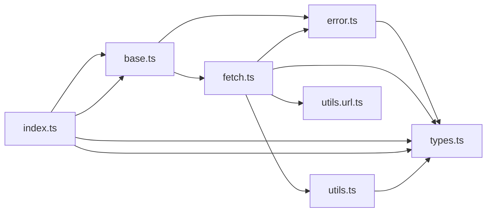

# CodeProof report

Commit: 1dbc37fd1ceab832fc7c90cad81b1091c95ba563  |  run-id: e02cc2e908e2078a  |  mode: smoke

**Publishing rule:** a finding appears under *Verified findings* only if the deterministic citation gate (L1) passed and the adversarial verifier confirmed it. Refuted, uncertain and moderate findings are kept in separate sections - nothing is hidden, and nothing unproven is presented as verified.

## Summary

| Metric | Value |
|---|---|
| Files / LOC | 7 / 802 |
| Import edges / cycles | 12 / 0 |
| Findings proposed | 4 |
| Rejected at L1 (bad citation) | 0 |
| Verified | 4 |
| Moderate confidence | 0 |
| Refuted | 0 |
| Uncertain | 0 |
| Calls / retries | 7 / 0 |
| Tokens in / out | 53398 / 39573 |
| Cached input tokens | 2500 |
| Cost | $0.5596 |

## Verified findings

### F-001 - high - isJSONSerializable mishandles null and throws on value.buffer

**Claim:** typeof value is never null so `t === null` is dead code; null falls through to `value.buffer` access which throws TypeError instead of returning true as JSON-serializable.

**Citation:** utils.ts:21-24
```text
  const t = typeof value;
  if (t === "string" || t === "number" || t === "boolean" || t === null) {
    return true;
  }
```
**Citation:** utils.ts:31-33
```text
  if (value.buffer) {
    return false;
  }
```

**Verifier (muse-wonder-1.0):** confirm - Confirmed at utils.ts:22 and utils.ts:31: typeof null is "object" so the string t can never equal null, null then passes the object check and Array.isArray check before value.buffer throws a TypeError.

### F-002 - high - Timeout retry reuses already-aborted AbortSignal

**Claim:** On retry the previous timeout-derived signal which is already aborted is spread into the next $fetchRaw and combined via AbortSignal.any, so the retried request starts already aborted and fails immediately.

**Citation:** fetch.ts:171-178
```text
    if (context.options.timeout) {
      context.options.signal = context.options.signal
        ? AbortSignal.any([
            AbortSignal.timeout(context.options.timeout),
            context.options.signal,
          ])
        : AbortSignal.timeout(context.options.timeout);
    }
```
**Citation:** fetch.ts:72-75
```text
        return $fetchRaw(context.request, {
          ...context.options,
          retry: retries - 1,
        });
```

**Verifier (muse-wonder-1.0):** confirm - The timeout handling at fetch.ts:171-178 mutates context.options.signal into an AbortSignal.timeout/AbortSignal.any result, and the retry at fetch.ts:72-75 spreads that same context.options into the next $fetchRaw, so the next pass combines a fresh timeout with the already-aborted prior signal via AbortSignal.any and the retried fetch starts aborted.

### F-003 - medium - withBase uses raw startsWith without segment boundary

**Claim:** Any input sharing a raw string prefix with the base is returned unchanged without checking a path-segment boundary, so base /api incorrectly matches /api-v2 and skips joining.

**Citation:** utils.url.ts:40-51
```text
export function withBase(input = "", base = ""): string {
  if (!base || base === "/") {
    return input;
  }

  const _base = withoutTrailingSlash(base);
  if (input.startsWith(_base)) {
    return input;
  }

  return joinURL(_base, input);
}
```

**Verifier (muse-wonder-1.0):** confirm - The code at utils.url.ts:46-48 returns input unchanged on input.startsWith(_base) with no segment-boundary check, so withBase('/api-v2','/api') incorrectly skips joinURL at utils.url.ts:50.

### F-004 - medium - withQuery appends array values without clearing existing key

**Claim:** When the URL already contains a query string, array values are appended without first deleting the existing key while scalar values use set (replace), so old values are retained and duplicated.

**Citation:** utils.url.ts:86-99
```text
  const searchParams = new URLSearchParams(input.slice(searchIndex + 1));
  const base = input.slice(0, searchIndex);

  for (const [key, value] of Object.entries(query)) {
    if (value === undefined) {
      searchParams.delete(key);
    } else if (Array.isArray(value)) {
      for (const item of value) {
        searchParams.append(key, normalizeQueryValue(item));
      }
    } else {
      searchParams.set(key, normalizeQueryValue(value));
    }
  }
```

**Verifier (muse-wonder-1.0):** confirm - At utils.url.ts:86 searchParams is initialized from the existing query string, and at utils.url.ts:92-95 the array branch uses append without a preceding delete while utils.url.ts:97 uses set for scalars, so pre-existing values for that key are retained alongside the new array values.

## Architecture

Deterministic facts only: 7 files, 802 LOC, 12 import edges, 0 cycles. The diagram is generated from the import graph by code, never by the model.



## Limits

- Static analysis only: the analyzed code is never executed.
- No completeness claim; this report shows what passed the gate, not everything that exists in the repository.
- Only direct correctness defects; omission, security and style findings are out of scope for this milestone.
- The L1 gate proves that a citation exists in the commit; the semantic match is judged by the verifier model and presented as such.

