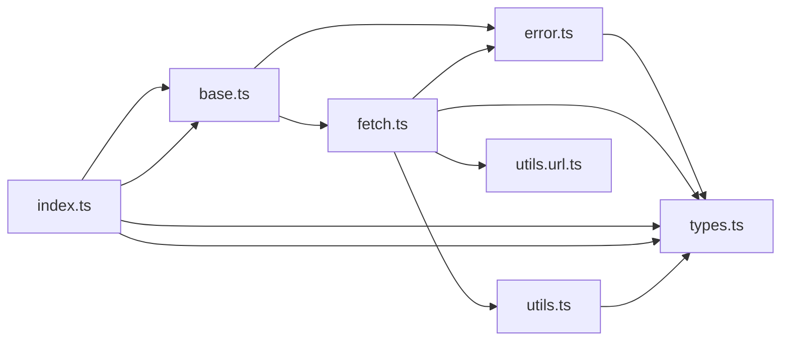

# CodeProof report

Commit: 1dbc37fd1ceab832fc7c90cad81b1091c95ba563  |  run-id: 09e78bb8e4a0b6eb  |  mode: smoke

**Publishing rule:** a finding appears under *Verified findings* only if the deterministic citation gate (L1) passed and the adversarial verifier confirmed it. Refuted, uncertain and moderate findings are kept in separate sections - nothing is hidden, and nothing unproven is presented as verified.

## Summary

| Metric | Value |
|---|---|
| Files / LOC | 7 / 802 |
| Import edges / cycles | 12 / 0 |
| Findings proposed | 4 |
| Rejected at L1 (bad citation) | 0 |
| Verified | 4 |
| Moderate confidence | 0 |
| Refuted | 0 |
| Uncertain | 0 |
| Calls / retries | 5 / 0 |
| Tokens in / out | 38529 / 15824 |
| Cached input tokens | 2000 |
| Cost | $0.2928 |

## Verified findings

### F-001 - high - isJSONSerializable crashes on null due to typeof comparison

**Claim:** t is the string result of typeof, so t === null is never true; null therefore falls through to value.buffer which throws TypeError instead of returning true.

**Citation:** utils.ts:21-32
```text
  const t = typeof value;
  if (t === "string" || t === "number" || t === "boolean" || t === null) {
    return true;
  }
  if (t !== "object") {
    return false; // bigint, function, symbol, undefined
  }
  if (Array.isArray(value)) {
    return true;
  }
  if (value.buffer) {
    return false;
  }
```

**Verifier (muse-wonder-1.0):** confirm - Confirmed at utils.ts:21-32: t is the string from typeof, so t === null at utils.ts:22 is never true, typeof null is "object" so it passes utils.ts:25, Array.isArray(null) is false, and utils.ts:31 then dereferences null.buffer throwing a TypeError.

### F-002 - high - Falsy request bodies are skipped by truthiness check

**Claim:** Truthiness test on body skips valid falsy JSON bodies like 0, "" and false, so they miss stringify and content-type handling.

**Citation:** fetch.ts:130-132
```text
    if (context.options.body && isPayloadMethod(context.options.method)) {
      if (isJSONSerializable(context.options.body)) {
        const contentType = context.options.headers.get("content-type");
```

**Verifier (muse-wonder-1.0):** confirm - The guard at fetch.ts:130 uses truthiness on context.options.body, so 0 and false skip the block at fetch.ts:131-153 that stringifies and sets application/json headers, even though utils.ts:22 explicitly treats number and boolean values as JSON-serializable.

### F-003 - medium - withBase prefix check lacks path-boundary

**Claim:** Prefix test without slash boundary treats /apiary as already based on /api and returns it unchanged instead of joining to /api/apiary.

**Citation:** utils.url.ts:40-50
```text
export function withBase(input = "", base = ""): string {
  if (!base || base === "/") {
    return input;
  }

  const _base = withoutTrailingSlash(base);
  if (input.startsWith(_base)) {
    return input;
  }

  return joinURL(_base, input);
```

**Verifier (muse-wonder-1.0):** confirm - Confirmed: at utils.url.ts:45-48, _base is '/api' for base '/api' and '/apiary'.startsWith('/api') is true, so withBase returns '/apiary' unchanged and never reaches joinURL at utils.url.ts:50 which would produce '/api/apiary'.

### F-004 - medium - withQuery array branch does not replace existing params

**Claim:** Array values are appended without deleting existing params while scalar values use set, so retrying withQuery on a URL with existing query leaves stale values.

**Citation:** utils.url.ts:89-99
```text
  for (const [key, value] of Object.entries(query)) {
    if (value === undefined) {
      searchParams.delete(key);
    } else if (Array.isArray(value)) {
      for (const item of value) {
        searchParams.append(key, normalizeQueryValue(item));
      }
    } else {
      searchParams.set(key, normalizeQueryValue(value));
    }
  }
```

**Verifier (muse-wonder-1.0):** confirm - The code at utils.url.ts:86 parses existing query params, then utils.url.ts:92-97 appends array items without deleting the key while scalar values use set to replace it, so pre-existing values remain alongside new array values.

## Architecture

Deterministic facts only: 7 files, 802 LOC, 12 import edges, 0 cycles. The diagram is generated from the import graph by code, never by the model.



## Limits

- Static analysis only: the analyzed code is never executed.
- No completeness claim; this report shows what passed the gate, not everything that exists in the repository.
- Only direct correctness defects; omission, security and style findings are out of scope for this milestone.
- The L1 gate proves that a citation exists in the commit; the semantic match is judged by the verifier model and presented as such.

