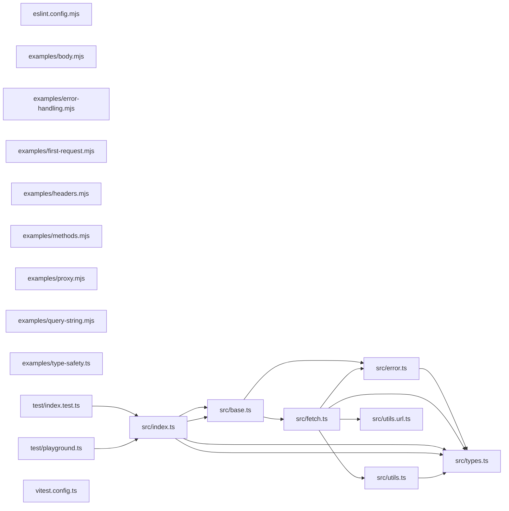

# CodeProof report

Commit: 1dbc37fd1ceab832fc7c90cad81b1091c95ba563  |  run-id: 12ffca4e627ee488  |  mode: smoke

**Publishing rule:** a finding appears under *Verified findings* only if every citation passed L1 and the adversarial verifier confirmed it. This checks provenance and model agreement, not semantic proof. Refuted, uncertain and moderate findings are in rejected.md.

## Summary

| Metric | Value |
|---|---|
| Files / LOC | 19 / 1470 |
| Import edges / cycles | 14 / 0 |
| Findings proposed | 3 |
| Rejected at L1 (bad citation) | 1 |
| Verified | 2 |
| Reproduced by execution (L3) | 1 |
| Moderate confidence | 0 |
| Refuted | 0 |
| Uncertain | 0 |
| Calls / retries | 6 / 0 |
| Tokens in / out | 42185 / 22959 |
| Cached input tokens | 0 |
| Cost | $0.4239 |

## Verified findings

### F-001 - high - isJSONSerializable crashes on null value due to wrong null check

**Claim:** isJSONSerializable compares typeof result `t` to null instead of `value`, so null falls through and `value.buffer` throws TypeError instead of returning a boolean.

**Evidence level:** citation-proven + adversarially-confirmed + **execution-proven (generated test fails on the analyzed commit)**

**Execution check:** reproduced by execution (see Reproduced by execution)

**Citation (from commit, lines 17-24):** src/utils.ts
```text
export function isJSONSerializable(value: any): boolean {
  if (value === undefined) {
    return false;
  }
  const t = typeof value;
  if (t === "string" || t === "number" || t === "boolean" || t === null) {
    return true;
  }
```
**Citation (from commit, lines 28-33):** src/utils.ts
```text
  if (Array.isArray(value)) {
    return true;
  }
  if (value.buffer) {
    return false;
  }
```

**Verifier (muse-wonder-1.0):** confirm - The code at src/utils.ts:22 compares the string `t` (typeof value) to null, so null with typeof "object" passes src/utils.ts:25 and src/utils.ts:28 and reaches src/utils.ts:31 where `value.buffer` on null throws a TypeError.

### F-002 - high - Timeout retry reuses aborted signal causing immediate abort

**Claim:** Retry passes `...context.options` containing the already-aborted timeout signal, and the next attempt combines it with `AbortSignal.any`, so the retried fetch starts already aborted instead of with a fresh timeout.

**Evidence level:** citation-proven + adversarially-confirmed

**Execution check:** inconclusive: reproducer failed L0: forbidden fetch; forbidden URL; forbidden console output (it could mask the real failure class)

**Citation (from commit, lines 171-178):** src/fetch.ts
```text
    if (context.options.timeout) {
      context.options.signal = context.options.signal
        ? AbortSignal.any([
            AbortSignal.timeout(context.options.timeout),
            context.options.signal,
          ])
        : AbortSignal.timeout(context.options.timeout);
    }
```
**Citation (from commit, lines 71-75):** src/fetch.ts
```text
        // Timeout
        return $fetchRaw(context.request, {
          ...context.options,
          retry: retries - 1,
        });
```

**Verifier (muse-wonder-1.0):** confirm - Mutation at src/fetch.ts:171-178 stores the timeout/AbortSignal.any signal back into context.options.signal, and the retry at src/fetch.ts:71-75 spreads ...context.options into the next $fetchRaw call, so the next attempt re-enters src/fetch.ts:171-178 with an already-aborted signal and AbortSignal.any produces an already-aborted signal.

## Reproduced by execution

For each finding below, the verifier model wrote a standalone test. The test runs on a `git archive` snapshot of the analyzed commit inside a permission-model sandbox: no network, no writes, 2 s timeout, three runs. The finding is execution-proven only if the test fails 3/3 with an assertion error.

### F-001 - isJSONSerializable crashes on null value due to wrong null check

**Expected behavior:** isJSONSerializable(null) returns true without throwing, since null is JSON-serializable and the early primitive branch was intended to return true for it.

**Generated test (fails on the analyzed commit):**
```js
import assert from "node:assert/strict";
import { isJSONSerializable } from "./src/utils.ts";

let thrown = null;
let result;
try {
  result = isJSONSerializable(null);
} catch (error) {
  thrown = error;
}
assert.equal(thrown, null, `isJSONSerializable(null) should not throw, got: ${thrown}`);
assert.equal(result, true, "null is JSON serializable, expected true");
assert.equal(isJSONSerializable("x"), true);
assert.equal(isJSONSerializable(42), true);
assert.equal(isJSONSerializable(true), true);
assert.equal(isJSONSerializable(undefined), false);
```

**Runner output (last of 3 attempts):**
```text
    at async asyncRunEntryPointWithESMLoader (node:internal/modules/run_main:101:5) {
  generatedMessage: false,
  code: 'ERR_ASSERTION',
  actual: TypeError: Cannot read properties of null (reading 'buffer')
      at isJSONSerializable (file:///tmp/codeproof-repro-Uv4PKt/snapshot/src/utils.ts:31:13)
      at file:///tmp/codeproof-repro-Uv4PKt/snapshot/.codeproof-repro.test.mjs:7:12
      at ModuleJob.run (node:internal/modules/esm/module_job:569:25)
      at async node:internal/modules/esm/loader:650:26
      at async asyncRunEntryPointWithESMLoader (node:internal/modules/run_main:101:5),
  expected: null,
  operator: 'strictEqual',
  diff: 'simple'
}

Node.js v26.8.2
```

## Architecture

Deterministic facts only: 19 files, 1470 LOC, 14 import edges, 0 cycles. The diagram is generated from the import graph by code, never by the model.



## Limits

- Scan and verify are static: the analyzed code is never executed while the scanner and verifier run. L3 runs only the generated test, on a git-archive snapshot, inside a permission-model sandbox (no network, no writes, 2 s timeout); isolation is process-level, not OS-level.
- No completeness claim; this report shows what passed the gate, not everything that exists in the repository.
- Only direct correctness defects; omission, security and style findings are out of scope for this milestone.
- The L1 gate proves that a citation exists in the commit; the semantic match is judged by the verifier model and presented as such.

