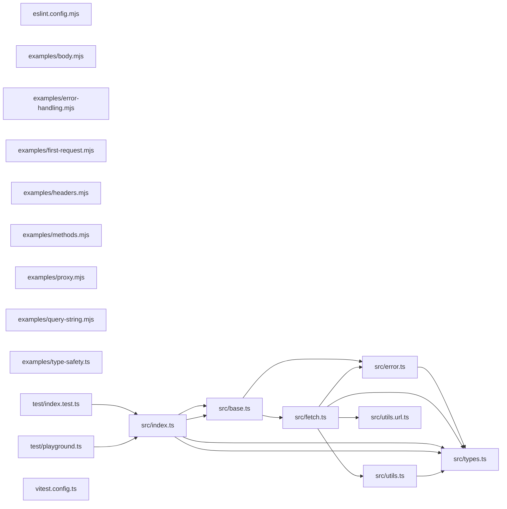

# CodeProof report

Commit: 1dbc37fd1ceab832fc7c90cad81b1091c95ba563  |  run-id: 12ffca4e627ee488  |  mode: smoke

**Publishing rule:** a finding appears under *Verified findings* only if every citation passed L1 and the adversarial verifier confirmed it. This checks provenance and model agreement, not semantic proof. Refuted, uncertain and moderate findings are in rejected.md.

## Summary

| Metric | Value |
|---|---|
| Files / LOC | 19 / 1470 |
| Import edges / cycles | 14 / 0 |
| Findings proposed | 3 |
| Rejected at L1 (bad citation) | 2 |
| Verified | 1 |
| Reproduced by execution (L3) | 0 |
| Moderate confidence | 0 |
| Refuted | 0 |
| Uncertain | 0 |
| Calls / retries | 3 / 0 |
| Tokens in / out | 24008 / 11586 |
| Cached input tokens | 0 |
| Cost | $0.1634 |

## Verified findings

### F-001 - high - isJSONSerializable crashes on null due to `t === null` check

**Claim:** typeof value never equals null, so null falls through the string/number/boolean check and reaches `value.buffer`, throwing TypeError on null input.

**Evidence level:** citation-proven + adversarially-confirmed

**Execution check:** inconclusive: test did not demonstrate the claim consistently

**Citation (from commit, lines 21-32):** src/utils.ts
```text
  const t = typeof value;
  if (t === "string" || t === "number" || t === "boolean" || t === null) {
    return true;
  }
  if (t !== "object") {
    return false; // bigint, function, symbol, undefined
  }
  if (Array.isArray(value)) {
    return true;
  }
  if (value.buffer) {
    return false;
```

**Verifier (muse-wonder-1.0):** confirm - Confirmed: at src/utils.ts:22 `t === null` compares the string result of `typeof` to null and can never be true, so null (typeof "object") passes src/utils.ts:25, fails Array.isArray at src/utils.ts:28, and dereferences null at src/utils.ts:31 via `value.buffer`, throwing a TypeError.

## Architecture

Deterministic facts only: 19 files, 1470 LOC, 14 import edges, 0 cycles. The diagram is generated from the import graph by code, never by the model.



## Limits

- Scan and verify are static: the analyzed code is never executed while the scanner and verifier run. L3 runs only the generated test, on a git-archive snapshot, inside a permission-model sandbox (no network, no writes, 2 s timeout); isolation is process-level, not OS-level.
- No completeness claim; this report shows what passed the gate, not everything that exists in the repository.
- Only direct correctness defects; omission, security and style findings are out of scope for this milestone.
- The L1 gate proves that a citation exists in the commit; the semantic match is judged by the verifier model and presented as such.

