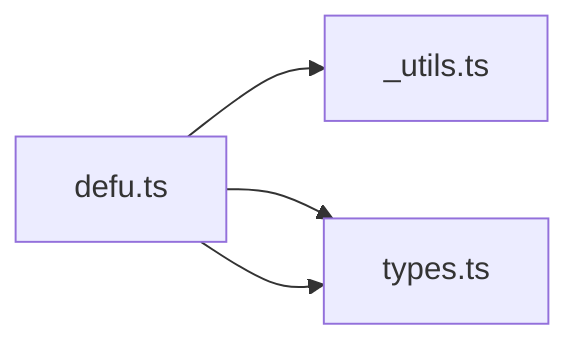

# CodeProof report

Commit: 82632b66f5914e9946edce300e10633a3d5c0cb7  |  run-id: 705ac06fa45bb0f9  |  mode: smoke

**Publishing rule:** a finding appears under *Verified findings* only if every citation passed L1 and the adversarial verifier confirmed it. This checks provenance and model agreement, not semantic proof. Refuted, uncertain and moderate findings are in rejected.md.

## Summary

| Metric | Value |
|---|---|
| Files / LOC | 3 / 197 |
| Import edges / cycles | 3 / 0 |
| Findings proposed | 1 |
| Rejected at L1 (bad citation) | 0 |
| Verified | 1 |
| Reproduced by execution (L3) | 0 |
| Moderate confidence | 0 |
| Refuted | 0 |
| Uncertain | 0 |
| Calls / retries | 3 / 0 |
| Tokens in / out | 7256 / 12077 |
| Cached input tokens | 244 |
| Cost | $0.1506 |

## Verified findings

### F-001 - high - defu instance missing fn/arrayFn/extend implementations

**Claim:** defu is cast to DefuInstance which requires fn, arrayFn and extend, but the implementation never assigns them; defu.fn/defu.arrayFn/defu.extend are undefined at runtime so typed calls throw.

**Evidence level:** citation-proven + adversarially-confirmed

**Execution check:** inconclusive: empty model output

**Citation (from commit, lines 51-53):** defu.ts
```text
// Standard version
export const defu = createDefu() as DefuInstance;
export default defu;
```
**Citation (from commit, lines 49-57):** types.ts
```text
export interface DefuInstance {
  <Source extends Input, Defaults extends Array<Input | IgnoredInput>>(
    source: Source | IgnoredInput,
    ...defaults: Defaults
  ): Defu<Source, Defaults>;
  fn: DefuFn;
  arrayFn: DefuFn;
  extend(merger?: Merger): DefuFn;
}
```
**Citation (from commit, lines 55-61):** defu.ts
```text
// Custom version with function merge support
export const defuFn = createDefu((object, key, currentValue) => {
  if (object[key] !== undefined && typeof currentValue === "function") {
    object[key] = currentValue(object[key]);
    return true;
  }
});
```

**Verifier (muse-wonder-1.0):** confirm - Confirmed: types.ts:49-57 requires fn, arrayFn and extend on DefuInstance, but defu.ts:45-52 shows createDefu returns a bare arrow function and defu is only cast with `as DefuInstance` with no property assignments anywhere in defu.ts.

## Architecture

Deterministic facts only: 3 files, 197 LOC, 3 import edges, 0 cycles. The diagram is generated from the import graph by code, never by the model.



## Limits

- Scan and verify are static: the analyzed code is never executed while the scanner and verifier run. L3 runs only the generated test, on a git-archive snapshot, inside a permission-model sandbox (no network, no writes, 2 s timeout); isolation is process-level, not OS-level.
- No completeness claim; this report shows what passed the gate, not everything that exists in the repository.
- Only direct correctness defects; omission, security and style findings are out of scope for this milestone.
- The L1 gate proves that a citation exists in the commit; the semantic match is judged by the verifier model and presented as such.

