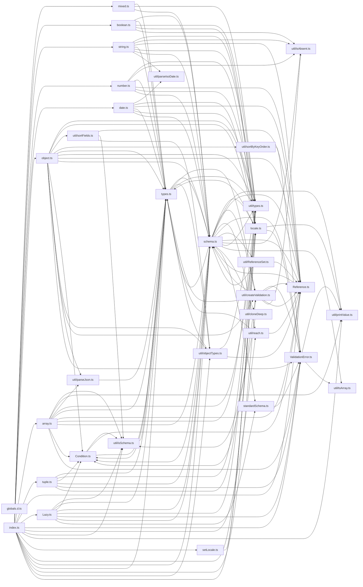

# CodeProof report

Commit: ff31eee8a2b10c938bb3a22544d9e33957a8cf01  |  run-id: 451f781988ac6920  |  mode: smoke

**Publishing rule:** a finding appears under *Verified findings* only if every citation passed L1 and the adversarial verifier confirmed it. This checks provenance and model agreement, not semantic proof. Refuted, uncertain and moderate findings are in rejected.md.

## Summary

| Metric | Value |
|---|---|
| Files / LOC | 33 / 4865 |
| Import edges / cycles | 137 / 12 |
| Findings proposed | 6 |
| Rejected at L1 (bad citation) | 0 |
| Verified | 5 |
| Reproduced by execution (L3) | 0 |
| Moderate confidence | 0 |
| Refuted | 0 |
| Uncertain | 1 |
| Calls / retries | 13 / 0 |
| Tokens in / out | 124687 / 50105 |
| Cached input tokens | 11016 |
| Cost | $1.1496 |

## Verified findings

### F-001 - high - concat shares and mutates base exclusiveTests

**Claim:** Schema.concat shares the base exclusiveTests object by reference and then mutates it via test(), polluting the base schema.

**Evidence level:** citation-proven + adversarially-confirmed

**Execution check:** inconclusive: generated test imports paths that are not in the analyzed snapshot: ./src/index.ts

**Citation (from commit, lines 310-312):** schema.ts
```text
    // start with the current tests
    combined.tests = base.tests;
    combined.exclusiveTests = base.exclusiveTests;
```
**Citation (from commit, lines 799-799):** schema.ts
```text
    if (opts.name) next.exclusiveTests[opts.name] = !!opts.exclusive;
```

**Verifier (muse-wonder-1.0):** confirm - Concat assigns the base object by reference at schema.ts:311-312, then within withMutation at schema.ts:316-320 calls test() on the mutated combined schema, and test() mutates that object in place at schema.ts:799 via next.exclusiveTests[opts.name] assignment, so the base schema's exclusiveTests is polluted.

### F-002 - medium - whitespace ref bypasses non-empty check

**Claim:** Reference constructor trims the key but checks the original untrimmed key for emptiness, so whitespace-only refs bypass validation.

**Evidence level:** citation-proven + adversarially-confirmed

**Execution check:** inconclusive: generated test imports paths that are not in the analyzed snapshot: ./src/Reference.ts

**Citation (from commit, lines 36-38):** Reference.ts
```text
    this.key = key.trim();

    if (key === '') throw new TypeError('ref must be a non-empty string');
```

**Verifier (muse-wonder-1.0):** confirm - Confirmed: Reference.ts:36 assigns this.key = key.trim() while Reference.ts:38 checks the original key === '', so a whitespace-only key yields an empty this.key without throwing.

### F-003 - medium - validateSync error uses wrong value

**Claim:** validateSync constructs ValidationError with the original input value while async validate uses the validated value, losing cast results on sync errors.

**Evidence level:** citation-proven + adversarially-confirmed

**Execution check:** inconclusive: generated test imports paths that are not in the analyzed snapshot: ./src/index.ts

**Citation (from commit, lines 585-595):** schema.ts
```text
        },
        (errors, validated) => {
          if (errors.length)
            reject(
              new ValidationError(
                errors!,
                validated,
                undefined,
                undefined,
                disableStackTrace,
              ),
```
**Citation (from commit, lines 619-627):** schema.ts
```text
      (errors, validated) => {
        if (errors.length)
          throw new ValidationError(
            errors!,
            value,
            undefined,
            undefined,
            disableStackTrace,
          );
```

**Verifier (muse-wonder-1.0):** confirm - Async validate constructs ValidationError with validated at schema.ts:591, while validateSync receives validated in the same callback but constructs ValidationError with the original value at schema.ts:623, losing the cast result on sync errors.

### F-004 - medium - sortByKeyOrder uses substring match

**Claim:** Error sorting matches keys by substring includes instead of exact path segment, so unrelated paths containing the key sort incorrectly.

**Evidence level:** citation-proven + adversarially-confirmed

**Execution check:** unavailable: the repository's own imports are not directly executable by Node without a build step (extensionless specifiers)

**Citation (from commit, lines 3-12):** util/sortByKeyOrder.ts
```text
function findIndex(arr: readonly string[], err: ValidationError) {
  let idx = Infinity;
  arr.some((key, ii) => {
    if (err.path?.includes(key)) {
      idx = ii;
      return true;
    }
  });
  return idx;
}
```

**Verifier (muse-wonder-1.0):** confirm - The code at util/sortByKeyOrder.ts:6 uses err.path?.includes(key) as a substring test with no path-segment or prefix boundary, so paths such as 'address.name' or 'ab' can match an earlier unrelated key like 'name' or 'a' and be sorted by that key's index.

### F-006 - low - truncate overflows via bitwise OR

**Claim:** truncate() uses 32-bit bitwise truncation which overflows for values outside signed 32-bit range instead of Math.trunc semantics.

**Evidence level:** citation-proven + adversarially-confirmed

**Execution check:** unavailable: the repository's own imports are not directly executable by Node without a build step (extensionless specifiers)

**Citation (from commit, lines 134-136):** number.ts
```text
  truncate() {
    return this.transform((value) => (!isAbsent(value) ? value | 0 : value));
  }
```

**Verifier (muse-wonder-1.0):** confirm - Confirmed: number.ts:135 implements truncate() as `value | 0`, which performs ToInt32 conversion and wraps values outside the signed 32-bit range, unlike Math.trunc, and number.ts:143 also routes round('trunc') to this implementation.

## Architecture

Deterministic facts only: 33 files, 4865 LOC, 137 import edges, 12 cycles. The diagram is generated from the import graph by code, never by the model.



## Limits

- Scan and verify are static: the analyzed code is never executed while the scanner and verifier run. L3 runs only the generated test, on a git-archive snapshot, inside a permission-model sandbox (no network, no writes, 2 s timeout); isolation is process-level, not OS-level.
- No completeness claim; this report shows what passed the gate, not everything that exists in the repository.
- Only direct correctness defects; omission, security and style findings are out of scope for this milestone.
- The L1 gate proves that a citation exists in the commit; the semantic match is judged by the verifier model and presented as such.

