# CodeProof report

Commit: 7257c14239476205b4b0bf7e47b07b3e7a517be6  |  run-id: 499e42278d0530ee  |  mode: smoke

**Publishing rule:** a finding appears under *Verified findings* only if every citation passed L1 and the adversarial verifier confirmed it. This checks provenance and model agreement, not semantic proof. Refuted, uncertain and moderate findings are in rejected.md.

## Summary

| Metric | Value |
|---|---|
| Files / LOC | 128 / 7581 |
| Import edges / cycles | 256 / 1 |
| Findings proposed | 1 |
| Rejected at L1 (bad citation) | 0 |
| Verified | 1 |
| Reproduced by execution (L3) | 1 |
| Moderate confidence | 0 |
| Refuted | 0 |
| Uncertain | 0 |
| Calls / retries | 3 / 0 |
| Tokens in / out | 117874 / 14185 |
| Cached input tokens | 0 |
| Cost | $0.2789 |

## Verified findings

### F-001 - high - LRUCache.set drops updates to existing keys

**Claim:** LRUCache.set deletes an existing key and then fails to re-insert it, so updating any cached key loses the entry.

**Evidence level:** citation-proven + adversarially-confirmed + **execution-proven (generated test fails on the analyzed commit)**

**Execution check:** reproduced by execution (see Reproduced by execution)

**Citation (from commit, lines 25-36):** internal/lrucache.js
```text
  set (key, value) {
    const deleted = this.delete(key)

    if (!deleted && value !== undefined) {
      // If cache is full, delete the least recently used item
      if (this.map.size >= this.max) {
        const firstKey = this.map.keys().next().value
        this.delete(firstKey)
      }

      this.map.set(key, value)
    }
```

**Verifier (muse-wonder-1.0):** confirm - The code at internal/lrucache.js:26-35 deletes the key first and only calls this.map.set inside if (!deleted && value !== undefined), so setting an existing key with a defined value deletes it without re-inserting it.

## Reproduced by execution

For each finding below, the verifier model wrote a standalone test. The test runs on a `git archive` snapshot of the analyzed commit inside a permission-model sandbox: no network, no writes, 2 s timeout, three runs. The finding is execution-proven only if the test fails 3/3 with an assertion error.

### F-001 - LRUCache.set drops updates to existing keys

**Expected behavior:** LRUCache.set on an existing key updates its value and retains the entry, so a subsequent get returns the new value.

**Generated test (fails on the analyzed commit):**
```js
import assert from 'node:assert/strict'
import LRUCache from './internal/lrucache.js'

const cache = new LRUCache()
cache.set('key', 'first')
assert.equal(cache.get('key'), 'first')
cache.set('key', 'second')
assert.equal(cache.get('key'), 'second')
assert.equal(cache.map.size, 1)
cache.set('other', 1)
cache.set('other', 2)
assert.equal(cache.get('other'), 2)
assert.equal(cache.get('key'), 'second')
```

**Runner output (last of 3 attempts):**
```text
- 'second'

    at file:///tmp/codeproof-repro-posXBY/snapshot/.codeproof-repro.test.mjs:8:8
    at ModuleJob.run (node:internal/modules/esm/module_job:569:25)
    at async node:internal/modules/esm/loader:650:26
    at async asyncRunEntryPointWithESMLoader (node:internal/modules/run_main:101:5) {
  generatedMessage: true,
  code: 'ERR_ASSERTION',
  actual: undefined,
  expected: 'second',
  operator: 'strictEqual',
  diff: 'simple'
}

Node.js v26.8.2
```

## Architecture

Deterministic facts only: 128 files, 7581 LOC, 256 import edges, 1 cycles. The diagram is generated from the import graph by code, never by the model.

```mermaid
graph LR
  n0[".commitlintrc.js"]
  n1[".eslintrc.js"]
  n2[".eslintrc.local.js"]
  n3["benchmarks/bench-compare.js"]
  n4["benchmarks/bench-diff.js"]
  n5["benchmarks/bench-parse-options.js"]
  n6["benchmarks/bench-parse.js"]
  n7["benchmarks/bench-satisfies.js"]
  n8["benchmarks/bench-subset.js"]
  n9["bin/semver.js"]
  n10["classes/comparator.js"]
  n11["classes/index.js"]
  n12["classes/range.js"]
  n13["classes/semver.js"]
  n14["functions/clean.js"]
  n15["functions/cmp.js"]
  n16["functions/coerce.js"]
  n17["functions/compare-build.js"]
  n18["functions/compare-loose.js"]
  n19["functions/compare.js"]
  n20["functions/diff.js"]
  n21["functions/eq.js"]
  n22["functions/gt.js"]
  n23["functions/gte.js"]
  n24["functions/inc.js"]
  n25["functions/lt.js"]
  n26["functions/lte.js"]
  n27["functions/major.js"]
  n28["functions/minor.js"]
  n29["functions/neq.js"]
  n30["functions/parse.js"]
  n31["functions/patch.js"]
  n32["functions/prerelease.js"]
  n33["functions/rcompare.js"]
  n34["functions/rsort.js"]
  n35["functions/satisfies.js"]
  n36["functions/sort.js"]
  n37["functions/truncate.js"]
  n38["functions/valid.js"]
  n39["index.js"]
  n40["internal/constants.js"]
  n41["internal/debug.js"]
  n42["internal/identifiers.js"]
  n43["internal/lrucache.js"]
  n44["internal/parse-options.js"]
  n45["internal/re.js"]
  n46["map.js"]
  n47["preload.js"]
  n48["ranges/gtr.js"]
  n49["ranges/intersects.js"]
  n50["ranges/ltr.js"]
  n51["ranges/max-satisfying.js"]
  n52["ranges/min-satisfying.js"]
  n53["ranges/min-version.js"]
  n54["ranges/outside.js"]
  n55["ranges/simplify.js"]
  n56["ranges/subset.js"]
  n57["ranges/to-comparators.js"]
  n58["ranges/valid.js"]
  n59["tap-snapshots/test/bin/semver.js.test.cjs"]
  n60["test/bin/semver.js"]
  n61["test/classes/comparator.js"]
  n62["test/classes/index.js"]
  n63["test/classes/range.js"]
  n64["test/classes/semver.js"]
  n65["test/fixtures/comparator-intersection.js"]
  n66["test/fixtures/comparisons.js"]
  n67["test/fixtures/equality.js"]
  n68["test/fixtures/increments.js"]
  n69["test/fixtures/invalid-versions.js"]
  n70["test/fixtures/range-exclude.js"]
  n71["test/fixtures/range-include.js"]
  n72["test/fixtures/range-intersection.js"]
  n73["test/fixtures/range-parse.js"]
  n74["test/fixtures/truncations.js"]
  n75["test/fixtures/valid-versions.js"]
  n76["test/fixtures/version-gt-range.js"]
  n77["test/fixtures/version-lt-range.js"]
  n78["test/fixtures/version-not-gt-range.js"]
  n79["test/fixtures/version-not-lt-range.js"]
  n80["test/functions/clean.js"]
  n81["test/functions/cmp.js"]
  n82["test/functions/coerce.js"]
  n83["test/functions/compare-build.js"]
  n84["test/functions/compare-loose.js"]
  n85["test/functions/compare.js"]
  n86["test/functions/diff.js"]
  n87["test/functions/eq.js"]
  n88["test/functions/gt.js"]
  n89["test/functions/gte.js"]
  n90["test/functions/inc.js"]
  n91["test/functions/lt.js"]
  n92["test/functions/lte.js"]
  n93["test/functions/major.js"]
  n94["test/functions/minor.js"]
  n95["test/functions/neq.js"]
  n96["test/functions/parse.js"]
  n97["test/functions/patch.js"]
  n98["test/functions/prerelease.js"]
  n99["test/functions/rcompare.js"]
  n100["test/functions/rsort.js"]
  n101["test/functions/satisfies.js"]
  n102["test/functions/sort.js"]
  n103["test/functions/truncate.js"]
  n104["test/functions/valid.js"]
  n105["test/index.js"]
  n106["test/integration/comparator-normalization.js"]
  n107["test/integration/long-identifiers.js"]
  n108["test/integration/whitespace.js"]
  n109["test/internal/constants.js"]
  n110["test/internal/debug.js"]
  n111["test/internal/identifiers.js"]
  n112["test/internal/lrucache.js"]
  n113["test/internal/parse-options.js"]
  n114["test/internal/re.js"]
  n115["test/map.js"]
  n116["test/preload.js"]
  n117["test/ranges/gtr.js"]
  n118["test/ranges/intersects.js"]
  n119["test/ranges/ltr.js"]
  n120["test/ranges/max-satisfying.js"]
  n121["test/ranges/min-satisfying.js"]
  n122["test/ranges/min-version.js"]
  n123["test/ranges/outside.js"]
  n124["test/ranges/simplify.js"]
  n125["test/ranges/subset.js"]
  n126["test/ranges/to-comparators.js"]
  n127["test/ranges/valid.js"]
  n3 --> n13
  n3 --> n66
  n4 --> n20
  n5 --> n44
  n6 --> n30
  n7 --> n35
  n8 --> n56
  n9 --> n44
  n10 --> n44
  n10 --> n45
  n10 --> n15
  n10 --> n41
  n10 --> n13
  n10 --> n12
  n11 --> n13
  n11 --> n12
  n11 --> n10
  n12 --> n43
  n12 --> n44
  n12 --> n10
  n12 --> n41
  n12 --> n13
  n12 --> n45
  n12 --> n40
  n13 --> n41
  n13 --> n40
  n13 --> n45
  n13 --> n44
  n13 --> n42
  n14 --> n30
  n15 --> n21
  n15 --> n29
  n15 --> n22
  n15 --> n23
  n15 --> n25
  n15 --> n26
  n16 --> n13
  n16 --> n30
  n16 --> n45
  n17 --> n13
  n18 --> n19
  n19 --> n13
  n20 --> n30
  n21 --> n19
  n22 --> n19
  n23 --> n19
  n24 --> n13
  n25 --> n19
  n26 --> n19
  n27 --> n13
  n28 --> n13
  n29 --> n19
  n30 --> n13
  n31 --> n13
  n32 --> n30
  n33 --> n19
  n34 --> n17
  n35 --> n12
  n36 --> n17
  n37 --> n30
  n37 --> n40
  n37 --> n13
  n38 --> n30
  n39 --> n45
  n39 --> n40
  n39 --> n13
  n39 --> n42
  n39 --> n30
  n39 --> n38
  n39 --> n14
  n39 --> n24
  n39 --> n20
  n39 --> n27
  n39 --> n28
  n39 --> n31
  n39 --> n32
  n39 --> n19
  n39 --> n33
  n39 --> n18
  n39 --> n17
  n39 --> n36
  n39 --> n34
  n39 --> n22
  n39 --> n25
  n39 --> n21
  n39 --> n29
  n39 --> n23
  n39 --> n26
  n39 --> n15
  n39 --> n16
  n39 --> n37
  n39 --> n10
  n39 --> n12
  n39 --> n35
  n39 --> n57
  n39 --> n51
  n39 --> n52
  n39 --> n53
  n39 --> n58
  n39 --> n54
  n39 --> n48
  n39 --> n50
  n39 --> n49
  n39 --> n55
  n39 --> n56
  n45 --> n40
  n45 --> n41
  n47 --> n39
  n48 --> n54
  n49 --> n12
  n50 --> n54
  n51 --> n13
  n51 --> n12
  n52 --> n13
  n52 --> n12
  n53 --> n13
  n53 --> n12
  n53 --> n22
  n54 --> n13
  n54 --> n10
  n54 --> n12
  n54 --> n35
  n54 --> n22
  n54 --> n25
  n54 --> n26
  n54 --> n23
  n55 --> n35
  n55 --> n19
  n56 --> n12
  n56 --> n10
  n56 --> n35
  n56 --> n19
  n57 --> n12
  n58 --> n12
  n61 --> n10
  n61 --> n65
  n62 --> n13
  n62 --> n12
  n62 --> n10
  n63 --> n12
  n63 --> n10
  n63 --> n72
  n63 --> n71
  n63 --> n70
  n63 --> n73
  n64 --> n13
  n64 --> n68
  n64 --> n66
  n64 --> n67
  n64 --> n69
  n64 --> n75
  n69 --> n40
  n73 --> n40
  n80 --> n14
  n81 --> n15
  n81 --> n66
  n81 --> n67
  n81 --> n13
  n82 --> n16
  n82 --> n30
  n82 --> n38
  n83 --> n17
  n84 --> n18
  n84 --> n13
  n84 --> n21
  n85 --> n19
  n85 --> n66
  n85 --> n67
  n85 --> n13
  n86 --> n20
  n87 --> n21
  n87 --> n66
  n87 --> n67
  n88 --> n22
  n88 --> n66
  n88 --> n67
  n89 --> n23
  n89 --> n66
  n89 --> n67
  n90 --> n24
  n90 --> n30
  n90 --> n68
  n91 --> n25
  n91 --> n66
  n91 --> n67
  n92 --> n26
  n92 --> n66
  n92 --> n67
  n93 --> n27
  n94 --> n28
  n95 --> n29
  n95 --> n66
  n95 --> n67
  n96 --> n30
  n96 --> n13
  n96 --> n69
  n97 --> n31
  n98 --> n32
  n99 --> n33
  n100 --> n34
  n101 --> n35
  n101 --> n71
  n101 --> n70
  n102 --> n36
  n103 --> n37
  n103 --> n30
  n103 --> n74
  n103 --> n75
  n104 --> n38
  n104 --> n13
  n104 --> n69
  n104 --> n40
  n105 --> n40
  n107 --> n40
  n108 --> n12
  n108 --> n13
  n108 --> n10
  n108 --> n58
  n108 --> n53
  n108 --> n52
  n108 --> n51
  n109 --> n40
  n110 --> n41
  n111 --> n42
  n112 --> n43
  n113 --> n44
  n114 --> n45
  n115 --> n46
  n116 --> n47
  n116 --> n39
  n117 --> n48
  n117 --> n76
  n117 --> n78
  n118 --> n49
  n118 --> n12
  n118 --> n10
  n118 --> n65
  n118 --> n72
  n119 --> n50
  n119 --> n77
  n119 --> n79
  n120 --> n51
  n121 --> n52
  n122 --> n53
  n123 --> n54
  n123 --> n76
  n123 --> n78
  n123 --> n77
  n123 --> n79
  n124 --> n55
  n124 --> n12
  n125 --> n56
  n125 --> n12
  n126 --> n57
  n127 --> n58
  n127 --> n73
  %% cycle: classes/range.js -> classes/comparator.js -> classes/range.js
```



## Limits

- Scan and verify are static: the analyzed code is never executed while the scanner and verifier run. L3 runs only the generated test, on a git-archive snapshot, inside a permission-model sandbox (no network, no writes, 2 s timeout); isolation is process-level, not OS-level.
- No completeness claim; this report shows what passed the gate, not everything that exists in the repository.
- Only direct correctness defects; omission, security and style findings are out of scope for this milestone.
- The L1 gate proves that a citation exists in the commit; the semantic match is judged by the verifier model and presented as such.

