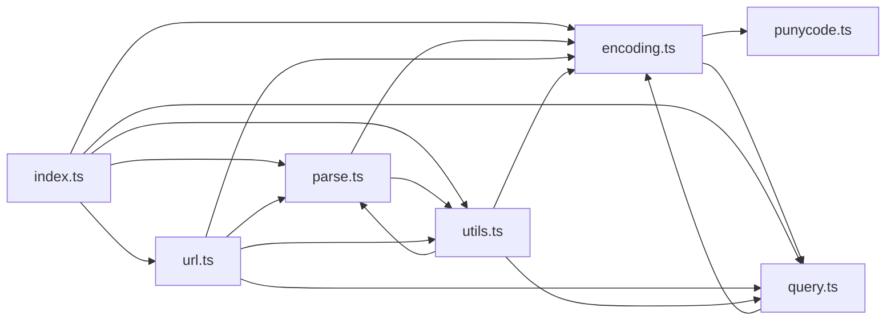

# CodeProof report

Commit: f06c800d0c59f2a4a1b9ba65eb6cb61a84419be6  |  run-id: deb844e0328b6a39  |  mode: smoke

**Publishing rule:** a finding appears under *Verified findings* only if every citation passed L1 and the adversarial verifier confirmed it. This checks provenance and model agreement, not semantic proof. Refuted, uncertain and moderate findings are in rejected.md.

## Summary

| Metric | Value |
|---|---|
| Files / LOC | 7 / 1571 |
| Import edges / cycles | 17 / 2 |
| Findings proposed | 4 |
| Rejected at L1 (bad citation) | 0 |
| Verified | 4 |
| Reproduced by execution (L3) | 0 |
| Moderate confidence | 0 |
| Refuted | 0 |
| Uncertain | 0 |
| Calls / retries | 10 / 0 |
| Tokens in / out | 74921 / 30957 |
| Cached input tokens | 10796 |
| Cost | $0.6907 |

## Verified findings

### F-001 - high - withoutLeadingSlash returns slash for slash input

**Claim:** withoutLeadingSlash("/") returns "/" instead of "" because empty result falls back to "/", breaking append/join/resolve that expect stripped slash.

**Evidence level:** citation-proven + adversarially-confirmed

**Execution check:** inconclusive: reproducer failed L0: forbidden URL

**Citation (from commit, lines 235-237):** utils.ts
```text
export function withoutLeadingSlash(input = ""): string {
  return (hasLeadingSlash(input) ? input.slice(1) : input) || "/";
}
```

**Verifier (muse-wonder-1.0):** confirm - At utils.ts:235-236, withoutLeadingSlash("/") slices to "" and then falls back via || "/" to return "/", and url.ts:124-126 concatenates that result after withTrailingSlash in append, so a root pathname yields a double slash rather than a stripped segment.

### F-002 - high - withFragment early return makes clearing fragment impossible

**Claim:** withFragment cannot clear fragment: early return on falsy hash returns input unchanged, making the hash==="" branch unreachable, contradicting documented withFragment("/foo#bar","") => "/foo".

**Evidence level:** citation-proven + adversarially-confirmed

**Execution check:** unavailable: the repository's own imports are not directly executable by Node without a build step (extensionless specifiers)

**Citation (from commit, lines 736-743):** utils.ts
```text
export function withFragment(input: string, hash: string): string {
  if (!hash || hash === "#") {
    return input;
  }
  const parsed = parseURL(input);
  parsed.hash = hash === "" ? "" : "#" + encodeHash(hash);
  return stringifyParsedURL(parsed);
}
```

**Verifier (muse-wonder-1.0):** confirm - Confirmed: utils.ts:737 returns input unchanged when hash is falsy, so the documented empty-string case at utils.ts:731 never reaches the hash === "" branch at utils.ts:741, making that branch unreachable and clearing via withFragment impossible.

### F-003 - high - parseAuth truncates password at second colon

**Claim:** parseAuth splits on every colon but keeps only first two parts, so password containing colon is truncated (e.g. user:pass:word loses :word).

**Evidence level:** citation-proven + adversarially-confirmed

**Execution check:** unavailable: the repository's own imports are not directly executable by Node without a build step (extensionless specifiers)

**Citation (from commit, lines 133-139):** parse.ts
```text
export function parseAuth(input = ""): ParsedAuth {
  const [username, password] = input.split(":");
  return {
    username: decode(username),
    password: decode(password),
  };
}
```

**Verifier (muse-wonder-1.0):** confirm - The code at parse.ts:134 destructures only the first two elements of input.split(":"), so a third colon-separated segment such as ':word' in 'user:pass:word' is discarded and the password is truncated.

### F-004 - medium - searchParams array values skip JSON stringify

**Claim:** $URL.searchParams appends array elements raw while non-array branch JSON-stringifies objects, so array object values become [object Object] instead of JSON, inconsistent with stringifyQuery/encodeQueryValue.

**Evidence level:** citation-proven + adversarially-confirmed

**Execution check:** inconclusive: reproducer failed L0: forbidden URL

**Citation (from commit, lines 71-83):** url.ts
```text
    for (const name in this.query) {
      const value = this.query[name];
      if (Array.isArray(value)) {
        for (const v of value) {
          p.append(name, v);
        }
      } else {
        p.append(
          name,
          typeof value === "string" ? value : JSON.stringify(value),
        );
      }
    }
```

**Verifier (muse-wonder-1.0):** confirm - Confirmed: url.ts:73-80 appends array elements raw via p.append(name, v) while the non-array branch JSON-stringifies non-strings, and encoding.ts:59-61 plus query.ts:105-111 show encodeQueryValue/encodeQueryItem JSON-stringify each array element, so an object element is coerced to [object Object] inconsistently.

## Architecture

Deterministic facts only: 7 files, 1571 LOC, 17 import edges, 2 cycles. The diagram is generated from the import graph by code, never by the model.



## Limits

- Scan and verify are static: the analyzed code is never executed while the scanner and verifier run. L3 runs only the generated test, on a git-archive snapshot, inside a permission-model sandbox (no network, no writes, 2 s timeout); isolation is process-level, not OS-level.
- No completeness claim; this report shows what passed the gate, not everything that exists in the repository.
- Only direct correctness defects; omission, security and style findings are out of scope for this milestone.
- The L1 gate proves that a citation exists in the commit; the semantic match is judged by the verifier model and presented as such.

