# CodeProof report

Commit: 9ff342479591ca5a43cb30000195bcf55c1bbed9  |  run-id: e9ead2e30ee9115d  |  mode: smoke

**Publishing rule:** a finding appears under *Verified findings* only if every citation passed L1 and the adversarial verifier confirmed it. This checks provenance and model agreement, not semantic proof. Refuted, uncertain and moderate findings are in rejected.md.

## Summary

| Metric | Value |
|---|---|
| Files / LOC | 114 / 6158 |
| Import edges / cycles | 258 / 0 |
| Findings proposed | 6 |
| Rejected at L1 (bad citation) | 1 |
| Verified | 5 |
| Reproduced by execution (L3) | 0 |
| Moderate confidence | 0 |
| Refuted | 0 |
| Uncertain | 0 |
| Calls / retries | 11 / 0 |
| Tokens in / out | 150475 / 37581 |
| Cached input tokens | 2988 |
| Cost | $0.9563 |

## Verified findings

### F-002 - high - isCreditCard mastercard regex missing group anchors

**Claim:** Mastercard alternation is not grouped, so ^ anchors only the first branch and $ only the second branch, accepting any string starting with 5[1-5]xx or ending with the second branch.

**Evidence level:** citation-proven + adversarially-confirmed

**Execution check:** unavailable: the repository's own imports are not directly executable by Node without a build step (extensionless specifiers)

**Citation (from commit, lines 9-9):** lib/isCreditCard.js
```text
  mastercard: /^5[1-5][0-9]{2}|(222[1-9]|22[3-9][0-9]|2[3-6][0-9]{2}|27[01][0-9]|2720)[0-9]{12}$/, // /^[25][1-7][0-9]{14}$/;
```

**Verifier (muse-wonder-1.0):** confirm - The regex at lib/isCreditCard.js:9 is /^5[1-5][0-9]{2}|(222[1-9]|...|2720)[0-9]{12}$/ with no grouping around the alternation, so ^ applies only to the first branch and $ only to the second, and the subsequent Luhn check at lib/isCreditCard.js:41 and lib/isLuhnNumber.js:25 enforces no length or prefix, confirming the claim.

### F-003 - high - isISO6346 regex not anchored across alternation

**Claim:** Alternation is not grouped so ^ applies only to the first branch and $ only to the second, allowing prefix/suffix matches with extra characters; [J,Z] also matches a literal comma.

**Evidence level:** citation-proven + adversarially-confirmed

**Execution check:** unavailable: the repository's own imports are not directly executable by Node without a build step (extensionless specifiers)

**Citation (from commit, lines 6-6):** lib/isISO6346.js
```text
const isISO6346Str = /^[A-Z]{3}(U[0-9]{7})|([J,Z][0-9]{6,7})$/;
```

**Verifier (muse-wonder-1.0):** confirm - The regex at lib/isISO6346.js:6 is ungrouped as /^[A-Z]{3}(U[0-9]{7})|([J,Z][0-9]{6,7})$/, so ^ anchors only the first branch and $ only the second, and [J,Z] includes a literal comma; lib/isISO6346.js:14 only tests this regex and lib/isISO6346.js:35 returns true for non-11 lengths, allowing extra prefix/suffix characters to pass.

### F-004 - high - isLicensePlate pt-BR regex missing group anchors

**Claim:** pt-BR alternation is not grouped, so ^ anchors only the first branch and $ only the second, accepting strings with extra prefix/suffix characters.

**Evidence level:** citation-proven + adversarially-confirmed

**Execution check:** unavailable: the repository's own imports are not directly executable by Node without a build step (extensionless specifiers)

**Citation (from commit, lines 14-15):** lib/isLicensePlate.js
```text
  'pt-BR': str =>
    /^[A-Z]{3}[ -]?[0-9][A-Z][0-9]{2}|[A-Z]{3}[ -]?[0-9]{4}$/.test(str),
```

**Verifier (muse-wonder-1.0):** confirm - The regex at lib/isLicensePlate.js:15 is ungrouped, so it parses as (^Mercosur-pattern)|(old-pattern$) and is applied directly via .test(str) with no length or trimming guard in lib/isLicensePlate.js:25-28, allowing trailing characters after the first format and leading characters before the second.

### F-005 - medium - isCurrency escapes only first symbol character

**Claim:** Symbol escaping uses /\W/ without global flag, so only the first non-word character is escaped and multi-character symbols produce a broken/incorrect currency pattern.

**Evidence level:** citation-proven + adversarially-confirmed

**Execution check:** unavailable: the repository's own imports are not directly executable by Node without a build step (extensionless specifiers)

**Citation (from commit, lines 8-9):** lib/isCurrency.js
```text
  const symbol =
    `(${options.symbol.replace(/\W/, m => `\\${m}`)})${(options.require_symbol ? '' : '?')}`,
```

**Verifier (muse-wonder-1.0):** confirm - The code at lib/isCurrency.js:9 uses options.symbol.replace(/\W/, ...) without a global flag, so String.replace escapes only the first non-word character and leaves subsequent metacharacters in multi-character symbols unescaped in the constructed RegExp.

### F-006 - medium - isVAT HN/PA matchers accept empty string

**Claim:** HN and PA VAT matchers use optional-group-only patterns that match the empty string, so empty input is reported as valid VAT.

**Evidence level:** citation-proven + adversarially-confirmed

**Execution check:** unavailable: the repository's own imports are not directly executable by Node without a build step (extensionless specifiers)

**Citation (from commit, lines 121-121):** lib/isVAT.js
```text
  HN: str => /^(HN)?$/.test(str),
```
**Citation (from commit, lines 124-124):** lib/isVAT.js
```text
  PA: str => /^(PA)?$/.test(str),
```

**Verifier (muse-wonder-1.0):** confirm - The HN matcher at lib/isVAT.js:121 uses /^(HN)?$/ and the PA matcher at lib/isVAT.js:124 uses /^(PA)?$/, both of which match the empty string, and isVAT at lib/isVAT.js:132-137 only type-checks via assertString before dispatching to the matcher, so isVAT('', 'HN') and isVAT('', 'PA') return true.

## Architecture

Deterministic facts only: 114 files, 6158 LOC, 258 import edges, 0 cycles. The diagram is generated from the import graph by code, never by the model.

```mermaid
graph LR
  n0["index.js"]
  n1["lib/alpha.js"]
  n2["lib/blacklist.js"]
  n3["lib/contains.js"]
  n4["lib/equals.js"]
  n5["lib/escape.js"]
  n6["lib/isAbaRouting.js"]
  n7["lib/isAfter.js"]
  n8["lib/isAlpha.js"]
  n9["lib/isAlphanumeric.js"]
  n10["lib/isAscii.js"]
  n11["lib/isBIC.js"]
  n12["lib/isBase32.js"]
  n13["lib/isBase58.js"]
  n14["lib/isBase64.js"]
  n15["lib/isBefore.js"]
  n16["lib/isBoolean.js"]
  n17["lib/isBtcAddress.js"]
  n18["lib/isByteLength.js"]
  n19["lib/isCreditCard.js"]
  n20["lib/isCurrency.js"]
  n21["lib/isDataURI.js"]
  n22["lib/isDate.js"]
  n23["lib/isDecimal.js"]
  n24["lib/isDivisibleBy.js"]
  n25["lib/isEAN.js"]
  n26["lib/isEmail.js"]
  n27["lib/isEmpty.js"]
  n28["lib/isEthereumAddress.js"]
  n29["lib/isFQDN.js"]
  n30["lib/isFloat.js"]
  n31["lib/isFullWidth.js"]
  n32["lib/isHSL.js"]
  n33["lib/isHalfWidth.js"]
  n34["lib/isHash.js"]
  n35["lib/isHexColor.js"]
  n36["lib/isHexadecimal.js"]
  n37["lib/isIBAN.js"]
  n38["lib/isIMEI.js"]
  n39["lib/isIP.js"]
  n40["lib/isIPRange.js"]
  n41["lib/isISBN.js"]
  n42["lib/isISIN.js"]
  n43["lib/isISO15924.js"]
  n44["lib/isISO31661Alpha2.js"]
  n45["lib/isISO31661Alpha3.js"]
  n46["lib/isISO31661Numeric.js"]
  n47["lib/isISO4217.js"]
  n48["lib/isISO6346.js"]
  n49["lib/isISO6391.js"]
  n50["lib/isISO8601.js"]
  n51["lib/isISRC.js"]
  n52["lib/isISSN.js"]
  n53["lib/isIdentityCard.js"]
  n54["lib/isIn.js"]
  n55["lib/isInt.js"]
  n56["lib/isJSON.js"]
  n57["lib/isJWT.js"]
  n58["lib/isLatLong.js"]
  n59["lib/isLength.js"]
  n60["lib/isLicensePlate.js"]
  n61["lib/isLocale.js"]
  n62["lib/isLowercase.js"]
  n63["lib/isLuhnNumber.js"]
  n64["lib/isMACAddress.js"]
  n65["lib/isMD5.js"]
  n66["lib/isMagnetURI.js"]
  n67["lib/isMailtoURI.js"]
  n68["lib/isMimeType.js"]
  n69["lib/isMobilePhone.js"]
  n70["lib/isMongoId.js"]
  n71["lib/isMultibyte.js"]
  n72["lib/isNumeric.js"]
  n73["lib/isOctal.js"]
  n74["lib/isPassportNumber.js"]
  n75["lib/isPort.js"]
  n76["lib/isPostalCode.js"]
  n77["lib/isRFC3339.js"]
  n78["lib/isRgbColor.js"]
  n79["lib/isSemVer.js"]
  n80["lib/isSlug.js"]
  n81["lib/isStrongPassword.js"]
  n82["lib/isSurrogatePair.js"]
  n83["lib/isTaxID.js"]
  n84["lib/isTime.js"]
  n85["lib/isULID.js"]
  n86["lib/isURL.js"]
  n87["lib/isUUID.js"]
  n88["lib/isUppercase.js"]
  n89["lib/isVAT.js"]
  n90["lib/isVariableWidth.js"]
  n91["lib/isWhitelisted.js"]
  n92["lib/ltrim.js"]
  n93["lib/matches.js"]
  n94["lib/normalizeEmail.js"]
  n95["lib/rtrim.js"]
  n96["lib/stripLow.js"]
  n97["lib/toBoolean.js"]
  n98["lib/toDate.js"]
  n99["lib/toFloat.js"]
  n100["lib/toInt.js"]
  n101["lib/trim.js"]
  n102["lib/unescape.js"]
  n103["lib/util/algorithms.js"]
  n104["lib/util/assertString.js"]
  n105["lib/util/checkHost.js"]
  n106["lib/util/includesArray.js"]
  n107["lib/util/includesString.js"]
  n108["lib/util/merge.js"]
  n109["lib/util/multilineRegex.js"]
  n110["lib/util/nullUndefinedCheck.js"]
  n111["lib/util/toString.js"]
  n112["lib/util/typeOf.js"]
  n113["lib/whitelist.js"]
  n0 --> n98
  n0 --> n99
  n0 --> n100
  n0 --> n97
  n0 --> n4
  n0 --> n3
  n0 --> n93
  n0 --> n26
  n0 --> n86
  n0 --> n64
  n0 --> n39
  n0 --> n40
  n0 --> n29
  n0 --> n22
  n0 --> n84
  n0 --> n16
  n0 --> n61
  n0 --> n6
  n0 --> n8
  n0 --> n9
  n0 --> n72
  n0 --> n74
  n0 --> n75
  n0 --> n62
  n0 --> n88
  n0 --> n38
  n0 --> n10
  n0 --> n31
  n0 --> n33
  n0 --> n90
  n0 --> n71
  n0 --> n79
  n0 --> n82
  n0 --> n55
  n0 --> n30
  n0 --> n23
  n0 --> n36
  n0 --> n73
  n0 --> n24
  n0 --> n35
  n0 --> n78
  n0 --> n32
  n0 --> n51
  n0 --> n37
  n0 --> n11
  n0 --> n65
  n0 --> n34
  n0 --> n57
  n0 --> n56
  n0 --> n27
  n0 --> n59
  n0 --> n18
  n0 --> n85
  n0 --> n87
  n0 --> n70
  n0 --> n7
  n0 --> n15
  n0 --> n54
  n0 --> n63
  n0 --> n19
  n0 --> n53
  n0 --> n25
  n0 --> n42
  n0 --> n41
  n0 --> n52
  n0 --> n83
  n0 --> n69
  n0 --> n28
  n0 --> n20
  n0 --> n17
  n0 --> n48
  n0 --> n49
  n0 --> n50
  n0 --> n77
  n0 --> n43
  n0 --> n44
  n0 --> n45
  n0 --> n46
  n0 --> n47
  n0 --> n12
  n0 --> n13
  n0 --> n14
  n0 --> n21
  n0 --> n66
  n0 --> n67
  n0 --> n68
  n0 --> n58
  n0 --> n76
  n0 --> n92
  n0 --> n95
  n0 --> n101
  n0 --> n5
  n0 --> n102
  n0 --> n96
  n0 --> n113
  n0 --> n2
  n0 --> n91
  n0 --> n94
  n0 --> n111
  n0 --> n80
  n0 --> n60
  n0 --> n81
  n0 --> n89
  n2 --> n104
  n3 --> n104
  n3 --> n111
  n3 --> n108
  n4 --> n104
  n5 --> n104
  n6 --> n104
  n7 --> n98
  n8 --> n104
  n8 --> n1
  n9 --> n104
  n9 --> n1
  n10 --> n104
  n11 --> n104
  n11 --> n44
  n12 --> n104
  n12 --> n108
  n13 --> n104
  n14 --> n104
  n14 --> n108
  n15 --> n98
  n16 --> n104
  n16 --> n106
  n17 --> n104
  n18 --> n104
  n19 --> n104
  n19 --> n63
  n20 --> n108
  n20 --> n104
  n21 --> n104
  n22 --> n108
  n23 --> n108
  n23 --> n104
  n23 --> n106
  n23 --> n1
  n24 --> n104
  n24 --> n99
  n25 --> n104
  n26 --> n104
  n26 --> n105
  n26 --> n18
  n26 --> n29
  n26 --> n39
  n26 --> n108
  n27 --> n104
  n27 --> n108
  n28 --> n104
  n29 --> n104
  n29 --> n108
  n30 --> n104
  n30 --> n110
  n30 --> n1
  n31 --> n104
  n32 --> n104
  n33 --> n104
  n34 --> n104
  n35 --> n104
  n35 --> n108
  n36 --> n104
  n37 --> n104
  n37 --> n106
  n38 --> n104
  n39 --> n104
  n40 --> n104
  n40 --> n39
  n41 --> n104
  n42 --> n104
  n43 --> n104
  n44 --> n104
  n45 --> n104
  n46 --> n104
  n47 --> n104
  n48 --> n104
  n49 --> n104
  n50 --> n104
  n51 --> n104
  n52 --> n104
  n53 --> n104
  n53 --> n106
  n53 --> n55
  n54 --> n104
  n54 --> n111
  n55 --> n104
  n55 --> n110
  n56 --> n104
  n56 --> n106
  n56 --> n108
  n57 --> n104
  n57 --> n14
  n58 --> n104
  n58 --> n108
  n58 --> n107
  n59 --> n104
  n60 --> n104
  n61 --> n104
  n62 --> n104
  n63 --> n104
  n64 --> n104
  n65 --> n104
  n66 --> n104
  n67 --> n101
  n67 --> n26
  n67 --> n104
  n68 --> n104
  n69 --> n104
  n70 --> n104
  n70 --> n36
  n71 --> n104
  n72 --> n104
  n72 --> n1
  n73 --> n104
  n74 --> n104
  n75 --> n55
  n76 --> n104
  n77 --> n104
  n78 --> n104
  n79 --> n104
  n79 --> n109
  n80 --> n104
  n81 --> n108
  n81 --> n104
  n82 --> n104
  n83 --> n104
  n83 --> n103
  n83 --> n22
  n84 --> n108
  n85 --> n104
  n86 --> n104
  n86 --> n105
  n86 --> n107
  n86 --> n29
  n86 --> n39
  n86 --> n108
  n87 --> n104
  n88 --> n104
  n89 --> n104
  n89 --> n103
  n90 --> n104
  n90 --> n31
  n90 --> n33
  n91 --> n104
  n92 --> n104
  n93 --> n104
  n94 --> n108
  n95 --> n104
  n96 --> n104
  n96 --> n2
  n97 --> n104
  n98 --> n104
  n99 --> n30
  n100 --> n104
  n101 --> n95
  n101 --> n92
  n102 --> n104
  n113 --> n104
```



## Limits

- Scan and verify are static: the analyzed code is never executed while the scanner and verifier run. L3 runs only the generated test, on a git-archive snapshot, inside a permission-model sandbox (no network, no writes, 2 s timeout); isolation is process-level, not OS-level.
- No completeness claim; this report shows what passed the gate, not everything that exists in the repository.
- Only direct correctness defects; omission, security and style findings are out of scope for this milestone.
- The L1 gate proves that a citation exists in the commit; the semantic match is judged by the verifier model and presented as such.

