# CodeProof report

Commit: 436bde0bcded312781cbe45dc2b0ef079a36d8e3  |  run-id: dc98683bb6856931  |  mode: smoke

**Publishing rule:** a finding appears under *Verified findings* only if every citation passed L1 and the adversarial verifier confirmed it. This checks provenance and model agreement, not semantic proof. Refuted, uncertain and moderate findings are in rejected.md.

## Summary

| Metric | Value |
|---|---|
| Files / LOC | 184 / 9082 |
| Import edges / cycles | 17 / 0 |
| Findings proposed | 6 |
| Rejected at L1 (bad citation) | 0 |
| Verified | 4 |
| Reproduced by execution (L3) | 0 |
| Moderate confidence | 0 |
| Refuted | 0 |
| Uncertain | 0 |
| Calls / retries | 13 / 0 |
| Tokens in / out | 196105 / 71755 |
| Cached input tokens | 7864 |
| Cost | $1.7285 |

## Verified findings

### F-001 - high - Locale fallback loses isLocal flag

**Claim:** parseLocale fallback for hyphenated locales drops isLocal/object and recurses without them, so a local lookup can mutate the global locale L.

**Evidence level:** citation-proven + adversarially-confirmed

**Execution check:** inconclusive: reproducer failed L0: testCode must bind at least one named or default symbol from the repository import

**Citation (from commit, lines 26-29):** index.js
```text
    const presetSplit = preset.split('-')
    if (!l && presetSplit.length > 1) {
      return parseLocale(presetSplit[0])
    }
```

**Verifier (muse-wonder-1.0):** confirm - Recursion at index.js:28 calls parseLocale(presetSplit[0]) without isLocal/object, so a local call such as index.js:87 with isLocal=true recurses with isLocal undefined and reaches index.js:35 where L is mutated.

### F-002 - high - Duration ISO leading sign ignored

**Claim:** Duration ISO string parsing slices from group 2 onward and never applies the leading -/+ sign captured in group 1, so negative durations parse as positive.

**Evidence level:** citation-proven + adversarially-confirmed

**Execution check:** unavailable: the repository's own imports are not directly executable by Node without a build step (extensionless specifiers)

**Citation (from commit, lines 12-12):** plugin/duration/index.js
```text
const DURATION_REGEX_PARSE = /^(-|\+)?P(?:([-+]?[0-9,.]*)Y)?(?:([-+]?[0-9,.]*)M)?(?:([-+]?[0-9,.]*)W)?(?:([-+]?[0-9,.]*)D)?(?:T(?:([-+]?[0-9,.]*)H)?(?:([-+]?[0-9,.]*)M)?(?:([-+]?[0-9,.]*)S)?)?$/
```
**Citation (from commit, lines 83-96):** plugin/duration/index.js
```text
    if (typeof input === 'string') {
      const d = input.match(DURATION_REGEX_PARSE)
      if (d) {
        const properties = d.slice(2)
        const numberD = properties.map(value => (value != null ? Number(value) : 0));
        [
          this.$d.years,
          this.$d.months,
          this.$d.weeks,
          this.$d.days,
          this.$d.hours,
          this.$d.minutes,
          this.$d.seconds
        ] = numberD
```

**Verifier (muse-wonder-1.0):** confirm - The regex at plugin/duration/index.js:12 captures the leading sign in group 1, but parsing at plugin/duration/index.js:86 uses d.slice(2) and maps those values directly to the duration fields without applying d[1], so a leading '-' is discarded and negative durations parse as positive.

### F-003 - high - Duration weeks omitted when adding to date

**Claim:** Adding/subtracting a Duration to a Dayjs drops the weeks component because manipulateDuration never adds weeks.

**Evidence level:** citation-proven + adversarially-confirmed

**Execution check:** unavailable: the repository's own imports are not directly executable by Node without a build step (extensionless specifiers)

**Citation (from commit, lines 261-268):** plugin/duration/index.js
```text
const manipulateDuration = (date, duration, k) =>
  date.add(duration.years() * k, 'y')
    .add(duration.months() * k, 'M')
    .add(duration.days() * k, 'd')
    .add(duration.hours() * k, 'h')
    .add(duration.minutes() * k, 'm')
    .add(duration.seconds() * k, 's')
    .add(duration.milliseconds() * k, 'ms')
```

**Verifier (muse-wonder-1.0):** confirm - manipulateDuration at plugin/duration/index.js:261-268 adds years, months, days, hours, minutes, seconds and milliseconds but no weeks, while weeks() is a distinct accessor at plugin/duration/index.js:253-254 separate from days() at plugin/duration/index.js:251-252, and Dayjs add/subtract delegate duration inputs to it at plugin/duration/index.js:282-295.

### F-004 - high - UTC valueOf falsy handling of zero offset

**Claim:** utc valueOf uses || for $localOffset, so a stored local offset of 0 is treated as falsy and replaced with getTimezoneOffset, producing a wrong timestamp.

**Evidence level:** citation-proven + adversarially-confirmed

**Execution check:** inconclusive: run budget exceeded before the reproducer call

**Citation (from commit, lines 119-123):** plugin/utc/index.js
```text
  proto.valueOf = function () {
    const addedOffset = !this.$utils().u(this.$offset)
      ? this.$offset + (this.$x.$localOffset || this.$d.getTimezoneOffset()) : 0
    return this.$d.valueOf() - (addedOffset * MILLISECONDS_A_MINUTE)
  }
```

**Verifier (muse-wonder-1.0):** confirm - The code at plugin/utc/index.js:121 uses (this.$x.$localOffset || this.$d.getTimezoneOffset()), so a stored 0 from plugin/utc/index.js:107 is falsy and replaced by getTimezoneOffset(), changing addedOffset and the returned timestamp at plugin/utc/index.js:122 when that value differs.

## Architecture

Deterministic facts only: 184 files, 9082 LOC, 17 import edges, 0 cycles. The diagram is generated from the import graph by code, never by the model.

```mermaid
graph LR
  n0["constant.js"]
  n1["index.js"]
  n2["locale/af.js"]
  n3["locale/am.js"]
  n4["locale/ar-dz.js"]
  n5["locale/ar-iq.js"]
  n6["locale/ar-kw.js"]
  n7["locale/ar-ly.js"]
  n8["locale/ar-ma.js"]
  n9["locale/ar-sa.js"]
  n10["locale/ar-tn.js"]
  n11["locale/ar.js"]
  n12["locale/az.js"]
  n13["locale/be.js"]
  n14["locale/bg.js"]
  n15["locale/bi.js"]
  n16["locale/bm.js"]
  n17["locale/bn-bd.js"]
  n18["locale/bn.js"]
  n19["locale/bo.js"]
  n20["locale/br.js"]
  n21["locale/bs.js"]
  n22["locale/ca.js"]
  n23["locale/cs.js"]
  n24["locale/cv.js"]
  n25["locale/cy.js"]
  n26["locale/da.js"]
  n27["locale/de-at.js"]
  n28["locale/de-ch.js"]
  n29["locale/de.js"]
  n30["locale/dv.js"]
  n31["locale/el.js"]
  n32["locale/en-au.js"]
  n33["locale/en-ca.js"]
  n34["locale/en-gb.js"]
  n35["locale/en-ie.js"]
  n36["locale/en-il.js"]
  n37["locale/en-in.js"]
  n38["locale/en-nz.js"]
  n39["locale/en-sg.js"]
  n40["locale/en-tt.js"]
  n41["locale/en.js"]
  n42["locale/eo.js"]
  n43["locale/es-do.js"]
  n44["locale/es-mx.js"]
  n45["locale/es-pr.js"]
  n46["locale/es-us.js"]
  n47["locale/es.js"]
  n48["locale/et.js"]
  n49["locale/eu.js"]
  n50["locale/fa.js"]
  n51["locale/fi.js"]
  n52["locale/fo.js"]
  n53["locale/fr-ca.js"]
  n54["locale/fr-ch.js"]
  n55["locale/fr.js"]
  n56["locale/fy.js"]
  n57["locale/ga.js"]
  n58["locale/gd.js"]
  n59["locale/gl.js"]
  n60["locale/gom-latn.js"]
  n61["locale/gu.js"]
  n62["locale/he.js"]
  n63["locale/hi.js"]
  n64["locale/hr.js"]
  n65["locale/ht.js"]
  n66["locale/hu.js"]
  n67["locale/hy-am.js"]
  n68["locale/id.js"]
  n69["locale/is.js"]
  n70["locale/it-ch.js"]
  n71["locale/it.js"]
  n72["locale/ja.js"]
  n73["locale/jv.js"]
  n74["locale/ka.js"]
  n75["locale/kk.js"]
  n76["locale/km.js"]
  n77["locale/kn.js"]
  n78["locale/ko.js"]
  n79["locale/ku.js"]
  n80["locale/ky.js"]
  n81["locale/lb.js"]
  n82["locale/lo.js"]
  n83["locale/lt.js"]
  n84["locale/lv.js"]
  n85["locale/me.js"]
  n86["locale/mi.js"]
  n87["locale/mk.js"]
  n88["locale/ml.js"]
  n89["locale/mn.js"]
  n90["locale/mr.js"]
  n91["locale/ms-my.js"]
  n92["locale/ms.js"]
  n93["locale/mt.js"]
  n94["locale/my.js"]
  n95["locale/nb.js"]
  n96["locale/ne.js"]
  n97["locale/nl-be.js"]
  n98["locale/nl.js"]
  n99["locale/nn.js"]
  n100["locale/oc-lnc.js"]
  n101["locale/pa-in.js"]
  n102["locale/pl.js"]
  n103["locale/pt-br.js"]
  n104["locale/pt.js"]
  n105["locale/rn.js"]
  n106["locale/ro.js"]
  n107["locale/ru.js"]
  n108["locale/rw.js"]
  n109["locale/sd.js"]
  n110["locale/se.js"]
  n111["locale/si.js"]
  n112["locale/sk.js"]
  n113["locale/sl.js"]
  n114["locale/sq.js"]
  n115["locale/sr-cyrl.js"]
  n116["locale/sr.js"]
  n117["locale/ss.js"]
  n118["locale/sv-fi.js"]
  n119["locale/sv.js"]
  n120["locale/sw.js"]
  n121["locale/ta.js"]
  n122["locale/te.js"]
  n123["locale/tet.js"]
  n124["locale/tg.js"]
  n125["locale/th.js"]
  n126["locale/tk.js"]
  n127["locale/tl-ph.js"]
  n128["locale/tlh.js"]
  n129["locale/tr.js"]
  n130["locale/tzl.js"]
  n131["locale/tzm-latn.js"]
  n132["locale/tzm.js"]
  n133["locale/ug-cn.js"]
  n134["locale/uk.js"]
  n135["locale/ur.js"]
  n136["locale/uz-latn.js"]
  n137["locale/uz.js"]
  n138["locale/vi.js"]
  n139["locale/x-pseudo.js"]
  n140["locale/yo.js"]
  n141["locale/zh-cn.js"]
  n142["locale/zh-hk.js"]
  n143["locale/zh-tw.js"]
  n144["locale/zh.js"]
  n145["plugin/advancedFormat/index.js"]
  n146["plugin/arraySupport/index.js"]
  n147["plugin/badMutable/index.js"]
  n148["plugin/bigIntSupport/index.js"]
  n149["plugin/buddhistEra/index.js"]
  n150["plugin/calendar/index.js"]
  n151["plugin/customParseFormat/index.js"]
  n152["plugin/dayOfYear/index.js"]
  n153["plugin/devHelper/index.js"]
  n154["plugin/duration/index.js"]
  n155["plugin/isBetween/index.js"]
  n156["plugin/isLeapYear/index.js"]
  n157["plugin/isMoment/index.js"]
  n158["plugin/isSameOrAfter/index.js"]
  n159["plugin/isSameOrBefore/index.js"]
  n160["plugin/isToday/index.js"]
  n161["plugin/isTomorrow/index.js"]
  n162["plugin/isYesterday/index.js"]
  n163["plugin/isoWeek/index.js"]
  n164["plugin/isoWeeksInYear/index.js"]
  n165["plugin/localeData/index.js"]
  n166["plugin/localizedFormat/index.js"]
  n167["plugin/localizedFormat/utils.js"]
  n168["plugin/minMax/index.js"]
  n169["plugin/negativeYear/index.js"]
  n170["plugin/objectSupport/index.js"]
  n171["plugin/pluralGetSet/index.js"]
  n172["plugin/preParsePostFormat/index.js"]
  n173["plugin/quarterOfYear/index.js"]
  n174["plugin/relativeTime/index.js"]
  n175["plugin/timezone/index.js"]
  n176["plugin/toArray/index.js"]
  n177["plugin/toObject/index.js"]
  n178["plugin/updateLocale/index.js"]
  n179["plugin/utc/index.js"]
  n180["plugin/weekOfYear/index.js"]
  n181["plugin/weekYear/index.js"]
  n182["plugin/weekday/index.js"]
  n183["utils.js"]
  n1 --> n0
  n1 --> n41
  n1 --> n183
  n145 --> n0
  n149 --> n0
  n151 --> n167
  n154 --> n0
  n163 --> n0
  n165 --> n167
  n166 --> n0
  n166 --> n167
  n173 --> n0
  n174 --> n0
  n175 --> n0
  n179 --> n0
  n180 --> n0
  n183 --> n0
```



## Limits

- Scan and verify are static: the analyzed code is never executed while the scanner and verifier run. L3 runs only the generated test, on a git-archive snapshot, inside a permission-model sandbox (no network, no writes, 2 s timeout); isolation is process-level, not OS-level.
- No completeness claim; this report shows what passed the gate, not everything that exists in the repository.
- Only direct correctness defects; omission, security and style findings are out of scope for this milestone.
- The L1 gate proves that a citation exists in the commit; the semantic match is judged by the verifier model and presented as such.

